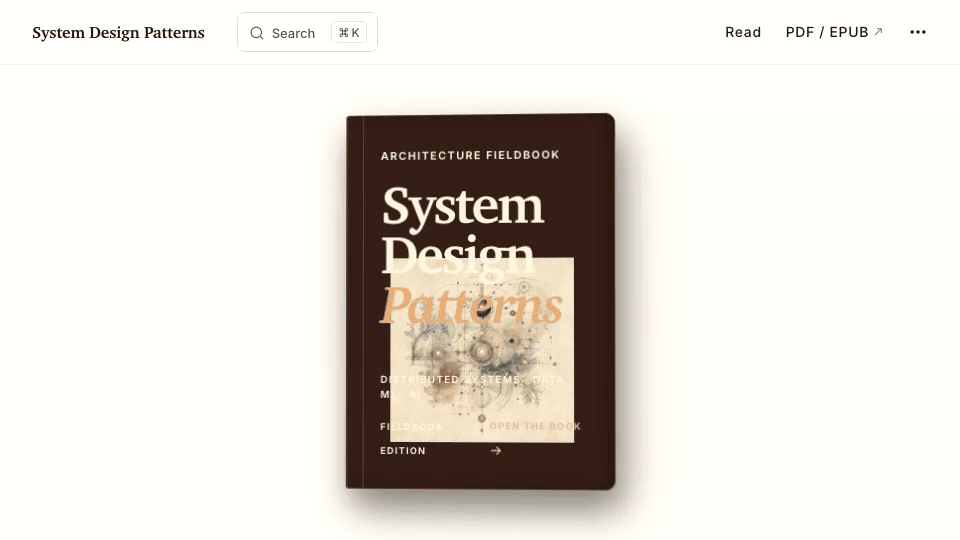

# System Design Patterns

A framework-agnostic system design fieldbook built around production contracts, protocol mechanics, failure recovery, capacity models, and evidence from papers and operating systems.

  

  <a href="https://design.babushkai.com/"><strong>Read the interactive fieldbook</strong></a>
  ·
  <a href="https://github.com/babushkai/system-design-patterns/releases/latest">Download PDF or EPUB</a>

> "Most system design resources are unorganized and overly simple. This repository aims to change that."

## Philosophy

1. **Contracts before components** - Start with invariants and observable promises
2. **Depth over breadth** - Follow mechanisms through overload, failure, recovery, and migration
3. **Single-owner chapters** - Cross-reference neighboring concepts instead of repeating generic checklists
4. **Framework-agnostic reasoning** - Use products as evidence, not as the architecture
5. **Quantitative honesty** - Source reported figures and label illustrative assumptions
6. **Verifiable decisions** - Include failure traces, observability, rollout, and tests

Evidence labels used throughout the fieldbook:

- **Documented** - A cited primary source states the behavior for its named version or publication scope.
- **Inference** - The conclusion follows from stated mechanisms and assumptions; it is not attributed to an undisclosed deployment.
- **Reference design** - A reusable architecture proposed by this book; thresholds and worked numbers remain illustrative until measured.

## How to Read This Fieldbook

The book is ordered as one climb. It starts with the promises a single machine can keep, moves out to many machines, adds the infrastructure a service is built from, then the work of running it, then systems that learn, and ends with the papers, products, and complete designs that put every earlier part to the test. Each part assumes the ones before it, and inside a part the chapters are in reading order.

| Stage | Parts | What you can do after it |
|---|---|---|
| **I. The laws** | 1 [Foundations](01-foundations/01-acid-transactions.md) · 2 [Storage Engines](02-storage-engines/01-b-trees.md) · 3 [Distributed Databases](03-distributed-databases/01-data-modeling.md) | Say exactly what a system promises about data, and what it costs to keep that promise on one machine and on many |
| **II. The building blocks** | 4 [Caching](04-caching/01-cache-strategies.md) · 5 [Messaging](05-messaging/01-message-queues.md) · 6 [Scaling](06-scaling/01-horizontal-vertical.md) · 7 [Service Connectivity and APIs](07-service-mesh/01-api-design-patterns.md) · 8 [Real-Time](08-real-time/01-polling.md) · 9 [Workflow & Job Systems](09-workflow-job-systems/01-workflow-system-fundamentals.md) | Assemble a service that stays up under load, talks to its neighbors, and finishes work that outlives a request |
| **III. Data in motion** | 10 [Data Pipelines](10-data-pipelines/01-batch-processing.md) · 11 [Search Systems](11-search-systems/01-inverted-indexes.md) | Move, reshape, and retrieve data without losing track of which copy is true |
| **IV. Running it** | 12 [Security](12-security/01-threat-modeling-and-abuse-cases.md) · 13 [Observability and Operations](13-observability/01-metrics-monitoring.md) · 14 [Deployment](14-deployment/01-compute-platform-scheduling.md) · 15 [Production Readiness](15-production-readiness/01-design-documents-and-decision-records.md) | Defend a design, see it, change it safely, and get it signed off |
| **V. Systems that learn** | 16 [ML Systems](16-ml-systems/01-ml-system-fundamentals.md) · 17 [LLM Systems](17-llm-systems/01-llm-infrastructure.md) · 18 [Always-On Agents](18-always-on-agents/01-always-on-agent-fundamentals.md) · 19 [Engineering Systems for Coding Agents](19-compound-engineering/01-compound-engineering-fundamentals.md) | Apply everything above to systems whose behavior comes from data and models, from one prediction to an agent that runs for months |
| **VI. The field** | 20 [Whitepapers](20-whitepapers/01-mapreduce.md) · 21 [Case Studies](21-case-studies/01-twitter.md) · 22 [Reference Designs](22-reference-designs/01-url-shortener.md) | Check the mechanisms against the papers that introduced them, the products that stress them, and complete designs built from them |

Reading front to back is the intended path, but nothing forces it. Every chapter is written to be read alone, with the terms it needs either defined in place or linked. The link graph is part of the build, so it cannot rot quietly: every chapter ends with a curated Related Chapters list that states why each neighbor follows from the page you just read, and no chapter ships that nothing else points to. Stage VI is also meant to be read sideways: the pairing tables below put each paper and product next to the mechanism chapters it grounds.

### Reading one chapter

Every chapter opens the same way, so you can stop as early as the question allows:

1. **The opening scenario** - One or two lines under the title: a production moment the chapter exists to explain. If you cannot answer it, read on.
2. **TL;DR** - The verdict and the contract in two paragraphs. Usually enough to decide whether this chapter is yours.
3. **Primary Evidence and Scope** (where present) - Which source establishes each claim and where that source stops applying. Read it before repeating a number.
4. **Mechanism sections** - Behavior under load, contention, partial failure, and migration, with the arithmetic behind the claims.
5. **Failure traces and verification** - What breaks, what the evidence looks like in production, and how to prove a fix worked.
6. **Decision framework and Key Takeaways** (where present) - The part worth pasting into a design review.
7. **References** - Primary sources for the chapter, not a bibliography of anything adjacent.
8. **Related Chapters** - Three to eight neighbors, each with one line on why it follows from this one. Read it before opening a new tab.

Chapters own one concept each. Where two designs meet, the boundary is stated in both directions rather than repeated, so read the linked chapter instead of guessing where the other half lives.

### Tracks

- **Data correctness** - [ACID Transactions](01-foundations/01-acid-transactions.md) and [Isolation Levels](01-foundations/02-isolation-levels.md), then [Consistency Models](01-foundations/05-consistency-models.md), the three [replication](03-distributed-databases/02-single-leader-replication.md) chapters, [Distributed Transactions](03-distributed-databases/10-distributed-transactions.md), and [Consensus Algorithms](03-distributed-databases/06-consensus-algorithms.md). Finish in [Storage Engines](02-storage-engines/01-b-trees.md) to see where durability actually lands.
- **Traffic that survives its own success** - [Capacity Planning](01-foundations/09-capacity-planning.md), then [Load Balancing](06-scaling/04-load-balancing.md), [Rate Limiting](06-scaling/07-rate-limiting.md), [Circuit Breakers](06-scaling/10-circuit-breakers.md), [Backpressure](06-scaling/08-backpressure.md), [Retries & Hedging](06-scaling/09-retries-timeouts-hedging.md), and [Cell-Based Architecture](06-scaling/13-cell-based-architecture.md).
- **Multi-region and edge** - [DNS & Connections](06-scaling/02-dns-and-connection-management.md), [Network Transport Internals](06-scaling/03-network-transport-internals.md), [Multi-Region Architecture](06-scaling/14-multi-region-architecture.md), [CDN Architecture](06-scaling/05-cdn-architecture.md), and [Disaster Recovery](14-deployment/07-disaster-recovery.md).
- **Moving data without lying** - [Message Queue Architecture](05-messaging/01-message-queues.md), [Message Ordering](05-messaging/03-message-ordering.md), [Delivery & Effect Boundaries](05-messaging/04-delivery-guarantees.md), [Outbox, Inbox & CDC](05-messaging/05-outbox-pattern.md), then [Batch Execution](10-data-pipelines/01-batch-processing.md), [Stream Execution](10-data-pipelines/02-stream-processing.md), [Lakehouse Table Formats](10-data-pipelines/04-lakehouse-table-formats.md), and [Analytical Query Engines](10-data-pipelines/05-analytical-query-engines.md).
- **Owning it in production** - [Tracing & Telemetry Pipelines](13-observability/03-distributed-tracing.md), [Metrics Systems](13-observability/01-metrics-monitoring.md), [Production Logging](13-observability/02-logging.md), [Alert Evaluation](13-observability/05-alerting.md), [SLOs & Error-Budget Control](13-observability/04-slos-error-budgets.md), and [Incident Command](13-observability/06-incident-management.md), plus [Progressive Delivery](14-deployment/03-deployment-strategies.md) and [Database Migrations](14-deployment/05-database-migrations.md).
- **Identity and trust** - [Authentication Systems](12-security/02-authentication-fundamentals.md), [OAuth 2.0 and OpenID Connect](12-security/04-oauth2-openid-connect.md), [JOSE and JWT Verification](12-security/05-jwt-tokens.md), [API Threat Boundaries](12-security/13-api-security.md), [Cryptographic Key Architecture](12-security/10-encryption.md), and [Authorization at Scale](12-security/07-authorization-patterns.md), with [DDoS Defense Architecture](12-security/14-ddos-defense.md) for traffic whose only purpose is exhaustion.
- **Work that outlives the request** - [Workflow Fundamentals](09-workflow-job-systems/01-workflow-system-fundamentals.md), [Background Jobs & Workers](09-workflow-job-systems/02-background-jobs-worker-pools.md), [Durable Execution](09-workflow-job-systems/07-durable-execution-workflow-engines.md), [Effect Commit Protocols](09-workflow-job-systems/04-retry-idempotency-compensation.md), and [Leases, Heartbeats & Recovery](09-workflow-job-systems/03-leases-heartbeats-recovery.md).
- **AI systems** - [ML System Fundamentals](16-ml-systems/01-ml-system-fundamentals.md), [Feature Stores](16-ml-systems/04-feature-stores.md), [Model Serving](16-ml-systems/10-model-serving.md), and [Offline Evaluation](16-ml-systems/08-offline-evaluation-metrics.md), then [LLM Infrastructure](17-llm-systems/01-llm-infrastructure.md), [GPU Inference Internals](17-llm-systems/02-gpu-inference-internals.md), [RAG Patterns](17-llm-systems/05-rag-patterns.md), and [LLM Evaluation](17-llm-systems/07-llm-evaluation.md).

- **Reads that stay fast and honest** - [Cache Strategies & Economics](04-caching/01-cache-strategies.md) and [Invalidation & Coherence](04-caching/02-cache-invalidation.md) decide how much staleness you are selling, then [Distributed Cache Internals](04-caching/03-distributed-caching.md) and [Stampede, Cold Start & Warming](04-caching/04-cache-stampede.md) show what happens when the cache leaves, with [CDN Architecture](06-scaling/05-cdn-architecture.md) for the same argument one layer out.
- **Real-time delivery and collaboration** - [Client Delivery Transports](08-real-time/01-polling.md) picks how a client learns that something changed, [Publish-Subscribe Architecture](05-messaging/02-pub-sub.md) and [Presence](08-real-time/03-presence.md) carry the fan-out, [WebRTC](08-real-time/02-webrtc.md) covers peer media, and [Collaborative Sync & CRDTs](08-real-time/04-crdts-collaborative-editing.md) with [Conflict Resolution](03-distributed-databases/05-conflict-resolution.md) settle two people typing at once.
- **Service boundaries and API contracts** - [Discovery & Control-Plane State](07-service-mesh/02-service-discovery.md), [Mesh Data & Control Planes](07-service-mesh/04-sidecar-pattern.md), and [Edge Gateway & API Mediation](07-service-mesh/03-api-gateway.md) decide where cross-cutting policy lives, then [API Design & Evolution](07-service-mesh/01-api-design-patterns.md), [API Threat Boundaries](12-security/13-api-security.md), and [Zero-Trust Workload Architecture](12-security/11-zero-trust-architecture.md) decide what each hop is allowed to assume.
- **Retrieval and ranking** - [Index Architecture & Internals](11-search-systems/01-inverted-indexes.md) and [Lexical Query Execution](11-search-systems/02-full-text-search.md) build the lexical path, [Vector Retrieval Systems](11-search-systems/03-vector-search.md) builds the semantic one, [Geospatial Indexing](11-search-systems/05-geospatial-indexing.md) answers what is near a point, then [Ranking & Evaluation](11-search-systems/04-ranking-algorithms.md) and [Typeahead & Autocomplete](11-search-systems/06-typeahead-autocomplete.md) turn scores into a product, with [RAG Patterns](17-llm-systems/05-rag-patterns.md) and [Recommendation Systems](16-ml-systems/15-recommendation-systems.md) as the two consumers.
- **Engineering systems for coding agents** - [Platform Fundamentals](19-compound-engineering/01-compound-engineering-fundamentals.md), [Tool & Runtime Contracts](19-compound-engineering/02-coding-agent-tool-design.md), and [Context & Policy Plane](19-compound-engineering/03-agent-context-engineering.md) build the platform, then [Repository Architecture](19-compound-engineering/04-ai-native-software-architecture.md), [Verification & Governance](19-compound-engineering/05-quality-engineering-with-ai-agents.md), and [Parallel Development](19-compound-engineering/06-compound-development-workflows.md) make it survive a fleet of agents, on top of [Agent Fundamentals](17-llm-systems/08-agent-fundamentals.md) and [Harness Engineering](17-llm-systems/09-harness-engineering.md).
- **Measuring at scale** - [Metrics Systems](13-observability/01-metrics-monitoring.md) defines what is recorded, [Time-Series Storage Engines](02-storage-engines/08-time-series-storage.md) shows why cardinality rather than volume is the limit, [Probabilistic Sketches](02-storage-engines/09-probabilistic-sketches.md) keeps counts and percentiles mergeable, and [Analytical Query Engines](10-data-pipelines/05-analytical-query-engines.md) takes the per-entity questions a metrics store should refuse.
- **Reference designs for recurring problems** - [URL Shortener](22-reference-designs/01-url-shortener.md) for identifier allocation and cache-bounded revocation, [Notification Delivery Platform](22-reference-designs/02-notification-delivery.md) for consent and irreversible sends, [Web Crawler](22-reference-designs/03-web-crawler.md) for scheduling under politeness, [Ad Click Aggregation](22-reference-designs/04-ad-click-aggregation.md) for event-time counts that are billed, [Ticketing & Inventory Reservation](22-reference-designs/05-ticketing-inventory-reservation.md) for holds under contention, and [Order Matching Engine](22-reference-designs/06-order-matching-engine.md) for a deterministic single-writer core.
- **From design review to signed-off production** - [Design Documents & ADRs](15-production-readiness/01-design-documents-and-decision-records.md) and [Architecture Review & Governance](15-production-readiness/02-architecture-review-and-governance.md) put the decision on paper and give it a forum, [Third-Party & Supply Chain](15-production-readiness/04-third-party-dependencies-and-supply-chain.md) prices the failure modes that decision inherits, [Verification Strategy](15-production-readiness/03-verification-strategy-for-distributed-systems.md) proves it survives interleavings and injected faults, and [Data Retention & Compliance](15-production-readiness/05-data-retention-and-compliance-engineering.md) keeps it lawful after launch, on top of [Resilience Testing & Fault Injection](13-observability/08-resilience-testing-and-fault-injection.md) and [Progressive Delivery](14-deployment/03-deployment-strategies.md), which supply the two verifiers no pre-production environment can replicate.

### Papers next to mechanisms

The whitepaper chapters are analyses of what a paper actually established, so they are most useful paired with the chapter that uses the design. Read the mechanism first when you need a decision; read the paper first when you want to know where the vocabulary came from.

| Paper | Mechanism chapters it grounds |
|---|---|
| [MapReduce](20-whitepapers/01-mapreduce.md) | [Batch Execution](10-data-pipelines/01-batch-processing.md) |
| [Dynamo](20-whitepapers/02-dynamo.md) | [Leaderless Replication](03-distributed-databases/04-leaderless-replication.md), [Conflict Resolution](03-distributed-databases/05-conflict-resolution.md) |
| [Bigtable](20-whitepapers/03-bigtable.md) | [LSM Trees](02-storage-engines/03-lsm-trees.md), [Column Storage](02-storage-engines/07-column-storage.md) |
| [Spanner](20-whitepapers/04-spanner.md) | [Distributed Time](01-foundations/04-distributed-time.md), [Distributed Transactions](03-distributed-databases/10-distributed-transactions.md) |
| [TAO](20-whitepapers/05-tao.md) | [Secondary Indexes](03-distributed-databases/09-secondary-indexes.md), [Partitioning Strategies](03-distributed-databases/08-partitioning-strategies.md) |
| [Kafka](20-whitepapers/06-kafka.md) | [Message Ordering](05-messaging/03-message-ordering.md), [Delivery & Effect Boundaries](05-messaging/04-delivery-guarantees.md) |
| [Raft](20-whitepapers/07-raft.md) | [Consensus Algorithms](03-distributed-databases/06-consensus-algorithms.md), [Leader Election](03-distributed-databases/07-leader-election.md) |
| [Chubby](20-whitepapers/08-chubby.md) | [Distributed Locks](01-foundations/08-distributed-locks.md), [Leader Election](03-distributed-databases/07-leader-election.md) |
| [Aurora](20-whitepapers/09-aurora.md) | [Write-Ahead Logging](02-storage-engines/02-write-ahead-logging.md), [Single-Leader Replication](03-distributed-databases/02-single-leader-replication.md) |
| [CockroachDB](20-whitepapers/10-cockroachdb.md) | [Distributed Transactions](03-distributed-databases/10-distributed-transactions.md), [Partitioning Strategies](03-distributed-databases/08-partitioning-strategies.md) |
| [Zanzibar](20-whitepapers/11-zanzibar.md) | [Authorization at Scale](12-security/07-authorization-patterns.md) |
| [Monarch](20-whitepapers/12-monarch.md) | [Metrics Systems & Monitoring](13-observability/01-metrics-monitoring.md), [Tracing & Telemetry Pipelines](13-observability/03-distributed-tracing.md) |
| [FoundationDB](20-whitepapers/13-foundationdb.md) | [Consensus Algorithms](03-distributed-databases/06-consensus-algorithms.md), [Distributed Transactions](03-distributed-databases/10-distributed-transactions.md) |
| [DynamoDB (2022)](20-whitepapers/14-dynamodb-2022.md) | [Database Sharding](06-scaling/11-database-sharding.md), [Secondary Indexes](03-distributed-databases/09-secondary-indexes.md) |
| [The Transformer](20-whitepapers/15-attention-transformers.md) | [GPU Inference Internals](17-llm-systems/02-gpu-inference-internals.md), [LLM Infrastructure](17-llm-systems/01-llm-infrastructure.md) |

### Products next to mechanisms

Each case study starts from a product you can use today and works back to the mechanism that decided its shape. Read the mechanism chapter first when the design question is already yours; read the case study first when you want to see what the constraint looks like at real scale.

| Product | Mechanism chapters it stresses |
|---|---|
| [Twitter/X](21-case-studies/01-twitter.md) | [Partitioning Strategies](03-distributed-databases/08-partitioning-strategies.md), [Backpressure](06-scaling/08-backpressure.md), [Outbox, Inbox & CDC](05-messaging/05-outbox-pattern.md) |
| [Instagram](21-case-studies/02-instagram.md) | [CDN Architecture](06-scaling/05-cdn-architecture.md), [Stampede, Cold Start & Warming](04-caching/04-cache-stampede.md), [Object Storage & Commit Protocols](02-storage-engines/10-object-storage.md) |
| [Uber](21-case-studies/03-uber.md) | [Distributed Time](01-foundations/04-distributed-time.md), [Secondary Indexes](03-distributed-databases/09-secondary-indexes.md), [Message Ordering](05-messaging/03-message-ordering.md) |
| [Netflix](21-case-studies/04-netflix.md) | [Cell-Based Architecture](06-scaling/13-cell-based-architecture.md), [Durable Execution](09-workflow-job-systems/07-durable-execution-workflow-engines.md), [Recommendation Systems](16-ml-systems/15-recommendation-systems.md) |
| [Slack](21-case-studies/05-slack.md) | [Delivery & Effect Boundaries](05-messaging/04-delivery-guarantees.md), [Client Delivery Transports](08-real-time/01-polling.md), [Lexical Query Execution](11-search-systems/02-full-text-search.md) |
| [Stripe](21-case-studies/06-stripe.md) | [Idempotency](01-foundations/07-idempotency.md), [Distributed Transactions](03-distributed-databases/10-distributed-transactions.md), [SLOs & Error-Budget Control](13-observability/04-slos-error-budgets.md) |
| [Dropbox](21-case-studies/07-dropbox.md) | [Object Storage & Commit Protocols](02-storage-engines/10-object-storage.md), [Collaborative Sync & CRDTs](08-real-time/04-crdts-collaborative-editing.md), [Disaster Recovery & Reconstruction](14-deployment/07-disaster-recovery.md) |
| [Discord](21-case-studies/08-discord.md) | [Partitioning Strategies](03-distributed-databases/08-partitioning-strategies.md), [Presence](08-real-time/03-presence.md), [LSM Trees](02-storage-engines/03-lsm-trees.md) |
| [Google Maps](21-case-studies/09-google-maps.md) | [Typeahead & Autocomplete](11-search-systems/06-typeahead-autocomplete.md), [Partitioning Strategies](03-distributed-databases/08-partitioning-strategies.md), [Dataset Management & Versioning](16-ml-systems/03-dataset-management-versioning.md) |
| [WhatsApp](21-case-studies/10-whatsapp.md) | [Cryptographic Key Architecture](12-security/10-encryption.md), [Client Delivery Transports](08-real-time/01-polling.md), [Network Transport Internals](06-scaling/03-network-transport-internals.md) |
| [Figma](21-case-studies/11-figma.md) | [Conflict Resolution](03-distributed-databases/05-conflict-resolution.md), [Collaborative Sync & CRDTs](08-real-time/04-crdts-collaborative-editing.md), [Write-Ahead Logging](02-storage-engines/02-write-ahead-logging.md) |
| [Cloudflare](21-case-studies/12-cloudflare.md) | [Multi-Region Architecture](06-scaling/14-multi-region-architecture.md), [Multi-Tenant Isolation & Lifecycle](06-scaling/12-multi-tenancy.md), [SLOs & Error-Budget Control](13-observability/04-slos-error-budgets.md) |
| [LLM Inference Platforms](21-case-studies/13-llm-inference-platforms.md) | [GPU Inference Internals](17-llm-systems/02-gpu-inference-internals.md), [LLM Infrastructure](17-llm-systems/01-llm-infrastructure.md), [FinOps & Cost Engineering](13-observability/09-finops-cost-engineering.md) |

## Table of Contents

<!-- BOOK_TOC:START -->

### Part 1: Foundations
- [ACID Transactions](01-foundations/01-acid-transactions.md)
- [Isolation Levels](01-foundations/02-isolation-levels.md)
- [Failure Semantics, Detection, and Recovery Boundaries](01-foundations/03-failure-modes.md)
- [Distributed Time](01-foundations/04-distributed-time.md)
- [Consistency Models](01-foundations/05-consistency-models.md)
- [CAP Theorem](01-foundations/06-cap-theorem.md)
- [Idempotency and Operation Identity](01-foundations/07-idempotency.md)
- [Distributed Locks and Leases](01-foundations/08-distributed-locks.md)
- [Capacity Planning and Back-of-the-Envelope Estimation](01-foundations/09-capacity-planning.md)

### Part 2: Storage Engines
- [B-Trees](02-storage-engines/01-b-trees.md)
- [Write-Ahead Logging (WAL)](02-storage-engines/02-write-ahead-logging.md)
- [LSM Trees](02-storage-engines/03-lsm-trees.md)
- [SSTables and Compaction](02-storage-engines/04-sstables-compaction.md)
- [Bloom Filters](02-storage-engines/05-bloom-filters.md)
- [Data Encoding](02-storage-engines/06-data-encoding.md)
- [Column-Oriented Storage](02-storage-engines/07-column-storage.md)
- [Time-Series Storage Engines](02-storage-engines/08-time-series-storage.md)
- [Probabilistic Sketches](02-storage-engines/09-probabilistic-sketches.md)
- [Object Storage Architecture and Commit Protocols](02-storage-engines/10-object-storage.md)

### Part 3: Distributed Databases
- [Workload-Driven Data Modeling and Derived Projections](03-distributed-databases/01-data-modeling.md)
- [Single-Leader Replication](03-distributed-databases/02-single-leader-replication.md)
- [Multi-Leader Replication](03-distributed-databases/03-multi-leader-replication.md)
- [Leaderless Replication](03-distributed-databases/04-leaderless-replication.md)
- [Conflict Resolution](03-distributed-databases/05-conflict-resolution.md)
- [Consensus Algorithms](03-distributed-databases/06-consensus-algorithms.md)
- [Leader Election](03-distributed-databases/07-leader-election.md)
- [Partitioning Strategies](03-distributed-databases/08-partitioning-strategies.md)
- [Secondary Indexes in Distributed Databases](03-distributed-databases/09-secondary-indexes.md)
- [Distributed Transactions](03-distributed-databases/10-distributed-transactions.md)

### Part 4: Caching
- [Cache Semantics and Economics](04-caching/01-cache-strategies.md)
- [Cache Invalidation and Coherence](04-caching/02-cache-invalidation.md)
- [Distributed Cache Internals](04-caching/03-distributed-caching.md)
- [Cache Stampede, Cold Start, and Warming](04-caching/04-cache-stampede.md)

### Part 5: Messaging
- [Message Queue Architecture](05-messaging/01-message-queues.md)
- [Publish-Subscribe Architecture](05-messaging/02-pub-sub.md)
- [Message Ordering](05-messaging/03-message-ordering.md)
- [Delivery Guarantees and Effect Boundaries](05-messaging/04-delivery-guarantees.md)
- [Transactional Outbox, Inbox, and CDC Publication](05-messaging/05-outbox-pattern.md)
- [Poison-Message Quarantine and Redrive](05-messaging/06-dead-letter-queues.md)
- [Event Sourcing and Domain Logs](05-messaging/07-event-sourcing.md)
- [CQRS and Projection Architecture](05-messaging/08-cqrs.md)

### Part 6: Scaling
- [Horizontal vs Vertical Scaling](06-scaling/01-horizontal-vertical.md)
- [DNS and Connection Management](06-scaling/02-dns-and-connection-management.md)
- [Network Transport Internals](06-scaling/03-network-transport-internals.md)
- [Load Balancing](06-scaling/04-load-balancing.md)
- [CDN Architecture](06-scaling/05-cdn-architecture.md)
- [Auto-Scaling: Delayed Feedback, Headroom, and Safe Scale-Down](06-scaling/06-auto-scaling.md)
- [Rate Limiting: Admission Policy and Distributed Budgets](06-scaling/07-rate-limiting.md)
- [Backpressure: Bounded Buffers, Flow Control, and Load Shedding](06-scaling/08-backpressure.md)
- [Retries, Timeouts, and Hedging: Deadline and Attempt Budgets](06-scaling/09-retries-timeouts-hedging.md)
- [Circuit Breakers: Dependency State and Concurrency Control](06-scaling/10-circuit-breakers.md)
- [Database Sharding](06-scaling/11-database-sharding.md)
- [Multi-Tenant Isolation and Tenant Lifecycle Architecture](06-scaling/12-multi-tenancy.md)
- [Cell-Based Architecture and Shuffle Sharding](06-scaling/13-cell-based-architecture.md)
- [Multi-Region Architecture: Authority, Routing, and Failover](06-scaling/14-multi-region-architecture.md)

### Part 7: Service Connectivity and APIs
- [API Design and Evolution](07-service-mesh/01-api-design-patterns.md)
- [Service Discovery and Control-Plane State](07-service-mesh/02-service-discovery.md)
- [Edge Gateway and API Mediation](07-service-mesh/03-api-gateway.md)
- [Service Mesh Data and Control Planes](07-service-mesh/04-sidecar-pattern.md)

### Part 8: Real-Time Systems
- [Client Delivery Transports](08-real-time/01-polling.md)
- [WebRTC Media Systems](08-real-time/02-webrtc.md)
- [Presence as Derived Multi-Session State](08-real-time/03-presence.md)
- [Collaborative Document Replication and CRDT Sync Engines](08-real-time/04-crdts-collaborative-editing.md)

### Part 9: Workflow & Job Systems
- [Workflow System Fundamentals](09-workflow-job-systems/01-workflow-system-fundamentals.md)
- [Background Jobs and Worker Pools](09-workflow-job-systems/02-background-jobs-worker-pools.md)
- [Leases, Heartbeats, and Recovery](09-workflow-job-systems/03-leases-heartbeats-recovery.md)
- [Effect Commit Protocols for Workflows](09-workflow-job-systems/04-retry-idempotency-compensation.md)
- [Distributed Scheduling and Timer Services](09-workflow-job-systems/05-distributed-cron-scheduling.md)
- [Priority, Fairness, and Backpressure](09-workflow-job-systems/06-priority-fairness-backpressure.md)
- [Durable Execution and Workflow Engines](09-workflow-job-systems/07-durable-execution-workflow-engines.md)
- [DAG Orchestration](09-workflow-job-systems/08-dag-orchestration.md)
- [Workflow Observability and Replay](09-workflow-job-systems/09-workflow-observability-replay.md)

### Part 10: Data Pipelines
- [Batch Execution: DAGs, Shuffle, and Safe Reprocessing](10-data-pipelines/01-batch-processing.md)
- [Stream Execution: Time, State, Recovery, and Backpressure](10-data-pipelines/02-stream-processing.md)
- [Change Data Capture: Snapshot, Tail, Apply, and Repair](10-data-pipelines/03-change-data-capture.md)
- [Lakehouse Table Formats: Snapshots, Commits, and Maintenance](10-data-pipelines/04-lakehouse-table-formats.md)
- [Analytical Query Engines](10-data-pipelines/05-analytical-query-engines.md)

### Part 11: Search Systems
- [Search Index Architecture and Internals](11-search-systems/01-inverted-indexes.md)
- [Lexical Query Execution](11-search-systems/02-full-text-search.md)
- [Vector Retrieval Systems](11-search-systems/03-vector-search.md)
- [Ranking and Evaluation Systems](11-search-systems/04-ranking-algorithms.md)
- [Geospatial Indexing](11-search-systems/05-geospatial-indexing.md)
- [Typeahead and Autocomplete](11-search-systems/06-typeahead-autocomplete.md)

### Part 12: Security
- [Threat Modeling and Abuse Case Engineering](12-security/01-threat-modeling-and-abuse-cases.md)
- [Authentication Systems](12-security/02-authentication-fundamentals.md)
- [Passkeys and Phishing-Resistant Authentication](12-security/03-passkeys-and-phishing-resistant-authentication.md)
- [OAuth 2.0 and OpenID Connect](12-security/04-oauth2-openid-connect.md)
- [JOSE and JSON Web Token Verification](12-security/05-jwt-tokens.md)
- [OAuth 2.1 and High-Assurance Authorization Profiles](12-security/06-oauth-security-profiles.md)
- [Authorization at Scale](12-security/07-authorization-patterns.md)
- [Identity Lifecycle and Continuous Access Evaluation](12-security/08-identity-lifecycle-and-continuous-access.md)
- [Verifiable Credentials and Selective Disclosure](12-security/09-verifiable-credentials-and-selective-disclosure.md)
- [Cryptographic Key and Data-Protection Architecture](12-security/10-encryption.md)
- [Zero-Trust Service and Workload Architecture](12-security/11-zero-trust-architecture.md)
- [Workload and Agent Identity Delegation](12-security/12-workload-and-agent-identity.md)
- [API Threat Boundaries and Abuse Resistance](12-security/13-api-security.md)
- [DDoS Defense Architecture](12-security/14-ddos-defense.md)

### Part 13: Observability and Operations
- [Metrics Systems and Monitoring](13-observability/01-metrics-monitoring.md)
- [Production Logging Architecture](13-observability/02-logging.md)
- [Distributed Tracing and Telemetry Pipelines](13-observability/03-distributed-tracing.md)
- [SLOs and Error-Budget Control](13-observability/04-slos-error-budgets.md)
- [Alert Evaluation and Notification](13-observability/05-alerting.md)
- [Incident Command and Learning](13-observability/06-incident-management.md)
- [Performance Engineering and Profiling](13-observability/07-performance-engineering-and-profiling.md)
- [Resilience Testing and Fault Injection](13-observability/08-resilience-testing-and-fault-injection.md)
- [FinOps and Cost Engineering](13-observability/09-finops-cost-engineering.md)

### Part 14: Deployment
- [Compute Platform and Scheduling Architecture](14-deployment/01-compute-platform-scheduling.md)
- [Software Delivery Control Planes and GitOps Reconciliation](14-deployment/02-cicd-gitops.md)
- [Progressive Delivery and Deployment Strategies](14-deployment/03-deployment-strategies.md)
- [Feature-Flag Control Planes](14-deployment/04-feature-flags.md)
- [Database Schema Migrations](14-deployment/05-database-migrations.md)
- [Service and Platform Migration](14-deployment/06-migration-strategies.md)
- [Disaster Recovery and Data Reconstruction](14-deployment/07-disaster-recovery.md)

### Part 15: Production Readiness and Governance
- [Design Documents and Architecture Decision Records](15-production-readiness/01-design-documents-and-decision-records.md)
- [Architecture Review and Technical Governance](15-production-readiness/02-architecture-review-and-governance.md)
- [Verification Strategy for Distributed Systems](15-production-readiness/03-verification-strategy-for-distributed-systems.md)
- [Third-Party Dependency and Supply Chain Architecture](15-production-readiness/04-third-party-dependencies-and-supply-chain.md)
- [Data Retention and Compliance Engineering](15-production-readiness/05-data-retention-and-compliance-engineering.md)

### Part 16: ML Systems
- [ML System Fundamentals](16-ml-systems/01-ml-system-fundamentals.md)
- [Label and Ground-Truth Systems](16-ml-systems/02-label-ground-truth-systems.md)
- [Dataset Management and Versioning](16-ml-systems/03-dataset-management-versioning.md)
- [Feature Stores](16-ml-systems/04-feature-stores.md)
- [Training Pipelines](16-ml-systems/05-training-pipelines.md)
- [Distributed Training Internals](16-ml-systems/06-distributed-training-internals.md)
- [Embedding Tables and Sparse Model Infrastructure](16-ml-systems/07-embedding-tables-sparse-models.md)
- [Offline Evaluation and Metric Design](16-ml-systems/08-offline-evaluation-metrics.md)
- [Model Registry and ML Metadata](16-ml-systems/09-model-registry-metadata.md)
- [Model Serving](16-ml-systems/10-model-serving.md)
- [Model Deployment and Rollouts](16-ml-systems/11-model-deployment-rollouts.md)
- [Online Experiments](16-ml-systems/12-online-experiments.md)
- [Model Monitoring](16-ml-systems/13-model-monitoring.md)
- [Continual Learning and Model Freshness](16-ml-systems/14-continual-learning-model-freshness.md)
- [Recommendation Systems](16-ml-systems/15-recommendation-systems.md)
- [ML Capacity and Cost Planning](16-ml-systems/16-ml-capacity-cost-planning.md)
- [ML Risk and Governance](16-ml-systems/17-ml-risk-governance.md)

### Part 17: LLM Systems
- [LLM Infrastructure](17-llm-systems/01-llm-infrastructure.md)
- [GPU Inference Internals](17-llm-systems/02-gpu-inference-internals.md)
- [Prompt Engineering](17-llm-systems/03-prompt-engineering.md)
- [Context Management](17-llm-systems/04-context-management.md)
- [Retrieval-Augmented Generation Systems](17-llm-systems/05-rag-patterns.md)
- [Fine-Tuning Patterns](17-llm-systems/06-fine-tuning-patterns.md)
- [LLM Evaluation and Observability](17-llm-systems/07-llm-evaluation.md)
- [LLM Agent Fundamentals](17-llm-systems/08-agent-fundamentals.md)
- [Harness Engineering](17-llm-systems/09-harness-engineering.md)
- [Agent Orchestration Patterns](17-llm-systems/10-orchestration-patterns.md)
- [Multi-Agent Systems](17-llm-systems/11-multi-agent-systems.md)
- [Agent Inference: Serving Multi-Step LLM Workloads](17-llm-systems/12-agent-inference.md)

### Part 18: Always-On Agents
- [Always-On Agents: The Standing Process Model](18-always-on-agents/01-always-on-agent-fundamentals.md)
- [Wake Sources, Mailboxes, and Scheduling](18-always-on-agents/02-wake-triggers-scheduling.md)
- [The Session Log and Durable Runtime](18-always-on-agents/03-session-log-durable-runtime.md)
- [Memory Lifecycle for Standing Agents](18-always-on-agents/04-memory-lifecycle.md)
- [Standing Authority and Containment](18-always-on-agents/05-standing-authority-containment.md)
- [Attention, Evaluation, and Operations](18-always-on-agents/06-attention-evaluation-operations.md)

### Part 19: Engineering Systems for Coding Agents
- [Coding Agent Platform Fundamentals](19-compound-engineering/01-compound-engineering-fundamentals.md)
- [Tool and Runtime Contracts for Coding Agents](19-compound-engineering/02-coding-agent-tool-design.md)
- [Repository Context and Policy Plane](19-compound-engineering/03-agent-context-engineering.md)
- [Repository Architecture for Safe Agentic Change](19-compound-engineering/04-ai-native-software-architecture.md)
- [Verification and Governance for Agentic Change](19-compound-engineering/05-quality-engineering-with-ai-agents.md)
- [Parallel Development and Integration](19-compound-engineering/06-compound-development-workflows.md)

### Part 20: Whitepapers
- [MapReduce (OSDI 2004): Evidence-First Paper Analysis](20-whitepapers/01-mapreduce.md)
- [Dynamo (SOSP 2007): Evidence-First Paper Analysis](20-whitepapers/02-dynamo.md)
- [Bigtable (OSDI 2006): Evidence-First Paper Analysis](20-whitepapers/03-bigtable.md)
- [Spanner (OSDI 2012): Evidence-First Paper Analysis](20-whitepapers/04-spanner.md)
- [TAO (USENIX ATC 2013): Evidence-First Paper Analysis](20-whitepapers/05-tao.md)
- [Kafka (NetDB 2011): Evidence-First Paper Analysis](20-whitepapers/06-kafka.md)
- [Raft (USENIX ATC 2014): Evidence-First Paper Analysis](20-whitepapers/07-raft.md)
- [Chubby (OSDI 2006): Evidence-First Paper Analysis](20-whitepapers/08-chubby.md)
- [Amazon Aurora (SIGMOD 2017): Evidence-First Paper Analysis](20-whitepapers/09-aurora.md)
- [CockroachDB (SIGMOD 2020): Evidence-First Paper Analysis](20-whitepapers/10-cockroachdb.md)
- [Zanzibar: Google's Consistent, Global Authorization System](20-whitepapers/11-zanzibar.md)
- [Monarch: Google's Planet-Scale In-Memory Time Series Database](20-whitepapers/12-monarch.md)
- [FoundationDB: A Distributed, Unbundled, Transactional Key-Value Store](20-whitepapers/13-foundationdb.md)
- [Amazon DynamoDB (2022): Predictability as the Product](20-whitepapers/14-dynamodb-2022.md)
- [Attention Is All You Need: The Transformer](20-whitepapers/15-attention-transformers.md)

### Part 21: Case Studies
- [Twitter/X Timelines: Evidence, Inference, and Reference Design](21-case-studies/01-twitter.md)
- [Instagram: Evidence, Inference, and a Media-System Reference Design](21-case-studies/02-instagram.md)
- [Uber: Evidence, Inference, and a Real-Time Marketplace Reference Design](21-case-studies/03-uber.md)
- [Netflix: Evidence, Inference, and a Streaming Reference Design](21-case-studies/04-netflix.md)
- [Slack: Evidence, Inference, and a Durable Real-Time Messaging Reference Design](21-case-studies/05-slack.md)
- [Stripe: Designing a Correct Payment State Machine](21-case-studies/06-stripe.md)
- [Dropbox: Convergent File Sync over Immutable Content](21-case-studies/07-dropbox.md)
- [Discord: Hot-Key Isolation for Text, Presence, and Voice](21-case-studies/08-discord.md)
- [Google Maps: Versioned Geospatial Data, Tiles, Routing, and ETA](21-case-studies/09-google-maps.md)
- [WhatsApp: End-to-End Encrypted Multi-Device Messaging](21-case-studies/10-whatsapp.md)
- [Figma System Design](21-case-studies/11-figma.md)
- [Cloudflare System Design](21-case-studies/12-cloudflare.md)
- [LLM Inference Platforms: Serving Tokens at Planetary Scale](21-case-studies/13-llm-inference-platforms.md)

### Part 22: Reference Designs
- [URL Shortener: Identifier Allocation and the Redirect Path](22-reference-designs/01-url-shortener.md)
- [Notification Delivery Platform: Preferences, Fan-Out, and Provider Semantics](22-reference-designs/02-notification-delivery.md)
- [Web Crawler: Frontier, Politeness, and Freshness](22-reference-designs/03-web-crawler.md)
- [Ad Click Aggregation: Event Time, Deduplication, and Reconciliation](22-reference-designs/04-ad-click-aggregation.md)
- [Ticketing and Inventory Reservation: Holds, Contention, and Fair Admission](22-reference-designs/05-ticketing-inventory-reservation.md)
- [Order Matching Engine: Sequencing, Determinism, and Replay](22-reference-designs/06-order-matching-engine.md)

<!-- BOOK_TOC:END -->

## Notation

| Symbol | Meaning |
|--------|---------|
| N | Total nodes/replicas |
| W | Write quorum size |
| R | Read quorum size |
| f | Failures tolerated |

## References

### Books

| Book | Author | Topics |
|------|--------|--------|
| [Designing Data-Intensive Applications](https://dataintensive.net/) | Martin Kleppmann | Replication, partitioning, transactions, distributed systems |
| [System Design Interview Vol. 1](https://www.amazon.com/System-Design-Interview-insiders-Second/dp/B08CMF2CQF) | Alex Xu | Rate limiting, consistent hashing, key-value stores |
| [System Design Interview Vol. 2](https://www.amazon.com/System-Design-Interview-Insiders-Guide/dp/1736049119) | Alex Xu | Real-world systems, proximity services, stock exchange |
| [Database Internals](https://www.databass.dev/) | Alex Petrov | B-trees, LSM trees, storage engines, distributed databases |
| [Understanding Distributed Systems](https://understandingdistributed.systems/) | Roberto Vitillo | Networking, coordination, scalability, resiliency |
| [Building Microservices](https://www.oreilly.com/library/view/building-microservices-2nd/9781492034018/) | Sam Newman | Service decomposition, integration, deployment |

### Original Papers

#### Distributed Systems Foundations

- [Time, Clocks, and the Ordering of Events](https://lamport.azurewebsites.net/pubs/time-clocks.pdf) - Lamport, 1978
- [Impossibility of Distributed Consensus with One Faulty Process (FLP)](https://groups.csail.mit.edu/tds/papers/Lynch/jacm85.pdf) - Fischer, Lynch, Paterson, 1985
- [The Part-Time Parliament (Paxos)](https://lamport.azurewebsites.net/pubs/lamport-paxos.pdf) - Lamport, 1998
- [Paxos Made Simple](https://lamport.azurewebsites.net/pubs/paxos-simple.pdf) - Lamport, 2001

#### Storage & Databases

- [The Google File System](https://static.googleusercontent.com/media/research.google.com/en//archive/gfs-sosp2003.pdf) - Ghemawat et al., 2003
- [MapReduce: Simplified Data Processing on Large Clusters](https://static.googleusercontent.com/media/research.google.com/en//archive/mapreduce-osdi04.pdf) - Dean & Ghemawat, 2004
- [Bigtable: A Distributed Storage System for Structured Data](https://static.googleusercontent.com/media/research.google.com/en//archive/bigtable-osdi06.pdf) - Chang et al., 2006
- [Dynamo: Amazon's Highly Available Key-value Store](https://www.allthingsdistributed.com/files/amazon-dynamo-sosp2007.pdf) - DeCandia et al., 2007
- [Spanner: Google's Globally-Distributed Database](https://static.googleusercontent.com/media/research.google.com/en//archive/spanner-osdi2012.pdf) - Corbett et al., 2012
- [Amazon Aurora: Design Considerations for High Throughput Cloud-Native Relational Databases](https://web.stanford.edu/class/cs245/readings/aurora.pdf) - Verbitski et al., 2017

#### Consensus & Coordination

- [The Chubby Lock Service for Loosely-Coupled Distributed Systems](https://static.googleusercontent.com/media/research.google.com/en//archive/chubby-osdi06.pdf) - Burrows, 2006
- [ZooKeeper: Wait-free coordination for Internet-scale systems](https://www.usenix.org/legacy/event/atc10/tech/full_papers/Hunt.pdf) - Hunt et al., 2010
- [In Search of an Understandable Consensus Algorithm (Raft)](https://raft.github.io/raft.pdf) - Ongaro & Ousterhout, 2014

#### Messaging & Streaming

- [Kafka: a Distributed Messaging System for Log Processing](http://notes.stephenholiday.com/Kafka.pdf) - Kreps et al., 2011
- [The Log: What every software engineer should know about real-time data's unifying abstraction](https://engineering.linkedin.com/distributed-systems/log-what-every-software-engineer-should-know-about-real-time-datas-unifying) - Jay Kreps, 2013

#### Social & Web Scale

- [TAO: Facebook's Distributed Data Store for the Social Graph](https://www.usenix.org/system/files/conference/atc13/atc13-bronson.pdf) - Bronson et al., 2013
- [Scaling Memcache at Facebook](https://www.usenix.org/system/files/conference/nsdi13/nsdi13-final170_update.pdf) - Nishtala et al., 2013
- [F4: Facebook's Warm BLOB Storage System](https://www.usenix.org/system/files/conference/osdi14/osdi14-paper-muralidhar.pdf) - Muralidhar et al., 2014

#### NewSQL

- [CockroachDB: The Resilient Geo-Distributed SQL Database](https://dl.acm.org/doi/pdf/10.1145/3318464.3386134) - Taft et al., 2020
- [TiDB: A Raft-based HTAP Database](https://www.vldb.org/pvldb/vol13/p3072-huang.pdf) - Huang et al., 2020

### Engineering Blogs

| Company | Notable Posts |
|---------|---------------|
| [Netflix Tech Blog](https://netflixtechblog.com/) | Microservices, chaos engineering, streaming |
| [Uber Engineering](https://www.uber.com/blog/engineering/) | Real-time systems, geospatial, scaling |
| [Meta Engineering](https://engineering.fb.com/) | TAO, distributed systems, ML infrastructure |
| [Stripe Engineering](https://stripe.com/blog/engineering) | API design, idempotency, payments |
| [Cloudflare Blog](https://blog.cloudflare.com/) | Edge computing, DNS, DDoS mitigation |
| [Discord Engineering](https://discord.com/blog/engineering-posts) | Real-time messaging, voice, scaling |
| [Slack Engineering](https://slack.engineering/) | Messaging architecture, search, reliability |
| [Dropbox Tech Blog](https://dropbox.tech/) | Sync, storage, infrastructure |
| [Pinterest Engineering](https://medium.com/pinterest-engineering) | Recommendations, search, scaling |
| [LinkedIn Engineering](https://engineering.linkedin.com/blog) | Kafka, data infrastructure, ML |
| [Twitter Engineering](https://blog.twitter.com/engineering) | Timeline, real-time, graph processing |
| [Spotify Engineering](https://engineering.atspotify.com/) | Streaming, personalization, microservices |
| [GitHub Engineering](https://github.blog/category/engineering/) | Git internals, availability, scaling |
| [Shopify Engineering](https://shopify.engineering/) | E-commerce, flash sales, payments |

### Online Resources

| Resource | Description |
|----------|-------------|
| [High Scalability](http://highscalability.com/) | Architecture case studies |
| [The Morning Paper](https://blog.acolyer.org/) | CS paper summaries (archived) |
| [Papers We Love](https://paperswelove.org/) | Community for reading CS papers |
| [Distributed Systems Reading List](https://dancres.github.io/Pages/) | Curated paper collection |
| [System Design Primer](https://github.com/donnemartin/system-design-primer) | Popular GitHub resource |
| [ByteByteGo](https://bytebytego.com/) | Visual system design explanations |
| [Awesome Distributed Systems](https://github.com/theanalyst/awesome-distributed-systems) | Curated resources list |

### Video Lectures

| Course | Institution | Topics |
|--------|-------------|--------|
| [MIT 6.824: Distributed Systems](https://pdos.csail.mit.edu/6.824/) | MIT | MapReduce, Raft, Spanner, distributed transactions |
| [CMU 15-445: Database Systems](https://15445.courses.cs.cmu.edu/) | CMU | Storage, indexing, query processing, concurrency |
| [CMU 15-721: Advanced Database Systems](https://15721.courses.cs.cmu.edu/) | CMU | In-memory databases, query optimization |
| [Stanford CS244B: Distributed Systems](https://www.scs.stanford.edu/20sp-cs244b/) | Stanford | Consensus, replication, distributed storage |

### Additional Books

#### Architecture & Design Patterns

| Book | Author | Topics |
|------|--------|--------|
| [Clean Architecture](https://www.oreilly.com/library/view/clean-architecture-a/9780134494272/) | Robert C. Martin | Dependency rule, boundaries, components, frameworks |
| [Patterns of Enterprise Application Architecture](https://martinfowler.com/books/eaa.html) | Martin Fowler | Domain logic, data source, web presentation patterns |
| [Domain-Driven Design](https://www.domainlanguage.com/ddd/) | Eric Evans | Bounded contexts, aggregates, ubiquitous language |
| [Implementing Domain-Driven Design](https://www.oreilly.com/library/view/implementing-domain-driven-design/9780133039900/) | Vaughn Vernon | Practical DDD patterns and techniques |
| [Release It!](https://pragprog.com/titles/mnee2/release-it-second-edition/) | Michael Nygard | Stability patterns, capacity, networking |
| [Software Architecture: The Hard Parts](https://www.oreilly.com/library/view/software-architecture-the/9781492086888/) | Ford, Richards, Sadalage, Dehghani | Trade-off analysis, modularity, decomposition |
| [Fundamentals of Software Architecture](https://www.oreilly.com/library/view/fundamentals-of-software/9781492043447/) | Mark Richards, Neal Ford | Architecture styles, characteristics, decisions |
| [A Philosophy of Software Design](https://web.stanford.edu/~ouster/cgi-bin/book.php) | John Ousterhout | Complexity, modules, abstractions, comments |

#### Distributed Systems & Reliability

| Book | Author | Topics |
|------|--------|--------|
| [Site Reliability Engineering](https://sre.google/sre-book/table-of-contents/) | Google | SLOs, error budgets, toil, monitoring, on-call |
| [The Site Reliability Workbook](https://sre.google/workbook/table-of-contents/) | Google | Practical SRE implementation |
| [Distributed Systems](https://www.distributed-systems.net/index.php/books/ds4/) | Tanenbaum & Van Steen | Processes, communication, naming, coordination |
| [Designing Distributed Systems](https://www.oreilly.com/library/view/designing-distributed-systems/9781491983638/) | Brendan Burns | Patterns for scalable, reliable services |
| [Database Reliability Engineering](https://www.oreilly.com/library/view/database-reliability-engineering/9781491925935/) | Campbell & Majors | Database operations, infrastructure, recovery |
| [Web Scalability for Startup Engineers](https://www.oreilly.com/library/view/web-scalability-for/9780071843669/) | Artur Ejsmont | Practical scaling strategies |

#### Data & Streaming

| Book | Author | Topics |
|------|--------|--------|
| [Streaming Systems](https://www.oreilly.com/library/view/streaming-systems/9781491983867/) | Akidau, Chernyak, Lax | Watermarks, windows, triggers, exactly-once |
| [Kafka: The Definitive Guide](https://www.oreilly.com/library/view/kafka-the-definitive/9781492043072/) | Shapira, Palino, et al. | Kafka internals, producers, consumers, operations |
| [Making Sense of Stream Processing](https://www.oreilly.com/library/view/making-sense-of/9781492042563/) | Martin Kleppmann | Event sourcing, change capture, stream processing |
| [Data Mesh](https://www.oreilly.com/library/view/data-mesh/9781492092384/) | Zhamak Dehghani | Decentralized data architecture |
| [The Data Warehouse Toolkit](https://www.kimballgroup.com/data-warehouse-business-intelligence-resources/books/) | Ralph Kimball | Dimensional modeling, ETL, BI |

#### Performance & Optimization

| Book | Author | Topics |
|------|--------|--------|
| [Systems Performance](https://www.brendangregg.com/systems-performance-2nd-edition-book.html) | Brendan Gregg | Linux, observability, methodologies, tools |
| [BPF Performance Tools](https://www.brendangregg.com/bpf-performance-tools-book.html) | Brendan Gregg | Linux BPF observability and tracing |
| [High Performance MySQL](https://www.oreilly.com/library/view/high-performance-mysql/9781492080503/) | Silvia Botros, Jeremy Tinley | Query optimization, replication, scaling |
| [High Performance Browser Networking](https://hpbn.co/) | Ilya Grigorik | TCP, UDP, TLS, HTTP/2, WebSocket, WebRTC |

### More Papers

#### Consistency & Transactions

- [Linearizability: A Correctness Condition for Concurrent Objects](https://cs.brown.edu/~mph/HerlihyW90/p463-herlihy.pdf) - Herlihy & Wing, 1990
- [A Critique of ANSI SQL Isolation Levels](https://www.microsoft.com/en-us/research/wp-content/uploads/2016/02/tr-95-51.pdf) - Berenson et al., 1995
- [Large-scale Incremental Processing Using Distributed Transactions and Notifications (Percolator)](https://research.google/pubs/pub36726/) - Peng & Dabek, 2010
- [Calvin: Fast Distributed Transactions for Partitioned Database Systems](http://cs.yale.edu/homes/thomson/publications/calvin-sigmod12.pdf) - Thomson et al., 2012
- [Highly Available Transactions: Virtues and Limitations](https://www.vldb.org/pvldb/vol7/p181-bailis.pdf) - Bailis et al., 2013
- [Serializable Snapshot Isolation in PostgreSQL](https://drkp.net/papers/ssi-vldb12.pdf) - Ports & Grittner, 2012

#### Distributed Data Structures

- [Consistent Hashing and Random Trees](https://www.cs.princeton.edu/courses/archive/fall09/cos518/papers/chash.pdf) - Karger et al., 1997
- [CRUSH: Controlled, Scalable, Decentralized Placement of Replicated Data](https://ceph.io/assets/pdfs/weil-crush-sc06.pdf) - Weil et al., 2006
- [A Comprehensive Study of Convergent and Commutative Replicated Data Types (CRDTs)](https://hal.inria.fr/inria-00555588/document) - Shapiro et al., 2011
- [The Phi Accrual Failure Detector](https://www.cs.cornell.edu/projects/Quicksilver/public_pdfs/SRDS04.pdf) - Hayashibara et al., 2004

#### Search & Indexing

- [The Anatomy of a Large-Scale Hypertextual Web Search Engine](http://infolab.stanford.edu/~backrub/google.html) - Brin & Page, 1998
- [Web Search for a Planet: The Google Cluster Architecture](https://static.googleusercontent.com/media/research.google.com/en//archive/googlecluster-ieee.pdf) - Barroso et al., 2003
- [Elasticsearch: The Definitive Guide (online)](https://www.elastic.co/guide/en/elasticsearch/guide/current/index.html) - Clinton Gormley, Zachary Tong

#### Machine Learning Systems

- [Scaling Distributed Machine Learning with the Parameter Server](https://www.cs.cmu.edu/~muli/file/parameter_server_osdi14.pdf) - Li et al., 2014
- [TensorFlow: A System for Large-Scale Machine Learning](https://www.usenix.org/system/files/conference/osdi16/osdi16-abadi.pdf) - Abadi et al., 2016
- [Hidden Technical Debt in Machine Learning Systems](https://papers.nips.cc/paper/2015/file/86df7dcfd896fcaf2674f757a2463eba-Paper.pdf) - Sculley et al., 2015
- [TFX: A TensorFlow-Based Production-Scale Machine Learning Platform](https://dl.acm.org/doi/10.1145/3097983.3098021) - Baylor et al., 2017
- [Data Validation for Machine Learning](https://mlsys.org/Conferences/2019/doc/2019/167.pdf) - Breck et al., 2019
- [TensorFlow Serving: Flexible, High-Performance ML Serving](https://arxiv.org/abs/1712.06139) - Olston et al., 2017
- [Deep Neural Networks for YouTube Recommendations](https://static.googleusercontent.com/media/research.google.com/en//pubs/archive/45530.pdf) - Covington et al., 2016
- [Wide & Deep Learning for Recommender Systems](https://arxiv.org/abs/1606.07792) - Cheng et al., 2016
- [Sampling-Bias-Corrected Neural Modeling for Large Corpus Item Recommendations](https://research.google/pubs/sampling-bias-corrected-neural-modeling-for-large-corpus-item-recommendations/) - Yi et al., 2019
- [Diversity-Promoting Recommendation with Determinantal Point Processes](https://arxiv.org/abs/1603.07645) - Chen et al., 2018
- [ZeRO: Memory Optimizations Toward Training Trillion Parameter Models](https://arxiv.org/abs/1910.02054) - Rajbhandari et al., 2019
- [Trustworthy Online Controlled Experiments](https://www.cambridge.org/core/books/trustworthy-online-controlled-experiments/6A3B263E7114E81B95669A95B219C1D8) - Kohavi et al., 2020
- [Improving the Sensitivity of Online Controlled Experiments by Utilizing Pre-Experiment Data (CUPED)](https://www.exp-platform.com/Documents/2013-02-CUPED-ImprovingSensitivityOfControlledExperiments.pdf) - Deng et al., 2013
- [Overlapping Experiment Infrastructure: More, Better, Faster Experimentation](https://research.google/pubs/overlapping-experiment-infrastructure-more-better-faster-experimentation/) - Tang et al., 2010
- [Model Cards for Model Reporting](https://arxiv.org/abs/1810.03993) - Mitchell et al., 2019
- [Datasheets for Datasets](https://arxiv.org/abs/1803.09010) - Gebru et al., 2018
- [A Unified Approach to Interpreting Model Predictions (SHAP)](https://arxiv.org/abs/1705.07874) - Lundberg & Lee, 2017
- [NIST AI Risk Management Framework](https://www.nist.gov/itl/ai-risk-management-framework) - NIST, 2023

#### Container & Orchestration

- [Borg, Omega, and Kubernetes](https://queue.acm.org/detail.cfm?id=2898444) - Burns et al., 2016
- [Large-scale cluster management at Google with Borg](https://research.google/pubs/pub43438/) - Verma et al., 2015
- [Mesos: A Platform for Fine-Grained Resource Sharing in the Data Center](https://people.eecs.berkeley.edu/~alig/papers/mesos.pdf) - Hindman et al., 2011

## License

MIT License
