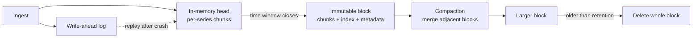

# 時系列ストレージエンジン

> **翻訳の状態:** 現行の[英語版](../../03-storage-engines/09-time-series-storage.md)からの翻訳です。

## TL;DR

時系列エンジンはサンプルを `(系列の識別子, タイムスタンプ, 値)` として保存する。汎用エンジンが前提にできない3つの規則性を利用することで成り立っている。1つの系列のサンプルは時刻順に届く。隣り合うサンプルはほとんど同じである。そしてほぼすべてのクエリは、少数の系列について直近の時間範囲を読む。この規則性があるから、追記だけの書き込みパス、バイトではなくビット単位で測る圧縮、時間で区切ったブロックを丸ごと捨てる削除が可能になる。

代償は、この規則性が成り立つあいだしか安くないことだ。最初に尽きる資源はサンプルレートではなく**系列のカーディナリティ**である。ラベルの組み合わせが1つ違えば別の系列になり、それぞれがメモリ上のヘッド、インデックスのエントリ、圧縮状態を持つ。遅延や順序の乱れたサンプル、生データに対する長期間のクエリ、エンティティごとのラベルは、それぞれ前提の1つを壊す。どれも上限を設けるか、コストを明示して受け入れるしかない。計器のセマンティクスと集約規則は[メトリクスシステムと監視](../11-observability/02-metrics-monitoring.md)が扱い、惑星規模の設計の1つは[Monarch](../09-whitepapers/12-monarch.md)が分析する。本章はその下にあるストレージエンジンを扱う。

## 一次資料と適用範囲

| 資料 | 示していること | 限界 |
|---|---|---|
| Pelkonen et al., Gorilla (VLDB 2015) | タイムスタンプの差分の差分と浮動小数点のXOR圧縮により、Facebookの監視データで1サンプルあたり約1.37バイトに達した。直近のデータはメモリから返す | 圧縮率は、間隔が規則的で値がゆっくり変わるというそのワークロードの性質による |
| Prometheus TSDBフォーマット文書 | 先行書き込みログを持つヘッドブロック、時間で区切った不変ブロック、ブロックごとの転置インデックス、トゥームストーン、コンパクション | 1つのオープンソース実装であり、既定値はそのプロジェクトの選択 |
| InfluxDBストレージエンジン文書 | 先行書き込みログ、メモリ上のキャッシュ、列指向のTSMファイル、別建ての系列インデックス | 対比のために挙げる1実装の構成 |
| Adams et al., Monarch (VLDB 2020) | リージョン単位のインメモリ設計、クエリのプッシュダウン、階層的な評価 | 特定の可用性要件のために作られたシステム |

容量モデルの節の数値は、そう明記した例示用の入力である。

## ワークロードと契約

時系列ワークロードは一般的なOLTPと異なり、エンジンは次の性質に依存してよい。

- **書き込みが支配的で、追記である。** 大半の系列は一定間隔でサンプルを受け取る。過去のサンプルの更新はまれか、禁止されている。
- **読み取りは時間範囲のスキャンである。** 多くは直近の数時間を対象とし、ラベルの条件で絞り込み、集約で縮約する。
- **価値は時間とともに減る。** 秒単位の解像度が要るのは1時間、分単位は1か月、傾向は1年である。
- **削除は経過時間で行う。** キーを指定した削除はほとんどない。

エンジンを選ぶ前に契約を明文化する。

| 項目 | 問い |
|---|---|
| サンプルモデル | 浮動小数点のゲージやカウンタか、ヒストグラムか、ペイロード付きのイベントか |
| タイムスタンプの権威 | 発生元、コレクタ、ストアのどれが付与するか |
| 順序 | 遅延や順序の乱れたサンプルを受け入れるか。受け入れるならどの時間窓までか |
| 耐久性 | サンプルへの確認応答は永続化の前か後か。クラッシュでどこまで失ってよいか |
| カーディナリティ上限 | テナントごと、メトリクス名ごとのアクティブ系列の最大数は |
| クエリ上限 | 1つのクエリが触れてよい系列数とサンプル数は |
| 保持 | 生データとダウンサンプル後の保持期間は。削除の証明が必要か |

カーディナリティとクエリの上限を暗黙のままにしたエンジンでは、リクエストIDを最初にラベルへ付けた利用者がその上限を決めることになる。

## 系列の識別子とカーディナリティ

系列はメトリクス名とラベルの組の集合で識別される。エンジンはこの識別子をコンパクトな系列参照へ対応づけ、サンプルを参照に対して保存する。ここから2つの帰結が出る。

第1に、カーディナリティは掛け算で増える。`method`(10値)、`status`(8値)、`instance`(500値)、`route`(200値)を持つメトリクスは最大800万系列を生む。エンジンは、その系列が一度も問い合わせられなくても、系列ごとにメモリ上のバッファ、圧縮状態、各ラベルのポスティングリストのエントリを負担する。

第2に、**チャーン**はカーディナリティと同じだけ高くつく。デプロイのたびにインスタンスが入れ替わると、そのインスタンスが公開するすべてのメトリクスについて新しい系列ができる。いまアクティブな系列の数は安定していても、保持期間中に存在した系列の数は際限なく増えうる。インデックスが覆わなければならないのは後者である。

両方に上限を設ける。取り込み時にテナント単位とメトリクス単位のアクティブ系列数を制限し、際限のない次元(ユーザー、リクエスト、セッション、生のURLパス)は拒否するか付け替える。1時間あたりの新規系列数を第一級のシグナルとして追跡する。エンティティ単位の分析は、イベントストア、トレースシステム、または[分析クエリエンジン](../13-data-pipelines/03-analytical-query-engines.md)に置く。そこでは高カーディナリティの列を識別子として索引せず、スキャンする。

## 書き込みパス: ヘッド、ログ、ブロック

一般的な設計は、[LSMツリー](./02-lsm-trees.md)のログ構造の考え方を、キー範囲ではなく時間で区切るよう特殊化したものだ。



**文書化済み、Prometheus TSDB:** 届いたサンプルは先行書き込みログとメモリ上のヘッドに追記され、ヘッドでは系列ごとに圧縮済みチャンクが積み上がる。ヘッドの古いデータは定期的に、固定の時間範囲を覆う不変ブロックとして書き出される。ブロックはチャンクファイル、インデックス、トゥームストーン、メタデータを収めたディレクトリである。その後コンパクションが隣り合うブロックをより大きなブロックへ統合する。

重要な設計上の選択は次のとおり。

- **確認応答の時点。** ログへの追記後、同期の前に確認応答を返せば、限られた範囲の喪失と引き換えにスループットを得る。監視データなら通常は許容できるが、課金や監査の系列では許容できないことが多い。同期のセマンティクスは[先行書き込みログ](./04-write-ahead-logging.md)を参照。
- **ヘッドのメモリ。** ヘッドはすべてのアクティブ系列を保持するので、メモリはサンプルレートではなくアクティブ系列数に比例する。カーディナリティが制約資源になる機械的な理由がこれだ。
- **ブロックの不変性。** 永続化したブロックはその場で書き換えない。削除はトゥームストーンとして記録し、コンパクション時に適用する。不変ブロックはキャッシュしやすく、[オブジェクトストレージ](./08-object-storage.md)へ安全にアップロードでき、1回の操作で削除できる。
- **再起動のコスト。** クラッシュ後はログを再生してヘッドを再構築する。再生時間はログの長さに比例するため、ヘッドのチェックポイントやスナップショットで復旧時間に上限を設ける。

## 圧縮: タイムスタンプと値

**文書化済み、Gorilla:** この論文は系列の2つの列を別々に圧縮する。

タイムスタンプには**差分の差分**符号化を使う。サンプルが60秒ごとに届けば、差分は60、60、60となり、2階の差分は0、0、0となる。0は1ビットで書き、小さなずれには短い可変長符号を使う。論文のデータでは、タイムスタンプの約96%が1ビットに圧縮された。

値には直前の値との**XOR**を使う。連続する同じ値はXORが0になり、1ビットで済む。値が異なる場合も、XORの結果は先頭と末尾に長い0の並びを持つことが多く、意味のある中央のビットとその位置だけを保存する。論文のデータでは、値の約半分が直前と同一だった。

論文は非圧縮の16バイトに対して平均1.37バイト/サンプルを報告している。これは定数ではなく、ワークロードの測定値として扱う。

- 不規則な間隔(イベント駆動のサンプル、ジッタのある収集)は差分の差分を無効にする。
- エントロピーの高い浮動小数点(下位ビットにノイズが乗る測定値)はXORを無効にする。保存前に意味のある精度へ丸めれば、圧縮率の大半は戻る。
- 増分がばらつくカウンタは、動かないゲージより圧縮が効かない。
- 整数や文字列の系列には別のコーデック(差分、ランレングス、辞書)が要る。列指向エンジンが列の型ごとに符号化を選ぶのはこのためだ。[列指向ストレージ](./06-column-storage.md)を参照。

圧縮は系列ごとに状態を持つ。あるサンプルを復号するには、チャンクを先頭から復号しなければならない。そのためチャンクは、点参照で数時間分を展開せずに済む程度に小さく保たれ、それがチャンクあたりのオーバーヘッドの下限を決める。

## インデックス: ラベル条件から系列へ

`http_requests{service="checkout", status=~"5.."}` のようなクエリは、まず系列参照の集合に変換しなければならない。標準的な構造は転置インデックスである。ラベル名と値の組ごとに、それを持つ系列をソートした**ポスティングリスト**を持つ。等値のマッチャはポスティングリストの積集合をとる。正規表現のマッチャは、まずラベルの一致する値を列挙し、それらのリストの和集合をとる。これはテキスト索引と同じ構造で、ラベルが語、系列が文書にあたる。詳しくは[検索インデックスのアーキテクチャと内部構造](../14-search-systems/01-inverted-indexes.md)を参照。

これを安く保つ性質が2つある。

1. **インデックスはブロック単位である。** 直近1時間のクエリは、その1時間と重なるブロックだけを参照する。インデックスのコストは全保持期間ではなく、問い合わせた時間範囲に従う。
2. **ポスティングリストは系列参照でソートされている。** 積集合は線形のマージで済む。

カーディナリティとチャーンの代償を払うのもインデックスである。100万個の値を持つラベルへの正規表現は、サンプルを1つも読む前に100万エントリを列挙する。値が系列ごとに一意なラベルでは、ポスティングリストが系列テーブルそのものと同じ大きさになる。

## クエリ実行

範囲クエリは4段階で進む。時間でブロックを選び、各ブロックのインデックスでマッチャを系列に解決し、該当するチャンクを復号し、集約を評価する。コストを決めるのは選ばれた系列数と復号したサンプル数なので、エンジンはこの両方を上限として公開する。

大規模では3つの手法でコストを抑える。

- **プッシュダウン。** データのある場所でフィルタと部分集約を評価し、縮約した結果だけを送る。Monarchがクエリ評価をデータを持つゾーンへ押し下げるのはこのためだ。
- **ステップの整列とキャッシュ。** ダッシュボードは同じクエリを時間窓をずらしながら繰り返し発行する。評価ステップを固定の境界にそろえれば、完了した時間範囲の結果をキャッシュし、最新の部分だけを再計算できる。
- **事前計算。** ダッシュボードを開くたびに数千系列を評価するクエリは、取り込み時に集約済みの1系列を書くレコーディングルールにしたほうが安い。

## 順序の乱れと遅延サンプル

追記だけのヘッドは、各系列のサンプルがタイムスタンプの昇順で届くことを前提にしている。実際のパイプラインはこれを破る。エージェントはネットワーク分断のあいだバッファし、時計は食い違い、バックフィルは数日遅れて届く。エンジンの選択肢は3つあり、どれを採るかを明示すべきである。

1. その系列の最新サンプルより古いサンプルを**拒否する**。単純で安いが、バッファしていたエージェントは再接続時にバックログを失う。
2. 第2の、ソートしていないメモリ上の構造を持ち、**限られた時間窓の範囲で受け入れる**。この構造はコンパクション時にマージする。時間窓が追加メモリとクエリ時のマージに上限を与える。
3. 完全なブロックをオフラインで書いてストアに追加する別のバックフィル経路を通じて、**すべて受け入れる**。

同じ問いは重複にも当てはまる。可用性のために2つのコレクタが同じ対象をスクレイプするなら、ストアは明示的なレプリカラベルで重複を除くか、両方を保存してクエリに選ばせるかのどちらかになる。これは設計時に決める。障害の最中に気づくと、レートが2倍になって表示される。

## 保持、ダウンサンプリング、階層化

時間で区切ってあるので、保持はO(1)の操作になる。期限より古いブロックを削除するだけだ。キーごとのトゥームストーンもコンパクションの負債も生まれない。時系列を汎用のキーバリューエンジンに保存する場合と比べた、運用上最大の利点である。

ダウンサンプリングは、長期間を問い合わせ可能に保つために、生サンプルを粗い集約に置き換える。これは特定の形で情報を失う。

- 時間窓ごとに、平均だけでなく `min`、`max`、`sum`、`count` を保持する。平均の平均は件数で重み付けしない限り誤りであり、1秒のスパイクは5分平均から消える。
- **分位点はダウンサンプルできない。** 1分ごとのp99の平均は、1時間のp99ではない。マージ可能なヒストグラムか[確率的スケッチ](./10-probabilistic-sketches.md)を保存し、マージしたあとで分位点を計算する。
- カウンタのリセットは集約の前に処理する。そうしないと、再起動が大きな負のレートに見える。

階層化は古いブロックをオブジェクトストレージへ移し、インデックスやキャッシュだけをローカルに残す。コールド層へのクエリはチャンク範囲ごとにオブジェクトストアの遅延を払うので、プランナは数か月にわたる無制限の生データクエリを拒否するか、ダウンサンプル済みデータへ回すべきである。

## 容量モデル

以下の入力はすべて例示である。

アクティブ系列200万、スクレイプ間隔15秒、生データの保持30日、圧縮後1.5バイト/サンプル、1日あたり20%の系列チャーンを仮定する。

```text
samples/s        = 2,000,000 / 15                 = 133,333
samples/day      = 133,333 x 86,400               = 11.52 billion
raw bytes/day    = 11.52e9 x 16 bytes             = 184 GB   (uncompressed)
stored bytes/day = 11.52e9 x 1.5 bytes            = 17.3 GB
30-day chunks    = 17.3 GB x 30                   = 518 GB   (before index and replication)
series in 30 d   = 2,000,000 x (1 + 0.20 x 30)    = 14 million distinct series
```

ここから3つのことが分かる。チャンクのストレージは控えめで、サンプルレートにほぼ比例する。ヘッドのメモリはアクティブ系列数に比例する。エンジンがアクティブ系列あたり数キロバイトを必要とするなら、200万系列はクエリを1つも実行する前に数ギガバイトを要する。したがって系列あたりの数字は仮定せず、配備するバージョンで実測する。そしてインデックスは1400万系列、つまりアクティブ数の7倍を覆う。原因はチャーンだけである。チャーンを半分にすれば、スクレイプ頻度を半分にしてチャンクを節約するより多くのインデックスを節約できる。

## 障害トレース

### 1回のデプロイによるカーディナリティ爆発

1. あるサービスがリクエストカウンタに `customer_id` をラベルとして追加する。
2. 各インスタンスが、顧客ごと、ルートごと、ステータスごとに1系列を公開するようになる。
3. スクレイプ1回のあいだに、アクティブ系列が200万から4000万へ増える。
4. ヘッドのメモリが増え続け、プロセスが強制終了される。再起動するとログの再生が同じヘッドを再構築し、再び強制終了される。

復旧するには、再生の前に問題の系列をログから落とすか、取り込みで遮断する必要がある。入口でメトリクス単位の系列上限を強制していれば、これは障害ではなく、原因を名指しした書き込み拒否で済む。

### 長期間のクエリが取り込みを飢えさせる

ダッシュボードが5万系列にわたる90日分の生データを要求する。エンジンは数十億サンプルを復号し、ページキャッシュが追い出され、取り込みの遅延が増えてサンプルが落ち始める。クエリごとのサンプル上限を強制し、長期間のクエリはダウンサンプル済みデータへ回し、クエリと取り込みの資源を分離する。

### 分断後にバックログが拒否される

エージェントがネットワーク分断のあいだ40分ぶんのサンプルをバッファし、再接続時に再送する。ストアは順序どおりのサンプルしか受け入れないため、2台目のコレクタがすでに書いた時刻より古いサンプルはすべて拒否される。グラフには欠落が現れるが、エージェントのログは配送済みだと言っている。限られた順序外の時間窓を設定するか、拒否を件数として数え、アラート可能なイベントとして見えるようにする。

### ダウンサンプルした分位点がずれる

レイテンシのSLOを、インスタンスごとのp99の5分平均から計算している。平均を重ねるたびに結果は中央値へ引き寄せられ、SLOは達成と報告し、利用者は遅いと訴える。マージしたヒストグラムから再計算し、保存済みの分位点は表示専用として扱う。

## 運用と検証

監視する対象は次のとおり。テナント別、メトリクス別のアクティブ系列数と1時間あたりの新規系列数。系列あたりのヘッドメモリ。ログ再生の所要時間。理由別(順序外、上限、重複)の拒否サンプル数。コンパクションの滞留。ブロック数。そしてクエリが触れたサンプル数と系列数のテール。

障害トレースに対応するテストで検証する。すべての発生元を入れ替えてインデックスの増加を確かめるチャーンテスト。ブロック書き出し中のクラッシュとその後の再生。既存ブロックと重なるバックフィル。設定した上限ちょうどのクエリ。そして期限切れのブロックがすべてのレプリカと階層から消えたことを証明する保持の実行である。

## 判断の枠組み

| 状況 | 選択 | 理由 |
|---|---|---|
| ラベル集合に上限があり、間隔が規則的で、直近範囲を問い合わせる | 専用の時系列エンジン | ビット単位の圧縮とブロック単位の破棄がそのまま効く |
| エンティティ単位やリクエスト単位の次元 | 列指向の分析ストアかイベントストア | カーディナリティは設計上際限がない。識別子として索引せずスキャンする |
| 時刻順の行に、リレーショナルな結合と更新が要る | リレーショナルエンジンの時間パーティションテーブル | トランザクションとSQLを保てる。圧縮の大半は諦める |
| 遅延データが常態(モバイル、IoT、断続的な回線) | 明示的な順序外の時間窓か、バッチのバックフィル経路を持つエンジン | 順序どおりのみの取り込みはバックログを黙って落とす |
| 複数年の保持と傾向のクエリ | ダウンサンプリングとオブジェクトストレージへの階層化 | 生データの保持コストは時間に比例する。傾向のクエリに生サンプルは要らない |
| レイテンシやサイズの分布 | ヒストグラムかスケッチを保存型にする | 分位点はマージできない。分布はできる |

採用を決める前に4つの問いに答える。アクティブ系列とチャーンに何が上限を与えるか。1つのクエリは何に触れてよいか。遅れて届いたサンプルはどうなるか。どの集約がダウンサンプリングを生き延びるか。

## 参考文献

- [Pelkonen et al., *Gorilla: A Fast, Scalable, In-Memory Time Series Database* (VLDB 2015)](https://www.vldb.org/pvldb/vol8/p1816-teller.pdf): 差分の差分とXORによる圧縮の原論文
- [Prometheus, *TSDB format* documentation](https://github.com/prometheus/prometheus/blob/main/tsdb/docs/format/README.md)
- [InfluxData, *In-memory indexing and the Time-Structured Merge Tree (TSM)*](https://docs.influxdata.com/influxdb/v1/concepts/storage_engine/)
- [Adams et al., *Monarch: Google's Planet-Scale In-Memory Time Series Database* (VLDB 2020)](https://www.vldb.org/pvldb/vol13/p3181-adams.pdf)
- [Jensen, Pedersen, and Thomsen, *Time Series Management Systems: A Survey* (2017)](https://arxiv.org/abs/1710.01077)
