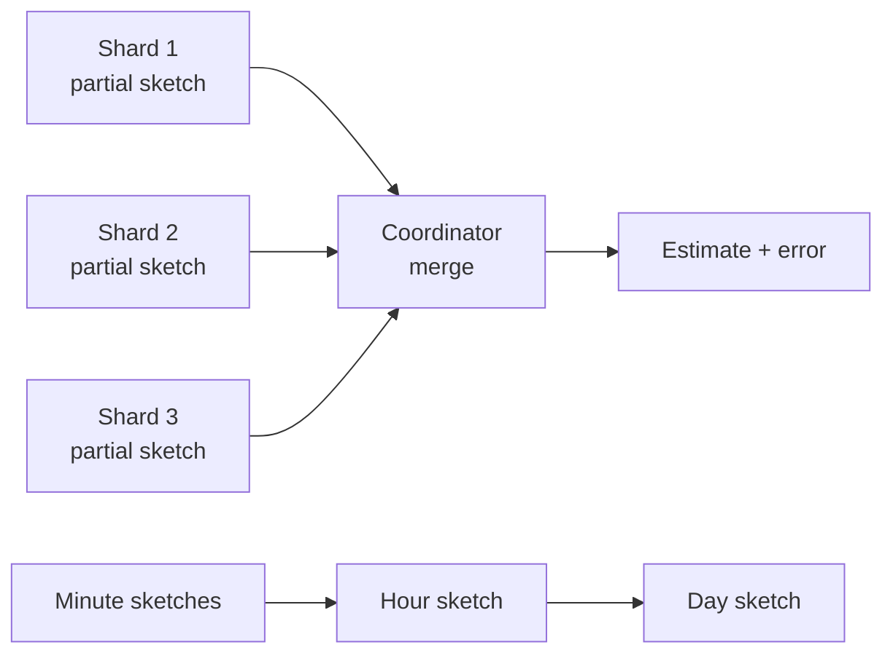

# 確率的スケッチ

> **翻訳の状態:** 現行の[英語版](../../03-storage-engines/10-probabilistic-sketches.md)からの翻訳です。

## TL;DR

スケッチは、ストリームを固定サイズに要約したものだ。1つの問い(異なる要素はいくつあるか、この要素は何回現れたか、99パーセンタイルはいくつか)に対して、正確な答えの代わりに、誤差を明示した答えを返す。スケッチが存在するのは、正確な答えにはデータに比例するメモリが必要で、しかもデータは多数のマシンに同時に届くからである。HyperLogLogは10億個の異なる値を約12キロバイトで数える。Count-Minスケッチは数千個のカウンタで頻度の誤差に上限を与える。分位点スケッチは数百個のバケットからテールのレイテンシを報告する。

スケッチをアルゴリズムの道具にとどめず、システム設計の道具にしている性質は**マージ可能性**である。別々に作った2つのスケッチは、どの順序で結合しても、和集合のスケッチになる。これがあるから、クエリをシャードへ分散でき、分単位を日単位へ集約でき、部分集約が再送されても二重に数えずに済む。したがってスケッチを選ぶことは、3つを同時に選ぶことである。問い、誤差の定義(絶対誤差、相対誤差、順位誤差)、そしてマージの振る舞いだ。よくある失敗は誤差の定義の取り違えである。順位誤差1%のスケッチは中央値では正確だが、p99.9では役に立たない。集合への所属判定は[ブルームフィルタ](./05-bloom-filters.md)が扱う。本章は計数、頻度、分布のスケッチを扱う。

## 一次資料と適用範囲

| 資料 | 示していること | 限界 |
|---|---|---|
| Flajolet, Fusy, Gandouet, Meunier (2007) | HyperLogLogは m 個の小さなレジスタで、標準誤差およそ 1.04/sqrt(m) でカーディナリティを推定する | 一様に振る舞うハッシュを仮定する。素の推定量は小さなカーディナリティで偏る |
| Heule, Nunkesser, Hall (EDBT 2013) | HyperLogLog++。Googleで運用されている64ビットハッシュ、疎表現、経験的な偏り補正 | 工学的な改良であり、漸近的な誤差は同じ |
| Cormode, Muthukrishnan (2005) | Count-Min。過大評価は確率 1 - delta でストリーム長の epsilon 倍以内 | 誤差は総数に対する絶対値なので、まれな要素の推定は粗い |
| Metwally, Agrawal, El Abbadi (2005) | Space-Savingは k 個のカウンタで頻出要素を見つけ、誤差は高々 N/k | 保証は頻度のしきい値を超える要素についてのもの |
| Karnin, Lang, Liberty (2016) | KLL。順位誤差を保証する、空間最適な分位点スケッチ | 値の誤差ではなく順位の誤差 |
| Masson, Rim, Lee (VLDB 2019) | DDSketch。値の相対誤差を保証し、正確にマージできる分位点スケッチ | バケット数は最大値と最小値の比に応じて増える |
| Dunning (2019) | t-digest。テール付近で小さくなる適応的なクラスタ | 精度は経験的であり、同じ形の最悪時の上限はない |

## 近似が正しい契約になる場合

正確な答えには正確なコストがかかる。64ビットの識別子を正確に数えるには、見た識別子をすべて保持する必要がある。1億個なら、ハッシュテーブルのオーバーヘッドを除いても800メガバイトを占める。同じ利用者が両方に現れうるので、2つのシャードは識別子そのものを交換しない限り、数を結合できない。正確なパーセンタイルには、すべての観測値をソートして持つ必要がある。

近似が適切なのは、次のすべてが成り立つ場合である。

1. 利用側が、誤差の幅の中のどの答えに対しても同じ行動をとる(ダッシュボード、容量の傾向、上位k件のリスト、クエリプランナの行数推定)。
2. 誤差が利用側に明示されており、隠されていない。
3. 対象が金額、権利、監査上の件数ではない。推定値で顧客に課金すると、スケッチの誤差が紛争に変わる。

本番で最も古くから使ってきたのはクエリプランナである。異なる値の数の推定は[分析クエリエンジン](../13-data-pipelines/03-analytical-query-engines.md)の結合順序を決める。そこでは2%の誤差は問題にならず、正確に数えるほうがクエリ本体より高くつく。

## マージ可能性がシステム上の性質である

あるスケッチの型がマージ可能であるとは、`merge(sketch(A), sketch(B)) = sketch(A + B)` が同じ誤差保証で成り立ち、マージが結合的かつ可換であることをいう。この1つの性質が、スケッチを置ける場所を決める。



- **スキャッタ・ギャザー型のクエリ**は、シャードごとにスケッチを計算し、コーディネータでマージする。運ぶのは生の値ではなく数キロバイトである。
- **ロールアップ**は時間窓ごとに1つのスケッチを保存し、クエリ時に窓をマージする。30日間のユニーク数は、再スキャンではなく30個の日次スケッチのマージになる。
- **冪等な復旧**は、マージがレジスタごとの最大値であるスケッチで成り立つ。同じ部分結果を2回マージしても何も変わらない。カウンタに基づくスケッチにはこの性質がなく、パイプラインが重複を除かない限り、再送された部分結果は2回数えられる。[配信保証と効果の境界](../05-messaging/04-delivery-guarantees.md)を参照。

裏返せば、マージできないものがはっきりする。保存済みの分位点の値(p99の数値の列)はマージできず、保存済みのユニーク数もマージできない。列の型としてスケッチそのものを永続化し、スカラー値は読み取り時に計算する。

## カーディナリティ: HyperLogLog

HyperLogLogは各要素をハッシュし、ハッシュの先頭 `p` ビットで `m = 2^p` 個のレジスタの1つを選ぶ。そして残りのビットで観測した先頭の0の連続の最大長を、そのレジスタに保存する。先頭に0が長く続くことはまれなので、レジスタの値は、異なるハッシュをいくつ観測したかの手がかりになる。レジスタ全体の調和平均が推定値を与える。

**文書化済み:** 標準誤差はおよそ `1.04 / sqrt(m)` である。

| 精度 p | レジスタ数 m | おおよそのサイズ | 標準誤差 |
|---|---|---|---|
| 11 | 2,048 | 1.5 KB | 2.3% |
| 12 | 4,096 | 3 KB | 1.6% |
| 14 | 16,384 | 12 KB | 0.81% |
| 16 | 65,536 | 48 KB | 0.41% |

サイズはレジスタあたり6ビットを仮定している。Redisは自らの実装を、キーあたり12キロバイト、標準誤差0.81%と文書化している。これは `p = 14` の行にあたる。

設計を左右する性質は次のとおり。

- **重複はコストにならない。** 同じ要素をもう一度加えても、どのレジスタも上がらない。at-least-onceの取り込みでも数は膨らまない。
- **マージはレジスタごとの最大値である。** ただし両方のスケッチが同じ精度と同じハッシュ関数を使っていることが条件になる。
- **削除はできない。** レジスタは最大値を覚えているだけで、要素の除去は表現できない。スライディングウィンドウは、部分窓ごとにスケッチを持ち、有効なものをマージして作る。
- **小さなカーディナリティには補正が要る。** セットされたレジスタが少ないとき、素の推定量は偏る。HyperLogLog++はこの範囲で、厳密に近い疎表現と経験的な偏り補正を使う。
- **標準誤差は上限ではない。** 推定値のおよそ3回に1回は標準誤差1つぶんの外に、20回に1回は2つぶんの外に落ちる。判断に見合う区間を示す。

## 頻度: Count-Minと頻出要素

Count-Minスケッチは `d` 行 `w` 列のカウンタの配列で、行ごとに1つのハッシュ関数を持つ。要素を加えるときは各行で1つのカウンタを増やす。頻度を推定するときは、その要素の `d` 個のカウンタの最小値をとる。衝突は加算しか起こさないので、推定値が過小になることはない。

**文書化済み:** `w = ceil(e / epsilon)`、`d = ceil(ln(1 / delta))` とすると、推定値が真の数を超える幅は、確率 `1 - delta` 以上で高々 `epsilon x N` である。ここで `N` は加えたすべての数の合計である。

`epsilon = 0.001`、`delta = 0.01` なら `w = 2,719`、`d = 5` となる。異なる要素がいくつあっても、カウンタは13,595個で済む。

重要なのは誤差項である。これは要素ではなく、ストリーム全体に比例する。10億イベントのストリームでは上の上限は100万になる。2億回現れた要素には十分だが、50回しか現れない要素には意味がない。Count-Minは、偏ったデータの中の頻出要素のための道具である。

「どの要素が頻出か」という直接の問いには、通常カウンタに基づくアルゴリズムのほうがよい。**Space-Saving**は `k` 個のカウンタを持つ。新しい要素が届いたときにカウンタがすべて埋まっていれば、最小のものを置き換え、その数を引き継ぐ。真の頻度が `N / k` を超える要素は必ず含まれ、報告される数の過大評価は高々 `N / k` である。これはキャッシュや分割ストアでのホットキー検出の仕組みであり、その出力は[キャッシュスタンピード、コールドスタート、ウォーミング](../04-caching/04-cache-stampede.md)で述べる対策へ渡される。

## 分位点: 順位誤差と相対誤差

分位点スケッチは約束する内容が異なり、その違いがテールのパーセンタイルに意味があるかどうかを決める。

KLLのような**順位誤差**のスケッチは、分位点 `q` に対して返す値の真の順位が `q +/- epsilon` の範囲にあることを保証する。`epsilon = 1%` なら、p50の要求にはp49からp51のあいだの値が返り、これは十分に狭い。p99.9の要求にはp98.9からp100のあいだの値が返る。テールの長いレイテンシ分布では、この両端が1桁違うことがある。

DDSketchのような**相対誤差**のスケッチは、返す値が真の分位点の値の `1 +/- alpha` 倍以内にあることを保証する。これは、境界が `gamma = (1 + alpha) / (1 - alpha)` 倍ずつ幾何的に広がるバケットで実現する。バケット内のどの値も、バケットの代表値から `alpha` 以内に収まる。

**参照設計、例示のサイジング:** `alpha = 1%` のとき `gamma` は約1.0202である。1ミリ秒から1時間までを覆うと比は360万で、`ln(3,600,000) / ln(1.0202)`、およそ755個のバケットが要る。このスケッチ2つのマージはバケットごとに件数を足すだけで、誤差を増やさない。

同じ幾何バケットの考え方が、メトリクスシステムの指数ヒストグラムの土台になっている。境界が固定のヒストグラムもマージ可能だが、その精度は、あとで重要になった値の近くに誰かが境界を置いていたかどうかに左右される。t-digestは第3の道をとる。両端付近で小さく保たれる適応的な大きさのクラスタを使い、同じ形の最悪時の上限はないものの、実用上テールで良い精度を出す。

ここから3つの規則が出る。

1. レイテンシ、サイズ、そのほかテールにアラートをかける量には相対誤差を選ぶ。
2. 保存済みの分位点を、ホスト間や時間窓間で平均してはならない。スケッチをマージしてから分位点を読む。ストレージ側の帰結は[時系列ストレージエンジン](./09-time-series-storage.md)で扱う。
3. スケッチの型とパラメータをデータとともに記録する。`alpha` やバケット方式が異なる2つのスケッチは、安全にマージできない。

## 集合演算とその誤差

和集合はカーディナリティスケッチがもともと備えている。積集合はそうではない。`|A and B|` を包除原理 `|A| + |B| - |A or B|` で推定すると、大きな推定値どうしを引くことになる。各集合が1000万要素を1%の誤差で持ち、真の重なりが5万であれば、結果の絶対誤差は10万以上の桁になり、答えそのものより大きい。積集合を直接扱えるスケッチ(シータスケッチなど、サンプリングに基づく設計)を使うか、大きな集合どうしの小さな積集合は本質的に高くつくと受け入れるか、サンプルから正確に計算する。

## システムの中でスケッチを置く場所

- **取り込み時。** パーティションと時間窓ごとの部分集約として置き、本来なら保存されるはずの生の値を置き換える。
- **ストレージ。** 列の型として置く。分析ストアは、集約演算子がマージするスケッチ列を提供する。ロールアップテーブルを小さく保ったまま、ユニーク数や分位点のクエリに答えられる。
- **プロセスの境界。** メモリ上のホットキー検出器や頻出要素検出器として置き、アドミッションやルーティングの判断に使う。
- **プランナ。** テーブル統計として置く。

どの位置でも同じ運用上の事実が当てはまる。スケッチにはバージョン(アルゴリズム、パラメータ、ハッシュ関数とシード)を付け、安定した形式で直列化し、サイズに上限を設ける。入力の値域に応じて大きくなる設計があるからだ。

## ロールアップのサイジング

入力はすべて例示である。

あるプロダクトが、1万ページについて、ページごと、1分ごとのユニーク訪問者数を、1日のうち任意の範囲で問い合わせたい。

```text
sketches per day       = 10,000 pages x 1,440 minutes   = 14.4 million
at p = 14 (12 KB)      = 14.4e6 x 12 KB                 = 172.8 GB per day
at p = 11 (1.5 KB)     = 14.4e6 x 1.5 KB                = 21.6 GB per day
```

カウンタ1つではただ同然に見えた精度が、1400万個では支配的なストレージコストになる。選択肢は3つある。精度を下げる(分単位のセルで標準誤差2.3%。セルをマージして改善するのは、マージ後のカーディナリティが増える場合だけである)。訪問者が数人しかいない多数の低トラフィックのセルに疎表現を使う。あるいはトラフィックがしきい値を下回るページでは窓を粗くする。セルごとに訪問者の識別子を保存する正確な方法は、セルごと、異なる訪問者ごとに8バイトかかり、読み直さない限りマージできない。

## 障害トレース

### パラメータの異なるスケッチが黙ってマージされる

2つのサービスが同じメトリクスについてHyperLogLogスケッチを出力するが、片方は `p = 12`、もう片方は `p = 14` である。あるいはハッシュのシードが異なる。検査をしないマージは、形式上は正しいが推定値に意味のないスケッチを作る。直列化した形式にアルゴリズム、精度、ハッシュの識別情報を持たせ、不一致は拒否する。

### 順位誤差のスケッチから求めたテールのパーセンタイル

p99.9のレイテンシSLOを、順位誤差0.5%のスケッチから計算している。報告される値は、評価のたびに真のp99.4から最大値のあいだを動き、サービスに何の変化もないのにアラートが点滅する。相対誤差のスケッチに切り替えるか、順位誤差が `1 - q` の小さな割合になるまで精度を上げる。

### 再送後にカウンタ型スケッチが二重に数える

ストリームジョブが時間窓ごとに部分的なCount-Minスケッチを出力する。あるタスクが出力後に失敗し、再起動して、もう一度出力する。下流のマージは両方を足す。頻度は、再送された窓のぶんだけ正確に膨らむ。各部分結果に識別子(パーティション、窓、試行)を与えて冪等にマージするか、部分結果を入力オフセットとともにトランザクションでコミットする。

### 推定値を課金に使う

標準誤差0.8%のユニーク数スケッチから利用量を請求している。数千の顧客のうち何社かは、どの月も偶然だけで2%多く請求される。近似値は、誤差の幅を許容できる判断のためのものだ。請求書には、正確で照合可能な数が要る。

## 検証

スケッチは測定器としてテストする。システムが扱うカーディナリティと分布の範囲にわたって、正解の分かっているストリームを流す。ごく小さな入力、強い偏り、敵対的に繰り返される値も含める。そして観測した誤差を、主張されている上限と比べる。`merge(a, b)`、`merge(b, a)`、逐次挿入が保証の範囲で一致することをテストする。ライブラリのバージョンをまたいで直列化の往復を確認し、ストレージに残っている最も古いバージョンの直列化済みスケッチをフィクスチャとして保持する。

## 判断の枠組み

| 問い | スケッチ | 示すべき誤差 | マージ可能か |
|---|---|---|---|
| 異なる要素はいくつか | HyperLogLog、HyperLogLog++ | 相対標準誤差。およそ 1.04/sqrt(m) | 可。レジスタごとの最大値 |
| 偏ったデータで、この要素は何回現れたか | Count-Min | 絶対的な過大評価。epsilon x N | 可。カウンタごとの和(冪等ではない) |
| どの要素が最も頻出か | Space-Saving、Misra-Gries | 件数あたり高々 N/k | 可。注意が要る |
| p99やp99.9の値はいくつか | DDSketch、指数ヒストグラム | 値の相対誤差 alpha | 可。正確 |
| 値域の限られた分布の中央値は | KLL | 順位誤差 epsilon | 可 |
| この要素は集合に含まれるか | ブルームフィルタ | 偽陽性率 | 可。同じサイズでビットごとのOR |
| 2つの集合の積集合の大きさは | シータスケッチ、またはサンプル上で正確に | 重なりの割合による | 可。集合演算子を使う |

出荷の前に3つの条件を確かめる。利用側に誤差が伝えられていること。スケッチのパラメータがデータとともに保存されていること。そして下流のどこも、推定値を正確で監査可能な数として扱っていないことである。

## 参考文献

- [Flajolet, Fusy, Gandouet, and Meunier, *HyperLogLog: The Analysis of a Near-optimal Cardinality Estimation Algorithm* (2007)](https://algo.inria.fr/flajolet/Publications/FlFuGaMe07.pdf): HyperLogLogの原論文
- [Heule, Nunkesser, and Hall, *HyperLogLog in Practice: Algorithmic Engineering of a State of the Art Cardinality Estimation Algorithm* (EDBT 2013)](https://research.google/pubs/hyperloglog-in-practice-algorithmic-engineering-of-a-state-of-the-art-cardinality-estimation-algorithm/)
- [Cormode and Muthukrishnan, *An Improved Data Stream Summary: The Count-Min Sketch and Its Applications* (Journal of Algorithms, 2005)](https://doi.org/10.1016/j.jalgor.2003.12.001)
- [Metwally, Agrawal, and El Abbadi, *Efficient Computation of Frequent and Top-k Elements in Data Streams* (ICDT 2005)](https://doi.org/10.1007/978-3-540-30570-5_27)
- [Karnin, Lang, and Liberty, *Optimal Quantile Approximation in Streams* (2016)](https://arxiv.org/abs/1603.05346)
- [Masson, Rim, and Lee, *DDSketch: A Fast and Fully-Mergeable Quantile Sketch with Relative-Error Guarantees* (VLDB 2019)](https://arxiv.org/abs/1908.10693)
- [Dunning, *The t-digest: Efficient Estimates of Distributions* (2019)](https://arxiv.org/abs/1902.04023)
- [Apache DataSketches documentation](https://datasketches.apache.org/)
- [Redis documentation, *HyperLogLog*](https://redis.io/docs/latest/develop/data-types/probabilistic/hyperloglogs/)
