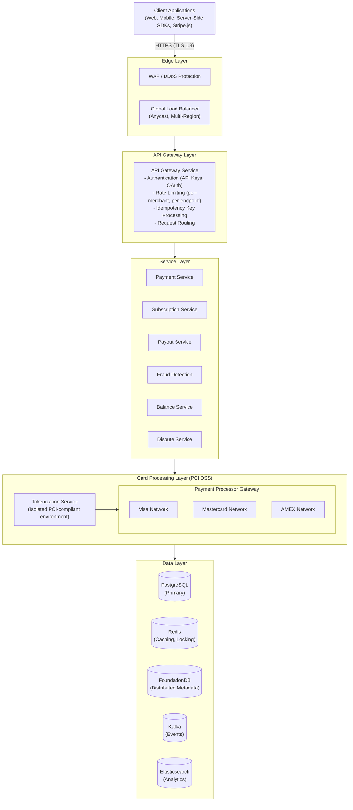
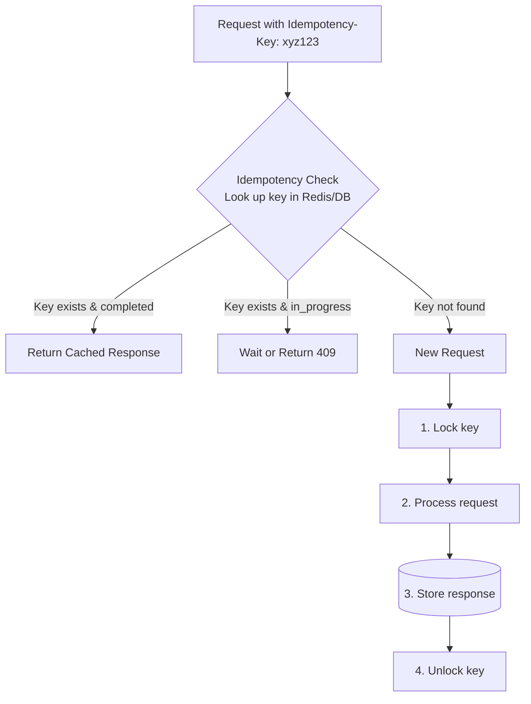
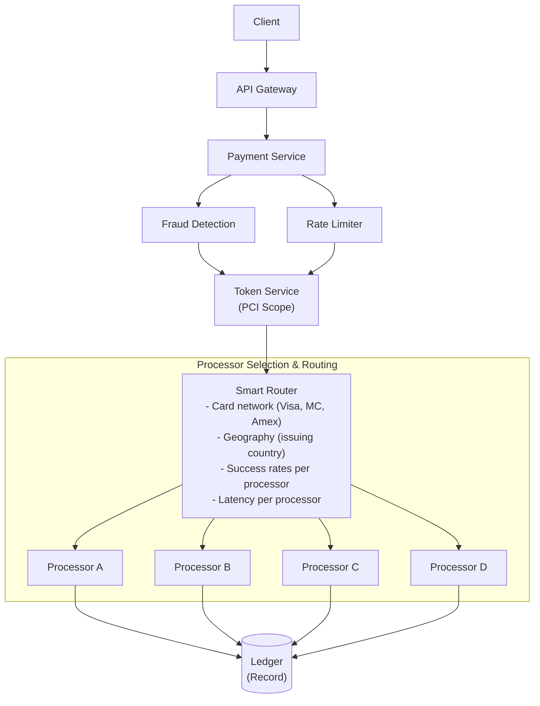

# Stripe システム設計

> **注意:** この記事は英語版からの翻訳です。コードブロック、Mermaidダイアグラム、企業名、技術スタック名は原文のまま記載しています。

## TL;DR

Stripeは年間数千億ドルを99.999%の稼働率で処理しています。アーキテクチャの中心には、厳密に1回の決済処理を実現する**べき等キー**、財務正確性のための**複式簿記**、複数プロバイダーにまたがる**リクエストヘッジング**、**PCI DSS準拠インフラ**の分離、そしてテナント公平性を備えた**レート制限**があります。重要な知見：金融システムは可用性よりも正確性を重視します。決済の失敗が二重請求や金銭の喪失につながることは決して許されません。

---

## コア要件

### 機能要件

1. **決済処理** - クレジットカード、銀行振込、デジタルウォレットの課金
2. **マルチ通貨** - 135以上の通貨と換算のサポート
3. **サブスクリプション** - 日割り計算付きの定期課金
4. **ペイアウト** - 加盟店への資金移動
5. **紛争処理** - チャージバックと返金の処理
6. **レポーティング** - リアルタイムダッシュボードと照合

### 非機能要件

1. **整合性** - 二重課金なし、金銭の喪失なし
2. **可用性** - 99.999%の稼働率（年間約5分のダウンタイム）
3. **レイテンシ** - 決済承認 < 2秒
4. **セキュリティ** - PCI DSS レベル1準拠
5. **監査可能性** - 完全な取引履歴

---

## 上位レベルアーキテクチャ



---

## べき等システム



### べき等の実装

```ruby
require "json"
require "digest"
require "securerandom"

module IdempotencyStatus
  STARTED   = "started"
  COMPLETED = "completed"
  FAILED    = "failed"
end

IdempotencyRecord = Struct.new(
  :key, :merchant_id, :status, :request_hash,
  :response, :created_at, :locked_until,
  keyword_init: true
)

# Ensures exactly-once processing for payment operations.
# Uses distributed locking with careful handling of edge cases.
class IdempotencyService
  LOCK_TIMEOUT = 60        # seconds
  KEY_EXPIRY   = 24 * 3600 # 24 hours

  def initialize(redis:, db:)
    @redis = redis
    @db    = db
  end

  # Execute the given block with idempotency guarantees.
  # Returns cached result if key was previously processed.
  def process_with_idempotency(idempotency_key:, merchant_id:, request_params:, &processor_fn)
    request_hash = compute_hash(request_params)

    existing = get_idempotency_record(idempotency_key, merchant_id)

    if existing
      return handle_existing_key(existing, request_hash, &processor_fn)
    end

    unless acquire_lock(idempotency_key, merchant_id, request_hash)
      raise ConcurrentRequestError, "Another request with this idempotency key is in progress"
    end

    begin
      result = processor_fn.call

      store_completed_result(idempotency_key, merchant_id, request_hash, result)

      result
    rescue => e
      if should_store_failure?(e)
        store_failed_result(idempotency_key, merchant_id, request_hash, e)
      else
        release_lock(idempotency_key, merchant_id)
      end

      raise
    end
  end

  private

  # Handle request with existing idempotency key
  def handle_existing_key(record, request_hash, &processor_fn)
    if record.request_hash != request_hash
      raise IdempotencyMismatchError, "Request parameters differ from original request"
    end

    case record.status
    when IdempotencyStatus::COMPLETED
      record.response
    when IdempotencyStatus::FAILED
      raise CachedFailureError, record.response["error"]
    when IdempotencyStatus::STARTED
      if record.locked_until && Time.now.to_f > record.locked_until
        retry_processing(record, &processor_fn)
      else
        raise ConcurrentRequestError, "Request is still being processed"
      end
    end
  end

  # Acquire distributed lock for idempotency key.
  # Uses INSERT ... ON CONFLICT DO NOTHING to avoid TOCTOU races.
  def acquire_lock(key, merchant_id, request_hash)
    lock_key      = "idem_lock:#{merchant_id}:#{key}"
    locked_until  = Time.now.to_f + LOCK_TIMEOUT

    acquired = @redis.set(
      lock_key,
      JSON.generate(locked_until: locked_until, request_hash: request_hash),
      nx: true,
      ex: LOCK_TIMEOUT
    )

    if acquired
      # Atomic insert — ON CONFLICT DO NOTHING prevents duplicate key races
      @db.exec_query(<<~SQL, [key, merchant_id, IdempotencyStatus::STARTED, request_hash, locked_until])
        INSERT INTO idempotency_keys (key, merchant_id, status, request_hash, locked_until, created_at)
        VALUES ($1, $2, $3, $4, $5, NOW())
        ON CONFLICT (merchant_id, key) DO NOTHING
      SQL
    end

    acquired
  end

  # Store successful result for future idempotent requests
  def store_completed_result(key, merchant_id, request_hash, result)
    @db.exec_query(<<~SQL, [IdempotencyStatus::COMPLETED, JSON.generate(result), key, merchant_id])
      UPDATE idempotency_keys
      SET status = $1, response = $2, locked_until = NULL
      WHERE key = $3 AND merchant_id = $4
    SQL

    @redis.del("idem_lock:#{merchant_id}:#{key}")

    @redis.setex(
      "idem_result:#{merchant_id}:#{key}",
      KEY_EXPIRY,
      JSON.generate(status: "completed", request_hash: request_hash, response: result)
    )
  end

  # Compute deterministic hash of request parameters
  def compute_hash(params)
    canonical = JSON.generate(params.sort_by { |k, _| k.to_s }.to_h)
    Digest::SHA256.hexdigest(canonical)
  end

  # Determine if failure should be cached (non-retryable)
  def should_store_failure?(error)
    [CardDeclinedError, InsufficientFundsError, InvalidCardError, FraudDetectedError].any? do |klass|
      error.is_a?(klass)
    end
  end
end
```

---

## 複式簿記台帳システム

```
┌─────────────────────────────────────────────────────────────────────────┐
│                    Double-Entry Bookkeeping                              │
│                                                                          │
│   Every transaction creates balanced debit and credit entries           │
│                                                                          │
│   Example: $100 payment from Customer → Merchant                        │
│                                                                          │
│   ┌─────────────────────────────────────────────────────────────────┐   │
│   │  Entry 1: Debit Customer Card Account         $100.00          │   │
│   │  Entry 2: Credit Stripe Pending Balance       $100.00          │   │
│   └─────────────────────────────────────────────────────────────────┘   │
│                              │                                          │
│                              ▼ (After settlement)                       │
│   ┌─────────────────────────────────────────────────────────────────┐   │
│   │  Entry 3: Debit Stripe Pending Balance        $100.00          │   │
│   │  Entry 4: Credit Stripe Revenue (2.9%)          $2.90          │   │
│   │  Entry 5: Credit Merchant Balance              $97.10          │   │
│   └─────────────────────────────────────────────────────────────────┘   │
│                                                                          │
│   Invariant: SUM(debits) = SUM(credits) = 0 always                      │
└─────────────────────────────────────────────────────────────────────────┘
```

### 台帳の実装

```ruby
require "bigdecimal"
require "securerandom"
require "json"

module AccountType
  ASSET     = "asset"
  LIABILITY = "liability"
  EQUITY    = "equity"
  REVENUE   = "revenue"
  EXPENSE   = "expense"
end

module EntryType
  DEBIT  = "debit"
  CREDIT = "credit"
end

LedgerEntry = Struct.new(
  :id, :transaction_id, :account_id, :entry_type,
  :amount, :currency, :created_at, :metadata,
  keyword_init: true
)

LedgerTransaction = Struct.new(
  :id, :entries, :description, :idempotency_key, :created_at,
  keyword_init: true
)

# Double-entry bookkeeping system for financial transactions.
# Guarantees that debits always equal credits.
class LedgerService
  def initialize(db:, event_publisher:)
    @db     = db
    @events = event_publisher
  end

  # Create a balanced transaction with multiple entries.
  # All entries must sum to zero (debits = credits).
  def create_transaction(entries:, description:, idempotency_key: nil)
    validate_balance!(entries)

    transaction_id = SecureRandom.uuid

    ledger_entries = []

    ActiveRecord::Base.transaction do
      if idempotency_key
        existing = @db.select_one(<<~SQL, [idempotency_key])
          SELECT id FROM ledger_transactions WHERE idempotency_key = $1
        SQL
        return get_transaction(existing["id"]) if existing
      end

      @db.execute(<<~SQL, [transaction_id, description, idempotency_key])
        INSERT INTO ledger_transactions (id, description, idempotency_key, created_at)
        VALUES ($1, $2, $3, NOW())
      SQL

      entries.each do |entry|
        entry_id = SecureRandom.uuid
        account  = get_account(entry[:account_id])

        @db.execute(<<~SQL, [entry_id, transaction_id, entry[:account_id], entry[:entry_type], entry[:amount].to_s, entry[:currency], JSON.generate(entry.fetch(:metadata, {}))])
          INSERT INTO ledger_entries (id, transaction_id, account_id, entry_type, amount, currency, metadata, created_at)
          VALUES ($1, $2, $3, $4, $5, $6, $7, NOW())
        SQL

        update_account_balance(entry[:account_id], entry[:entry_type], entry[:amount], entry[:currency])

        ledger_entries << LedgerEntry.new(
          id: entry_id,
          transaction_id: transaction_id,
          account_id: entry[:account_id],
          entry_type: entry[:entry_type],
          amount: entry[:amount],
          currency: entry[:currency],
          created_at: Time.now.utc,
          metadata: entry.fetch(:metadata, {})
        )
      end
    end

    transaction = LedgerTransaction.new(
      id: transaction_id,
      entries: ledger_entries,
      description: description,
      idempotency_key: idempotency_key,
      created_at: Time.now.utc
    )

    debit_total = entries
      .select { |e| e[:entry_type] == EntryType::DEBIT }
      .sum { |e| e[:amount] }

    @events.publish("ledger.transaction.created", {
      transaction_id: transaction_id,
      entry_count: entries.size,
      total_amount: debit_total.to_s
    })

    transaction
  end

  private

  # Ensure debits equal credits for each currency
  def validate_balance!(entries)
    by_currency = Hash.new { |h, k| h[k] = { debit: BigDecimal("0"), credit: BigDecimal("0") } }

    entries.each do |entry|
      side = entry[:entry_type] == EntryType::DEBIT ? :debit : :credit
      by_currency[entry[:currency]][side] += entry[:amount]
    end

    by_currency.each do |currency, balances|
      if balances[:debit] != balances[:credit]
        raise UnbalancedTransactionError,
          "Transaction not balanced for #{currency}: debit=#{balances[:debit]}, credit=#{balances[:credit]}"
      end
    end
  end

  # Update account balance based on entry type and account type.
  # Assets/Expenses: Debit increases, Credit decreases.
  # Liabilities/Equity/Revenue: Credit increases, Debit decreases.
  def update_account_balance(account_id, entry_type, amount, currency)
    account = get_account(account_id)

    delta = if [AccountType::ASSET, AccountType::EXPENSE].include?(account.account_type)
              entry_type == EntryType::DEBIT ? amount : -amount
            else
              entry_type == EntryType::CREDIT ? amount : -amount
            end

    @db.execute(<<~SQL, [account_id, currency, delta.to_s])
      INSERT INTO account_balances (account_id, currency, balance)
      VALUES ($1, $2, $3)
      ON CONFLICT (account_id, currency)
      DO UPDATE SET balance = account_balances.balance + $3
    SQL
  end
end

# High-level payment operations using double-entry ledger
class PaymentLedger
  def initialize(ledger_service:, account_service:)
    @ledger   = ledger_service
    @accounts = account_service
  end

  # Record a successful payment charge
  def record_successful_charge(payment_id:, merchant_id:, customer_id:, amount:, currency:, fee_amount:)
    customer_account = @accounts.get_customer_card_account(customer_id)
    stripe_pending   = @accounts.get_stripe_pending_account
    stripe_revenue   = @accounts.get_stripe_revenue_account

    net_amount = amount - fee_amount

    entries = [
      { account_id: customer_account.id, entry_type: EntryType::DEBIT,
        amount: amount, currency: currency, metadata: { payment_id: payment_id } },
      { account_id: stripe_pending.id, entry_type: EntryType::CREDIT,
        amount: net_amount, currency: currency, metadata: { payment_id: payment_id, merchant_id: merchant_id } },
      { account_id: stripe_revenue.id, entry_type: EntryType::CREDIT,
        amount: fee_amount, currency: currency, metadata: { payment_id: payment_id, fee_type: "processing" } }
    ]

    @ledger.create_transaction(
      entries: entries,
      description: "Payment #{payment_id} from customer #{customer_id}",
      idempotency_key: "charge:#{payment_id}"
    )
  end

  # Record payout from Stripe to merchant bank account
  def record_payout(payout_id:, merchant_id:, amount:, currency:)
    merchant_balance = @accounts.get_merchant_balance_account(merchant_id)
    stripe_bank      = @accounts.get_stripe_bank_account(currency)

    entries = [
      { account_id: merchant_balance.id, entry_type: EntryType::DEBIT,
        amount: amount, currency: currency, metadata: { payout_id: payout_id } },
      { account_id: stripe_bank.id, entry_type: EntryType::CREDIT,
        amount: amount, currency: currency, metadata: { payout_id: payout_id } }
    ]

    @ledger.create_transaction(
      entries: entries,
      description: "Payout #{payout_id} to merchant #{merchant_id}",
      idempotency_key: "payout:#{payout_id}"
    )
  end
end
```

---

## 決済処理フロー



### 決済サービスの実装

```ruby
require "bigdecimal"
require "securerandom"
require "concurrent"

module PaymentStatus
  PENDING         = "pending"
  REQUIRES_ACTION = "requires_action" # 3DS, etc.
  PROCESSING      = "processing"
  SUCCEEDED       = "succeeded"
  FAILED          = "failed"
  CANCELED        = "canceled"
end

PaymentIntent = Struct.new(
  :id, :merchant_id, :amount, :currency, :status,
  :payment_method_id, :customer_id, :metadata, :created_at,
  keyword_init: true
)

ProcessorResponse = Struct.new(
  :success, :processor, :authorization_code,
  :decline_code, :error_message, :latency_ms,
  keyword_init: true
)

# Orchestrates payment processing with multiple processors.
# Implements hedging, retries, and smart routing.
class PaymentService
  def initialize(db:, token_service:, fraud_service:, router:, ledger:, idempotency_service:)
    @db          = db
    @tokens      = token_service
    @fraud       = fraud_service
    @router      = router
    @ledger      = ledger
    @idempotency = idempotency_service
  end

  # Create a new payment intent
  def create_payment_intent(merchant_id:, amount:, currency:, payment_method_id: nil, customer_id: nil, metadata: nil, idempotency_key: nil)
    creator = proc do
      intent_id = "pi_#{SecureRandom.hex}"

      intent = PaymentIntent.new(
        id: intent_id,
        merchant_id: merchant_id,
        amount: amount,
        currency: currency,
        status: PaymentStatus::PENDING,
        payment_method_id: payment_method_id,
        customer_id: customer_id,
        metadata: metadata || {},
        created_at: Time.now.utc
      )

      save_payment_intent(intent)
      intent
    end

    if idempotency_key
      @idempotency.process_with_idempotency(
        idempotency_key: idempotency_key,
        merchant_id: merchant_id,
        request_params: { amount: amount.to_s, currency: currency, payment_method_id: payment_method_id },
        &creator
      )
    else
      creator.call
    end
  end

  # Confirm and process a payment intent
  def confirm_payment_intent(intent_id:, payment_method_id: nil, idempotency_key: nil)
    confirmer = proc do
      intent = get_payment_intent(intent_id)

      unless [PaymentStatus::PENDING, PaymentStatus::REQUIRES_ACTION].include?(intent.status)
        raise InvalidStateError, "Cannot confirm intent in #{intent.status} state"
      end

      pm_id = payment_method_id || intent.payment_method_id
      raise ValidationError, "Payment method required" unless pm_id

      update_intent_status(intent_id, PaymentStatus::PROCESSING)

      begin
        fraud_result = @fraud.evaluate(
          merchant_id: intent.merchant_id,
          amount: intent.amount,
          currency: intent.currency,
          payment_method_id: pm_id,
          customer_id: intent.customer_id
        )

        if fraud_result.block
          fail_payment(intent_id, "blocked_by_fraud_check")
          raise FraudDetectedError, "Payment blocked"
        end

        card_details = @tokens.get_card_details(pm_id)

        result = process_payment(
          intent: intent,
          card_details: card_details,
          fraud_score: fraud_result.score
        )

        if result.success
          fee = calculate_fee(intent.amount, intent.currency)
          @ledger.record_successful_charge(
            payment_id: intent_id,
            merchant_id: intent.merchant_id,
            customer_id: intent.customer_id,
            amount: intent.amount,
            currency: intent.currency,
            fee_amount: fee
          )

          intent.status = PaymentStatus::SUCCEEDED
          update_intent_status(intent_id, PaymentStatus::SUCCEEDED)
        else
          intent.status = PaymentStatus::FAILED
          fail_payment(intent_id, result.decline_code)
        end

        intent
      rescue => e
        fail_payment(intent_id, e.message)
        raise
      end
    end

    if idempotency_key
      @idempotency.process_with_idempotency(
        idempotency_key: idempotency_key,
        merchant_id: get_payment_intent(intent_id).merchant_id,
        request_params: { intent_id: intent_id, payment_method_id: payment_method_id },
        &confirmer
      )
    else
      confirmer.call
    end
  end

  private

  # Process payment with smart routing and hedging.
  # May send to multiple processors for redundancy.
  def process_payment(intent:, card_details:, fraud_score:)
    processors = @router.get_processors(
      card_network: card_details["network"],
      issuing_country: card_details["issuing_country"],
      amount: intent.amount,
      currency: intent.currency
    )

    should_hedge = intent.amount > 1000 &&
                   fraud_score < 0.3 &&
                   processors.size >= 2

    if should_hedge
      process_with_hedging(intent, card_details, processors.first(2))
    else
      process_sequential(intent, card_details, processors)
    end
  end

  # Send to multiple processors simultaneously.
  # Use first successful response, cancel others.
  def process_with_hedging(intent, card_details, processors)
    futures = processors.map do |processor|
      Concurrent::Future.execute do
        call_processor(processor, intent, card_details)
      end
    end

    result = nil
    futures.each do |future|
      future.wait
      if future.fulfilled? && future.value.success
        result = future.value
        void_other_authorizations_async(intent.id, result.processor)
        break
      end
    end

    result || futures.last.value
  end

  # Try processors sequentially until one succeeds.
  # Used for lower-value or higher-risk transactions.
  def process_sequential(intent, card_details, processors)
    last_result = nil

    processors.each do |processor|
      result = call_processor(processor, intent, card_details)
      return result if result.success
      return result if %w[do_not_retry fraud lost_card].include?(result.decline_code)

      last_result = result
    end

    last_result
  end
end

# Routes payments to optimal processor based on
# success rates, latency, and cost.
class SmartRouter
  def initialize(metrics:, redis:)
    @metrics = metrics
    @redis   = redis
  end

  # Get ranked list of processors for this payment
  def get_processors(card_network:, issuing_country:, amount:, currency:)
    all_processors = get_eligible_processors(card_network, currency)

    scored = all_processors.map do |processor|
      score = score_processor(processor, card_network, issuing_country, currency)
      [processor, score]
    end

    scored.sort_by { |_, s| -s }.map(&:first)
  end

  private

  # Score processor based on:
  # - Historical success rate
  # - Recent success rate (last hour)
  # - Latency
  # - Cost
  def score_processor(processor, card_network, issuing_country, _currency)
    key     = "processor_metrics:#{processor}:#{card_network}:#{issuing_country}"
    metrics = @redis.hgetall(key)

    return 0.5 if metrics.empty?

    success_rate     = metrics.fetch("success_rate", "0.95").to_f
    success_score    = success_rate * 0.4

    recent_rate      = metrics.fetch("success_rate_1h", "0.95").to_f
    recent_score     = recent_rate * 0.3

    avg_latency      = metrics.fetch("avg_latency_ms", "500").to_f
    latency_score    = [0, (1000 - avg_latency) / 1000].max * 0.2

    cost_bps         = metrics.fetch("cost_bps", "20").to_f
    cost_score       = [0, (50 - cost_bps) / 50].max * 0.1

    success_score + recent_score + latency_score + cost_score
  end
end
```

---

## 公平性を備えたレート制限

```ruby
RateLimitConfig = Struct.new(:requests_per_second, :burst_size, :enforce_fairness, keyword_init: true) do
  def initialize(requests_per_second:, burst_size:, enforce_fairness: true)
    super
  end
end

RateLimitResult = Struct.new(:allowed, :remaining, :reset_at, :retry_after, keyword_init: true)

# Token bucket rate limiter with tenant fairness.
# Prevents one merchant from consuming all capacity.
class TokenBucketRateLimiter
  GLOBAL_LIMIT = 100_000 # requests per second

  TOKEN_BUCKET_SCRIPT = <<~LUA
    local key = KEYS[1]
    local max_tokens = tonumber(ARGV[1])
    local refill_rate = tonumber(ARGV[2])
    local cost = tonumber(ARGV[3])
    local now = tonumber(ARGV[4])

    local bucket = redis.call('HMGET', key, 'tokens', 'last_update')
    local tokens = tonumber(bucket[1]) or max_tokens
    local last_update = tonumber(bucket[2]) or now

    -- Refill based on time elapsed
    local elapsed = now - last_update
    local refill = elapsed * refill_rate
    tokens = math.min(max_tokens, tokens + refill)

    local allowed = 0
    local remaining = tokens

    if tokens >= cost then
        tokens = tokens - cost
        allowed = 1
        remaining = tokens
    end

    redis.call('HMSET', key, 'tokens', tokens, 'last_update', now)
    redis.call('EXPIRE', key, 3600)  -- Clean up after 1 hour

    return {allowed, remaining}
  LUA

  def initialize(redis:, config:)
    @redis  = redis
    @config = config
  end

  # Check if request is allowed under rate limits.
  # Uses multi-level limiting: global, per-merchant, per-endpoint.
  def check_rate_limit(merchant_id:, endpoint:, cost: 1)
    now = Time.now.to_f

    endpoint_config = @config.fetch(endpoint) do
      RateLimitConfig.new(requests_per_second: 100, burst_size: 200)
    end

    global_result = check_bucket(
      key: "rate:global",
      max_tokens: GLOBAL_LIMIT,
      refill_rate: GLOBAL_LIMIT,
      cost: cost,
      now: now
    )
    return global_result unless global_result.allowed

    merchant_result = check_bucket(
      key: "rate:merchant:#{merchant_id}",
      max_tokens: endpoint_config.burst_size,
      refill_rate: endpoint_config.requests_per_second,
      cost: cost,
      now: now
    )
    return merchant_result unless merchant_result.allowed

    check_bucket(
      key: "rate:merchant:#{merchant_id}:#{endpoint}",
      max_tokens: endpoint_config.burst_size / 2,
      refill_rate: endpoint_config.requests_per_second / 2,
      cost: cost,
      now: now
    )
  end

  private

  # Atomic token bucket check using Redis Lua script.
  # Refills tokens based on time elapsed.
  def check_bucket(key:, max_tokens:, refill_rate:, cost:, now:)
    result = @redis.call(:eval, TOKEN_BUCKET_SCRIPT, keys: [key], argv: [max_tokens, refill_rate, cost, now])

    allowed   = result[0] == 1
    remaining = result[1].to_i

    retry_after = allowed ? nil : (cost - remaining).to_f / refill_rate

    RateLimitResult.new(
      allowed: allowed,
      remaining: remaining,
      reset_at: now + (max_tokens - remaining).to_f / refill_rate,
      retry_after: retry_after
    )
  end
end

# Adaptive rate limiting that adjusts based on
# system load and error rates.
class AdaptiveRateLimiter
  LOAD_THRESHOLD  = 0.8  # Start throttling at 80% capacity
  ERROR_THRESHOLD = 0.05 # Start throttling at 5% error rate

  def initialize(base_limiter:, metrics:)
    @base    = base_limiter
    @metrics = metrics
  end

  # Check rate limit with adaptive adjustments
  def check_rate_limit(merchant_id:, endpoint:, cost: 1)
    load       = @metrics.get_current_load
    error_rate = @metrics.get_error_rate_1m

    factor        = calculate_factor(load, error_rate)
    adjusted_cost = factor < 1 ? (cost / factor).to_i : cost

    @base.check_rate_limit(merchant_id: merchant_id, endpoint: endpoint, cost: adjusted_cost)
  end

  private

  # Calculate rate limit adjustment factor.
  # < 1.0 means we are under stress, reduce limits.
  def calculate_factor(load, error_rate)
    load_factor = if load > LOAD_THRESHOLD
                    1 - ((load - LOAD_THRESHOLD) / (1 - LOAD_THRESHOLD))
                  else
                    1.0
                  end

    error_factor = if error_rate > ERROR_THRESHOLD
                     1 - ((error_rate - ERROR_THRESHOLD) / (1 - ERROR_THRESHOLD))
                   else
                     1.0
                   end

    [load_factor, error_factor].min
  end
end
```

---

## Webhook配信システム

```ruby
require "openssl"
require "json"
require "securerandom"
require "net/http"

WebhookEndpoint = Struct.new(:id, :merchant_id, :url, :events, :secret, :enabled, keyword_init: true)
WebhookEvent    = Struct.new(:id, :type, :data, :created_at, keyword_init: true)
WebhookDelivery = Struct.new(:id, :endpoint_id, :event_id, :attempt, :status_code, :response_body, :delivered_at, keyword_init: true)

# Reliable webhook delivery with retries and signatures.
# Guarantees at-least-once delivery.
class WebhookService
  # Retry schedule (exponential backoff)
  RETRY_DELAYS = [
    0,      # Immediate
    60,     # 1 minute
    300,    # 5 minutes
    3600,   # 1 hour
    7200,   # 2 hours
    14400,  # 4 hours
    28800,  # 8 hours
    43200   # 12 hours
  ].freeze

  MAX_ATTEMPTS = RETRY_DELAYS.size

  def initialize(db:, http_client:)
    @db   = db
    @http = http_client
  end

  # Trigger webhook event for a merchant
  def trigger_event(event_type:, data:, merchant_id:)
    event = WebhookEvent.new(
      id: "evt_#{SecureRandom.hex}",
      type: event_type,
      data: data,
      created_at: Time.now.to_f
    )

    save_event(event, merchant_id)

    endpoints = get_endpoints(merchant_id, event_type)

    endpoints.each do |endpoint|
      WebhookDeliveryWorker.perform_async(event.id, endpoint.id, 1)
    end
  end
end

# Sidekiq worker for async webhook delivery with retries
class WebhookDeliveryWorker
  include Sidekiq::Worker

  sidekiq_options queue: "webhook_deliveries", retry: false

  def perform(event_id, endpoint_id, attempt)
    event    = find_event(event_id)
    endpoint = find_endpoint(endpoint_id)
    return unless endpoint.enabled

    payload = {
      id: event.id,
      type: event.type,
      data: event.data,
      created: event.created_at,
      api_version: "2023-10-16"
    }

    signature = sign_payload(payload, endpoint.secret)

    begin
      start_time = Time.now.to_f

      response = deliver(
        url: endpoint.url,
        payload: payload,
        signature: signature
      )

      save_delivery(WebhookDelivery.new(
        id: "whd_#{SecureRandom.hex}",
        endpoint_id: endpoint.id,
        event_id: event.id,
        attempt: attempt,
        status_code: response.code.to_i,
        response_body: response.body&.slice(0, 1000),
        delivered_at: Time.now.to_f
      ))

      return if (200...300).cover?(response.code.to_i)

      schedule_retry(event.id, endpoint.id, attempt + 1)
    rescue StandardError => e
      save_delivery(WebhookDelivery.new(
        id: "whd_#{SecureRandom.hex}",
        endpoint_id: endpoint.id,
        event_id: event.id,
        attempt: attempt,
        status_code: nil,
        response_body: e.message.slice(0, 1000),
        delivered_at: nil
      ))

      schedule_retry(event.id, endpoint.id, attempt + 1)
    end
  end

  private

  # Schedule retry with exponential backoff
  def schedule_retry(event_id, endpoint_id, attempt)
    if attempt > WebhookService::MAX_ATTEMPTS
      mark_permanently_failed(event_id, endpoint_id)
      return
    end

    delay = WebhookService::RETRY_DELAYS[attempt - 1]
    WebhookDeliveryWorker.perform_in(delay, event_id, endpoint_id, attempt)
  end

  # Generate Stripe signature for payload.
  # Format: t={timestamp},v1={signature}
  def sign_payload(payload, secret)
    timestamp   = Time.now.to_i
    payload_str = JSON.generate(payload, space: nil)
    signed_data = "#{timestamp}.#{payload_str}"

    signature = OpenSSL::HMAC.hexdigest("SHA256", secret, signed_data)

    "t=#{timestamp},v1=#{signature}"
  end

  def deliver(url:, payload:, signature:)
    uri = URI(url)
    req = Net::HTTP::Post.new(uri)
    req["Content-Type"]    = "application/json"
    req["Stripe-Signature"] = signature
    req["User-Agent"]       = "Stripe/1.0"
    req.body = JSON.generate(payload)

    Net::HTTP.start(uri.hostname, uri.port, use_ssl: uri.scheme == "https", read_timeout: 30) do |http|
      http.request(req)
    end
  end
end
```

---

## 主要メトリクスとスケール

| メトリクス | 値 |
|--------|-------|
| **取引量** | 年間数千億USD |
| **APIリクエスト** | 1日あたり数十億 |
| **稼働率** | 99.999%（5ナイン） |
| **決済承認** | < 2秒 |
| **加盟店数** | 世界中で数百万 |
| **対応通貨数** | 135以上 |
| **対応国数** | 46以上 |
| **Webhook配信率** | > 99.99%の成功率 |
| **カードネットワーク** | 20以上 |
| **不正検知精度** | > 99% |

---

## 重要なポイント

1. **べき等が基盤** - すべての変更操作でべき等キーを使用します。リトライ、ネットワーク障害、バグによる二重課金を防止します。

2. **複式簿記台帳** - すべての資金移動をバランスの取れた借方/貸方エントリとして記録します。監査可能性を提供し、金銭の「喪失」を防止します。

3. **ヘッジングを備えたスマートルーティング** - 成功率に基づいて最適なプロセッサにルーティングします。高額決済では信頼性のために複数のプロセッサにヘッジします。

4. **PCI分離** - カードデータの処理は、厳重に監査されたPCI準拠の独立インフラで行います。メインシステムは生のカード番号を見ることはありません。

5. **多段レート制限** - グローバル、加盟店単位、エンドポイント単位の制限に公平性保証を備えます。システムの健全性に基づく適応的なスロットリングを行います。

6. **一貫性のあるWebhook** - 署名による検証を備えたat-least-once配信を実現します。数時間にわたる複数回のリトライでエクスポネンシャルバックオフを行います。

7. **残高の楽観的ロック** - 可能な限り分散ロックではなく、バージョンチェック付きのデータベーストランザクションを使用します。

8. **可用性よりも正確性** - 一般的なWebサービスとは異なり、金融システムは誤った結果を決して出してはなりません。二重課金するよりも失敗する方が良いです。

---

## 本番環境での知見

### モノリスからサービスへの移行

Stripeは長年、コアAPIを大規模なRubyモノリスとして運用してきたことで知られています。ビッグバンリライトを追求するのではなく、エンジニアリングチームはサービスを段階的に切り出しました。

- **APIレイヤー**はSinatra/カスタムフレームワークによるRubyモノリスのままで、すべての加盟店リクエストの単一エントリポイントとして機能します。この「APIゲートウェイとしてのモノリス」パターンにより、ルーティングロジックを集中管理しつつ、下流のサービスがドメインロジックを所有します。
- **決済処理**、**台帳**、**リスク評価**が最初に専用サービスとして切り出され、それぞれ独自のPostgreSQLクラスタに支えられています。
- サービス間通信は、レイテンシに敏感なパス（認証/キャプチャ）には同期gRPCを、決済、照合、レポーティングパイプラインにはカスタムイベントバスを介した非同期メッセージパッシングを組み合わせて使用しています。
- データベース移行はストラングラーフィグアプローチに従いました。新しいサービスデータベースにシャドウライトし、整合性を検証してからリードを切り替えます。モノリスが複数の請求サイクルにわたってパリティが証明されるまで独自のコピーを保持していたため、各ステップでロールバックが可能でした。

### Sorbet型チェッカーの採用

Stripeは、大規模な動的型付けコードベースに固有の信頼性ギャップに対処するため、Rubyの漸進的型チェッカーであるSorbetを共同開発しました。

- Sorbetは開発時に静的解析を行い、`T.let`、`T.sig`、`T::Struct`アノテーションによるランタイム型契約を強制します。これにより、デプロイ前にnil関連エラーのカテゴリ全体を検出できます。
- 採用は段階的でした。チームはまずパブリックAPIの境界（コントローラアクションとサービスインターフェースの`sig`）にアノテーションを付け、その後カバレッジを内部に拡大しました。`typed: strict`のファイルレベルディレクティブにより、数百万行にわたる段階的なロールアウトが可能になりました。
- 内部メトリクスでは、クリティカルな決済パスでシグネチャカバレッジが約80%に達した後、本番環境での型関連インシデントが測定可能なレベルで減少したことが示されました。
- Sorbetの速度（数百万行を数秒で型チェック）により、開発者の生産性を低下させることなく、pre-commitフックやCIゲートとして実用的です。

### Radar不正検知MLの100ms未満処理

Stripe Radarは、すべての決済意図の確認時に不正リスクを評価します。システムは決済承認のレイテンシバジェット内でスコアを返す必要があります。

- 特徴量抽出は、過去の取引グラフ、デバイスフィンガープリント、行動シグナル、ネットワークレベルのメタデータから行います。Redisの事前計算済み特徴量ストアにより、ホットパスのルックアップを5ms未満に抑えます。
- モデル推論は、勾配ブースティングツリーとニューラル埋め込みのアンサンブルを使用する専用のサービングティアで実行されます。p99推論レイテンシの目標は50msで、全体の2秒承認SLA内に余裕を残します。
- モデルはラベル付きチャージバック/紛争結果に基づいて継続的に再学習し、フィードバックループの遅延は数日ではなく数時間です。これにより、Radarは1営業日以内に新たな不正ベクトルに適応できます。
- 加盟店固有のオーバーライドとカスタムルールがMLスコアの上に重ねられ、追加のネットワークホップを避けるために同じリクエストパスで軽量ルールエンジンとして評価されます。
