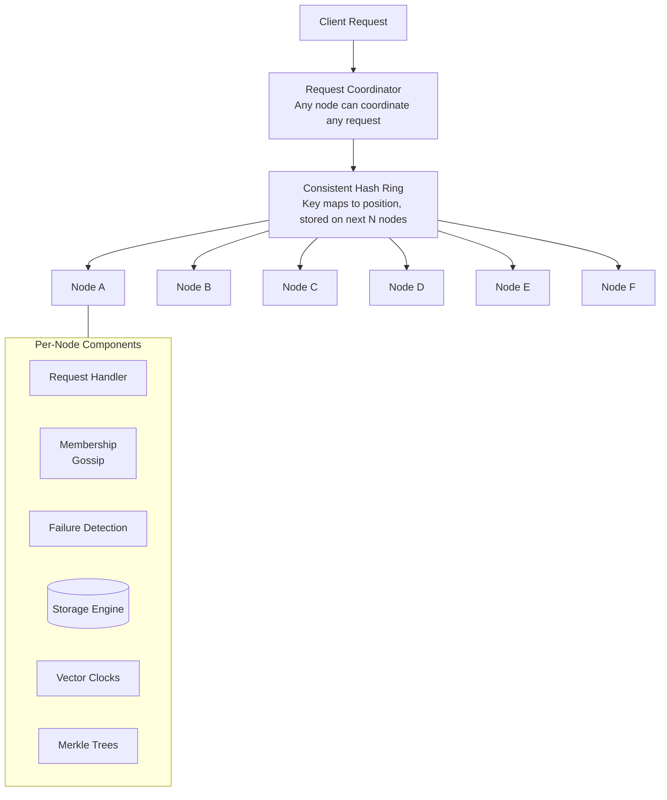

# Dynamo: Amazon's Highly Available Key-Value Store

> **注:** この記事は英語の原文を日本語に翻訳したものです。コードブロック、Mermaidダイアグラム、論文タイトル、システム名、技術用語は原文のまま保持しています。

## TL;DR

Dynamoは、特定の障害シナリオ下で一貫性を犠牲にする高可用性キーバリューストアです。パーティショニングに**Consistent Hashing**、競合検出に**Vector Clock**、チューナブルな一貫性のための**Quorum ベースのレプリケーション**、可用性のための**Sloppy Quorum**とHinted Handoff、レプリカ同期のための**Merkle Treeを用いたAnti-Entropy**を使用しています。Dynamoは、現在分散データベースで標準となっている多くの技術を先駆けました。

## 論文概要

**著者:** Giuseppe DeCandia他 (Amazon)
**発表:** SOSP 2007
**背景:** Amazonのショッピングカートおよびセッションストレージ向けに設計

---

## 課題

Amazonのeコマースプラットフォームには以下が求められました：
- **常に書き込み可能** - ショッピングカートは障害時でも書き込みを受け入れる必要があります
- **低レイテンシ** - 99.9パーセンタイルの応答時間が重要です（テールレイテンシ）
- **高可用性** - 障害 = 売上損失
- **スケーラブル** - ホリデーシーズンのトラフィックスパイクに対応

従来のRDBMSではこれらの要件を満たせませんでした：
- シングルマスターの書き込みが可用性を制限
- 強い一貫性がレイテンシを増加
- 垂直スケーリングには限界がある

---

## 設計哲学

```
┌─────────────────────────────────────────────────────────────────────────┐
│                    Dynamo Design Principles                              │
│                                                                          │
│   ┌──────────────────────────────────────────────────────────────────┐  │
│   │                     CAP Theorem Choice                            │  │
│   │                                                                   │  │
│   │   Consistency ──────────────── Availability                      │  │
│   │                      │                                           │  │
│   │                      │                                           │  │
│   │                      ▼                                           │  │
│   │               Partition Tolerance                                │  │
│   │                                                                   │  │
│   │   Dynamo chooses: AP (Availability + Partition Tolerance)        │  │
│   │   Consistency is eventual, conflicts resolved at read time       │  │
│   └──────────────────────────────────────────────────────────────────┘  │
│                                                                          │
│   主要な設計判断:                                                       │
│   1. インクリメンタルなスケーラビリティ（シームレスなノード追加）       │
│   2. 対称性（特別なノードなし）                                        │
│   3. 分散化（単一障害点なし）                                          │
│   4. 異種性（混在ハードウェアの対応）                                  │
└─────────────────────────────────────────────────────────────────────────┘
```

---

## システムアーキテクチャ



---

## Virtual Nodeを用いたConsistent Hashing

```
┌─────────────────────────────────────────────────────────────────────────┐
│                    Consistent Hashing                                    │
│                                                                          │
│   基本的なConsistent Hashingの問題:                                     │
│   - 不均一な分散（ランダムな位置）                                     │
│   - ノードの追加/削除時にデータの移動が多すぎる                        │
│                                                                          │
│   解決策: Virtual Node                                                  │
│   ┌──────────────────────────────────────────────────────────────────┐  │
│   │                                                                   │  │
│   │   Physical Node A → Virtual Nodes: A1, A2, A3, A4, ...          │  │
│   │   Physical Node B → Virtual Nodes: B1, B2, B3, B4, ...          │  │
│   │                                                                   │  │
│   │           A1                                                      │  │
│   │            ●                                                      │  │
│   │        ╱       ╲                                                 │  │
│   │      B2 ●         ● A3                                           │  │
│   │     ╱               ╲                                            │  │
│   │   ●                   ●                                          │  │
│   │  B1                   A2                                         │  │
│   │     ╲               ╱                                            │  │
│   │      A4 ●         ● B4                                           │  │
│   │        ╲       ╱                                                 │  │
│   │            ●                                                      │  │
│   │           B3                                                      │  │
│   │                                                                   │  │
│   │   利点:                                                           │  │
│   │   - 均一な分散（多くの位置で平均化）                              │  │
│   │   - 異種性（高性能マシンにより多くのVirtual Node）               │  │
│   │   - より滑らかなリバランシング（Virtual Nodeを段階的に削除）     │  │
│   └──────────────────────────────────────────────────────────────────┘  │
└─────────────────────────────────────────────────────────────────────────┘
```

### 実装

```python
from dataclasses import dataclass
from typing import Dict, List, Optional, Set
import hashlib
import bisect

@dataclass
class VirtualNode:
    physical_node: str
    token: int  # Position on ring

class ConsistentHashRing:
    """
    Consistent hash ring with virtual nodes.
    """

    def __init__(self, replication_factor: int = 3):
        self.replication_factor = replication_factor
        self.ring: List[VirtualNode] = []  # Sorted by token
        self.tokens: List[int] = []  # Just tokens, for binary search
        self.nodes: Dict[str, int] = {}  # node -> num_vnodes

    def add_node(self, node: str, num_vnodes: int = 150):
        """Add physical node with virtual nodes"""
        self.nodes[node] = num_vnodes

        for i in range(num_vnodes):
            # Hash node name + vnode index to get position
            token = self._hash(f"{node}:{i}")
            vnode = VirtualNode(physical_node=node, token=token)

            # Insert in sorted order
            pos = bisect.bisect_left(self.tokens, token)
            self.ring.insert(pos, vnode)
            self.tokens.insert(pos, token)

    def remove_node(self, node: str):
        """Remove physical node and all its virtual nodes"""
        if node not in self.nodes:
            return

        # Remove all vnodes for this physical node
        self.ring = [vn for vn in self.ring if vn.physical_node != node]
        self.tokens = [vn.token for vn in self.ring]
        del self.nodes[node]

    def get_preference_list(self, key: str) -> List[str]:
        """
        Get preference list for a key.
        Returns N distinct physical nodes responsible for key.
        """
        if not self.ring:
            return []

        token = self._hash(key)

        # Find first position >= key's token
        pos = bisect.bisect_left(self.tokens, token)
        if pos >= len(self.ring):
            pos = 0

        # Walk ring clockwise until we have N distinct physical nodes
        preference_list = []
        seen_nodes: Set[str] = set()

        for i in range(len(self.ring)):
            idx = (pos + i) % len(self.ring)
            physical_node = self.ring[idx].physical_node

            if physical_node not in seen_nodes:
                preference_list.append(physical_node)
                seen_nodes.add(physical_node)

                if len(preference_list) >= self.replication_factor:
                    break

        return preference_list

    def get_coordinator(self, key: str) -> str:
        """Get the coordinator node for a key (first in preference list)"""
        return self.get_preference_list(key)[0]

    def _hash(self, key: str) -> int:
        """Hash key to ring position"""
        return int(hashlib.md5(key.encode()).hexdigest(), 16)
```

---

## Vector Clock

```
┌─────────────────────────────────────────────────────────────────────────┐
│                    Vector Clocks for Conflict Detection                  │
│                                                                          │
│   問題: 異なるノードで同じキーへの並行書き込み                         │
│   解決策: Vector Clockで因果関係を追跡                                  │
│                                                                          │
│   ┌──────────────────────────────────────────────────────────────────┐  │
│   │   例: ショッピングカートの更新                                    │  │
│   │                                                                   │  │
│   │   初期状態:  cart = [], clock = []                                │  │
│   │                                                                   │  │
│   │   クライアント1がNode Aで:                                       │  │
│   │     商品Xを追加 → cart = [X], clock = [(A,1)]                    │  │
│   │                                                                   │  │
│   │   クライアント2がAから読み取り、Node Bに書き込み:                │  │
│   │     商品Yを追加 → cart = [X,Y], clock = [(A,1), (B,1)]           │  │
│   │                                                                   │  │
│   │   クライアント3がAから読み取り（Bの書き込み前）、Node Cに書き込み:│  │
│   │     商品Zを追加 → cart = [X,Z], clock = [(A,1), (C,1)]           │  │
│   │                                                                   │  │
│   │   競合を検出! どちらのClockも支配しない:                          │  │
│   │     [(A,1), (B,1)] vs [(A,1), (C,1)]                            │  │
│   │                                                                   │  │
│   │   解決: 両方のバージョンをクライアントに返す                      │  │
│   │     クライアントがマージ: cart = [X,Y,Z], clock = [(A,1), (B,1), (C,1)]│  │
│   └──────────────────────────────────────────────────────────────────┘  │
│                                                                          │
│   Clock比較ルール:                                                      │
│   - Clock AがBを支配する条件: all(A[i] >= B[i]) かつ any(A[i] > B[i]) │
│   - どちらも支配しない → 並行 → 競合                                   │
└─────────────────────────────────────────────────────────────────────────┘
```

### 実装

```python
from dataclasses import dataclass, field
from typing import Dict, List, Tuple, Optional
import copy

@dataclass
class VectorClock:
    """
    Vector clock for tracking causality.
    Maps node_id -> logical timestamp
    """
    clock: Dict[str, int] = field(default_factory=dict)

    def increment(self, node_id: str):
        """Increment clock for a node (on write)"""
        self.clock[node_id] = self.clock.get(node_id, 0) + 1

    def merge(self, other: 'VectorClock') -> 'VectorClock':
        """Merge two clocks (take max of each component)"""
        merged = VectorClock()
        all_nodes = set(self.clock.keys()) | set(other.clock.keys())

        for node in all_nodes:
            merged.clock[node] = max(
                self.clock.get(node, 0),
                other.clock.get(node, 0)
            )

        return merged

    def dominates(self, other: 'VectorClock') -> bool:
        """Check if this clock causally dominates other"""
        dominated = False

        for node in set(self.clock.keys()) | set(other.clock.keys()):
            self_val = self.clock.get(node, 0)
            other_val = other.clock.get(node, 0)

            if self_val < other_val:
                return False  # Other has something we don't
            if self_val > other_val:
                dominated = True

        return dominated

    def concurrent_with(self, other: 'VectorClock') -> bool:
        """Check if clocks are concurrent (neither dominates)"""
        return not self.dominates(other) and not other.dominates(self)

    def copy(self) -> 'VectorClock':
        return VectorClock(clock=copy.copy(self.clock))

@dataclass
class VersionedValue:
    """Value with its vector clock"""
    value: any
    clock: VectorClock
    timestamp: float  # Wall clock for display/pruning

class DynamoStore:
    """
    Key-value store with vector clock versioning.
    """

    def __init__(self, node_id: str):
        self.node_id = node_id
        self.data: Dict[str, List[VersionedValue]] = {}

    def get(self, key: str) -> List[VersionedValue]:
        """
        Get all versions of a key.
        Returns list because there may be conflicts.
        """
        return self.data.get(key, [])

    def put(
        self,
        key: str,
        value: any,
        context: Optional[VectorClock] = None
    ) -> VectorClock:
        """
        Put a value with optional context (from previous get).
        Returns new vector clock.
        """
        if context:
            new_clock = context.copy()
        else:
            new_clock = VectorClock()

        new_clock.increment(self.node_id)

        new_version = VersionedValue(
            value=value,
            clock=new_clock,
            timestamp=time.time()
        )

        existing = self.data.get(key, [])

        # Remove versions dominated by new version
        surviving = [
            v for v in existing
            if not new_clock.dominates(v.clock)
        ]

        # Add new version
        surviving.append(new_version)

        self.data[key] = surviving

        return new_clock

    def reconcile(
        self,
        key: str,
        remote_versions: List[VersionedValue]
    ):
        """
        Reconcile local versions with remote versions.
        Used during read repair and anti-entropy.
        """
        local = self.data.get(key, [])
        all_versions = local + remote_versions

        # Keep only versions not dominated by any other
        surviving = []

        for v in all_versions:
            dominated = any(
                other.clock.dominates(v.clock)
                for other in all_versions
                if other is not v
            )
            if not dominated:
                # Check for duplicates (same clock)
                is_dup = any(
                    s.clock.clock == v.clock.clock
                    for s in surviving
                )
                if not is_dup:
                    surviving.append(v)

        self.data[key] = surviving
```

---

## Quorumシステム

```
┌─────────────────────────────────────────────────────────────────────────┐
│                    Quorum-Based Replication                              │
│                                                                          │
│   N = レプリカ数                                                        │
│   R = Read Quorum（読み取りノード数）                                   │
│   W = Write Quorum（書き込みノード数）                                  │
│                                                                          │
│   ┌──────────────────────────────────────────────────────────────────┐  │
│   │   一貫性の保証:                                                   │  │
│   │                                                                   │  │
│   │   R + W > N  →  強い一貫性（読み取りが最新の書き込みを確認）     │  │
│   │                                                                   │  │
│   │   例: N=3, R=2, W=2                                              │  │
│   │   - 応答前に2ノードに書き込み                                    │  │
│   │   - 2ノードから読み取り                                          │  │
│   │   - 少なくとも1ノードが最新値を保持（オーバーラップ保証）       │  │
│   └──────────────────────────────────────────────────────────────────┘  │
│                                                                          │
│   ┌──────────────────────────────────────────────────────────────────┐  │
│   │   一般的な構成:                                                   │  │
│   │                                                                   │  │
│   │   (N=3, R=1, W=3): 高速読み取り、低速書き込み、強い一貫性       │  │
│   │   (N=3, R=3, W=1): 低速読み取り、高速書き込み、古いデータのリスク│  │
│   │   (N=3, R=2, W=2): バランス型（Dynamoデフォルト）               │  │
│   │   (N=3, R=1, W=1): 高速だが弱い一貫性                           │  │
│   └──────────────────────────────────────────────────────────────────┘  │
│                                                                          │
│   ┌──────────────────────────────────────────────────────────────────┐  │
│   │   書き込み操作 (W=2, N=3):                                       │  │
│   │                                                                   │  │
│   │   Coordinator ────┬───▶ Replica A ✓                              │  │
│   │                   ├───▶ Replica B ✓   → 成功 (2 acks)           │  │
│   │                   └───▶ Replica C (非同期、失敗の可能性あり)     │  │
│   └──────────────────────────────────────────────────────────────────┘  │
└─────────────────────────────────────────────────────────────────────────┘
```

### 実装

```python
from dataclasses import dataclass
from typing import List, Optional, Tuple
import asyncio

@dataclass
class QuorumConfig:
    n: int = 3  # Replication factor
    r: int = 2  # Read quorum
    w: int = 2  # Write quorum

class DynamoCoordinator:
    """
    Coordinates read/write operations with quorum.
    """

    def __init__(
        self,
        node_id: str,
        ring: ConsistentHashRing,
        quorum: QuorumConfig
    ):
        self.node_id = node_id
        self.ring = ring
        self.quorum = quorum
        self.local_store = DynamoStore(node_id)

    async def get(self, key: str) -> Tuple[any, VectorClock]:
        """
        Read with quorum.
        Returns merged value and context for subsequent writes.
        """
        preference_list = self.ring.get_preference_list(key)

        # Send read requests to N nodes
        tasks = []
        for node in preference_list[:self.quorum.n]:
            task = self._read_from_node(node, key)
            tasks.append(task)

        # Wait for R responses
        responses = []
        for coro in asyncio.as_completed(tasks):
            try:
                result = await coro
                if result:
                    responses.append(result)

                if len(responses) >= self.quorum.r:
                    break
            except Exception:
                continue

        if len(responses) < self.quorum.r:
            raise InsufficientReplicasError("Could not reach read quorum")

        # Merge all versions
        all_versions = []
        for versions in responses:
            all_versions.extend(versions)

        # Reconcile (keep non-dominated versions)
        reconciled = self._reconcile_versions(all_versions)

        # Read repair: update stale replicas asynchronously
        asyncio.create_task(
            self._read_repair(key, reconciled, preference_list)
        )

        if len(reconciled) == 1:
            return reconciled[0].value, reconciled[0].clock
        else:
            # Multiple versions - return all for client to resolve
            return [v.value for v in reconciled], self._merge_clocks(reconciled)

    async def put(
        self,
        key: str,
        value: any,
        context: Optional[VectorClock] = None
    ) -> bool:
        """
        Write with quorum.
        Context should be from a previous get (for conflict handling).
        """
        preference_list = self.ring.get_preference_list(key)

        # Prepare versioned value
        if context:
            new_clock = context.copy()
        else:
            new_clock = VectorClock()
        new_clock.increment(self.node_id)

        versioned = VersionedValue(
            value=value,
            clock=new_clock,
            timestamp=time.time()
        )

        # Send write requests to N nodes
        tasks = []
        for node in preference_list[:self.quorum.n]:
            task = self._write_to_node(node, key, versioned)
            tasks.append(task)

        # Wait for W acknowledgments
        acks = 0
        for coro in asyncio.as_completed(tasks):
            try:
                await coro
                acks += 1

                if acks >= self.quorum.w:
                    return True
            except Exception:
                continue

        if acks < self.quorum.w:
            raise InsufficientReplicasError("Could not reach write quorum")

        return True

    def _reconcile_versions(
        self,
        versions: List[VersionedValue]
    ) -> List[VersionedValue]:
        """Keep only versions not dominated by others"""
        surviving = []

        for v in versions:
            dominated = any(
                other.clock.dominates(v.clock)
                for other in versions
                if other is not v
            )
            if not dominated:
                # Deduplicate by clock
                is_dup = any(
                    s.clock.clock == v.clock.clock
                    for s in surviving
                )
                if not is_dup:
                    surviving.append(v)

        return surviving

    def _merge_clocks(
        self,
        versions: List[VersionedValue]
    ) -> VectorClock:
        """Merge clocks from multiple versions"""
        merged = VectorClock()
        for v in versions:
            merged = merged.merge(v.clock)
        return merged

    async def _read_repair(
        self,
        key: str,
        reconciled: List[VersionedValue],
        preference_list: List[str]
    ):
        """Update stale replicas with reconciled versions"""
        for node in preference_list[:self.quorum.n]:
            try:
                await self._write_to_node(node, key, reconciled[0])
            except Exception:
                pass  # Best effort
```

---

## Sloppy QuorumとHinted Handoff

```
┌─────────────────────────────────────────────────────────────────────────┐
│                    Sloppy Quorum for High Availability                   │
│                                                                          │
│   問題: Preference List内のいずれかのNノードがダウンすると              │
│         Strict Quorumが失敗する                                         │
│                                                                          │
│   解決策: Hinted Handoffを伴うSloppy Quorum                            │
│   ┌──────────────────────────────────────────────────────────────────┐  │
│   │                                                                   │  │
│   │   キーKのPreference List: [A, B, C]                              │  │
│   │   ノードAがダウン                                                │  │
│   │                                                                   │  │
│   │   Strict Quorum: W=2でAがダウンすると書き込み失敗               │  │
│   │                                                                   │  │
│   │   Sloppy Quorum:                                                 │  │
│   │   - リングをさらに歩く                                           │  │
│   │   - 次の正常なノード（D）を見つける                              │  │
│   │   - B, C, Dに書き込み（DはAへの「ヒント」を保持）               │  │
│   │   - Aが復旧したら、DがAにヒントを送信                           │  │
│   │   - Dはヒントデータを削除                                        │  │
│   │                                                                   │  │
│   │                 Ring                                              │  │
│   │            A (down)                                               │  │
│   │              ●                                                    │  │
│   │          ╱       ╲                                               │  │
│   │        B ●         ● C       Kのデータは B, C, D に書き込み     │  │
│   │       ╱               ╲      Dはヒント保持:「これはAのもの」    │  │
│   │     D ●─────────────────● E                                      │  │
│   │                                                                   │  │
│   └──────────────────────────────────────────────────────────────────┘  │
│                                                                          │
│   トレードオフ:                                                         │
│   - 可用性の向上（障害時でも書き込みが成功）                           │
│   - 耐久性保証の弱体化（データが「間違った」ノードに存在）            │
│   - 結果整合性（ヒント配信は非同期）                                   │
└─────────────────────────────────────────────────────────────────────────┘
```

### 実装

```python
@dataclass
class HintedValue:
    """Value stored as hint for another node"""
    target_node: str
    key: str
    value: VersionedValue
    created_at: float

class HintedHandoffManager:
    """
    Manages hinted handoff for temporarily failed nodes.
    """

    def __init__(self, node_id: str, max_hints_per_node: int = 10000):
        self.node_id = node_id
        self.hints: Dict[str, List[HintedValue]] = {}  # target_node -> hints
        self.max_hints = max_hints_per_node

    def store_hint(
        self,
        target_node: str,
        key: str,
        value: VersionedValue
    ):
        """Store a hint for a failed node"""
        if target_node not in self.hints:
            self.hints[target_node] = []

        hint = HintedValue(
            target_node=target_node,
            key=key,
            value=value,
            created_at=time.time()
        )

        self.hints[target_node].append(hint)

        # Limit hints per node
        if len(self.hints[target_node]) > self.max_hints:
            self.hints[target_node] = self.hints[target_node][-self.max_hints:]

    async def deliver_hints(self, target_node: str):
        """Deliver stored hints when node recovers"""
        hints = self.hints.pop(target_node, [])

        for hint in hints:
            try:
                await self._send_hint(target_node, hint)
            except Exception:
                # Re-queue failed hints
                self.store_hint(target_node, hint.key, hint.value)

    async def run_hint_delivery(self, node_monitor):
        """Background task to deliver hints to recovered nodes"""
        while True:
            for target_node in list(self.hints.keys()):
                if await node_monitor.is_alive(target_node):
                    await self.deliver_hints(target_node)

            await asyncio.sleep(10)  # Check every 10 seconds
```

---

## Merkle Treeを用いたAnti-Entropy

```
┌─────────────────────────────────────────────────────────────────────────┐
│                    Merkle Trees for Replica Sync                         │
│                                                                          │
│   問題: レプリカ間の差分を効率的に見つけるには？                       │
│   素朴な方法: すべてのキーを比較 → O(n)のデータ転送                   │
│   賢い方法: Merkle Tree → O(log n)で差分を検出                         │
│                                                                          │
│   ┌──────────────────────────────────────────────────────────────────┐  │
│   │                     Merkle Tree構造                               │  │
│   │                                                                   │  │
│   │                        Root Hash                                  │  │
│   │                           │                                       │  │
│   │              ┌────────────┴────────────┐                         │  │
│   │              │                         │                         │  │
│   │         Hash(L)                    Hash(R)                       │  │
│   │           │                           │                          │  │
│   │      ┌────┴────┐                ┌─────┴─────┐                   │  │
│   │      │         │                │           │                   │  │
│   │   Hash(LL)  Hash(LR)        Hash(RL)    Hash(RR)               │  │
│   │      │         │                │           │                   │  │
│   │   [keys     [keys            [keys       [keys                  │  │
│   │    0-99]    100-199]         200-299]    300-399]               │  │
│   │                                                                   │  │
│   └──────────────────────────────────────────────────────────────────┘  │
│                                                                          │
│   同期プロセス:                                                         │
│   ┌──────────────────────────────────────────────────────────────────┐  │
│   │   1. ルートハッシュを比較                                        │  │
│   │      - 等しい場合: レプリカは同一、終了                         │  │
│   │      - 異なる場合: 下位へ降下                                   │  │
│   │                                                                   │  │
│   │   2. 子ノードのハッシュを比較                                    │  │
│   │      - 異なるハッシュのサブツリーのみ降下                       │  │
│   │                                                                   │  │
│   │   3. リーフで: 異なるキーを交換                                  │  │
│   │                                                                   │  │
│   │   結果: O(log n)のハッシュ比較 + 差分のみ転送                   │  │
│   └──────────────────────────────────────────────────────────────────┘  │
└─────────────────────────────────────────────────────────────────────────┘
```

### 実装

```python
import hashlib
from typing import Dict, List, Optional, Tuple

class MerkleTree:
    """
    Merkle tree for efficient replica comparison.
    Each node in tree covers a range of the key space.
    """

    def __init__(self, depth: int = 10):
        self.depth = depth
        self.num_leaves = 2 ** depth
        # Tree stored as array: index 1 = root, 2*i = left child, 2*i+1 = right
        self.tree: List[Optional[bytes]] = [None] * (2 * self.num_leaves)
        self.dirty_leaves: set = set()

    def update(self, key: str, value_hash: bytes):
        """Update tree with a key's value hash"""
        leaf_idx = self._key_to_leaf(key)
        tree_idx = self.num_leaves + leaf_idx

        # Update leaf
        self.tree[tree_idx] = self._combine_hash(
            self.tree[tree_idx] or b'',
            value_hash
        )
        self.dirty_leaves.add(leaf_idx)

    def rebuild(self):
        """Rebuild internal nodes from dirty leaves upward"""
        # Find all ancestors of dirty leaves
        dirty_nodes = set()
        for leaf_idx in self.dirty_leaves:
            idx = self.num_leaves + leaf_idx
            while idx > 1:
                idx //= 2
                dirty_nodes.add(idx)

        # Rebuild from bottom up
        for idx in sorted(dirty_nodes, reverse=True):
            left = self.tree[2 * idx] or b''
            right = self.tree[2 * idx + 1] or b''
            self.tree[idx] = self._combine_hash(left, right)

        self.dirty_leaves.clear()

    def get_root_hash(self) -> bytes:
        """Get root hash of tree"""
        return self.tree[1] or b''

    def get_node_hash(self, level: int, index: int) -> bytes:
        """Get hash of node at given level and index"""
        tree_idx = (2 ** level) + index
        return self.tree[tree_idx] or b''

    def find_differences(
        self,
        other: 'MerkleTree'
    ) -> List[Tuple[int, int]]:
        """
        Find leaf ranges with differences.
        Returns list of (start_leaf, end_leaf) ranges.
        """
        differences = []
        self._find_diff_recursive(other, 1, differences)
        return differences

    def _find_diff_recursive(
        self,
        other: 'MerkleTree',
        idx: int,
        differences: List[Tuple[int, int]]
    ):
        """Recursively find differing subtrees"""
        if self.tree[idx] == other.tree[idx]:
            return  # Subtree identical

        if idx >= self.num_leaves:
            # Leaf node - this is a difference
            leaf_idx = idx - self.num_leaves
            differences.append((leaf_idx, leaf_idx + 1))
        else:
            # Internal node - check children
            self._find_diff_recursive(other, 2 * idx, differences)
            self._find_diff_recursive(other, 2 * idx + 1, differences)

    def _key_to_leaf(self, key: str) -> int:
        """Map key to leaf index"""
        key_hash = int(hashlib.md5(key.encode()).hexdigest(), 16)
        return key_hash % self.num_leaves

    def _combine_hash(self, left: bytes, right: bytes) -> bytes:
        """Combine two hashes"""
        return hashlib.sha256(left + right).digest()

class AntiEntropyService:
    """
    Background service for replica synchronization.
    """

    def __init__(self, store: DynamoStore, ring: ConsistentHashRing):
        self.store = store
        self.ring = ring
        self.merkle_trees: Dict[str, MerkleTree] = {}  # key_range -> tree

    async def sync_with_replica(self, replica_node: str, key_range: str):
        """Synchronize key range with another replica"""
        local_tree = self.merkle_trees.get(key_range)
        if not local_tree:
            return

        # Get remote tree
        remote_tree = await self._fetch_merkle_tree(replica_node, key_range)

        # Find differences
        diff_ranges = local_tree.find_differences(remote_tree)

        # Exchange differing keys
        for start_leaf, end_leaf in diff_ranges:
            local_keys = self._get_keys_in_range(key_range, start_leaf, end_leaf)
            remote_keys = await self._fetch_keys_in_range(
                replica_node, key_range, start_leaf, end_leaf
            )

            # Exchange data
            for key, versions in remote_keys.items():
                self.store.reconcile(key, versions)

            for key in local_keys:
                versions = self.store.get(key)
                await self._send_versions(replica_node, key, versions)

    async def run(self):
        """Background anti-entropy loop"""
        while True:
            # Pick random key range and replica to sync
            key_range = self._pick_random_range()
            replica = self._pick_random_replica(key_range)

            try:
                await self.sync_with_replica(replica, key_range)
            except Exception:
                pass  # Best effort

            await asyncio.sleep(60)  # Sync every minute
```

---

## Gossipベースの障害検出

```
┌─────────────────────────────────────────────────────────────────────────┐
│                    Gossip-Based Failure Detection                        │
│                                                                          │
│   各ノードが保持する情報:                                               │
│   - 全ノードのリストとそのHeartbeatカウンター                          │
│   - 最後にHeartbeatを受信したタイムスタンプ                            │
│                                                                          │
│   ┌──────────────────────────────────────────────────────────────────┐  │
│   │   Gossipプロトコル:                                               │  │
│   │                                                                   │  │
│   │   T秒ごとに:                                                     │  │
│   │   1. 自分のHeartbeatカウンターをインクリメント                   │  │
│   │   2. ランダムなノードを選択                                      │  │
│   │   3. メンバーシップリストを送信                                   │  │
│   │   4. 受信したリストをマージ（最大Heartbeatを採用）               │  │
│   │                                                                   │  │
│   │   T_fail秒間Heartbeatが増加しない場合:                           │  │
│   │   - ノードを疑わしいとマーク                                     │  │
│   │                                                                   │  │
│   │   T_cleanup秒間疑わしい状態が続く場合:                           │  │
│   │   - ノードを障害とマーク                                         │  │
│   │                                                                   │  │
│   └──────────────────────────────────────────────────────────────────┘  │
│                                                                          │
│   特性:                                                                 │
│   - 分散型（中央の監視ノードなし）                                     │
│   - 結果整合性のあるメンバーシップビュー                               │
│   - O(log N)の収束時間                                                  │
│   - ネットワーク分断に対してロバスト                                   │
└─────────────────────────────────────────────────────────────────────────┘
```

---

## 論文からの主要結果

### パフォーマンス

| メトリクス | 99.9パーセンタイル |
|--------|-------------------|
| 読み取りレイテンシ | 10ms |
| 書き込みレイテンシ | 10ms |
| 成功率 | 99.94% |

### 耐久性

- データは複数のデータセンターにレプリケーションされています
- Vector Clockにより更新の損失がありません
- Anti-Entropyがあらゆる乖離を検出します

---

## 影響とレガシー

### 直接的な後継システム

- **Apache Cassandra** - Dynamoに触発されたオープンソースデータベース
- **Riak** - Dynamoの商用実装
- **Voldemort** - LinkedInのキーバリューストア

### 広く採用されたコンセプト

- Consistent Hashing（ほぼすべての分散システムで使用）
- Vector Clock（Conflict-freeデータ型、CRDT）
- Quorumベースのレプリケーション
- Gossipプロトコル
- Sloppy QuorumとHinted Handoff

---

## 主な学び

1. **一貫性よりも可用性** - ショッピングカートでは、書き込みを受け入れることが完全な一貫性よりも重要です。

2. **読み取り時の競合解決** - 書き込みをブロックせず、クライアントに競合を解決させます。

3. **均一な分散のためのVirtual Node** - ノードごとに複数のポジションを持つことでConsistent Hashingの不均衡を解決します。

4. **Vector Clockで因果関係を追跡** - ブロックなしで並行書き込みを検出します。

5. **チューナブルな一貫性** - N、R、Wパラメータによりアプリケーションがトレードオフを選択できます。

6. **Sloppy Quorumで可用性を維持** - 任意のN個の正常なノードに書き込み、後でハンドオフします。

7. **効率的な同期のためのMerkle Tree** - データではなくツリーを比較して差分を検出します。

8. **分散型メンバーシップのためのGossip** - クラスタ状態に単一障害点がありません。
