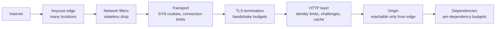

# DDoS防御アーキテクチャ

> **翻訳の状態:** 現行の[英語版](../../10-security/09-ddos-defense.md)からの翻訳です。

## TL;DR

分散サービス妨害攻撃は、制御を破るのではない。防御側が供給できるより速く、資源を使い果たす。その資源は、回線の帯域かもしれないし、コネクションテーブルのエントリ、TLSハンドシェイクのためのCPU、あるいは1つの高価なエンドポイントの裏にあるデータベースの時間かもしれない。したがって防御は、検知の問題である前に、容量と配置の問題である。**各層は、攻撃者が送るために費やしたより少ない自層の資源で敵対的な仕事を捨てなければならず、しかもその仕事がより高くつく層へ届く前に捨てなければならない。**

この原則から標準的なアーキテクチャが導かれる。ボリューム型のフラッドは、どの単一拠点よりはるかに大きな帯域を持つ、分散したエニーキャストのエッジで吸収する。トランスポート層の状態枯渇は、検証されていない相手のために状態を割り当てないことで退ける。アプリケーション層のフラッドには、アイデンティティに基づく制限、コストを考慮したアドミッション、チャレンジで対処する。個々のリクエストはどれも正当だからである。オリジンにはエッジ経由でしか到達できないようにする。そうでなければ、この仕組み全体が迂回される。リミッタのアルゴリズムと分散予算は[レート制限](../06-scaling/05-rate-limiting.md)、認証済みクライアントによる濫用は[APIの脅威境界と濫用耐性](./04-api-security.md)が扱う。本章の主題は、枯渇を目的とするトラフィックを生き延びることである。

## 一次資料と適用範囲

| 資料 | 示していること | 限界 |
|---|---|---|
| RFC 2827 (BCP 38) | ネットワークの端での入力フィルタリングは、リフレクション攻撃の前提条件である送信元アドレスの詐称を防ぐ | 運用者が導入している場所でしか効かない |
| RFC 4987 | SYNフラッドの仕組みと、SYNキャッシュやSYNクッキーを含む緩和策 | TCPに限る |
| Rossow, Amplification Hell (NDSS 2014) | 増幅に使えるUDPベースのプロトコル14種。帯域増幅率は最大4,670 | 当時配備されていたプロトコルの調査 |
| GitHubのインシデントレポート (2018) | memcachedのリフレクション攻撃。ピークは1.35 Tbps、毎秒1億2690万パケット。トラフィックをスクラビング事業者へ迂回させて緩和した | 1件のインシデント |
| Antonakakis et al., Mirai (USENIX Security 2017) | ピーク時に約60万台の感染機器を持ったIoTボットネットと、その攻撃の履歴 | 1つのボットネットの系統 |
| CloudflareとGoogleによるHTTP/2 Rapid Resetの報告 (2023) | ストリームを安く取り消せるプロトコル機能を使った、毎秒2億100万および3億9800万リクエストのフラッド | 1つの脆弱性についてのベンダー報告のピーク値 |
| RFC 9000 | QUICは、未検証のアドレスに対してサーバが送れる量を、受信したバイト数の3倍に制限する | このプロトコルの増幅対策の規則 |

以下のサイジング例は例示である。

## 枯渇させる資源による攻撃の分類

攻撃は、何を消費するかで分類する。それが、どこで止めなければならないかを決めるからだ。

| 分類 | 枯渇する資源 | 典型的な形 | 止めるべき場所 |
|---|---|---|---|
| ボリューム型 | 回線とトランジットの帯域、パケット転送能力 | UDPでのリフレクションと増幅、ボットネットからの直接フラッド | サイトの上流、多数の拠点にまたがって |
| プロトコル型、状態型 | コネクションテーブル、ハーフオープンのキュー、ロードバランサやファイアウォールの状態 | SYNフラッド、フラグメントフラッド、コネクション枯渇 | 状態を割り当てるはずの最初の機器 |
| アプリケーション型 | CPU、メモリ、ワーカープール、データベースや下流の容量 | HTTPリクエストフラッド、低速リクエスト、高価なクエリ、ストリームの高速リセットのようなプロトコルの濫用 | リクエストの主体を特定し、コストを付けられる最初の層 |

2つの性質がこれらの分類を分ける。ボリューム型の攻撃は、ほとんどが**詐称されたステートレスなもの**なので、セッションを理解しなくてもパケットの性質でフィルタできる。アプリケーション型の攻撃は**詐称がなく、形式も正しい**。すべてのリクエストがハンドシェイクを完了し、検証を通過する。これを捨てるには、どのクライアントを信じるかを決める必要がある。

### 増幅が成立する理由

リフレクションには2つのものが要る。攻撃者が被害者の送信元アドレスを付けたパケットを送れるネットワークと、小さなリクエストに大きな応答を返す公開サービスである。攻撃者のコストはリクエストで、被害者が受け取るのは応答である。

**文書化済み、Rossow:** この研究は14のプロトコルについて帯域増幅率を測定し、最大は4,670だった。**文書化済み、GitHub:** 2018年の攻撃は公開されたmemcachedサーバを使った。レポートは、その増幅率を最大51,000倍と述べている。100 Mbpsの詐称トラフィックと増幅率500の増幅器を持つ攻撃者は50 Gbpsを届けられる。これは、ほとんどの単一拠点が契約している帯域を超える。

ネットワークの端での送信元アドレスフィルタリングは、この前提条件を取り除く。それが現行の最良実践として公表されている理由である。ただし防御側は、ほかのネットワークがそれを導入していることを当てにできない。

## 多層の防御経路



各段階は、次の段階よりも、捨てる単位あたりのコストが安い。ステートレスなフィルタが落とすパケットのコストはナノ秒である。SYNクッキーが拒否するコネクションはハッシュ1回で済む。TLSのあとで拒否するリクエストは、すでにハンドシェイク1回ぶんを費やしている。アプリケーションが拒否するリクエストは、ワーカー、構文解析、場合によってはデータベースのクエリを費やしている。設計の目標は、可能な限り早い段階に捨てさせることである。

## エッジでボリュームを吸収する

帯域の攻撃に勝つには、攻撃者が集中できるより多くの場所に、攻撃者より大きな容量を持つことである。

**エニーキャスト**は同じアドレスプレフィックスを多数の拠点から広告する。経路制御は各パケットを近くの拠点へ届ける。世界中のマシンから来る攻撃は、正当なトラフィックと同じ境界に沿って拠点間に分割され、どの拠点も総量を受け取らない。このアーキテクチャは[CDNアーキテクチャ](../06-scaling/04-cdn-architecture.md)と[Cloudflareのシステム設計](../08-case-studies/12-cloudflare.md)で述べている。

運用モデルは3つある。

- **常時プロキシ。** すべてのトラフィックが事業者のエッジから入る。検知の遅れがなく、攻撃中の経路変更もない。事業者がすべてのリクエストの経路上にいることになり、それに伴うレイテンシと依存を負う。
- **オンデマンドの迂回。** 攻撃を受けたら経路を変更し、トラフィックをスクラビングセンターに通す。クリーンなトラフィックはトンネルで戻す。検知と経路収束のあいだ、サイトは攻撃にさらされる。**文書化済み、GitHub:** 2018年のレポートはまさにこの流れを述べており、迂回が効くまでの数分間、サイトは利用できなかった。
- **遠隔起動のブラックホール。** 上流のネットワークが、攻撃されたアドレス宛のトラフィックをすべて落とす。これは、そのアドレスについては攻撃者の目的を完遂させ、引き換えにネットワーク上のほかのすべてを救う。最後の手段であり、無関係なサービスを別のアドレスに置いておく理由でもある。

エッジでは、ステートレスなフィルタが、正当なクライアントが送るはずのないものを取り除く。TCPしか提供しないアドレスへのUDP、フラグメント、既知の増幅器の送信元ポート、サービスが話さないプロトコルのパケットなどである。運用者はこうした規則をネットワーク境界のルータへ配布し、トラフィックが内側へ運ばれる前に落とす。

## 状態を持つことを拒む

TCPサーバは従来、SYNを受け取るとレコードを割り当て、ハンドシェイクが完了するかタイムアウトするまで保持する。SYNフラッドは完了しないハンドシェイクを送り、このテーブルを埋めて、本物のコネクションを拒否させる。

**文書化済み、RFC 4987:** SYNクッキーはこの割り当てをなくす。サーバはコネクションのパラメータをSYN-ACKの初期シーケンス番号に符号化し、何も保持しない。本物のクライアントはその番号をACKで返し、サーバはそこから状態を復元する。詐称された送信元は応答しない。サーバが費やすのはハッシュ計算1回である。

同じ考え方は一般化でき、相手が未検証であるあらゆる場所に適用すべきである。

- **受け取った以上に送らない。** **文書化済み、RFC 9000:** クライアントのアドレスを検証する前、QUICサーバが送れるのは受信したバイト数の3倍までである。これは増幅器としての有用性に上限を与える。
- **まず戻りの経路を証明させる。** リトライトークンやクッキーは、サーバが資源を費やす前に、クライアントが主張するアドレスでパケットを受信できることを示させる。
- **中間機器は可能な限りステートレスに保つ。** サーバの前に置いたステートフルなファイアウォールやロードバランサは、それ自体が枯渇させられるコネクションテーブルである。転送経路でコネクションごとのメモリを持たず、パケットを一貫したハッシュでバックエンドへ振り分ける設計には、この故障モードがない。[ロードバランシング](../06-scaling/01-load-balancing.md)を参照。

ハンドシェイクのコストやカーネルのキューを含むトランスポートの詳細は、[ネットワークトランスポートの内部](../06-scaling/14-network-transport-internals.md)にある。

## アプリケーション層のフラッド

すべてのリクエストが正当なとき、フィルタリングはクライアントについての判断になる。攻撃者の優位は**コストの非対称性**にある。送るのにマイクロ秒しかかからないリクエストが、防御側ではデータベースのクエリ、テンプレートの描画、パスワードのハッシュ計算を要することがある。

**文書化済み、2023年のRapid Resetの報告:** 攻撃者はHTTP/2のストリームを開いてすぐに取り消した。取り消しはクライアントの並行枠を解放するが、サーバはすでに仕事を始めている。そのためプロトコルの同時ストリーム数の上限は、リクエストレートを制限しなかった。Cloudflareはピークで毎秒2億100万リクエスト、Googleは3億9800万リクエストを報告した。Cloudflareは、関与したボットネットが2万台程度だったと述べている。この教訓は一般化できる。クライアントにとっては始めるのも捨てるのも安いが、サーバにとってはそうでない操作は、どれも増幅器である。

防御の道具を、おおよそ適用する順に挙げる。

1. **キャッシュから返す。** キャッシュ済みの応答は、エッジにほとんどコストをかけない。だから攻撃者はキャッシュできないものを狙う。検索、ログイン、カート、キャッシュキーを無効にするクエリ文字列である。キャッシュキーを正規化し、際限のない変種を拒否する。
2. **アイデンティティで、複数の粒度で制限する。** アドレス単位、ネットワークプレフィックス単位、認証済みアカウント単位、APIキー単位、セッション単位、TLSやクライアントのフィンガープリント単位。2万台のボットネットが1台あたり毎秒50リクエストを送ると、合計は毎秒100万リクエストになるが、個々のアドレスは穏当に見える。アドレス単位の制限だけでは、これは見えない。
3. **リクエストを件数ではなくコストで値付けする。** 各エンドポイントにバックエンドのコストを反映した重みを与え、その単位で予算を消費させる。検索クエリ10件を、静的ファイルの取得10件と同じに扱うべきではない。
4. **確信が持てないときはチャレンジする。** 計算や対話を要するチャレンジは、攻撃者のリクエストあたりのコストを上げ、自動化されたクライアントをブラウザから分ける。正当な自動化やアクセシビリティも損なうので、疑いがある場合に限って選択的に適用する。
5. **コネクションの振る舞いに上限を設ける。** コネクションあたりのストリームの開始数とリセット数、ヘッダと本文の読み取り時間、リクエストサイズを制限する。振る舞いのおかしいコネクションは、リクエストを拒否するだけでなく閉じる。
6. **オリジンで優先度に従って落とす。** それでも負荷が容量を超えるなら、認証済みのセッションと進行中のセッションを先に処理し、残りはすばやく失敗させる。[バックプレッシャー](../06-scaling/07-backpressure.md)を参照。

## オリジンと依存先の保護

攻撃を吸収するエッジも、オリジンに直接到達できるなら価値がない。攻撃者は、過去のDNSレコード、証明書の透明性ログ、送信メールのヘッダ、設定を誤ったサブドメインからオリジンのアドレスを見つける。

- オリジンへのコネクションはエッジからのものだけを受け入れる。ネットワークの許可リストと、相互TLSまたはオリジンが検証する署名付きヘッダで強制する。
- 露出があったらオリジンのアドレスを変更し、DNSレコードには決して公開しない。
- 管理とデプロイのアクセスは別の経路に置く。公開経路が飽和しているあいだも緩和策を変更できるようにするためだ。

依存先も攻撃面である。権威DNS、IDプロバイダ、決済ゲートウェイ、共有のレート制限ストアが本当の標的であることがあり、それらへの攻撃はアプリケーションの障害に見える。2016年のマネージドDNS事業者への攻撃は、サーバには一切触れずに、多数の無関係なサイトを到達不能にした。プロダクトがそれに見合うなら複数のDNS事業者を使う。[DNSとコネクション管理](../06-scaling/13-dns-and-connection-management.md)を参照。

マルチテナントのプラットフォームでは、問うべきは影響範囲である。攻撃された1顧客が、ほかの顧客と共有する容量を使い果たしてはならない。テナントをエッジ容量の重なり合う部分集合へ割り当てれば、被害は、まったく同じ部分集合を共有するテナントに限られる。[セルベースアーキテクチャとシャッフルシャーディング](../06-scaling/11-cell-based-architecture.md)で述べているとおりである。

## 容量とコストのモデル

入力はすべて例示である。

**SYNフラッド。** 60バイトのSYNパケットが毎秒1000万個届く。

```text
bandwidth        = 10,000,000 x 60 x 8      = 4.8 Gbit/s
state if stored  = 10,000,000 x 60 s hold   = 600 million half-open entries
state with cookies                          = 0
```

帯域は、接続性のよいサイトなら耐えられる。状態は耐えられない。だから緩和策は、状態を一切保存しないことになる。

**小さなオリジンへのアプリケーションフラッド。** オリジンは、レイテンシ目標の範囲で毎秒2万リクエストを処理できる。ボットネットが100万を送る。

```text
required discard rate at the edge  = 1 - 20,000 / 1,000,000  = 98%
```

識別が不完全で、敵対的なリクエストの5%が通過すると、オリジンは正当なトラフィックの前に、毎秒5万の敵対的なリクエストを受け取る。容量の2倍を超える。エッジでのフィルタリングだけでは足りない。オリジンにも、アドミッション制御と、安く失敗する経路が要る。

**攻撃の結果としてのオートスケーリング。** 各インスタンスが1時間あたり0.20通貨単位で、毎秒1,000リクエストを処理するとする。毎秒100万リクエストをスケールアウトで吸収すると、攻撃者が続けるあいだ、1時間あたり200かかる。スケーリングの上限と予算のアラームは防御の一部である。上限を設けて超過分を落とすサービスが、正しい設計であることは多い。上限のないサービスは、サービス妨害を財布への攻撃に変える。

## 障害トレース

### オリジンは隠されていなかった

サイトはプロキシサービスの後ろにある。そのオリジンのアドレスが、ステージング用ホスト名の古いDNSレコードに残っている。攻撃者はオリジンのホスティング事業者へ直接ボリューム型のフラッドを送り、事業者はそのアドレスをブラックホールにする。エッジは健全で、エラーを返し続ける。オリジンをエッジからの送信元だけに絞り、アドレスの露出があれば変更が必要だと扱う。

### 再試行が攻撃を増幅する

エッジがリクエストの30%をエラーで落とす。モバイルクライアントは、それぞれ即座に3回再試行する。攻撃に加えて正当な負荷がほぼ2倍になり、劣化していたサービスが利用不能になる。明示的な再試行の遅延を返し、クライアントにはジッタを付けてそれを守らせる。再試行には[リトライ、タイムアウト、ヘッジング](../06-scaling/10-retries-timeouts-hedging.md)で述べる予算を設ける。

### 1つの高価なエンドポイント

商品検索のエンドポイントが、インデックスのないクエリを実行し、データベースの時間を400ミリ秒使う。毎秒50リクエストでデータベースが飽和するが、リクエストレートはアドレス単位の制限にも全体の制限にもかからない。エンドポイントをリクエストあたりのバックエンドコストで順位付けし、攻撃者より先にこうしたエンドポイントを見つけ、専用の小さな予算を与える。

### 緩和策が攻撃された経路に依存していた

運用者が新しいフィルタ規則を投入する必要がある。設定画面は、攻撃を受けているのと同じエッジ、同じ認証サービスを通じて提供されており、ログインがタイムアウトする。帯域外の管理経路と、主系のコントロールプレーンなしで有効にできる事前承認済みの緊急規則を用意しておく。

### 1つのアドレスの後ろにいる正当な利用者

毎秒100リクエストのアドレス単位の制限が、大学や携帯通信事業者を遮断する。その利用者は、変換後の少数のアドレスを共有している。サポートへの問い合わせが2つ目のインシデントになる。認証済みのアイデンティティがあればそちらを優先し、既知の共有ネットワークには制限を広げ、遮断の前にチャレンジへ段階的に下げる。

## 運用と検証

判断を名指ししたランブックを維持する。サイト全体でチャレンジを有効にしてよいのは誰か。ブラックホールを依頼してよいのは誰か。主系のツールが落ちているときの連絡経路は何か。指揮の構造は[インシデント指揮と学習](../11-observability/07-incident-management.md)にある。

層ごとに分けて観測する。エッジでのプロトコル別の毎秒パケット数とビット数。SYNとコネクションテーブルの占有率。ハンドシェイクのレート。エンドポイントのコストクラス別の毎秒リクエスト数。キャッシュヒット率。チャレンジの発行率と通過率。オリジンでのアドミッション拒否。依存先の飽和。リクエストレートのグラフ1枚では、どの層が失敗しているかが隠れる。

テストは意図的に、関係するすべてのネットワークの許可を得て行う。オリジンの負荷遮断の振る舞いを負荷試験する。オリジンが直接のコネクションを拒否することを確かめる。経路の迂回を定期的に実施し、収束時間を把握しておく。記録した攻撃パターンをステージングのエッジに対して再生する。テストしていない緩和策は仮説にすぎない。

## 判断の枠組み

| 状況 | 選択 | 理由 |
|---|---|---|
| 検知の遅れを許容できない公開Webサイト | オリジンを封鎖した、常時のエニーキャストプロキシ | 露出の時間帯がない。容量のある場所でボリュームを吸収する |
| HTTP以外のサービスや自前のアドレス空間で、攻撃がまれ | スクラビングへのオンデマンドの経路迂回 | 平時は直接の経路を保てる。数分の露出を受け入れる |
| 自前のホスト上のTCPサービス | SYNクッキーを有効にし、前段はステートレスな転送 | ハーフオープンのテーブルを標的でなくする |
| 自分が運用するUDPサービス | 大きな応答の前にアドレスを検証する。応答はリクエストの小さな倍数以内 | 他者にとっての増幅器にならない |
| 認証済みクライアントを持つAPI | キー単位のコスト予算。未認証の経路には厳しい制限 | アイデンティティはアドレスより良いリミッタのキーである |
| バックエンドコストの高いエンドポイント | 専用の小さな予算、キャッシュや事前計算、異常時のチャレンジ | 小さなフラッドが成功するのはここである |
| マルチテナントのプラットフォーム | テナント単位の容量分離とシャッフルシャーディング | 1テナントへの攻撃者を、全テナントの障害にしてはならない |
| オートスケーリングを使う、コストに敏感なサービス | スケーリングの厳格な上限と、過負荷時の負荷遮断 | レイテンシだけでなく請求額にも上限を設ける |

最後に、各層について問う。敵対的な単位あたり、この層はどの資源を費やすか。攻撃者は何を費やすか。そして、より前のどの層がそれを捨てられたはずか。

## 参考文献

- [RFC 2827 (BCP 38), *Network Ingress Filtering: Defeating Denial of Service Attacks which employ IP Source Address Spoofing*](https://www.rfc-editor.org/rfc/rfc2827): 送信元アドレス詐称を防ぐ入力フィルタリング
- [RFC 4987, *TCP SYN Flooding Attacks and Common Mitigations*](https://www.rfc-editor.org/rfc/rfc4987)
- [RFC 9000, *QUIC: A UDP-Based Multiplexed and Secure Transport*](https://www.rfc-editor.org/rfc/rfc9000)
- [Rossow, *Amplification Hell: Revisiting Network Protocols for DDoS Abuse* (NDSS 2014)](https://www.ndss-symposium.org/ndss2014/programme/amplification-hell-revisiting-network-protocols-ddos-abuse/)
- [GitHub Engineering, *February 28th DDoS Incident Report* (2018)](https://github.blog/news-insights/company-news/ddos-incident-report/)
- [Antonakakis et al., *Understanding the Mirai Botnet* (USENIX Security 2017)](https://www.usenix.org/conference/usenixsecurity17/technical-sessions/presentation/antonakakis)
- [Cloudflare, *HTTP/2 Rapid Reset: Deconstructing the Record-Breaking Attack* (2023)](https://blog.cloudflare.com/technical-breakdown-http2-rapid-reset-ddos-attack/)
- [Google Cloud, *How it works: The novel HTTP/2 Rapid Reset DDoS attack* (2023)](https://cloud.google.com/blog/products/identity-security/how-it-works-the-novel-http2-rapid-reset-ddos-attack)
- [Eisenbud et al., *Maglev: A Fast and Reliable Software Network Load Balancer* (NSDI 2016)](https://research.google/pubs/maglev-a-fast-and-reliable-software-network-load-balancer/)
- [AWS, *AWS Best Practices for DDoS Resiliency*](https://docs.aws.amazon.com/whitepapers/latest/aws-best-practices-ddos-resiliency/aws-best-practices-ddos-resiliency.html)
