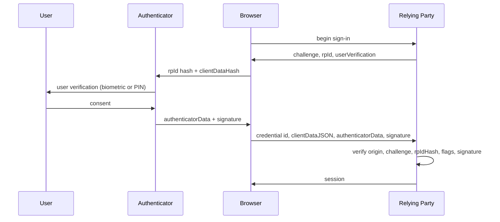
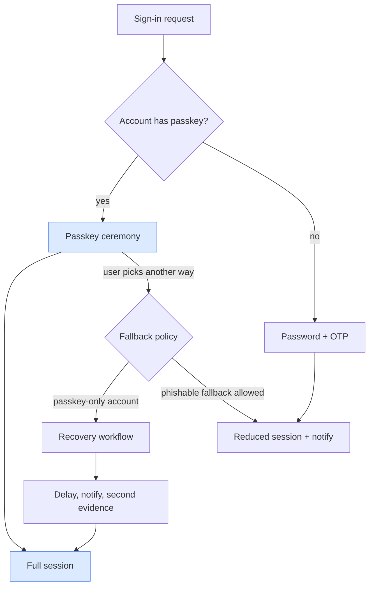

# パスキーとフィッシング耐性認証

> **翻訳の状態:** 現行の[英語版](../../10-security/10-passkeys-and-phishing-resistant-authentication.md)からの翻訳です。

## TL;DR

パスキーとは、ユーザーが識別子を入力しなくても発見して使えるWebAuthnの公開鍵クレデンシャルである。サーバは公開鍵を保存する。秘密鍵は認証器の中にとどまり、そのクレデンシャルが作られたリライングパーティに対してだけチャレンジに署名する。どのサイトが要求しているかを判断するのは、ユーザーではなくブラウザである。パスキーがフィッシングに耐える理由はこれに尽きる。そっくりなドメインは本物のドメインにスコープされた署名を得られず、被害者と本物のサイトのあいだに座る中継者が受け取るのは、誤ったオリジンに束縛されたアサーションである。

**フィッシング耐性は認証器の性質ではなく、アカウントの性質である。** パスキーを受け付け、同時にパスワードとワンタイムコードも受け付けるアカウントは、パスワード経路とまったく同じだけフィッシングに弱い。経路を選ぶのは攻撃者だからである。したがって設計の仕事は、ライブラリが実装するWebAuthnのセレモニーではなく、その周囲のシステムにある。どのフォールバックを残すか、リカバリをどう認可するか、同期されるクレデンシャルとデバイス固定のクレデンシャルをどう見分けるか、セレモニーが終わったあとのセッションを何が守るか、である。パスワードの保存、セッションストア、認証器ライフサイクル全般は[認証システム](01-authentication-fundamentals.md)が扱う。本章の主題は、公開鍵による経路と、それに続くセッション束縛である。

## セキュリティ契約

次のすべてが成り立つときに限り、その配備はフィッシング耐性を持つ。

1. **オリジン束縛。** 受理されるすべてのアサーションは、リライングパーティが明示的に許可したオリジンのために生成されている。サーバはクライアントを信用せず、自分でそれを検証する。
2. **チャレンジの鮮度。** 各チャレンジはサーバが生成し、1つの保留中セレモニーに結び付けられ、ちょうど1回だけ消費される。
3. **より弱い同等経路がない。** フィッシング耐性のある要素なしに同じセッションを与える経路は、削除するか、低い権限に制限するか、遅延させて通知する。
4. **リカバリはサインインと同等以上に強い。** 新しいパスキーの追加やアカウントのリセットには、既存のパスキーを使うのに匹敵する証拠を要求する。
5. **クレデンシャルの状態はサーバが正である。** サーバ側で削除したクレデンシャルは、認証器が何を保持していても、ただちに使えなくなる。
6. **認証後の窃取は有界である。** 盗まれたセッションクッキーやトークンは、すぐに失効するか、窃取者が持たない鍵に束縛されている。

**文書化済み、WebAuthn Level 3:** この仕様は2026年8月25日にW3C勧告となった。条件付きメディエーション、関連オリジンリクエスト、シグナルメソッド、バックアップフラグ、ハイブリッドトランスポートなど、ブラウザがすでに出荷していた機能を標準化している。**文書化済み、NIST SP 800-63B-4(2025年):** 同期可能な認証器はAAL2まで認められる。AAL3はエクスポート不可能な鍵を持つフィッシング耐性認証器を要求する。AAL2で運用する検証者は、フィッシング耐性のある選択肢を提供しなければならない。

## オリジン束縛の仕組み



スコープは独立した2者が強制する。ブラウザは、ページのオリジンの登録可能なサフィックスでない`rpId`に対するセレモニーの実行を拒み、実際のオリジンを`clientDataJSON`に書き込む。認証器は`rpId`のハッシュでクレデンシャルを検索し、そのハッシュを署名対象の`authenticatorData`に含める。署名は`authenticatorData`と、それに続く`clientDataJSON`のSHA-256ハッシュを覆う。そのため、どちらの値もあとから差し替えられない。

サーバの検証項目は短く、どの項目も欠かせない。

| 検査 | 防ぐもの |
|---|---|
| `clientDataJSON.type`が`webauthn.get`(または`webauthn.create`)である | 登録レスポンスをサインインとして再送する攻撃 |
| `clientDataJSON.challenge`が保留中のチャレンジと一致し、その後に削除する | 捕獲したアサーションのリプレイ |
| `clientDataJSON.origin`が許可リストにある | そっくりなオリジンや埋め込まれたオリジンで生成されたアサーション |
| `rpIdHash`が期待する`rpId`のSHA-256と一致する | 別のリライングパーティ向けに作られたクレデンシャル |
| User Presentフラグが立っている。ポリシーが要求するならUser Verifiedフラグも立っている | 無言での使用、またはローカルの第2要素なしの使用 |
| 保存済みの公開鍵で署名が検証できる | 偽造 |
| Backup Eligibleフラグが登録時から変わっていない | 改ざんされたクレデンシャルレコード |

リアルタイムの中継キットは、パスワード、ワンタイムコード、プッシュ承認を破る。被害者が入力または承認したものを、攻撃者が転送できるからである。WebAuthnでは、被害者のブラウザは攻撃者のオリジンのために署名する。本物のリライングパーティは、それをオリジンと`rpIdHash`の検査で拒否する。

## 同期されるクレデンシャルとデバイス固定のクレデンシャル

`authenticatorData`は2つのフラグを運ぶ。サーバが保持しているのがどの種類のクレデンシャルかは、これで決まる。

| フラグ | 意味 | 設計上の帰結 |
|---|---|---|
| Backup Eligible(BE) | クレデンシャルは提供者によって他のデバイスへ複製されうる | 作成時に一度だけ設定され、変化しない。BE=0はデバイス固定を意味する |
| Backup State(BS) | クレデンシャルは現在バックアップされている | セレモニーのあいだで変化しうる。BS=1なら、このデバイスを失ってもクレデンシャルは失われない |

**同期パスキー**はクレデンシャルマネージャの中にあり、ユーザーのプラットフォームアカウントについて回る。デバイスを失っても残るので、リカバリのトラフィックの大半がなくなる。ただし、その安全性は同期アカウントとそのリカバリ手続きの安全性になる。ハードウェアキーやプラットフォームのセキュアエレメントにある**デバイス固定パスキー**はエクスポートできない。高保証のポリシーが求めるのはこの性質だが、紛失はアカウントリカバリの事象になる。

ここから3つの帰結が導かれる。

- **署名カウンタは、同期パスキーの複製検知には使えない。** 提供者は一般にゼロを報告する。デバイス固定クレデンシャルでカウンタが後退したらシグナルとして扱い、BE=1のときは無視する。
- **同期パスキーにはアテステーションがほとんどない。** 消費者向けの提供者はアテステーションを返さないので、サーバは認証器の機種を証明できない。ハードウェアの出自を必要とする企業の配備では、アテステーションを要求し、FIDOメタデータサービスの項目と照合し、許可するAAGUIDを制限する。
- **ポリシーの鍵は製品名ではなくフラグである。** 妥当な規則はこうなる。BE=1のクレデンシャルは通常のサインインを満たす。特権操作にはBE=0のクレデンシャルか、新しいステップアップを要求する。後者は[OAuth 2.1と高保証の認可プロファイル](11-oauth-security-profiles.md)で述べるOAuthのチャレンジで実現できる。

## 登録、サインイン、アップグレード経路

**参照設計:** クレデンシャルIDをキーとして、クレデンシャルごとに1行を保存する。

```text
credential_id      bytes   primary key
user_handle        bytes   opaque, never an email address
public_key         COSE    algorithm included
backup_eligible    bool    immutable
backup_state       bool    last observed
sign_count         uint32  last observed
aaguid             uuid    provider or model identifier
transports         set     hints for the next ceremony
created_at, last_used_at, created_by_session
```

`user_handle`は、発見可能なサインインのあいだに認証器が返す値である。サーバはこれを使い、入力された識別子なしでアカウントを見つける。ランダムかつ不変でなければならない。ここにメールアドレスを入れると、認証器を持つ誰にでも個人データが漏れ、アドレスが変わったときに壊れる。

Level 3の機能は、登録のファネルを形作る。

- **条件付きメディエーション**は、ユーザー名欄の自動入力の中にパスキーを提示する。1つのフォームがパスキーを持つユーザーにも持たないユーザーにも対応でき、アカウントの列挙も不要になる。
- **条件付き作成**によって、リライングパーティは、対応するクレデンシャルマネージャでパスワードによるサインインが成功した直後に、追加のプロンプトなしでパスキーを登録できる。既存の利用者集団を移行させるのは、このアップグレード経路である。
- **関連オリジンリクエスト**によって、リライングパーティは、1つの`rpId`を使ってよいオリジンのリストを`/.well-known/webauthn`で公開できる。国別ドメインやブランド移行を、ドメインごとのクレデンシャルなしで扱える。それでもサーバは、受理するオリジンをそれぞれ許可リストに載せなければならない。
- **シグナルメソッド**によって、サーバはクレデンシャルマネージャに、あるクレデンシャルが未知であること、どのクレデンシャルがまだ有効か、現在のユーザー名が何かを伝えられる。これがないと、削除済みのクレデンシャルが選択画面に残り、サインインで失敗する。
- **ハイブリッドトランスポート**によって、スマートフォンが近くのデスクトップの認証器として働く。QRコードがブートストラップ用の秘密を運び、Bluetoothの近接確認が2台のデバイスが物理的に近いことを証明する。遠隔の攻撃者が被害者にQRコードを見せるだけでは成立しないのは、このためである。

## フォールバックが実際の保証を決める

パスキーをフィッシングできない攻撃者は、フォールバックをフィッシングする。フィッシングページは「パスキーを利用できません。別の方法でサインインしてください」と表示し、パスワードとコードを集めるだけでよい。



選択肢を、弱いものから順に挙げる。

1. **パスキー優先。** フォールバックは完全なセッションを与える。利便性と転換率は上がるが、安全性は上がらない。
2. **フォールバックは権限を下げる。** フィッシング可能な経路で得たセッションは、パスキーによるステップアップまで、クレデンシャルの変更、送金、管理機能への到達ができない。
3. **パスキー必須。** パスキーが2つ(または同期パスキーが1つ)存在したら、フィッシング可能な要素をアカウントから取り除く。紛失はリカバリだけで扱う。

こうすると、構造上リカバリが最も弱い環になる。メールリンクによるリカバリは、メールボックスを実質的な認証器にする。より強い設計は、待機期間を、既存の全チャネルへの通知、本人確認のやり直し、登録時に印刷したリカバリ用クレデンシャル、登録済みの別デバイスからの承認と組み合わせる。何を選ぶにせよ、それをサインイン手段として脅威モデリングすべきである。実際にサインイン手段だからである。

## サインイン後のセッション束縛

パスキーが守るのはセレモニーである。ブラウザのストレージから結果のクッキーを複製するマルウェアは、セレモニーを完全に迂回する。強い認証を持つアカウントの大半は、クッキーの窃取で乗っ取られる。

- **Device Bound Session Credentials(DBSC)。** セッション開始時にブラウザが鍵ペアを作る。可能ならハードウェアの中に作る。サーバは短命のクッキーを発行し、ブラウザがリフレッシュ用エンドポイントで秘密鍵の所持を証明したときだけ更新する。別のマシンへ持ち出されたクッキーは数分で失効し、更新できない。**文書化済み、Google(2026年):** DBSCは2026年4月、Windows上のChrome 146で一般提供に入った。鍵はTPMで保護され、macOSが続くと発表されている。未対応のブラウザは通常のクッキーで動き続けるので、この制御は追加的である。
- **送信者制約付きトークン。** APIクライアントでは、DPoPと相互TLSが同じ方法でアクセストークンを鍵に束縛する。
- **機微な操作での再検証。** クレデンシャルの変更、出金、データのエクスポートの前には、生きているセッションだけでなく、ユーザー検証を伴う新しいアサーションを要求する。

正直な限界を述べておく。ユーザーのデバイス上でユーザーとして動くマルウェアは、正規のブラウザに操作を依頼できる。束縛が止めるのはクレデンシャルの持ち出しであり、その場での悪用ではない。

## 容量とストレージのモデル

計算は小さい。それも魅力の一部である。

- **検証コスト。** サインイン1回につき、ES256の署名検証が1回とSHA-256のハッシュが2回。メモリハードなパスワードハッシュより数桁安い。パスキーの比率が高い利用者集団では、サインイン層に必要なCPUが減り、クレデンシャルスタッフィングの洪水が消費していたパスワードハッシュの容量が不要になる。
- **チャレンジストア。** 保留中のセレモニーごとに1エントリ。**例示:** サインイン開始が毎秒2,000件、有効期間が5分なら、ストアが保持するチャレンジは最大60万件である。1件およそ100バイトなら、オーバーヘッドを除いて60 MBになる。アトミックな取得と削除が必要である。また、セレモニーごとに単一リージョンを本拠とするか、チャレンジにリージョンを記すかして、1つのレスポンスが2つのリージョンで二重に引き換えられないようにする。
- **クレデンシャルテーブル。** クレデンシャル1件あたり数百バイト。5,000万ユーザーに1人3件なら1億5,000万行で、100 GBを大きく下回る。
- **DBSCのリフレッシュ。** 束縛された各セッションは、クッキーの有効期間ごとに1回リフレッシュ用エンドポイントを呼ぶ。**例示:** 同時にアクティブなセッションが500万、クッキーが10分なら、毎秒およそ8,300回のリフレッシュが発生する。それぞれが署名検証とセッション検索である。この層は以前は存在しなかったので、明示的に容量を見積もる。

## 障害モード

| 障害 | 機構 | 検知と制御 |
|---|---|---|
| フォールバックへのダウングレード | フィッシングページがパスキーの選択肢を隠し、パスワードとコードを収集する | アカウントごとに手段別のサインインを追跡する。パスキー登録済みのアカウントがフィッシング可能な経路を使ったら警告する。権限を下げたセッションのポリシーを適用する |
| リカバリによる乗っ取り | 攻撃者がメールの受信箱を支配し、アカウントをリセットする | リカバリを遅延させ通知する。第2の証拠を要求する。リカバリを特権イベントとして記録する |
| オリジン許可リストのドリフト | ステージングやパートナーのオリジンが、許可リストや関連オリジンのファイルに残る | 許可リストをセキュリティ設定としてレビューする。リストにないオリジンが拒否されることをテストする |
| リージョンをまたぐチャレンジのリプレイ | 削除が複製される前に、チャレンジが2つのリージョンで検証される | セレモニーを、発行したリージョンに固定する |
| 孤立したクレデンシャル | サーバがクレデンシャルを削除しても、選択画面にはまだ表示される | 削除後とサインイン時にシグナルメソッドを呼ぶ |
| 同期アカウントの侵害 | 攻撃者が被害者のクレデンシャルマネージャを新しいデバイスに復元する | リライングパーティの制御の外にある。特権操作にはBE=0かステップアップを要求する |
| ロックアウトの波 | プラットフォームのバグやポリシー変更で、ある提供者のパスキーが使えなくなる | 単一の提供者に依存しないリカバリ経路を保つ。AAGUID別の失敗率を監視する |
| クッキーの窃取 | インフォスティーラーがセッションクッキーを持ち出す | DBSCか短いセッション。機微な操作では再検証する |

## 検証

1. 捕獲したアサーションをリプレイする。消費済みのチャレンジで失敗しなければならない。
2. 署名は正しいがオリジンが異なるアサーションを提示する。署名検証が意味を持つ前に失敗しなければならない。
3. 登録レスポンスをサインイン用エンドポイントに送る。`type`で失敗しなければならない。
4. サーバ側でクレデンシャルを削除し、それでサインインする。拒否され、シグナル呼び出しが発行される。
5. パスキー登録済みのアカウントでフォールバック経路を完了する。セッションが制限され、ユーザーに通知されることを確認する。
6. DBSCで束縛されたクッキーを別のブラウザプロファイルに複製する。失効までは動き、その後のリフレッシュに失敗する。
7. メールの受信箱だけを支配する攻撃者として、リカバリのフローを最初から最後まで実行し、何がそれを止めるかを書き出す。

## 判断の枠組み

1. **単にパスキーが使えるだけでなく、フィッシング耐性が必須なのはどのアカウントか。** まず管理者と従業員。次に、侵害されると資金やデータが動くアカウント。
2. **この保証レベルで、同期されるクレデンシャルは許容できるか。** ポリシーがエクスポート不可能な鍵を要求するなら、登録時にBE=0とアテステーションを強制する。
3. **フォールバックは何か。それで得たセッションは何ができるか。** 答えが「すべて」なら、その配備は利便機能である。
4. **使える認証器を持たないユーザーはどう復帰するか。攻撃者はそれをどう悪用するか。**
5. **どのオリジンがその`rpId`でアサーションを出せるか。そのリストの変更を誰が承認するか。**
6. **盗まれたセッションを何が制限するか。** クッキーの有効期間、DBSC、再検証。
7. **成功をどう測るか。** 手段別のサインイン比率、登録済みアカウントでのフォールバック利用、リカバリの件数、侵入経路別の乗っ取り報告。

## 重要なポイント

- オリジンのスコープを強制するのはブラウザと認証器である。サーバの仕事は、それらが署名したものを検証し、それらを迂回する経路をすべて取り除くことである。
- クレデンシャルが同期されるのかデバイス固定なのかをサーバに伝えるのは、製品名ではなくバックアップフラグである。ポリシーはフラグの上に築く。
- 実際の保証レベルを決めるのはリカバリとフォールバックである。それらを最初に設計する。
- 認証の強さはセレモニーで終わる。それを先へ運ぶのは、セッション束縛と再検証である。

## 参考文献

- [W3C, *Web Authentication: An API for accessing Public Key Credentials, Level 3*](https://www.w3.org/TR/webauthn-3/)
- [FIDO Alliance, *WebAuthn Level 3 Is Now a W3C Recommendation* (2026年)](https://fidoalliance.org/webauthn-level-3-is-now-a-w3c-recommendation/)
- [NIST SP 800-63B-4, *Digital Identity Guidelines: Authentication and Authenticator Management* (2025年)](https://csrc.nist.gov/pubs/sp/800/63/b/4/final)
- [W3C Web Application Security Working Group, *Device Bound Session Credentials*](https://w3c.github.io/webappsec-dbsc/)
- [Google, *Protecting Cookies with Device Bound Session Credentials* (2026年)](https://blog.google/security/protecting-cookies-with-device-bound-session-credentials/)
- [RFC 9449: OAuth 2.0 Demonstrating Proof of Possession (DPoP)](https://www.rfc-editor.org/rfc/rfc9449)
