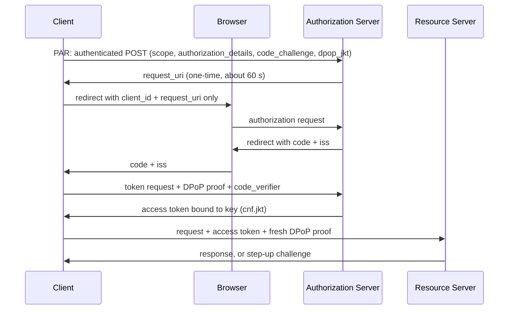

# OAuth 2.1と高保証の認可プロファイル

> **翻訳の状態:** この日本語版は英語版の以前の版に基づいており、現行の[英語版](../../10-security/11-oauth-security-profiles.md)とは構成や内容が異なります。最新の内容は英語版を参照してください。

## TL;DR

OAuth 2.0(RFC 6749)は、任意の部品を多く持つフレームワークである。現実の侵害の大半は、その任意の選択肢から生じた。URLに載るトークン、緩く照合されるリダイレクト、持っている者なら誰でも使えるベアラートークン、どの認可サーバが応答したのかを区別できないクライアントである。10年分の拡張RFCが、これらの穴を1つずつ塞いできた。現在の最先端は新しいプロトコルではなく、**プロファイル**である。つまり、危険な選択肢がそもそも存在しないように、それらの拡張を固定的に選んだ組み合わせである。

3つの層を区別しておく価値がある。**RFC 9700**(2025年)は公開済みのBest Current Practiceであり、実装がすでに満たしているべき内容である。**OAuth 2.1**はその実践を1つの文書に統合する。2026年11月時点ではまだIETFのインターネットドラフトなので、標準としてではなく方向性として引用する。**FAPI 2.0**はOpenID Foundationの最終版プロファイルで、プッシュ型リクエスト、送信者制約付きトークン、公開された攻撃者モデルによって、さらに先へ進む。グラントの仕組み、トークンの種類、リフレッシュのライフサイクルは[OAuth 2.0とOpenID Connect](02-oauth2-openid-connect.md)が扱う。本章の主題は、どの拡張をどの順序で採用するか、そしてそれぞれの運用コストである。

## ベースラインが取り除くもの

**文書化済み、RFC 9700およびOAuth 2.1ドラフト:** 統合されたベースラインは、主に削除によって定義される。

| 削除または禁止されるもの | 代替 | 理由 |
|---|---|---|
| インプリシットグラント(`response_type=token`) | PKCE付きの認可コード | フラグメント内のトークンは、履歴、リファラ、注入されたスクリプトから漏れる |
| リソースオーナーパスワードクレデンシャルグラント | 認可コード。入力が制約される機器にはデバイスグラント | クライアントがパスワードを見てしまい、多要素認証を適用できない |
| PKCEなしの認可コード | コンフィデンシャルクライアントを含む全クライアントで`S256`のPKCE | コードの注入と横取り |
| リダイレクトURIのパターン照合や前方一致 | 文字列の完全一致 | オープンリダイレクトやサブドメインの乗っ取りが、コードの窃取に変わる |
| URIクエリに載るベアラートークン | `Authorization`ヘッダまたはフォームボディ | URLは至る所でログに残る |
| パブリッククライアント向けの長寿命ベアラーリフレッシュトークン | 送信者制約、または再利用検知を伴うローテーション | 盗まれたリフレッシュトークンは、常設の権限になる |

この表を満たすシステムは、ごく普通の、弁護可能なOAuthの配備である。以下のプロファイルは、ブラウザのトラフィックを読み書きできる攻撃者や、保存中のトークンを盗める攻撃者に対しても失敗させなければならないシステムのためのものである。

## 強化されたリクエスト経路



それぞれの拡張は、素のフロントチャネルフローが持つ特定の弱点に1つずつ答える。

### プッシュ型認可リクエスト

素のOAuthでは、認可リクエストはクエリパラメータとしてブラウザを通る。そこではユーザー、拡張機能、中間者が読み取り、書き換えられる。**文書化済み、RFC 9126:** クライアントは代わりに、パラメータを認可サーバのプッシュ型リクエスト用エンドポイントへ直接POSTする。認証はトークンエンドポイントと同じ方法で行い、`request_uri`を受け取る。ブラウザが運ぶのは`client_id`とその参照だけである。

効果は具体的である。リクエストパラメータは、署名なしで完全性と機密性を得る。認可サーバはクライアントを認証し、ユーザーとのやり取りが始まる前に不正なリクエストを拒否できる。大きなリクエストがURL長の上限に当たらなくなる。コストは、認可1回につきバックチャネルの往復が1回増えることと、保留中リクエストの短命なストアである。署名付きリクエストオブジェクト(**RFC 9101**、JAR)は、リクエストをあとからクライアントの鍵に帰属させる必要があるときの代替である。その代償は、全クライアントでの鍵管理である。

### リッチ認可リクエスト

`payments`のようなスコープ文字列は、金額や受取人について何も語らない。**文書化済み、RFC 9396:** `authorization_details`は型付きオブジェクトのJSON配列であり、何が認可されるのかを正確に記述する。

```json
[{
  "type": "payment_initiation",
  "actions": ["initiate"],
  "locations": ["https://api.bank.example/payments"],
  "instructedAmount": {"currency": "EUR", "amount": "123.50"},
  "creditorAccount": {"iban": "DE02100100109307118603"}
}]
```

ユーザーはそのオブジェクトに同意し、付与された詳細はトークンとともに返され、リソースサーバがそれを強制する。これを安全に保つ規則は2つある。各`type`には認可サーバが検証するスキーマがある。そしてリソースサーバは、その詳細を上限として扱い、[大規模な認可](07-authorization-patterns.md)で述べる自身のオブジェクト単位のポリシーに照らしてなお検査する。ペイロードは機微で大きくなりうるので、RFC 9396は通常、プッシュ型リクエストと組み合わせる。

### 送信者制約付きトークン

ベアラートークンは、APIに対するパスワードである。送信者制約は、盗まれたトークンを秘密鍵なしでは無用にする。

| 機構 | 束縛 | 適する対象 | 運用コスト |
|---|---|---|---|
| 相互TLS(RFC 8705) | `cnf.x5t#S256`に入る証明書のサムプリント | 管理された証明書を持つサーバ間クライアント | TLS終端は、検証済みの証明書アイデンティティをアプリケーションへ渡さなければならない |
| DPoP(RFC 9449) | `cnf.jkt`に入るJWKのサムプリント。リクエストごとの証明JWT | ブラウザ、モバイルアプリ、多様なネットワーク経路の背後にあるクライアント | リプレイキャッシュまたはサーバノンス。プロキシの背後での正確なURIの再構成 |

DPoP証明は、`typ`に`dpop+jwt`を設定し、ヘッダに公開鍵を入れたJWTである。クレームは`htm`(メソッド)、`htu`(クエリを除いた対象URI)、`iat`、一意の`jti`、そしてリソースを呼ぶときの`ath`(アクセストークンのハッシュ)である。リソースサーバは、埋め込まれた鍵で署名を検査し、その鍵のサムプリントをトークンの`cnf.jkt`と比較し、鮮度を強制する。サーバが発行する`DPoP-Nonce`は受理の窓を狭める。事前に作られた証明を、あとで使えなくするためである。プッシュ型リクエストで`dpop_jkt`を渡すと、認可コードが同じ鍵に束縛され、コード発行とトークン発行のあいだの隙間が閉じる。

送信者制約がしないこともある。クライアントの内部でコードを実行できる攻撃者は、クライアントに署名を依頼できる。ブラウザでは、スクリプトが使えてもエクスポートはできないよう、鍵を抽出不可として生成する。また、トークンをページから完全に締め出すbackend-for-frontendを優先する。

### 発行者とリソースの束縛

- **発行者の識別。** 複数の認可サーバと通信するクライアントは、ある認可サーバが発行したコードを別の認可サーバへ送るよう騙されうる。これがミックスアップ攻撃である。**文書化済み、RFC 9207:** 認可レスポンスは`iss`パラメータを運び、クライアントはそれを、フローを開始した相手の発行者と比較する。
- **リソースインジケータ。** **文書化済み、RFC 8707:** クライアントは`resource`パラメータで対象のAPIを名指しし、認可サーバは、そのAPIだけをオーディエンスとするトークンを発行する。リソースサーバごとに1つのトークンにすれば、侵害されたAPIや悪意あるAPIが、隣のAPIへトークンをリプレイできなくなる。
- **保護リソースメタデータ。** **文書化済み、RFC 9728:** リソースサーバは`/.well-known/oauth-protected-resource`で文書を公開し、自身の認可サーバ、対応するスコープ、トークン束縛の方式を列挙する。そして401レスポンスの`WWW-Authenticate`ヘッダから、その文書を指し示す。そのAPIを一度も見たことのないクライアントが、帯域外の設定なしに、どこでトークンを得ればよいかを発見できる。これはModel Context Protocolが採用した発見の仕組みであり、[ワークロードとエージェントのアイデンティティ委任](12-workload-and-agent-identity.md)で述べる。
- **型付きアクセストークン。** **文書化済み、RFC 9068:** JWTのアクセストークンは`typ`に`at+jwt`を持つ。そのため、IDトークンがアクセストークンとして検証を通ることはない。

### ステップアップ認証

操作によっては、セッションが持つものより強い認証や、より新しい認証が必要になる。**文書化済み、RFC 9470:** リソースサーバは401で応答し、その`WWW-Authenticate`ヘッダに`error="insufficient_user_authentication"`と、要求する`acr_values`または`max_age`を載せる。クライアントはそれらのパラメータで新しい認可リクエストを開始する。新しいトークンは`acr`と`auth_time`のクレームを運び、リソースサーバがそれを検査できる。

これによって、操作の価値を知っているAPIの側が、パスキーのセレモニーや新しいサインインを標準的な方法で要求できる。どのエンドポイントが機微かをクライアントにハードコードする必要がない。ループには注意する。要求されたレベルを満たせないクライアントは、永遠にリダイレクトするのではなく、エラーで失敗しなければならない。

## 参照プロファイルとしてのFAPI 2.0

**文書化済み、FAPI 2.0 Security Profile(最終版、2025年):** このプロファイルは、ネットワークとユーザーのブラウザトラフィックを支配する攻撃者を対象とし、形式的なセキュリティ分析を伴っている。その要件は、本章のチェックリストとして読める。

- 認可コードフローのみ。PKCE `S256`とプッシュ型認可リクエストを伴う。
- コンフィデンシャルクライアントは`private_key_jwt`または相互TLSで認証し、共有シークレットは決して使わない。
- アクセストークンはDPoPまたは相互TLSで送信者制約を受ける。
- `iss`レスポンスパラメータ、完全一致のリダイレクトURI、短命の認可コード。
- 署名アルゴリズムとTLSバージョンの制限。

付随するMessage Signingプロファイルは、否認防止が法的要件である場合のために、署名付きリクエスト、署名付きレスポンス、HTTPメッセージ署名(RFC 9421)を加える。オープンバンキングや医療のエコシステムはFAPIを義務付けている。しかし規制の外でのFAPIの価値は、すでに議論が済んだ構成であることにある。採用すれば、数十の局所的な設計判断が、1つの適合性テストスイートに置き換わる。

## 事前登録なしのクライアントアイデンティティ

古典的なOAuthは、各クライアントが手作業で登録されていることを前提とする。任意のクライアントが任意のサーバと出会うオープンなエコシステムでは、この前提が崩れる。

| 方式 | クライアントの識別方法 | 状態とリスク |
|---|---|---|
| 動的クライアント登録(RFC 7591) | クライアントがメタデータをPOSTし、`client_id`を受け取る | 標準。クライアントレコードが際限なく増え、濫用対策が必要 |
| Client ID Metadata Document | `client_id`がHTTPSのURLであり、サーバがそこからメタデータを取得する | 2026年時点でIETFのインターネットドラフト。取得はサーバ側リクエストなので、SSRF対策、サイズ制限、キャッシュが必要 |
| アテステーションに基づくクライアント認証 | プラットフォームまたはバックエンドが、アプリインスタンスの鍵を証明する | IETFのインターネットドラフト。共有シークレットを保持できないモバイルアプリやウォレットに適する |

ブラウザベースのアプリケーションについて、IETFの指針である*OAuth 2.0 for Browser-Based Applications*は、アーキテクチャを露出の度合いで順位付けしている。トークンをサーバ側で保持し、ブラウザにはクッキーだけを渡すbackend-for-frontendが最も強い。トークンを仲介するバックエンドがそれに次ぐ。トークンをすべてスクリプトで扱う方式が最後に来る。

**GNAP(RFC 9635)**には一言だけ触れておく。これは2024年の再設計であり、鍵に束縛されたクライアントと交渉型のインタラクションを最初から組み込んでいる。技術的にはより整っている。しかし、OAuthのライブラリ、サーバ、監査人という既存の基盤があるので、ほとんどのシステムは、上記の拡張を通じて同じ性質に到達することになる。

## 容量と状態のモデル

強化は、ステートレスな検査を少量の共有状態に変える。それを計画に入れる。

- **プッシュ型リクエストのストア。** 開始された認可ごとに1エントリで、最初の使用時に削除する。**例示:** 毎秒500件の認可、有効期間60秒なら、生きているエントリは最大3万件である。
- **DPoPのリプレイキャッシュ。** リソースサーバは、受理の窓のあいだ、各`jti`を覚えていなければならない。**例示:** 毎秒5,000リクエスト、窓が60秒なら、リソースサーバのクラスタあたり30万エントリになる。1件およそ64バイトなら約20 MBである。サーバノンスを使えば窓を縮められる。ノードごとのキャッシュが許容されるのは、別ノードへのリプレイが残ることを、そのAPIが許容できる場合だけである。
- **検証のCPU。** 各リクエストは、検証すべき署名を2つ運ぶようになる。アクセストークンと証明である。証明の鍵はクライアントごとに異なるので、発行者の鍵のようにはキャッシュできない。リクエスト1件につきES256の検証1回を見積もる。
- **トークンの発行。** トークンごとに1つのオーディエンスにすると、クライアントあたりのトークン数が増える。呼び出しごとに要求するのではなく、リソースごとに、失効が近づくまでクライアント側でキャッシュする。
- **認可サーバの可用性。** プッシュ型リクエストとステップアップは、ユーザーに面する経路での認可サーバ呼び出しを増やす。一方、ローカルでのトークン検証は、既存のトークンが有効なあいだ、障害時にもリソースサーバを動かし続ける。

## 障害トレース

### 2つの発行者のあいだのミックスアップ

1. クライアントは発行者AとBによるサインインに対応し、両者に1つのリダイレクトURIを使う。
2. ユーザーが、悪意あるBとのフローを開始する。Bは、そのクライアントの`client_id`を付けてブラウザをAへリダイレクトする。
3. Aがコードを発行し、クライアントへリダイレクトする。
4. クライアントはBとのフローの最中だと信じており、コードとPKCEのベリファイアをBのトークンエンドポイントへ送る。

**防止:** `iss`レスポンスパラメータを、保留中のトランザクションとともに保存した発行者と照合する。発行者ごとに別のリダイレクトURIを使う。

### プロキシの背後でDPoP証明が拒否される

1. クライアントは、公開URLを`htu`として署名する。
2. ゲートウェイがパスを書き換え、内部ホスト名へ平文HTTPで転送する。
3. リソースサーバは別のURLを再構成し、すべての証明を拒否する。あるいは、エンジニアがその検査を無効にする。

**防止:** 外部URLは、クライアントが設定できるリクエストヘッダからではなく、信頼できる転送設定から再構成する。本物のエッジを通してテストする。

### トークンが第2のAPIで再利用される

1. 認可サーバが、すべての内部APIに共通のオーディエンスでトークンを発行する。
2. 価値の低いAPIが侵害され、受信したトークンをログに記録する。
3. 攻撃者が、記録されたトークンを価値の高いAPIへ提示する。そのAPIはオーディエンスを受理する。

**防止:** リソースインジケータを使い、APIごとに1つのオーディエンスにする。送信者制約によって、記録されたトークンが使える鍵を伴わないようにする。

### ステップアップのループ

1. APIが、ユーザーのアイデンティティプロバイダには生成できない認証コンテキストを要求する。
2. クライアントは、チャレンジを受け取るたびに認可リクエストを再試行する。
3. ユーザーは終わりのないリダイレクトを目にし、認可サーバはリクエストの嵐を受ける。

**防止:** 操作ごとのステップアップ試行回数に上限を設ける。返されたトークンの`acr`がチャレンジを満たさないときは、エラーを表示する。

## 検証

1. 1文字、または末尾のスラッシュだけが異なるリダイレクトURIで認可リクエストを送る。拒否される。
2. `request_uri`を再利用する。2回目の使用で拒否される。
3. DPoPに束縛されたトークンを、証明なしで、別のメソッドやURI向けの証明とともに、そしてリプレイされた`jti`とともに提示する。すべて拒否される。
4. API A向けに発行されたトークンをAPI Bへ提示する。オーディエンスで拒否される。
5. IDトークンをアクセストークンとして提示する。`typ`で拒否される。
6. `iss`が誤っている、または欠けている認可レスポンスをクライアントへ返す。クライアントは中断する。
7. 選んだプロファイルの公開適合性スイートを、公開時に一度だけでなく、継続的インテグレーションで実行する。

## 判断の枠組み

次の順序で採用する。各段階は、次の段階がなくても有用である。

1. **ベースラインを満たす。** 至る所でPKCE、完全一致のリダイレクト、インプリシットグラントとパスワードグラントの廃止、ローテーションまたは束縛されたリフレッシュトークン。これはRFC 9700であり、任意ではない。
2. **オーディエンスを束縛する。** リソースインジケータと型付きアクセストークンは、ほぼゼロのコストでAPI間のリプレイを止める。
3. **発行者の識別を加える。** クライアントが複数の認可サーバと通信しうるようになったら、すぐに行う。
4. **トークンに送信者制約をかける。** 保存中または転送中のトークンの窃取が脅威モデルに含まれるときに行う。管理されたサーバクライアントには相互TLS、それ以外にはDPoPを使う。
5. **リクエストをプッシュする。** リクエストパラメータが機微であるか、改ざんされてはならないときに行う。リッチ認可の詳細を使うなら常に行う。
6. **ステップアップのチャレンジを加える。** APIごとに機微さが異なり、その知識をクライアントに持たせるべきでないときに行う。
7. **FAPI 2.0を丸ごと採用する。** 規制当局、パートナーのエコシステム、セキュリティレビューが、名前のあるテスト可能な目標を必要とするときに行う。

そのプロファイルをすでに実装している、保守された認可サーバを選ぶ。エンジニアリングの労力は、リソースサーバでの強制とクライアントの鍵の扱いに注ぐ。この2つは、どの製品も代わりにやってはくれない。

## 参考文献

- [RFC 9700: Best Current Practice for OAuth 2.0 Security](https://www.rfc-editor.org/rfc/rfc9700)
- [IETFインターネットドラフト, *The OAuth 2.1 Authorization Framework*](https://datatracker.ietf.org/doc/draft-ietf-oauth-v2-1/)
- [RFC 9126: OAuth 2.0 Pushed Authorization Requests](https://www.rfc-editor.org/rfc/rfc9126)
- [RFC 9101: JWT-Secured Authorization Request (JAR)](https://www.rfc-editor.org/rfc/rfc9101)
- [RFC 9396: OAuth 2.0 Rich Authorization Requests](https://www.rfc-editor.org/rfc/rfc9396)
- [RFC 9449: OAuth 2.0 Demonstrating Proof of Possession (DPoP)](https://www.rfc-editor.org/rfc/rfc9449)
- [RFC 8705: OAuth 2.0 Mutual-TLS Client Authentication and Certificate-Bound Access Tokens](https://www.rfc-editor.org/rfc/rfc8705)
- [RFC 9207: OAuth 2.0 Authorization Server Issuer Identification](https://www.rfc-editor.org/rfc/rfc9207)
- [RFC 8707: Resource Indicators for OAuth 2.0](https://www.rfc-editor.org/rfc/rfc8707)
- [RFC 9728: OAuth 2.0 Protected Resource Metadata](https://www.rfc-editor.org/rfc/rfc9728)
- [RFC 9470: OAuth 2.0 Step Up Authentication Challenge Protocol](https://www.rfc-editor.org/rfc/rfc9470)
- [RFC 9068: JSON Web Token (JWT) Profile for OAuth 2.0 Access Tokens](https://www.rfc-editor.org/rfc/rfc9068)
- [OpenID Foundation, *FAPI 2.0 Security Profile*(最終版)](https://openid.net/specs/fapi-security-profile-2_0-final.html)
- [IETFインターネットドラフト, *OAuth Client ID Metadata Document*](https://datatracker.ietf.org/doc/draft-ietf-oauth-client-id-metadata-document/)
- [IETF, *OAuth 2.0 for Browser-Based Applications*](https://datatracker.ietf.org/doc/draft-ietf-oauth-browser-based-apps/)
- [RFC 9635: Grant Negotiation and Authorization Protocol (GNAP)](https://www.rfc-editor.org/rfc/rfc9635)
