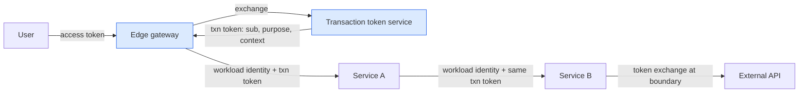

# ワークロードとエージェントのアイデンティティ委任

> **翻訳の状態:** 現行の[英語版](../../10-security/12-workload-and-agent-identity.md)からの翻訳です。

## TL;DR

ユーザーのリクエストが、それを受け取ったサービスで終わることはまれである。リクエストはゲートウェイ、いくつかの内部サービス、そして多くの場合は別組織のAPIをまたぐ。その経路の一部を、次の呼び出しを自分で選ぶAIエージェントが占めることも増えている。どのホップも、2つの問いに答えなければならない。**どのソフトウェアが呼んでいるのか**、そして**誰のために、何の目的で呼んでいるのか**である。前者だけに答えるシステムは、あらゆるサービスに全ユーザーの権限の和集合を与える。ユーザーのトークンを内側へ転送して後者だけに答えるシステムは、侵害されたホップが、そのトークンの通用する場所ならどこへでもリプレイすることを許す。

現在の答えは3つの部分から成る。ワークロードは、保存されたシークレットの代わりに、短命でアテステーション済みのアイデンティティを得る(SPIFFE、および同じ形を標準化しつつあるIETFのWIMSE)。権限は、信頼境界ごとにトークンを**交換**して渡す。その結果はより狭く、オーディエンスに束縛され、アクターの連鎖を記録する(RFC 8693)。1つの信頼ドメインの内部では、トランザクショントークンが、ユーザーとリクエストのコンテキストを、変更不能な形で呼び出しグラフ全体へ運ぶ。AIエージェントは新しい分類ではない。エージェントとは、ユーザーのために行動するワークロードである。違いは、その制御フローが信頼できない入力によって誘導されうる点にある。だからその権限は、ユーザーのアカウント全体ではなく、タスクによって制限しなければならない。サービス間の相互認証とポリシーの強制は[ゼロトラストのサービスおよびワークロードアーキテクチャ](05-zero-trust-architecture.md)が扱う。本章の主題は、アイデンティティと委任された権限が呼び出しの連鎖をどう移動するかである。

## 委任の契約

1. **すべての呼び出しは呼び出し元を名指しする。** ネットワーク上の位置や共有の静的鍵によって認可されるリクエストはない。
2. **サブジェクトとアクターは別である。** 権限を使われる側と、それを使う側は別々のクレームであり、両方をログに記録する。
3. **権限はホップごとに狭まる。** 下流のトークンは、派生元のトークンより広いスコープ、広いオーディエンス、長い有効期間を決して持たない。
4. **トークンはオーディエンスに束縛される。** あるサービスが受け取ったトークンを、別のサービスへ提示することはできない。
5. **コンテキストは変更不能である。** エッジで確定したユーザーのアイデンティティと目的を、中間のサービスが書き換えることはできない。
6. **クレデンシャルは短命であり、保存されるのではなく発行される。** 漏れたクレデンシャルは、売られる前に失効する。
7. **失効は連鎖に届く。** ユーザーのセッションが終わると、派生した権限も、明示された上限時間の内に終わる。

## シークレットなしのワークロードアイデンティティ

静的なAPIキーは、「どのソフトウェアが呼んでいるのか」に「その文字列を持つ誰か」と答える。ワークロードアイデンティティはそれを、プラットフォームが実体をアテステーションしたあとで、実行中のワークロードに発行されるクレデンシャルに置き換える。

**文書化済み、SPIFFE:** ワークロードは`spiffe://prod.example.com/payments/api`のようなURIで名付けられる。そのオーソリティ部分が信頼ドメインである。ワークロードは、X.509証明書またはJWTであるSVIDを、ローカルのワークロードAPIから取得する。自分自身の認証用シークレットは持たない。発行者は、ノードとオーケストレータを通じて、たとえばKubernetesのサービスアカウントによって、ワークロードをアテステーションする。SVIDの寿命は数分から数時間で、自動的にローテーションされる。

**文書化済み、IETF WIMSEドラフト(2026年):** WIMSEワーキンググループは、同じモデルをIETFのために仕様化している。アーキテクチャ文書と、ワークロードを名付けてその公開鍵を運ぶワークロードアイデンティティトークン(WIT)があり、リクエストごとに所持を証明する方法が2つある。ワークロード証明トークン(WPT)と、HTTPメッセージ署名(RFC 9421)である。WITは明示的に、ベアラートークンではない。これらはインターネットドラフトである。形は設計の目標にできる程度に安定しているが、詳細はまだ確定していない。

同じ考えは、**ワークロードアイデンティティフェデレーション**として組織の境界を越える。CIジョブ、Kubernetesのポッド、クラウドファンクションは、自身を記述するプラットフォーム署名付きのトークンをすでに持っている。クラウドプロバイダやSaaSのAPIは、その発行者を信頼するよう設定され、JWTベアラーアサーション(RFC 7523)またはトークン交換を使って、そのトークンを自身の短命なクレデンシャルに交換する。長寿命の鍵は一度も作られないので、ローテーションすべきものも、漏れるものもない。セキュリティの仕事は信頼ポリシーへ移る。信頼ポリシーは、発行者、オーディエンス、そして特定のサブジェクトクレーム(リポジトリ、ブランチ、名前空間、サービスアカウント)を固定しなければならない。「この発行者のトークンなら何でも」は、そのプラットフォームの全テナントを意味するからである。

## なりすまし、委任、トークン交換

**文書化済み、RFC 8693:** クライアントは、認可サーバのトークンエンドポイントに`subject_token`を提示する。任意で、自分自身を識別する`actor_token`を添える。そして、必要とする`audience`または`resource`と`scope`を指定する。サーバはポリシーを適用し、新しいトークンを返す。

意味論は2通りありうる。その違いは結果に現れる。

| | なりすまし | 委任 |
|---|---|---|
| 結果のトークンが述べること | サブジェクトはユーザーである | サブジェクトはユーザーであり、名指しされたアクターを通じて行動している |
| クレーム | `sub`のみ | `sub`と`act`(以前のアクターごとに入れ子になる) |
| 下流から見えるもの | ユーザー自身のものと区別できないリクエスト | 誰が行動しているか、およびその背後の連鎖 |
| 用途 | 弁護できる場合はまれ | デフォルト |

2ホップ後の委任トークンは、次のようになる。

```json
{
  "iss": "https://sts.example.com",
  "aud": "https://ledger.internal.example.com",
  "sub": "user:8c1f",
  "scope": "ledger:read",
  "exp": 1794686400,
  "act": {
    "sub": "spiffe://prod.example.com/orders/api",
    "act": { "sub": "spiffe://prod.example.com/edge/gateway" }
  }
}
```

安全性が宿るのは、交換点のポリシーである。どのアクターが、どのサブジェクトトークンを、どのオーディエンス向けに、どの最大スコープで交換してよいかを定める。サブジェクトトークンの`may_act`クレームによって、元の発行者は、誰がそのサブジェクトのために行動してよいかを、あらかじめ表明できる。そうしたポリシーのない交換エンドポイントは、トークンの洗浄サービスである。

## 信頼ドメイン内のトランザクショントークン

内部のホップごとにトークン交換を行うのは、正しいが、多くの場合は高くつきすぎる。外部のアクセストークンを転送するのは、安いが、誤っている。トランザクショントークンは、その中間の道である。



**文書化済み、OAuth Transaction Tokens(IETFインターネットドラフト、2026年):** トランザクショントークンは、短命の署名付きJWTである。信頼ドメインごとに論理的に1つのトランザクショントークンサービスが発行し、トランザクションを開始したユーザーまたはワークロードのアイデンティティを、認可コンテキストとともに表明する。外部のトークンはエッジで止まる。トランザクショントークンは、リクエストヘッダに載って、変更されないまま呼び出しグラフを通る。各サービスは、直接の呼び出し元を、そのワークロードアイデンティティで別途認証する。

これは、転送されたアクセストークンが混同している2つのものを分離する。ワークロードのクレデンシャルは、「いま誰が自分を呼んでいるのか」にホップごとに答える。トランザクショントークンは、「これはどのユーザーリクエストの一部で、何をすることを認可されたのか」にエンドツーエンドで答える。署名されているので、中間のサービスはそれを広げられない。有効期間は数秒から数分であり、最長の同期呼び出しの連鎖に合わせて決める。トークンより長く続く非同期の仕事には、より長いトークンではなく、それ自身の保存された認可が必要である。

**参照設計:** エッジでは、外部トークンを検証し、トークンとリクエストの詳細を付けてトランザクショントークンサービスを呼び、結果を添付する。すべてのサービスでは、呼び出し元のワークロードアイデンティティを検証し、トランザクショントークンの署名、オーディエンス(信頼ドメイン)、有効期限を検証し、その両方に照らして操作を認可する。信頼ドメインを出るときは、交換する。決して転送しない。

## 信頼ドメインをまたぐ

ある組織のサービスAが、ユーザーのために別組織のAPIを呼ばなければならないとき、共有のトークンサービスは存在しない。2つのドラフトがこのパターンを記述しており、どちらも既存のRFCを組み合わせている。

- **アイデンティティと認可のチェイニング。** 呼び出し元は、自身の認可サーバでトークンを交換し、相手ドメインの認可サーバ宛てのJWTアサーションを得る。次に、そのアサーションをJWTベアラーグラント(RFC 7523)として相手に提示し、ローカルのアクセストークンを受け取る。各ドメインは制御を保つ。第1のドメインは何を外へ出してよいかを決め、第2のドメインは、入ってきたアサーションにどれだけの価値を認めるかを決める。
- **アイデンティティアサーション認可グラント(ID-JAG)。** 企業のシングルサインオンでは、アイデンティティプロバイダが、ユーザーと両方のアプリケーションをすでに知っている。要求側のアプリケーションは、ユーザーのアイデンティティアサーションをアイデンティティプロバイダで交換し、対象アプリケーションの認可サーバ宛てのグラントを得て、そこで引き換える。ユーザーは同意画面を見ない。どのアプリケーションがどのアプリケーションに到達してよいかを決めるのは、個々のユーザーではなく、企業の管理者である。ベンダーがクロスアプリアクセスと呼ぶものの背後にあるのは、この仕組みである。

どちらも、2026年後半の時点でインターネットドラフトである。追跡する価値があるのは、今日配備されている代替が、ユーザーがSaaS製品間の長寿命のグラントを個別に承認する方式だからである。それは、どの管理者も一元的に見ることも、失効させることもできない。

## 委任されたワークロードとしてのAIエージェント

ユーザーのためにツールを呼ぶエージェントは、上記のモデルに当てはまる。ただし、リスクを変える性質が3つある。

1. **信頼できない入力が制御フローを誘導する。** Webページ、メール、ツールの結果など、エージェントが読むテキストは命令を含みうる。したがって、広い権限を持つエージェントは、デフォルトで混乱した代理人である。
2. **呼び出しの順序は事前にわからない。** スコープを、固定されたコードパスに照らしてレビューすることができない。
3. **長時間、無人で動く。** 権限は、ユーザーの注意より長く生き残りがちである。

制御はそこから直接導かれる。

- **エージェントはアクターであり、決してサブジェクトではない。** すべてのツール呼び出しは、ユーザーをサブジェクトとして、エージェントをアクターとして運ぶ。そうすればリソースは`user permissions ∩ agent permissions`を適用でき、監査ログは、どの判断を機械が下したかを示す。
- **権限はタスクにスコープする。** ツールごと、タスクごとに、最も狭いスコープ、単一のオーディエンス、数分の有効期間でトークンを要求する。[OAuth 2.1と高保証の認可プロファイル](11-oauth-security-profiles.md)で述べるリッチ認可の詳細を使えば、特定のオブジェクトを名指しできる。
- **認可はリソースで強制する。** モデルの判断は制御ではない。ツールサーバは、リクエストが敵対的であるかのように、すべての呼び出しを検査する。
- **影響の大きい操作にはユーザーが必要である。** 送金、データの削除、外部への共有は、帯域外の承認を引き起こす。たとえば、ユーザーのデバイスへのOpenID CIBAリクエストである。エージェントは、それに自分で応答できない。
- **クレデンシャルはコンテキストウィンドウの外に置く。** トークンはハーネスまたはクレデンシャルブローカーが保持し、呼び出しに添付する。プロンプトの中にあるものは何でも、注入された命令によって持ち出されうる。

**文書化済み、Model Context Protocolの認可:** MCPサーバは、OAuthのリソースサーバである。MCPサーバは、保護リソースメタデータ(RFC 9728)を通じて自身の認可サーバを広告する。クライアントは`resource`パラメータ(RFC 8707)を送らなければならず、それによってトークンはそのサーバに束縛される。サーバは、トークンが自分向けに発行されたことを検証しなければならず、受け取ったトークンを上流のAPIへ素通しで渡してはならない。クライアントのアイデンティティについては、仕様は2025-11-25版で、動的登録からClient ID Metadata Documentへ移行した。2026-07-28版はその方向を継続し、アイデンティティアサーショングラントの上に築かれたエンタープライズ管理認可の拡張を加えている。重要な規則は、トークンの素通しの禁止である。別のAPIを呼ぶMCPサーバは、そのAPI向けの自分のトークンを、交換によって取得する。

## 容量と可用性

- **交換のコスト。** 交換は、ネットワーク呼び出し1回と署名1回である。**例示:** 4つの境界をまたぎ、それぞれで交換するリクエストは、往復を4回増やす。1回2 msなら、直列で8 msのレイテンシになる。交換済みのトークンを(サブジェクトトークンのハッシュ、アクター、オーディエンス、スコープ)でキャッシュし、失効の少し前まで使う。そうすれば、定常状態のコストは、ユーザーごと、経路ごとの最初のリクエストだけに下がる。
- **トランザクショントークンの発行。** 外部リクエストごとに1つ。**例示:** エッジで毎秒2万リクエストなら、毎秒2万回の署名である。コア1つが毎秒2万回のES256署名をこなすという控えめな見積もりで、署名に必要なのは1コアである。したがって制約はCPUではなく、ネットワークのホップと可用性である。それ以外の場所での検証は、キャッシュされた鍵によるローカル処理である。
- **トークンサービスはティア0である。** それが止まると、新しいものは何も認可されない。全リージョンで動かし、それが保護するサービスへの依存を持たせない。そして、エッジがフェイルクローズしてよいのか(ほとんどのAPIで正しい)、外部トークン自身のクレームに基づいて、機能を落とした読み取り専用モードを提供してよいのかを、事前に決めておく。
- **ワークロードクレデンシャルのローテーション。** 1時間の証明書を半減期でローテーションすると、5万のワークロードは、定常状態で毎秒およそ28件の発行リクエストを生む。フリート全体の再起動後には、5万件が一斉に来る。更新にジッタを入れ、発行者がコールドスタートを吸収できるようにする。

## 障害トレース

### トークンの素通しが混乱した代理人を生む

1. ツールサーバが、自身をオーディエンスとするユーザーのアクセストークンを受け取る。
2. 上流のAPIを呼ぶために同じトークンを転送する。両者が発行者と広いオーディエンスを共有しているので、上流はそれを受理する。
3. ユーザーが接続していた第2の悪意あるツールサーバも、同様のトークンを受け取り、上流のAPIへ直接リプレイする。

**防止:** リソースごとに1つのオーディエンスにする。リソースサーバは、自分向けに発行されていないトークンを拒否する。下流の呼び出しには、交換したトークンを使う。

### 注入された命令が常設の権限を使う

1. エージェントは、要約タスクのために発行された、ユーザーのメールボックスの読み取りと送信のスコープを持つトークンを保持している。
2. 受信したメールに、最近のメッセージを外部のアドレスへ転送するようエージェントに命じるテキストが含まれている。
3. エージェントは従う。メールAPIから見えるのは、送信スコープを持つ有効なトークンである。

**防止:** 要約タスクのトークンには、読み取りスコープだけを与える。送信には、別のグラントとユーザーの承認を要求する。メールAPIはエージェントをアクターとして記録し、事象を帰属可能にする。

### フェデレーションのポリシーが発行者全体を信頼する

1. クラウドのロールが、共有のCIプロバイダの発行者によるトークンを信頼し、オーディエンスだけを検査する。
2. そのCIプロバイダのどの顧客も、自分のパイプラインから、そのオーディエンスを持つトークンを発行できる。
3. 攻撃者のパイプラインが、そのロールを引き受ける。

**防止:** 組織、リポジトリ、ブランチを識別するサブジェクトクレームを条件にする。無関係なテナントのトークンで、ポリシーをテストする。

### 派生トークンがセッションより長生きする

1. ユーザーがサインアウトするか、プロビジョニングを解除される。
2. エージェントがキャッシュしている交換済みトークンは、有効期間いっぱいまで有効なままであり、そのリフレッシュグラントもまだ機能する。

**防止:** 派生トークンの有効期間を分単位に保つ。グラントを元のセッションに結び付け、失効が連鎖するようにする。[アイデンティティライフサイクルと継続的アクセス評価](13-identity-lifecycle-and-continuous-access.md)で述べるように、失効イベントを伝播させる。

## 検証

1. サービスA向けに発行されたトークンをサービスBへ提示する。オーディエンスで拒否される。
2. 有効なトランザクショントークンを持ち、ワークロードクレデンシャルを持たない状態で内部サービスを呼ぶ。次に、有効なワークロードクレデンシャルを持ち、トランザクショントークンを持たない状態で呼ぶ。どちらも拒否される。
3. トランザクショントークンのクレームを改変する。署名検証が失敗する。
4. より広いスコープ、またはリストにないオーディエンスへの交換を要求する。ポリシーによって拒否され、その拒否がアクターとともに記録される。
5. 同じ発行者の別テナントから来たフェデレーショントークンを提示する。拒否される。
6. スコープ外の操作を行うよう命じる文書を、エージェントに与える。モデルが何を試みようと、リソースは拒否する。
7. ユーザーのセッションを終了し、派生トークンがどれだけ長く機能し続けるかを計測する。明示された上限と比較する。

## 判断の枠組み

1. **まず保存されたシークレットを取り除く。** 発行され、アテステーションされたワークロードアイデンティティが土台である。本章の他の内容は、共有鍵の上では何も機能しない。
2. **内部での伝播モデルを決める。** サービスが少数なら、ホップごとに交換する。レイテンシ予算のある深い呼び出しグラフなら、トランザクショントークンを使う。転送は決してしない。
3. **交換ポリシーをコードとして書く。** どのアクター、どのサブジェクト、どのオーディエンス、どの最大スコープか。ファイアウォールのルールのようにレビューする。
4. **すべてのトークンを1つのオーディエンスに束縛し**、すべてのリソースで、不一致なら拒否する。
5. **エージェントを、タスクにスコープされた権限を持つアクターとして扱う。** ツールで強制し、不可逆な操作にはユーザーを要求する。
6. **派生した権限の失効上限を明示し**、それをテストする。
7. **ドラフトは追跡し、RFCに依存する。** トークン交換、JWTベアラーアサーション、リソースインジケータ、保護リソースメタデータは安定している。トランザクショントークン、WIMSEのクレデンシャル、チェイニング、アイデンティティアサーショングラントは、まだ動いている。それらは内部インターフェースの背後に隔離する。

## 参考文献

- [RFC 8693: OAuth 2.0 Token Exchange](https://www.rfc-editor.org/rfc/rfc8693)
- [RFC 7523: JSON Web Token (JWT) Profile for OAuth 2.0 Client Authentication and Authorization Grants](https://www.rfc-editor.org/rfc/rfc7523)
- [RFC 9728: OAuth 2.0 Protected Resource Metadata](https://www.rfc-editor.org/rfc/rfc9728)
- [RFC 8707: Resource Indicators for OAuth 2.0](https://www.rfc-editor.org/rfc/rfc8707)
- [RFC 9421: HTTP Message Signatures](https://www.rfc-editor.org/rfc/rfc9421)
- [SPIFFE, *SPIFFE Overview*](https://spiffe.io/docs/latest/spiffe-about/overview/)
- [IETFインターネットドラフト, *Workload Identity in a Multi System Environment (WIMSE) Architecture*](https://datatracker.ietf.org/doc/draft-ietf-wimse-arch/)
- [IETFインターネットドラフト, *Transaction Tokens*](https://datatracker.ietf.org/doc/draft-ietf-oauth-transaction-tokens/)
- [IETFインターネットドラフト, *OAuth Identity and Authorization Chaining Across Domains*](https://datatracker.ietf.org/doc/draft-ietf-oauth-identity-chaining/)
- [IETFインターネットドラフト, *Identity Assertion JWT Authorization Grant*](https://datatracker.ietf.org/doc/draft-ietf-oauth-identity-assertion-authz-grant/)
- [Model Context Protocol, *Authorization*(2025-11-25版)](https://modelcontextprotocol.io/specification/2025-11-25/basic/authorization)
- [OpenID Foundation, *Client-Initiated Backchannel Authentication Flow, Core 1.0*](https://openid.net/specs/openid-client-initiated-backchannel-authentication-core-1_0.html)
