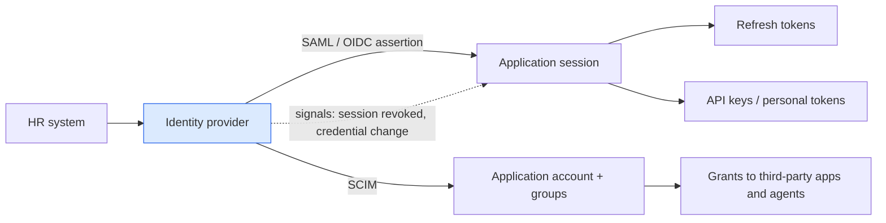

# アイデンティティライフサイクルと継続的アクセス評価

> **翻訳の状態:** 現行の[英語版](../../12-security/08-identity-lifecycle-and-continuous-access.md)からの翻訳です。

## TL;DR

認証は事象であり、アクセスは持続である。ユーザーがサインインした瞬間から、そのトークンが失効する瞬間までのあいだに、事実は変わる。従業員が解雇される。デバイスがコンプライアンスから外れる。侵害のあとでパスワードがリセットされる。グループのメンバーシップが外される。トークンをローカルで検証するシステムはどれも、トークンが尽きるまで、古い事実に基づいてアクセスを与え続ける。**アイデンティティシステムの露出の窓とは、何者も回収できない成果物のうち、最も長生きするものである。** フェデレーションされた配備では、それは通常アクセストークンではない。アイデンティティプロバイダが忘れてしまった、どこかの下流アプリケーションのセッションである。

2つの標準群が、この隙間を閉じる。**SCIM**(RFC 7643とRFC 7644)は、各アプリケーションのアカウントとグループを、信頼できる情報源と同期した状態に保つ。入社、異動、退職が、チケットなしで反映される。**Shared Signals Framework**と、そのイベントプロファイルであるCAEPおよびRISCは、2025年からOpenID Foundationの最終仕様である。これらは、セキュリティイベントをプロバイダ間でほぼリアルタイムに送る。ある場所で失効したセッションが、あらゆる場所で終わる。フェデレーションのプロトコルとトークンの検証は、[OAuth 2.0とOpenID Connect](04-oauth2-openid-connect.md)と[JOSEとJSON Web Tokenの検証](05-jwt-tokens.md)が扱う。本章の主題は、サインイン後のアイデンティティ状態の変化が、それに依存するシステムへどう届くかである。

## ライフサイクルの契約

1. **属性ごとに信頼できる情報源は1つ。** 雇用状態は人事システムから、グループのメンバーシップはディレクトリから、デバイスの状態はデバイス管理から来る。下流は、自分の写しを編集しない。
2. **安定した識別子。** アカウントは、不変のサブジェクト識別子で結合する。再割り当てされうるメールアドレスやユーザー名では、決して結合しない。
3. **有界なプロビジョニング解除。** 「情報源でアクセスが取り除かれた」時点から「どこでもリクエストが成功しない」時点までの最大時間が明示され、計測されている。
4. **失効はすべての成果物を覆う。** そのアイデンティティが作ったセッション、リフレッシュトークン、APIキー、個人アクセストークン、サードパーティへのグラントが、すべて対象である。
5. **受信側が判断する。** セキュリティシグナルは証拠である。受信するアプリケーションは自身のポリシーを適用し、盲目的には従わない。
6. **シグナルの喪失は検知できる。** 壊れたストリームや失敗したプロビジョニングジョブは、古いアクセスを黙って残すのではなく、アラートを上げる。

## 古いアクセスが潜む場所

アイデンティティプロバイダでユーザーを無効にすると、新しいサインインは止まる。しかしそれだけでは、最初の矢印より右にあるどの箱にも、何も起こらない。

| 成果物 | 典型的な寿命 | それを終わらせるもの |
|---|---|---|
| アイデンティティプロバイダのセッション | 数時間 | プロバイダ側での失効 |
| SAMLまたはOIDCでのサインイン後のアプリケーションセッション | 数時間から数週間。アプリケーションが決める | バックチャネルログアウト、セッション失効のシグナル、または失効期限 |
| アクセストークン | 数分 | 失効期限。リソースが確認するならイントロスペクション |
| リフレッシュトークン | 数日から数か月 | 認可サーバでの失効(RFC 7009) |
| APIキーまたは個人アクセストークン | 削除されるまで | それを明示的に削除するプロビジョニング解除 |
| サードパーティのアプリやエージェントへのOAuthグラント | 失効されるまで | グラントの失効。通常はユーザーの状態に結び付いていない |
| アプリケーション内のローカルアカウント | 永久 | SCIMによる無効化 |

**例示:** 15分のアクセストークン、12時間のアプリケーションセッション、個人アクセストークンを持つ解雇された従業員の露出は、それぞれ15分、12時間、無制限である。アクセストークンを短くしても、重要なことは何も変わらなかった。

## フェデレーションはいまも2つのプロトコルで動く

企業のシングルサインオンは、新しい統合ではOpenID Connectであり、大きな既存基盤ではSAML 2.0である。どちらも、サインインについての署名付きの言明をアプリケーションへ届ける。そして、どちらもその後については何も語らない。引き継がれる設計上の要点は次のとおりである。

- **SAML固有の点。** 署名ラッピングを破るため、実際に消費するアサーションを覆う署名を検証する。オーディエンス、受信者、有効期間を検査する。`InResponseTo`でレスポンスをリクエストに結び付け、業務上の理由が明示されていない限り、要求していないレスポンスを拒否する。アサーションIDのリプレイキャッシュを保つ。
- **アサーション内の属性は、ただちに古くなる。** サインイン時にセッションへ複製されたグループのメンバーシップは、スナップショットである。セッションを短く保つか、SCIMでグループを同期して、判断の時点で読む。
- **ジャストインタイムのプロビジョニングは、ライフサイクルの半分である。** 最初のサインイン時にアカウントを作る方式は、入社を扱う。退職は決して扱わない。サインインできないユーザーは、イベントを生まないからである。

## SCIMによるプロビジョニング

**文書化済み、RFC 7643およびRFC 7644:** SCIMは、ユーザーとグループのJSONスキーマと、それらを管理するRESTプロトコルを定義する。`POST /Users`、`GET /Users?filter=...`、`PATCH /Users/{id}`、`DELETE`があり、`/Groups`にも同じものがある。加えて、一括操作と、ETagによるリソースのバージョンがある。アイデンティティプロバイダがクライアントであり、各アプリケーションがサーバを公開する。

プロトコルは単純である。システム上の問題は、その縁にある。

- **対応付け。** プロバイダは、各ユーザーについてアプリケーション側の`id`を保存し、自身の`externalId`を供給する。作成は冪等でなければならない。作成がタイムアウトして再試行されたら、`externalId`またはユーザー名による検索が最初の試行を見つけなければならない。重複を生んではならない。
- **無効化し、それから削除する。** `active`をfalseにすることが退職のイベントであり、セッション、トークン、キーをただちに終わらせなければならない。レコードの削除は保持に関する判断であり、ずっとあとになることもある。先に削除すると、所有されていたリソースや監査履歴が孤立することが多い。
- **大規模なグループ更新。** 5万人のメンバーを持つグループを、変更のたびに丸ごと置き換えることはできない。追加と削除の操作を持つ`PATCH`を使い、プロバイダが大きな変更を多数のリクエストに分割することを想定する。
- **順序と収束。** リクエストは順不同で届き、一部は失敗する。プロバイダは、両側を比較してドリフトを修復する、定期的な完全照合を実行する。アプリケーションは、すべての操作を繰り返しても安全にする。
- **レートとバックプレッシャー。** 組織再編は、数分で数千のメンバーシップを変える。タイムアウトさせるのではなく、429と`Retry-After`で応答する。また、無効化が一括のグループ編集の後ろに並ばないようにする。

**例示:** 変更が発生するたびにプッシュし、40分ごとに照合するプロバイダでは、プッシュが1つ失われると、プロビジョニング解除の最悪遅延は40分になる。明示された上限が5分なら、プッシュの経路に配信保証とアラートが必要である。さもなければ、緊急の部分集合をシグナルのストリームで運ばなければならない。

## Shared Signals、CAEP、RISC

**文書化済み、OpenID Shared Signals Framework 1.0、CAEP 1.0、RISC 1.0(最終版、2025年):** 送信者と受信者が、1つのストリームについて合意する。イベントはSecurity Event Token(SET、RFC 8417)である。これは`events`クレームを持つ署名付きJWTであり、HTTPプッシュ(RFC 8935)または受信者によるポーリング(RFC 8936)で配信される。イベントのサブジェクトは、標準のサブジェクト識別子形式(RFC 9493)で表現され、ユーザー、セッション、デバイス、テナントを名指しできる。

| プロファイル | イベント | 受信者の典型的な動作 |
|---|---|---|
| CAEP(セッションの状態) | セッション失効、クレデンシャル変更、トークンクレームの変更、保証レベルの変更、デバイスコンプライアンスの変更 | セッションを終了するか再評価する。ステップアップを要求する |
| RISC(アカウントの状態) | アカウント無効化、アカウント有効化、アカウント削除、クレデンシャルの侵害、識別子の変更または再利用 | ロックする、レビュー対象にする、またはフェデレーションされたアイデンティティの連携を解く |

シグナルは双方向に流れる。アイデンティティプロバイダは、セッションが失効したことをアプリケーションへ伝える。ありえない移動やトークンの窃取を検知したアプリケーションは、アイデンティティプロバイダへ伝える。するとアイデンティティプロバイダは、他のすべてのアプリケーションについてもセッションを終わらせられる。デバイス管理サービスは、ノートパソコンがもはやコンプライアンスを満たさないことを、両者へ伝える。

ストリームの運用は、セキュリティ上の帰結を伴うメッセージングの問題である。

- **検証イベント。** 受信者は定期的に、検証イベントを送るよう送信者に求め、それが届かなければアラートを上げる。静かなストリームと死んだストリームを見分ける方法は、これしかない。
- **順序と重複。** SETは、一意の`jti`とイベント時刻を運ぶ。受信者は`jti`で重複を除去し、イベントを冪等に適用する。セッションが開始時刻を記録していれば、「時刻Tにセッション失効」は、2回処理しても、その後のサインインに対してどの順序で処理しても安全である。
- **プッシュとポーリング。** プッシュは速く、受信者が到達可能である必要がある。ポーリングはファイアウォールの背後でも動き、受信者の遅延を明示する。どちらにも、確認応答と再配信が必要である。
- **受信者でのポリシー。** 侵害された送信者や設定を誤った送信者が、組織を締め出せてはならない。破壊的な操作は送信者ごとにレート制限し、「削除」よりも「再認証を要求」を優先する。

## リソースでの失効の強制

シグナルが役に立つのは、リクエストの経路がその結果を参照するときだけである。パターンを、安いものから順に挙げる。

1. **短いトークンと、関門付きのリフレッシュ。** アクセストークンの寿命は5分から15分。失効は、クライアントがリフレッシュするときに強制される。露出は、トークンの有効期間に等しい。
2. **サブジェクトごとの有効性ウォーターマーク。** ユーザーまたはセッションごとにタイムスタンプを1つ保存する。「T以前に発行されたトークンは無効」という意味である。失効イベントは、それを現在時刻に設定する。リソースサーバは、トークンの`iat`を、イベントストリームから供給されるローカルキャッシュのウォーターマークと比較する。**例示:** 1,000万ユーザーに1人16バイトなら160 MBであり、あらゆる強制点でメモリに保持できる小ささである。ウォーターマークを最大トークン有効期間だけ保持するなら、最近イベントのあったユーザーだけにエントリがあればよい。
3. **イントロスペクション(RFC 7662)。** リソースは、リクエストごとに、または短いキャッシュを挟んで、認可サーバへ問い合わせる。これは正確である。そして、認可サーバを、すべてのリクエストの可用性とレイテンシの一部にする。
4. **バックチャネルログアウト。** アイデンティティプロバイダが、署名付きのログアウトトークンを付けて、各アプリケーションのログアウト用エンドポイントを呼ぶ。これはセッション失効シグナルの、OpenID Connectにおける前身であり、広く実装されている。

大規模に機能する組み合わせは、短いトークンと、シグナルから供給されるウォーターマークである。ウォーターマークが緊急の場合を数秒で処理し、シグナルが失われたときには失効期限が最後の砦になる。

## 人間以外のアクセスとサードパーティのアクセス

退職の手続きは人を中心に作られており、人が作るクレデンシャルを見逃す。

- **個人トークンとAPIキー**は、1つのアイデンティティに所有され、それとともに死ななければならない。さもなければ、意図的に移管しなければならない。
- **サービスアカウント**には、所有チーム、有効期限、レビューが必要である。それらについては、人事のイベントが発火することは決してないからである。
- **サードパーティへのOAuthグラント**は、AIエージェントや自動化ツールへのグラントを含め、それを承認した従業員より長生きする。しかも、その従業員の現在の役割より広いスコープを持つことが多い。認可サーバでそれらを棚卸しし、付与したユーザーの状態に結び付け、無効化の際に失効させる。[ワークロードとエージェントのアイデンティティ委任](12-workload-and-agent-identity.md)の委任モデルは、派生した権限を短命にすることで、これを扱いやすく保つ。

## 障害トレース

### プロビジョニング解除されたのにサインインしたまま

1. 人事が従業員を解雇する。アイデンティティプロバイダがアカウントを無効にし、SCIMがアプリケーションで`active`をfalseにする。
2. アプリケーションはアカウントを非アクティブと記すが、既存のセッションを無効にしない。
3. 元従業員の開いたままのブラウザタブは、30日のセッションクッキーが失効するまで動き続ける。

**防止:** 無効化は、同じトランザクションの中でセッションとトークンを無効にする。無効化後に行われたリクエストが失敗することを、テストで表明する。

### 再利用された識別子がアカウントを引き継ぐ

1. 従業員が退職する。そのメールアドレスが、のちに新入社員へ割り当てられる。
2. メールのクレームをアカウントのキーにしているアプリケーションが、新入社員を、元従業員のアカウントとデータへサインインさせる。

**防止:** 不変のサブジェクト識別子と発行者で結合する。識別子再利用のイベントを処理する。メールを決してキーとして扱わない。

### ストリームの無言の障害

1. 証明書のローテーションが、送信者からのプッシュ配信を壊す。
2. イベントが届かない。受信者には、これを静かな1日と区別できない。
3. 誰かがインシデントに気付くまで、失効は伝播しなくなる。

**防止:** アラートを伴う定期的な検証イベント。ストリームごとの最終イベント経過時間のダッシュボード。最後の砦としてのトークン失効期限。

### 照合のスタンピード

1. ディレクトリの再構成が、グループのメンバーシップの大半を変える。
2. プロバイダが数十万件のSCIMリクエストを発し、アプリケーションの書き込み経路が飽和する。
3. その後ろに並んだ無効化が、数時間遅れる。

**防止:** 無効化に別の優先度を与える。`Retry-After`を伴うレート制限を行う。容量は、平均の変更率ではなく、完全照合に合わせて見積もる。

## 検証

1. 情報源でテストユーザーを無効化し、すでに開いているセッション、リフレッシュ、個人アクセストークンのそれぞれが失敗するまでの時間を計測する。3つの数値を、明示された上限と照らして記録する。
2. テスト用のメールアドレスを新しいサブジェクト識別子へ再割り当てし、アプリケーションが新しいアカウントを作ることを確認する。
3. SETをリプレイする。2回目の配信は何もしない。
4. シグナルのストリームを止め、検証間隔の内にアラートが発火することを確認する。
5. グループ変更のバーストを送り、並行する無効化が上限内に処理されることを確認する。
6. アイデンティティが作りうるクレデンシャルの種類をすべて列挙し、それぞれをプロビジョニング解除のどの段階が終わらせるかを示す。

## 判断の枠組み

1. **アプリケーションの階層ごとに、プロビジョニング解除の上限はどれだけか。** 資金や本番環境へのアクセスを持つシステムでは数分。それ以外では1時間が許容されることもある。それを書き残す。
2. **アプリケーションごとに、最も長生きする成果物は何か。何がそれを回収するか。** 答えが「何もない」なら、それを短くするか、シグナルを加える。
3. **プロビジョニングは照合付きのプッシュか、サインイン時のみか。** サインイン時のみのプロビジョニングは、退職に関するどんな上限も満たせない。
4. **どのイベントがリアルタイムのシグナルに値するか。** セッション失効、クレデンシャルの侵害、アカウント無効化、デバイスの非コンプライアンスが、価値の大半を覆う。
5. **リクエスト経路のどこで失効を強制するか。** トークンの失効期限だけか、ウォーターマークか、イントロスペクションか。どれだけ正確でなければならないかに応じて、リソースごとに選ぶ。
6. **人間以外のクレデンシャルは誰が所有し、いつ失効するか。**

## 重要なポイント

- セッション、キー、グラントがより長生きするなら、トークンの有効期間を短くしても露出は短くならない。
- SCIMは収束しなければならない状態を扱い、Shared Signalsはいま届かなければならない変化を扱う。ほとんどのシステムは両方を必要とする。
- 無効化は生きているセッションを終わらせなければならない。その性質にはテストが必要である。
- アイデンティティは不変の識別子で結合する。静かなイベントストリームは、検証イベントが反証するまで、障害として扱う。

## 参考文献

- [RFC 7643: System for Cross-domain Identity Management: Core Schema](https://www.rfc-editor.org/rfc/rfc7643)
- [RFC 7644: System for Cross-domain Identity Management: Protocol](https://www.rfc-editor.org/rfc/rfc7644)
- [OpenID Foundation, *OpenID Shared Signals Framework Specification 1.0*(最終版)](https://openid.net/specs/openid-sharedsignals-framework-1_0-final.html)
- [OpenID Foundation, *OpenID Continuous Access Evaluation Profile 1.0*(最終版)](https://openid.net/specs/openid-caep-1_0-final.html)
- [RFC 8417: Security Event Token (SET)](https://www.rfc-editor.org/rfc/rfc8417)
- [RFC 8935: Push-Based Security Event Token (SET) Delivery Using HTTP](https://www.rfc-editor.org/rfc/rfc8935)
- [RFC 8936: Poll-Based Security Event Token (SET) Delivery Using HTTP](https://www.rfc-editor.org/rfc/rfc8936)
- [RFC 9493: Subject Identifiers for Security Event Tokens](https://www.rfc-editor.org/rfc/rfc9493)
- [RFC 7662: OAuth 2.0 Token Introspection](https://www.rfc-editor.org/rfc/rfc7662)
- [RFC 7009: OAuth 2.0 Token Revocation](https://www.rfc-editor.org/rfc/rfc7009)
- [OpenID Foundation, *OpenID Connect Back-Channel Logout 1.0*](https://openid.net/specs/openid-connect-backchannel-1_0.html)
