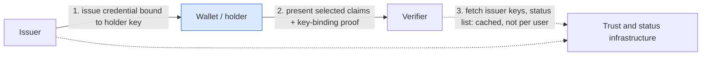

# 検証可能クレデンシャルと選択的開示

> **翻訳の状態:** 現行の[英語版](../../12-security/09-verifiable-credentials-and-selective-disclosure.md)からの翻訳です。

## TL;DR

フェデレーションによるサインインでは、2者がその場で対話する。アプリケーションが尋ね、アイデンティティプロバイダが答える。そのためプロバイダは、ユーザーが行くすべての場所を知る。検証可能クレデンシャルは、この段階を分離する。**発行者**は一組のクレームに一度だけ署名し、その結果をユーザーの**ウォレット**へ渡す。のちにウォレットは、それを**検証者**へ提示する。検証者は、発行者の署名をオフラインで検査する。発行者には連絡が行かず、発行者はクレデンシャルがどこで使われたかを知らない。

このモデルが配備可能になったのは、3つのものが標準化されてからである。保持者が一部のクレームを明かし、他を伏せられるクレデンシャル形式(**SD-JWT**、2025年11月公開のRFC 9901、およびモバイル運転免許証に使われるISOのmdoc形式)。発行と提示のためのプロトコル(**OpenID for Verifiable Credential Issuance 1.0**と**OpenID for Verifiable Presentations 1.0**、どちらも2025年に最終版)。そして選択肢を固定するプロファイル(**HAIP 1.0**、2025年12月に最終版)である。これは、1者が発行し、発行者に追跡させるべきでない多数の他者が消費するクレームに使う。年齢の証明、免許、資格、検証済みのアイデンティティ属性である。自分のサービスへの通常のサインインには使わない。そこでは[パスキーとフィッシング耐性認証](03-passkeys-and-phishing-resistant-authentication.md)のほうが単純で強い。

## 3者間の契約



1. **真正性。** 検証者は、そのクレデンシャル種別について信頼すると決めた発行者が署名したクレームだけを受理する。
2. **保持者束縛。** 提示は、クレデンシャルの発行先である秘密鍵の所持を証明する。そのため、複製されたクレデンシャルは役に立たない。
3. **提示束縛。** 各提示は、1つの検証者と1つのトランザクションに束縛される。そのため、他の場所でリプレイできない。
4. **最小限の開示。** 検証者が受け取るのは、自分が要求し、ユーザーが承認したクレームだけである。
5. **発行者の不可視性。** 検証によって、どの検証者がそのクレデンシャルを見たかが、発行者に明らかになることはない。
6. **失効可能性。** クレデンシャルは、保持者に連絡することなく、また発行者の不可視性を壊すことなく、停止または失効できる。

性質5と6は互いに引き合う。性質2と4は、リンク不能性と引き合う。本章のエンジニアリングの大半は、これらの緊張の管理である。

## SD-JWTにおける選択的開示の仕組み

**文書化済み、RFC 9901:** 発行者は、開示可能なクレームを署名付きJWTの中に入れない。その代わり、クレームごとに**ディスクロージャ**を作る。これは、ランダムなソルト、クレーム名、値を持つJSON配列のbase64urlエンコードである。署名されるペイロードは、各ディスクロージャのハッシュだけを`_sd`配列に含む。

```text
Disclosure:   ["2GLC42sKQveCfGfryNRN9w", "birthdate", "1990-04-12"]
In the JWT:   "_sd": ["Xq3...hash-of-that-disclosure...", "9fT...", "kL0..."],
              "_sd_alg": "sha-256",
              "cnf": {"jwk": { ...holder public key... }}
```

ウォレットは、署名付きJWTと、すべてのディスクロージャを受け取る。提示するときは、JWT、ユーザーが明かすことに同意したディスクロージャだけ、そして鍵束縛JWTを、チルダで連結して送る。

```text
<issuer-signed JWT>~<disclosure 1>~<disclosure 3>~<key-binding JWT>
```

検証者は、発行者の署名を検査する。次に、受け取った各ディスクロージャをハッシュし、そのハッシュが`_sd`に現れることを確認する。それから、鍵束縛JWTを`cnf`の鍵で検証する。この鍵束縛JWTは保持者が署名する。そこには、`aud`としての検証者の識別子、検証者が供給した`nonce`、発行時刻、そして`sd_hash`が入る。`sd_hash`は、提示されるJWTとディスクロージャそのものを覆うハッシュである。伏せられたクレームは、ソルト付きのハッシュとしてのみ表現され、何も明かさない。発行者はおとりのハッシュを加えて、伏せられたクレームの数さえ隠すことができる。

実務では、関連する2つの形式が重要である。**SD-JWT VC**は、SD-JWTを、`vct`クレームを持つ型付きクレデンシャルにするプロファイルである。これはIETFのドラフトだが、配備済みのプロファイルがすでに参照している。**ISO/IEC 18013-5のmdoc**は、CBORエンコードで同じソルト付きハッシュによる開示を実現する。これはモバイル運転免許証の形式である。一般公衆を相手にする検証者は、両方を受理することを想定すべきである。

## 発行と提示のプロトコル

**文書化済み、OpenID4VCI 1.0:** 発行は、ウォレットをクライアントとし、クレデンシャルエンドポイントを保護リソースとするOAuthフローである。発行者がウォレットにクレデンシャルオファーを渡す。ウォレットはアクセストークンを取得する。ユーザーが発行者で認証しなければならないときは認可コードによって、別のチャネルですでに認証を済ませているときは事前認可コードによって取得する。次に、クレデンシャルを束縛すべき鍵の所持証明を付けて、クレデンシャルエンドポイントを呼ぶ。発行者からの新しいノンスが、その証明のリプレイを防ぐ。エンドポイントは、それぞれ異なる鍵に束縛された複数のクレデンシャルを、一度に返すことができる。これは、後述するリンク不能性のために重要である。

**文書化済み、OpenID4VP 1.0:** 提示は、逆方向の認可リクエストである。検証者がクライアントであり、ウォレットが認可サーバである。リクエストは、Digital Credentials Query Language(DCQL)によるクエリと、ノンスを運ぶ。クエリは、求めるクレデンシャル種別と、特定のクレームを名指しする。レスポンスは提示そのものであり、通常は検証者宛てに暗号化される。Web上では、リクエストをブラウザのDigital Credentials APIを通じて届けられる。そこでは、ブラウザとオペレーティングシステムがウォレットの選択を仲介し、リクエストを呼び出し元のオリジンに束縛する。これは、WebAuthnがパスキーに与えるのと同じフィッシング耐性を与える。リダイレクトと、カスタムスキームを持つQRコードはフォールバックとして残るが、その性質は持たない。

**文書化済み、HAIP 1.0:** High Assurance Interoperability Profileは、選択を固定する。特定のクレデンシャル形式、暗号スイート、送信者制約付きトークン、ウォレットのアテステーション、クエリ言語である。[OAuth 2.1と高保証の認可プロファイル](06-oauth-security-profiles.md)のFAPIと同じく、その価値は、多くの選択肢を持つフレームワークを、独立した2つの実装がテストで照合できるものへ変えることにある。欧州デジタルアイデンティティウォレットのような地域プログラムは、その上に築かれている。

## 誰を信頼するかを決める

署名の検証は、「この発行者が署名したか」に答える。「この発行者の言うことを気にすべきか」には答えない。検証者には、各クレデンシャル種別を、それを表明することを許された発行者へ対応付ける規則と、その鍵を取得する方法が必要である。

| 機構 | 仕組み | 適する対象 |
|---|---|---|
| 静的な許可リスト | 検証者が、発行者の識別子と鍵を設定する | 発行者の少ない閉じたエコシステム |
| トラストアンカーへのX.509チェーン | 発行者の証明書が、検証者がそのクレデンシャル種別について信頼するルートへ連鎖する | 政府の文書。mdocのモデル |
| 公開されたトラストリスト | 統治機関が、認定された発行者とウォレットのリストに署名する | 国や業界のスキーム |
| フェデレーションのメタデータ | 各エンティティが、中間者を経てトラストアンカーへ連鎖する署名付きの言明を公開する | 大規模な多者間エコシステム |

対称的な問いは、ウォレットが検証者を信頼すべきかどうかである。検証者の認証と、各検証者が何を要求してよいかの何らかの登録がなければ、どのサイトも、完全な身分証明書を要求できる。そのため高保証のスキームは、検証者を認証し、誰が何のために尋ねているのかをユーザーに表示する。

## 問い合わせなしの失効

クレデンシャルごとの状態照会は、誰がどのクレデンシャルをいつ検証したかを発行者に伝え、発行者の不可視性を破壊する。現在の方式は、それを避ける。

- **ステータスリスト。** **文書化済み、Token Status List(IETF、2026年時点で公開手続き中):** 発行者は、圧縮されたビット配列を公開する。その中で、各クレデンシャルはインデックスを持つ。クレデンシャルは、リストのURIと自身のインデックスを運ぶ。検証者はリスト全体をダウンロードし、キャッシュし、1つの位置を読む。発行者から見えるのは、数千件以上のクレデンシャルを覆うリストの取得であり、どれが検査されたかではない。**例示:** 1,000万件のクレデンシャルに1件1ビットなら、圧縮前で1.25 MBである。ほとんどのビットがゼロなら、圧縮後はそれよりはるかに小さい。
- **短命のクレデンシャル。** 数日間有効なクレデンシャルを発行し、ウォレットに更新させる。失効は「再発行をやめる」ことになり、ステータスのインフラは一切なくなる。その代償として、ウォレットは発行者へ定期的に接続する必要がある。

どちらの場合も、検証者の鮮度は、キャッシュの有効期間かクレデンシャルの有効期間によって制限される。その上限を明示する。それが失効の遅延である。

## リンク不能性とその限界

選択的開示は、クレームの値を隠す。クレデンシャルの同一性は隠さない。発行者の署名、保持者の公開鍵、ハッシュは、クレデンシャルが提示されるたびに同じバイト列である。そのため、情報を突き合わせる2つの検証者や、同じユーザーを2度見る1つの検証者は、たとえ「18歳以上」しか開示されていなくても、提示同士をリンクできる。

- **バッチ発行。** ウォレットは、それぞれ異なる保持者鍵と異なるソルトを持つクレデンシャルの複製を多数取得し、それぞれを1回だけ使う。**例示:** 1,000万人の保持者が、20件のバッチを毎月更新すると、発行者の署名は月に2億回になる。平均で毎秒およそ77回であり、ピーク時にははるかに多い。加えて、保持者1人あたり20のステータスリスト位置が必要になる。
- **ゼロ知識の方式。** 保持者が1つのクレデンシャルからリンク不能な証明を導出できる署名方式は、バッチのコストをなくす。それらは標準化の途上にあり、上記の最終版プロファイルにはまだ含まれていない。
- **目的を台無しにするクレーム。** 氏名、文書番号、正確な生年月日を開示すれば、暗号に関係なくユーザーはリンクされる。年齢のしきい値を表すブール値のような導出クレームを優先し、発行者にそれを含めさせる。

## 容量と可用性

- **検証はオフラインで、安い。** 発行者の署名1つ、保持者の署名1つ、そして開示されたクレームごとにハッシュ1つである。検証者が依存するのは、キャッシュされた発行者の鍵とステータスリストである。そのため、キャッシュが許容できるあいだは、発行者の障害中も動き続ける。
- **発行者はホットパスにいない。** その負荷は発行と更新である。上で計算したように、バッチサイズとクレデンシャルの有効期間が負荷を決める。クレデンシャルが使われる頻度は関係しない。
- **ステータスリストの配布はCDNの問題である。** リストは静的で、署名されており、キャッシュ可能である。更新間隔が鮮度の上限になる。
- **ウォレットの紛失はリカバリの事象である。** セキュアなハードウェア内の保持者鍵は、エクスポートできない。そのため、スマートフォンの紛失は再発行を意味する。発行者には本人確認のやり直しの経路が必要であり、その経路はアカウントリカバリと同じ濫用の特性を持つ。

## 障害トレース

### 提示が第2の検証者へリプレイされる

1. 検証者がノンスなしで提示を要求する。または、鍵束縛JWTの`aud`を検査しない。
2. ユーザーから提示を受け取った悪意ある検証者が、それを転送する。
3. 第2の検証者は、有効な発行者の署名と、有効な保持者の署名を受理する。

**防止:** 常に新しいノンスを送る。鍵束縛JWTの`aud`、`nonce`、`sd_hash`を検証する。オリジンを束縛する、ブラウザ仲介のAPIを優先する。

### どの発行者でも受理される

1. 検証者が、クレデンシャル自身のメタデータにある鍵に対して、署名が有効であることを検査する。
2. 攻撃者が、正しい種別のクレデンシャルを自己発行する。

**防止:** 発行者の鍵は、信頼の仕組みを通じてのみ解決する。各クレデンシャル種別を、許可された発行者に結び付ける。

### 過剰な要求

1. 年齢の証明を必要とする検証者が、そのほうが簡単だという理由で、完全なアイデンティティクレデンシャルを要求する。
2. ユーザーは、習慣でプロンプトを承認する。検証者は身分証明書を保存することになり、それに伴う侵害時の帰結も抱える。

**防止:** 導出クレームを要求する。スキームは、各検証者が何を尋ねる資格を持つかを登録すべきである。クエリを、プライバシーレビューを経た成果物として扱う。

### 状態確認がユーザーを明かす

1. 発行者が、利便性のために、クレデンシャルごとの状態確認エンドポイントを配備する。
2. すべての検証が、クレデンシャルを名指しするリクエストを生む。発行者は、保持者の活動のログを手にする。

**防止:** ステータスリストか、短命のクレデンシャルだけを使う。クレデンシャルごとのコールバックを持つ設計は却下する。

## 検証

1. 検証者が必須とするディスクロージャを取り除く。提示は、デフォルト値で受理されるのではなく、クレームの欠落として拒否される。
2. ディスクロージャの値を改変する。そのハッシュが`_sd`と一致しなくなり、検証が失敗する。
3. 別の鍵で署名された鍵束縛JWT、誤った`aud`、古い`nonce`で提示する。すべて拒否される。
4. 受理される種別の、自己発行したクレデンシャルを提示する。信頼の規則によって拒否される。
5. クレデンシャルを失効させ、検証者がどれだけ長く受理し続けるかを計測する。キャッシュの上限と比較する。
6. 同じクレデンシャルを2つのテスト用検証者へ提示し、両者がそれをリンクできるかどうかを確認する。これは、その配備が実際に提供するリンク不能性を文書化する。
7. 発行者、ウォレット、検証者のうち該当する役割について、OpenID Foundationの適合性スイートを実行する。

## 判断の枠組み

1. **これは、検証者が多数で、発行者に見られるべきでない問題か。** 発行者と検証者が同じ組織であるか、ユーザーが単にサインインするだけなら、フェデレーションかパスキーを使う。
2. **どの形式を受理しなければならないか。** SD-JWT VC、mdoc、またはその両方。通常は、参加するエコシステムが決める。
3. **各クレデンシャル種別の発行を誰に委ねるか。その鍵はどう見つけるか。**
4. **最小のクレーム集合は何か。発行者は導出クレームを提供できるか。**
5. **どれだけの失効遅延が許容されるか。それはステータスリストから来るのか、クレデンシャルの有効期間から来るのか。**
6. **どれだけのリンク不能性が必要か。** なし、検証者ごと、提示ごと。それに応じてバッチ発行の規模を決める。
7. **ウォレットを紛失したら何が起こるか。**
8. **どのプロファイルを適合性の目標とするか。** 選択肢を個別に選ぶのではなく、HAIPか地域のプロファイルを採用する。

## 参考文献

- [RFC 9901: Selective Disclosure for JSON Web Tokens](https://www.rfc-editor.org/rfc/rfc9901)
- [IETFインターネットドラフト, *SD-JWT-based Verifiable Credentials (SD-JWT VC)*](https://datatracker.ietf.org/doc/draft-ietf-oauth-sd-jwt-vc/)
- [OpenID Foundation, *OpenID for Verifiable Credential Issuance 1.0*](https://openid.net/specs/openid-4-verifiable-credential-issuance-1_0.html)
- [OpenID Foundation, *OpenID for Verifiable Presentations 1.0*](https://openid.net/specs/openid-4-verifiable-presentations-1_0.html)
- [OpenID Foundation, *OpenID4VC High Assurance Interoperability Profile 1.0*(最終版)](https://openid.net/specs/openid4vc-high-assurance-interoperability-profile-1_0-final.html)
- [IETFインターネットドラフト, *Token Status List*](https://datatracker.ietf.org/doc/draft-ietf-oauth-status-list/)
- [W3C, *Verifiable Credentials Data Model v2.0*](https://www.w3.org/TR/vc-data-model-2.0/)
- [W3C, *Digital Credentials*](https://www.w3.org/TR/digital-credentials/)
