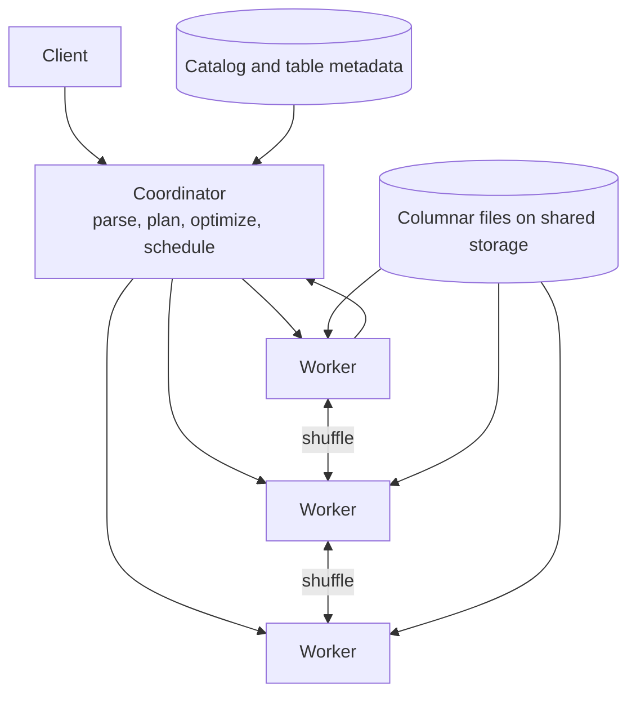

# 分析クエリエンジン

> **翻訳の状態:** 現行の[英語版](../../13-data-pipelines/03-analytical-query-engines.md)からの翻訳です。

## TL;DR

分析クエリエンジンは、テーブルの大きな部分を読んで小さな結果を返す問いに答える。合計、件数、ファクトとディメンションの結合、ある指標による上位k件などである。性能の源は3つあり、効果の大きい順に並べるとこうなる。**プルーニング**(クエリが必要としえないデータを読まないこと)は何桁もの差を生む。**列指向とベクトル化実行**は1桁の差を生む。**並列化**は、残った仕事をワーカー数で割るだけである。

このエンジンは分散システムであり、スキャンとは別の難問を3つ抱える。**オプティマイザ**は、大きく外れることが珍しくないカーディナリティ推定をもとに、結合順序と結合の分散方式を選ばなければならない。**シャッフル**は中間データをワーカー間で移動させる部分で、スキュー、メモリ圧迫、障害復旧がここに集中する。**アドミッション**は、固定のメモリ予算をいくつのクエリで分け合うかを決める。上限のないクエリが1つあれば、ほかの全テナントを巻き込んで落とせるからだ。ファイルと符号化の層は[列指向ストレージ](../03-storage-engines/06-column-storage.md)、テーブルのメタデータとコミットは[レイクハウステーブルフォーマット](./05-lakehouse-table-formats.md)、長時間の耐障害ジョブは[バッチ実行](./01-batch-processing.md)が扱う。本章の主題は、それらの上で動く対話型のエンジンである。

## 一次資料と適用範囲

| 資料 | 示していること | 限界 |
|---|---|---|
| Graefe, Volcano (SIGMOD 1990) | イテレータモデルと、並列性を閉じ込めてほかの演算子を単一スレッドのままにするexchange演算子 | 実行の枠組みであり、現代のハードウェアでの性能の主張ではない |
| Boncz, Zukowski, Nes, MonetDB/X100 (CIDR 2005) | 1回の呼び出しで値のベクトルを処理すれば、タプル単位の解釈オーバーヘッドの大半がなくなる | その論文のハードウェアとベンチマークでの測定 |
| Neumann (VLDB 2011) | ベクトル化の代替として、クエリのパイプラインをデータ中心の密なループへコンパイルする | 1つのコンパイル型エンジンの結果 |
| Melnik et al., Dremel (VLDB 2010, 2020) | 列指向のネストデータ、多段のサービングツリー、のちのストレージ・計算・シャッフルの分離 | Googleのシステムとワークロード |
| Dageville et al., Snowflake (SIGMOD 2016) | 共有データアーキテクチャ。オブジェクトストレージ、独立した計算クラスタ、インデックスの代わりにパーティション単位のメタデータによるプルーニング | 発表時点の1つの商用システム |
| Sethi et al., Presto (ICDE 2019) | コネクタをまたぐ、パイプライン型インメモリ実行の連合エンジン | 発表時点では、ワーカーの障害はクエリの失敗になった |
| Leis et al. (VLDB 2015) | 悪いプランの主因はコストモデルではなくカーディナリティ推定の誤差であり、結合のたびに増幅する | 特定のオプティマイザに対するベンチマーク研究 |

以下の計算例は例示用の入力である。

## ワークロードと契約

分析ワークロードは、設計を左右するすべての軸でトランザクションワークロードと異なる。

| 軸 | トランザクション | 分析 |
|---|---|---|
| クエリあたりの行数 | キー指定で数行 | 条件指定で数百万から数十億行 |
| 触れる列 | 行のほぼ全体 | 多数のうち数列 |
| 書き込み | 小さく、頻繁で、並行 | 一括追記と定期的な書き換え |
| 並行度 | 数千の短い操作 | 数十から数百の重いクエリ |
| レイテンシ目標 | ミリ秒、テールも厳しい | 秒単位、クエリによるばらつきが大きい |
| 正しさの拠り所 | 書き込み間の分離 | クエリごとの一貫したスナップショット |

契約は明示する。スナップショットのセマンティクス(クエリは最初から最後まで1つのテーブルバージョンを見るか)。鮮度(データはどれだけ古くてよいか)。結果の厳密さ(近似集約を許すか)。クエリ単位とテナント単位の資源上限。そしてワーカーが落ちたときクエリがどうなるか。

## アーキテクチャ: コーディネータ、ワーカー、ストレージ



コーディネータはSQLを解析し、カタログでテーブルを解決し、論理プランを作って最適化する。そしてデータの再分散が必要な箇所でプランを**ステージ**に切り分け、ステージの断片をワーカーにスケジュールする。ワーカーはファイルをスキャンし、演算子を実行し、中間行を交換する。

**文書化済み、SnowflakeとDremel:** どちらのシステムもストレージと計算を分離している。データは共有オブジェクトストレージに置かれ、計算クラスタはデータについて状態を持たず、独立にサイズ変更や追加ができる。これはアーキテクチャ上の帰結を持つ。ローカルキャッシュが吸収しない限り、スキャンはオブジェクトストアの遅延を払う。関連するかどうかを判断するためにファイルを列挙して開かずに済むよう、メタデータは十分に良質でなければならない。そして2つの計算クラスタは、カタログ以外の協調なしに同じテーブルを読める。[オブジェクトストレージのアーキテクチャとコミットプロトコル](../03-storage-engines/08-object-storage.md)を参照。

## プルーニング: 最も安い行は読まれなかった行

プルーニングは4つの段階で起こり、それぞれが次の段階の前にデータを取り除く。

1. **パーティションプルーニング。** パーティション列への条件が、ディレクトリやマニフェストのエントリを丸ごと除外する。
2. **ファイルやブロックのスキップ。** ファイル単位、ブロック単位の最小値と最大値(ゾーンマップ)が、範囲の合わないチャンクを除外する。高カーディナリティ列への所属フィルタは、等値条件に対して同じことをする。[ブルームフィルタ](../03-storage-engines/05-bloom-filters.md)を参照。
3. **列の射影。** 参照された列だけを読む。
4. **遅延マテリアライズ。** 条件をその列の上で評価し、残った行位置についてだけほかの列を取りに行く。

最小値・最大値によるスキップが効くのは、データが絞り込み列について**クラスタ化**されている場合だけである。行が `customer_id` に関して無作為な順序で届けば、どのブロックの範囲も全顧客にまたがり、何もスキップされない。ソート順、クラスタリングキー、多次元の順序付けは、ブロックの範囲を狭くするためにある。これは読み取り時のコストを決める書き込み時の判断であり、うまく効かせられるのは数列だけである。

**文書化済み、Snowflake:** この論文は、従来のインデックスの代わりにパーティション単位のメタデータでプルーニングすると述べている。非常に大きく頻繁に書き換えられるデータにインデックスを維持するのは高くつき、オブジェクトストレージへのランダムアクセスは遅いからである。

## 実行: ベクトル、コンパイルされたパイプライン、演算子

古典的なVolcanoモデルは、仮想関数 `next()` の呼び出しで、演算子の木を通して1行ずつ引き出す。分析ワークロードでは、行ごとの呼び出しオーバーヘッドと分岐予測ミスのほうが、実際の演算より高くつく。

このオーバーヘッドを取り除く設計は2つある。

- **ベクトル化実行**は列の値をバッチで渡す。典型的には1回に千個ほどである。各演算子は配列に対する密なループを実行する。解釈のコストはバッチごとに1回で済み、ループはCPUキャッシュとSIMD命令に向いている。エンジンはインタプリタのままなので、プロファイルやデバッグがしやすい。
- **コンパイル実行**は演算子のパイプラインごとにコードを生成する。行はスキャンから次のマテリアライズ点まで1つのループの中を流れ、値はレジスタに保たれる。

スキャンと集約では、どちらも同程度の速度に達する。違いは、実装コスト、短いクエリでのコンパイル遅延、実行時の適応のしやすさにある。システム設計者にとって重要な判断は別のところにある。マテリアライズが必要な演算子(ハッシュ結合のビルド側、ハッシュ集約のテーブル、ソート)は、入力やグループ数に比例するメモリを必要とする。アドミッション制御が予算として扱わなければならないのは、そのメモリである。

## 結合とオプティマイザ

分散結合には2つの判断がある。順序と分散方式である。

**分散方式。** **ブロードキャスト**結合は、小さいほうの入力を、大きいほうを持つ全ワーカーへコピーする。**パーティション**(シャッフル)結合は、両方の入力を結合キーでハッシュし、一致する行が同じワーカーで出会うようにする。ブロードキャストは大きい側のシャッフルを避けられるが、小さい側をワーカー数だけ複製する。正しいのは、小さい側が実際に小さい場合だけである。

**順序。** 複数のテーブルを結合するクエリでは、可能な順序の数は階乗で増える。悪い順序は、最終結果の数千倍の中間結果を生みうる。

どちらの判断も**カーディナリティ推定**、つまり各フィルタと各結合を何行が通過するかの推定に依存する。**文書化済み、Leis et al.:** この研究では、推定誤差は結合の数とともに急速に大きくなり、コストモデルそのものよりも、質の悪いプランの主因になっていた。推定は、条件どうしの独立性とヒストグラム内の一様性を仮定するが、現実のデータはその両方を破る。

エンジンは3つの方法で身を守る。

- **統計。** 行数、異なる値の数のスケッチ、ヒストグラム。一括ロードのあとに更新する。[確率的スケッチ](../03-storage-engines/10-probabilistic-sketches.md)を参照。
- **ランタイムフィルタ。** 小さい側のハッシュテーブルを構築したあと、そのキーのコンパクトな要約を大きい側のスキャンへ送り、一致しない行を発生元で落とす。
- **適応的実行。** ステージの境界で実際のサイズを観測し、続行する前に結合方式を切り替えたり再分割したりする。

## シャッフル、スキュー、障害

シャッフルは、ステージ間での中間行の交換である。エンジンの中で、分散ストレージの問題に最も近い部分だ。

- **スキュー。** ハッシュ分割は、同じキーを持つ行をすべて1つのワーカーへ送る。ある1つの値(多くは `NULL` や `0` のような既定値)が行の30%を占める列で結合や集約をすると、1つのワーカーがデータの30%を受け持つ。対策は、ホットキーにソルトを付けて複数のパーティションへ分けること、支配的な値を別扱いすること、あるいは意味を持たない値なら除外することである。
- **メモリ。** ハッシュテーブルを保持できないステージは、ディスクへスピルするか失敗する。スピルはクエリを生かすが、レイテンシの代償は大きい。
- **障害。** シャッフルデータがワーカーのメモリにしかなければ、ワーカーを失うとクエリを失う。シャッフル出力を別のサービスやストレージへ永続化するエンジンは、ステージだけを再試行できる。**文書化済み、Dremel (2020):** 回顧論文は、この理由と、シャッフルをワーカーのメモリから切り離す目的で、シャッフルを分離されたサービスへ移したと述べている。

明示すべき契約は、システムがどちらの種類かである。高速だが喪失時に失敗する方式は、クライアントが再実行できる対話型クエリに向く。永続シャッフルとステージ再試行を持つ方式は、1時間かかる変換処理に向く。後者のワークロードを前者のエンジンで走らせるのは、呼び出しを受ける原因としてよくあるものだ。

## アドミッション、分離、キャッシュ

分析クラスタは固定のメモリとCPUの予算を持ち、クエリあたりのコストが6桁もばらつくワークロードを受ける。アドミッション制御がなければ、クラスタの振る舞いは、同時に走っている最も高価なクエリが決める。

- **キューとリソースグループ**は、テナントやワークロードクラスごとに並行度とメモリの上限を設ける。定期レポートが対話型の利用者を飢えさせないようにするためだ。公平性の仕組みは[優先度、公平性、バックプレッシャー](../18-workflow-job-systems/07-priority-fairness-backpressure.md)にある。
- **クエリごとの上限**(スキャンバイト数、メモリ、実行時間)は、暴走したクエリを1人の利用者へのエラーに変える。
- **結果キャッシュとフラグメントキャッシュ**は、繰り返されるダッシュボードのクエリを吸収する。正しさは、キャッシュのキーにテーブルのスナップショットバージョンを含めることに依存する。
- **マテリアライズドビューとロールアップテーブル**は、高価な集約を事前に計算する。コストを書き込み時へ移し、読み手に見えなければならない鮮度の契約を追加する。

## 容量モデル

入力はすべて例示である。

ファクトテーブルは100億行、非圧縮で1行200バイト(2 TB)である。列指向で5倍に圧縮して400 GBになり、同程度の大きさの50列からなり、1年分を日単位でパーティションしている。ダッシュボードのクエリは、直近30日について4列を読む。

```text
column projection   = 400 GB x 4/50          = 32 GB
partition pruning   = 32 GB x 30/365         = 2.63 GB
scan cost           = 2.63 GB / 100 MB/s     = 26 core-seconds
on 64 cores         = 26 / 64                = 0.4 s plus planning and merge

without pruning     = 400 GB / 100 MB/s      = 4,000 core-seconds = 62 s on 64 cores
```

同じハードウェアが、レイアウトによってエンジンがバイトの99.3%をスキップできるかどうかで、1秒未満で答えることもあれば1分かかることもある。どれだけベクトル化しても、150倍の差は埋まらない。

結合の分散方式について。50 MBのディメンションテーブルを100ワーカーへブロードキャストすると、クラスタ全体で5 GBのメモリを使う。これは許容できる。オプティマイザが20 MBと推定したために20 GBのテーブルをブロードキャストすると、2 TBを要して失敗する。バグだったのは演算子ではなく推定である。

## 障害トレース

### 既定キーが1つのワーカーを食い尽くす

1. 注文を `customer_id` で顧客と結合する。ゲスト購入は `0` を保存している。
2. 全注文の4分の1が同じパーティションへハッシュされる。
3. ほかのワーカーが待機しているあいだ、1つのワーカーがメモリ上限の数倍のハッシュテーブルを構築する。
4. 設定に応じて、クエリは20分間スピルし続けるか、強制終了される。

プランは正しく、データが偏っていた。統計から支配的なキーを検出し、分割するか特別扱いする。

### 古い統計がブロードキャストを選ぶ

バックフィルのあと、テーブルが100万行から20億行に増えたが、統計が更新されていない。オプティマイザはそれをブロードキャストする。すべてのワーカーが同時にメモリ不足になる。統計の更新をロードの一部にし、ブロードキャストのサイズには、プラン時の推定だけでなく実行時の検査でも上限を設ける。

### メタデータがクエリそのものになる

ストリーミングの書き込みによって、テーブルに400万個の小さなファイルがたまる。プランニングは、最初の行をスキャンする前に、ファイルの列挙とフッタの読み込みに数分を費やし、コーディネータのヒープはファイル記述子で埋まる。コンパクションとマニフェスト単位の統計は、対話的なレイテンシの前提条件である。[レイクハウステーブルフォーマット](./05-lakehouse-table-formats.md)を参照。

### 月曜朝のスタンピード

200のダッシュボードが9時に更新され、それぞれが10個のクエリを発行する。キューがなければ2000個すべてが同時に走り、それぞれがわずかなメモリしか得られず、大半がスピルする。クライアントがタイムアウトして再試行するまでに、どれも終わらない。並行度に上限を設けたアドミッションは、同じ仕事をより早く終える。実行されるクエリが、RAMに収まるだけのメモリを得られるからである。

## 運用と検証

追跡する対象は次のとおり。クエリごとのスキャンバイト数とテーブルのバイト数の比(プルーニングの有効性)。プランの各ノードでの推定行数と実際の行数(推定誤差)。シャッフルのバイト数とパーティションごとのスキュー。スピルの量。キュー待ち時間と実行時間。プランニング時間。そしてスナップショットバージョン別のキャッシュヒット率。

正しさは、生成したクエリとデータについて、参照エンジンとの差分テストで検証する。`NULL` の扱い、空の入力、オーバーフローを含める。堅牢性は次のテストで検証する。設定した各上限ちょうどのクエリ。シャッフル中に強制終了されたワーカー。敵対的なスキューを持つテーブル。そして大きなロードのあとに統計の更新を保留した状態である。

## 判断の枠組み

| 状況 | 選択 | 理由 |
|---|---|---|
| 既知のディメンションに対する1秒未満のダッシュボード | クラスタ化したレイアウト上の、事前集約ロールアップかマテリアライズドビュー | プルーニングと事前計算は、どんなスキャン速度にも勝る |
| データレイクに対するアドホックな探索 | インメモリのパイプライン実行を行う連合MPPエンジン | 低レイテンシ。失敗したクエリは利用者が再実行する |
| 大きな結合を伴う数時間の変換処理 | 永続シャッフルとステージ再試行を持つエンジン | ワーカーの喪失でジョブをやり直してはならない |
| 新しい行に対する運用分析 | 取り込み時に索引するリアルタイムOLAPストア、または列指向の射影を持つリードレプリカ | 秒単位の鮮度の契約と、限定されたクエリの形 |
| 1つのクラスタに複数のテナント | リソースグループ、クエリごとの上限、クラスごとの計算の分離 | 分離はプロダクト要件であり、チューニングの一手順ではない |
| 既知の少数の列での絞り込み | その列でクラスタ化またはソートする | 最小値・最大値によるスキップはクラスタ化したデータでしか効かない |
| 大規模なユニーク数やパーセンタイル | 誤差を明示した近似集約 | 正確な方式はすべての値をシャッフルする必要がある |

エンジンを選ぶ前に、実際のワークロードで3つの比を測る。スキャンバイト数と保存バイト数の比。最悪の結合での推定カーディナリティと実際の比。そして最大のシャッフルパーティションと中央値の比である。これらは、どんなベンチマークの数字よりも、コストとインシデントをよく予測する。

## 参考文献

- [Graefe, *Encapsulation of Parallelism in the Volcano Query Processing System* (SIGMOD 1990)](https://doi.org/10.1145/93597.98720): イテレータモデルとexchange演算子の原論文
- [Boncz, Zukowski, and Nes, *MonetDB/X100: Hyper-Pipelining Query Execution* (CIDR 2005)](https://www.cidrdb.org/cidr2005/papers/P19.pdf)
- [Neumann, *Efficiently Compiling Efficient Query Plans for Modern Hardware* (VLDB 2011)](https://www.vldb.org/pvldb/vol4/p539-neumann.pdf)
- [Melnik et al., *Dremel: Interactive Analysis of Web-Scale Datasets* (VLDB 2010)](https://research.google/pubs/dremel-interactive-analysis-of-web-scale-datasets-2/)
- [Melnik et al., *Dremel: A Decade of Interactive SQL Analysis at Web Scale* (VLDB 2020)](https://www.vldb.org/pvldb/vol13/p3461-melnik.pdf)
- [Dageville et al., *The Snowflake Elastic Data Warehouse* (SIGMOD 2016)](https://doi.org/10.1145/2882903.2903741)
- [Sethi et al., *Presto: SQL on Everything* (ICDE 2019)](https://trino.io/Presto_SQL_on_Everything.pdf)
- [Leis et al., *How Good Are Query Optimizers, Really?* (VLDB 2015)](https://www.vldb.org/pvldb/vol9/p204-leis.pdf)
- [Schulze et al., *ClickHouse: Lightning Fast Analytics for Everyone* (VLDB 2024)](https://www.vldb.org/pvldb/vol17/p3731-schulze.pdf)
