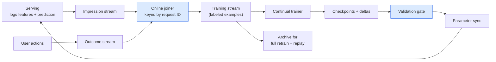

# 継続学習とモデルの鮮度

> **翻訳の状態:** 現行の[英語版](../../16-ml-systems/16-continual-learning-model-freshness.md)からの翻訳です。

## TL;DR

モデルは学習データを圧縮した写しであり、その写しは時間とともに古くなります。継続学習は、スナップショットではなくストリームで学習することで、イベントが発生してからモデルがそれを知るまでの間隔を数日から数分へ縮めます。広告、フィード、不正検知、マーケットプレイスのように入力の入れ替わりが速いワークロードでは、この効果は確かに現れます。その代償として、バッチ学習のために作られた安全策のほぼすべてが前提を失います。それらは完成したデータセットと離散的なモデルバージョンを前提としていましたが、ストリームにはどちらもありません。サンプルを消費する時点でラベルはまだ届いている途中であり、検証セットは未来そのものであり、オプティマイザは独自の時計で古びていく状態を抱え、「前のバージョンへロールバックする」という操作はバージョンを意図的に作らない限り意味を持ちません。本章では、鮮度を計測して購入する量として扱い、継続学習を出力がたまたま重みであるストリーミングシステムとして扱います。

定期的な再学習とそのトリガーは[学習パイプライン](05-training-pipelines.md)で、ラベルの成熟は[ラベルと正解データのシステム](10-label-ground-truth-systems.md)で扱います。分単位の更新を現実的なコストにするスパースパラメータの仕組みは[埋め込みテーブルとスパースモデル基盤](17-embedding-tables-sparse-models.md)にあります。

---

## 鮮度は計測できる性質である

継続学習の必要性は、たいてい逸話で語られます。競合が1時間ごとに再学習しているから自分たちもそうすべきだ、という具合です。しかし鮮度の価値は、すでに手元にあるデータでオフラインに計測できます。

時刻 `T - d` までのデータで学習したモデルを、`T` の直後のトラフィックで評価します。これを1時間、6時間、1日、1週間といった複数の遅延 `d` について繰り返します。指標を `d` に対してプロットした曲線が*鮮度曲線*であり、その傾きが1時間の古さのコストです。与信モデルでは曲線は数か月にわたって平坦であり、継続学習は見返りのない運用リスクを増やすだけです。インプレッションの大きな割合が直近1日に作られたアイテムへ向かうフィードのクリックモデルでは、最初の数時間で曲線は急になります。トラフィックを支配する識別子をモデルが一度も見ていないからです。

この曲線は、古さがどこにあるのかも教えてくれます。密なネットワークを固定し、新しいアイテムの埋め込み行だけを更新して損失の大半が回復するなら、必要なのは新鮮なスパースパラメータであって新鮮なモデルではなく、構築コストははるかに小さくなります。特徴量の再計算頻度を上げて回復するなら、対策は学習器ではなく[特徴量ストア](02-feature-stores.md)の側にあります。3つの対策はコストが1桁ずつ異なるため、アーキテクチャを決める前にこれらのアブレーションを実施します。

---

## 更新頻度のスペクトラム

「オンライン学習」という言葉は幅のある設計群を指しており、何が壊れうるかはそれぞれ異なります。

| 更新頻度 | 作業単位 | モデルの同一性 | 典型的な鮮度 | 手放すもの |
|---|---|---|---|---|
| 定期的なフル再学習 | スナップショット全体を初期値から | 実行ごとに不変のバージョン1つ | 数日 | 鮮度 |
| ウォームスタートの増分学習 | 新しいパーティションを前回のチェックポイントから | 増分ごとにバージョン1つ | 数時間 | 履歴からの独立性(誤りが増分をまたいで蓄積する) |
| マイクロバッチの継続学習 | 数分ぶんのストリーム | 定期的に発行するチェックポイント | 数分 | サービング前に確保されたホールドアウト検証セット |
| イベント単位のオンライン学習 | 1サンプル | 意図的に作らない限り存在しない | 数秒 | あらゆるバッチ単位の検証 |

表を下へ進むほど、人間やゲートが悪いモデルを止められた場所が1つずつ消えていきます。フル再学習は昇格前に何時間も評価できます。5分ごとに公開するマイクロバッチ学習器に与えられる時間は5分であり、実行するチェックはすべて自動でなければなりません。リアルタイムを名乗る本番システムの多くは3行目に位置し、ストリームの横で定期的なフル再学習をアンカーとして動かし続けています。その理由は忘却の節で説明します。

---

## パイプラインはストリーミングシステムになる

バッチ学習では、学習器が起動する前にデータセットが組み立てられ、検証され、凍結されます。継続学習ではデータセットは決して完成しないため、これらの各段階は独自の遅延、バックログ、障害時の振る舞いを持つ常駐オペレータになります。



図の中で重要なのはループです。モデルの予測が何を表示するかを決め、表示されたものがクリックされうるものを決め、クリックが次の学習サンプルになります。バッチシステムではこのループは1日に1回閉じ、検証段階を通過します。ここでは数分で閉じるため、悪い更新は誰かが確認する前に、自分自身の次の学習データを汚染できます。

学習器をストリームのコンシューマとして扱うと、2つの性質が導かれます。第一に、学習ストリーム上の位置は学習器の状態の一部です。重みだけを記録し、それに対応するストリームのオフセットを記録しないチェックポイントは、サンプルを飛ばすか二重に学習するかしなければ再開できません。第二に、学習器にはスループットがあり、ストリームがそれを上回ると、モデルは損失曲線には現れない形で遅れていきます。学習済みの最新サンプルと現在とのイベント時刻の差として測る学習器ラグが鮮度の第一の指標であり、精度指標より先にアラートを設定すべきものです。

---

## オンラインジョイナ

学習サンプルには特徴量とラベルが必要ですが、この2つは異なる時刻に異なるシステムで生成されます。特徴量は予測の瞬間に存在します。ラベルはユーザーが行動したとき、あるいは行動しないと結論づけるのに十分な時間が過ぎたときに存在します。

ジョイナは各インプレッションをキー付きバッファに保持し、対応する結果を待ちます。同じリクエストIDを持つクリックが届けば正例を出力します。結合ウィンドウ `W` が一致なしで満了すれば負例を出力します。この小さなコンポーネントにおける3つの設計判断が、システムの正しさの大半を決めます。

1つ目は特徴量の出どころです。ジョイナは、サービング経路が実際に使用し、予測時にログへ記録した特徴量の値を出力しなければならず、ラベルが届いた時点で再計算してはなりません。結合時に再計算すると判断より後の特徴量の値を読むことになり、[特徴量ストア](02-feature-stores.md)で扱う時点整合性のリークをストリーミング経路から再び持ち込みます。特徴量のログ記録はリクエストごとにストレージとネットワークを消費しますが、学習とサービングのスキューを構造的に不可能にする唯一の方法です。

2つ目は結合キーです。クライアントが送り返すリクエストIDは厳密です。時間ウィンドウ内でユーザーとアイテムによって結合するのは推測であり、同じアイテムが繰り返し表示された場合に誤ったラベルを付けます。

3つ目はウィンドウそのもので、これは鮮度とラベル精度の直接的なトレードオフです。ウィンドウ `W` はすべての負例を `W` だけ遅らせるため、学習器がどれほど速くても、モデルは負例について少なくとも `W` だけ古くなります。`W` を縮めれば鮮度は改善し、最終的には正例になるはずのものがより多く負例として出力されます。次節はこの変換を扱います。

ジョイナのバッファは、システムで最大のストリーミング状態でもあります。直近 `W` の全インプレッションについて1エントリずつ保持するからです。再起動を越えて残す必要があるため、チェックポイントを取るかストリームから再構築することになり、そのメモリ使用量はトラフィックとウィンドウの積に比例します。

---

## 遅延フィードバックと偽陰性の問題

あるインプレッションの真のコンバージョン確率を `p` とし、最終的なコンバージョンのうちインプレッションから `t` 以内に届く割合を `F(t)` とします。ウィンドウ `W` のジョイナは確率 `p · F(W)` で正例を観測し、残りを負例とラベル付けします。このストリームで学習したモデルは `p · F(W)` へ収束し、係数 `F(W)` のぶんだけ過小に予測します。

クリックでは `F` は数分以内に0.99へ達し、バイアスは無視できます。購入、インストール、サブスクリプション開始では `F(1時間)` が半分を下回ることがあり、1時間のウィンドウは、コンバージョンしたユーザーの大半がコンバージョンしなかったとモデルに教えます。このバイアスは一様でもありません。高額なアイテムは安価なアイテムより遅くコンバージョンするため、モデルは最も価値の高い結果ほど過小評価するようになります。

対応は4つあり、複雑さの順に並べられます。待つこと、すなわち `F(W)` が1に近くなるまで `W` を大きくして古さを受け入れる方法があります。事後に補正すること、すなわちセグメントごとに `F(W)` を推定して予測をそれで割る方法があり、これは全体のキャリブレーションを修復しますが、遅延が特徴量と相関する箇所ではランキングが歪んだままです。まず負例として即座に学習し、コンバージョンが最終的に届いた時点でそのサンプルの正例のコピーを2回目として出力し、期待勾配が真のラベル分布のそれと一致するよう重みを選ぶ方法があります。そして遅延を明示的にモデル化すること、すなわちコンバージョン確率と遅延分布を同時に学習し、経過時間 `a` の未コンバージョンのインプレッションが「コンバージョンしない」の尤度ではなく「まだコンバージョンしていない」の尤度として寄与するようにする方法があります。

多くの継続学習システムが採用するのは3番目です。学習器を単純に保ち、補正をストリームの側に置けるからです。

```python
# Emitted by the joiner. An impression first appears as a negative at
# window close; if its conversion arrives later, a positive copy follows.
#
# With q = model's current estimate of the biased (observed) positive
# rate, the importance weights below make the expected gradient equal
# that of training on true labels (the "fake negative weighted" loss).

def example_weight(label: int, q: float) -> float:
    if label == 1:
        return 1.0 + q          # late positive, counted once as a negative already
    return (1.0 - q) * (1.0 + q)  # negative that may yet turn out positive
```

どの補正を選んでも、完全に成熟したラベルに対して検証しなければなりません。つまり継続学習システムは、遅延分布の全体を待つ低速なバッチ評価経路に依存し続けます。学習の鮮度はラベルの時計を取り除きません。その代償を支払う場所を移すだけです。

---

## 忘却と振り回し

ストリームで学習するモデルはデータを時間順に見ることになり、確率的勾配降下法は直近のサンプルに最も大きな重みを置きます。それがこの取り組みの目的であり、同時に主要な危険でもあります。トラフィックには周期があります。午前4時に活動するユーザーは正午のユーザーとは異なり、週末の行動は平日とは異なります。実際の変化を追えるほど学習率の高い継続学習器は周期も追ってしまい、朝には日中のトラフィックについて知っていたことを部分的に上書きしています。これが破滅的忘却の実務上の姿です。ネットワークは学術的な意味でタスクを失うのではなく、自分自身の分布のうちオフピークの半分を毎日失います。

緩和策はいずれも、過去の記憶をいくらか取り戻すことで機能します。リプレイは、より長い期間からアーカイブされたサンプルを新しいバッチに混ぜ、すべての更新が昨日と直近5分の両方を見るようにします。学習率を分ければ、新しい識別子の埋め込み行は素早く動かしつつ、ゆっくり変化する構造を符号化する密な層はフル再学習の間はゆっくり動かすか、まったく動かさないようにできます。そして定期的なフル再学習がアンカーとして働きます。長くシャッフルされたウィンドウで初期値から学習したモデルが、継続学習モデルの密なパラメータを定期的に置き換え、蓄積したドリフトを捨てます。アンカーを外したシステムは、ボットの波、ログのバグ、祝日といった代表性のないデータがストリームから数時間流れ込み、モデルが元へ戻れなくなったインシデントの後で、アンカーを再発見することになりがちです。

---

## オプティマイザの状態も古くなる

Adagrad や FTRL のようにスパースモデルに適したオプティマイザは、パラメータごとに勾配の二乗の累積値を保持し、その平方根で学習率を割ります。バッチ実行ではこれは望ましい性質で、頻繁に更新されるパラメータほど小さな歩幅を取ります。終わりのない実行では累積値は増える一方であり、長く生きているすべてのパラメータの実効学習率はゼロへ向かって減衰し、モデルは次第に適応する能力を失います。症状は、名目上はリアルタイムで学習しているのに、鮮度曲線が日次再学習のものと同じに見えるシステムです。

したがって継続学習器にはオプティマイザ状態に対する方針が必要であり、その方針は重みと同じくモデルの一部です。一般的な選択肢は、累積値を指数的に減衰させること、アンカー再学習のたびにリセットすること、実効学習率に下限を設けることです。どれを選ぶにしても、ウォームスタートは重みとともに累積値を復元しなければなりません。重みだけを保存するチェックポイントは新しい累積値で再開し、すでに落ち着いていたパラメータに非常に大きな歩幅を適用します。これは再起動のたびに直後に現れる損失のスパイクとして観測されます。

---

## 差分の公開

数十億の埋め込み行を持つモデルを、数分ごとに再エクスポートして再ロードすることはできません。幸い、短い間隔のうちに勾配を受け取る行はごく一部です。トラフィックに現れる識別子がごく一部だからです。学習器はどの行が触れられたかを追跡してそれらを差分として公開し、サービングのレプリカはすでにメモリにあるパラメータへ差分を適用します。すべてのサンプルが更新する密な層は、丸ごと配布できるほど小さく、通常はより低い頻度で公開されます。

ここから、バッチサービングでは生じない整合性の問いが生まれます。差分が適用されている最中、あるリクエストは一部の行を新しい世代から、一部を古い世代から読む可能性があります。埋め込み行については、連続する世代の行同士が近いため、これは一般に許容できます。密な層の変更をまたぐ場合は許容できません。古いネットワークに対して学習された埋め込みを新しい密なネットワークが読むという組み合わせは、一度も学習も評価もされていないからです。そのため公開プロトコルは、すべての差分に世代をタグ付けし、スパースな差分は連続的に適用し、密なパラメータは世代の境界でアトミックに切り替え、その境界に属するスパース行がすでに配置されているようにします。ストレージとサービングの仕組みは[埋め込みテーブルとスパースモデル基盤](17-embedding-tables-sparse-models.md)の主題です。

---

## テストセットが未来であるときの検証

バッチ評価は、モデルが見ていないデータを取り分けておきます。ストリームはこれを無料で、ただし1回だけ提供します。すべてのサンプルは到着した瞬間には未見だからです。*プログレッシブ検証*は、各サンプルで学習する前に現在のモデルでスコアを付け、指標を累積します。推定値は全データで計算されるため分散が小さく、予測が更新に先行するため、モデルが直近の未来でどう振る舞うかについての誠実なアウトオブサンプル計測になります。

プログレッシブ検証は継続学習システムの主要な計器であり、公開ゲートはそれを短いウィンドウで読みます。差分を保留するゲートが典型的に確認するのは、プログレッシブ損失が直近のベースラインに対して跳ね上がっていないこと、予測の平均と観測された正例率の比が一定の帯域内に収まっていること、パラメータや勾配に非有限値がないこと、特徴量が欠損またはデフォルト値になったサンプルの割合が通常どおりであること、そして学習ストリーム自体の流量とラベル率が過去の同じ時間帯と同じように見えることです。最後のチェックが最も重要です。悪い継続学習モデルの最も一般的な原因は、上流の変更がストリームを変えてしまい、学習器が誤ったデータに対して正しく動作し続けることだからです。

ゲートが失敗したときの安全な動作は、公開を止めて最後の正常な世代を提供し続けることであり、その世代は緩やかに古くなっていきます。原因がデータにある場合、公開を保留したまま学習を続けるのは通常は誤りです。学習器が悪い区間を重みへ取り込んでいるからです。その場合の復旧では、サーバーだけでなく学習器もロールバックする必要があります。

プログレッシブ指標はストリームのラベルバイアスを共有するため、遅延フィードバック補正が持ち込んだキャリブレーションの誤りを検出できません。それは低速な経路の仕事です。日次ジョブがサンプルを成熟したラベルで再評価し、その結果を当時ゲートが信じていた値と比較します。

---

## バージョンは作り出さなければならない

レジストリ、ロールアウト、ロールバックの仕組みはいずれも、モデルが同一性を持つ不変のアーティファクトであることを前提としています。継続学習モデルはプロセスです。[モデルレジストリとMLメタデータ](13-model-registry-metadata.md)の利点を取り戻すため、バージョンを意図的に発行します。学習器は一定の間隔で、密な重み、スパース行、オプティマイザ状態、学習ストリームのオフセットを含む完全で整合したチェックポイントを書き出し、サービングが予測ログに記録する世代番号とともに登録します。

こうするとロールバックは、2つの部分からなる明確な意味を持ちます。サービングは世代 `g` のパラメータへ戻ります。学習器はチェックポイント `g` を復元し、そこに記録されたオフセットへストリームをシークして再開し、問題を起こした区間を飛ばすか修復します。学習器を戻さずにサービングだけを戻しても、次の差分が損傷を再適用するため何も解決しません。区間を飛ばすにはストリームがリプレイ可能かつフィルタ可能でなければならず、これがパイプライン図のアーカイブの分岐を省略できないもう1つの理由です。

発行されるチェックポイントの間隔はロールバックで失われる学習量の上限を決め、ストリームの保持期間はロールバックがどこまで遡れるかの上限を決めます。どちらも通常の意味での復旧目標であり、同じ方法でサイジングします。

---

## 動いているモデルでの実験

2つの継続学習モデルのA/Bテストには、静的なモデルにはない汚染経路があります。両方のアームがストリーム全体で学習すると、それぞれが相手のアームが選んだインプレッションから学習してアーム同士が収束し、計測される差はゼロへ向かって縮みます。各アームが自分のトラフィックだけで学習すると、5パーセントのアームは20分の1のデータで学習することになり、検証対象のアイデアとは無関係な理由で負けます。

どちらの選択も無償ではなく、実験設計はどちらを選んだかを明記しなければなりません。ストリーム全体で学習する場合は、学習内容を共有したうえでのアーム間のサービング側の差を計測します。別々のストリームで学習する場合は、小さい側のアームがデータ面で不利な状態で閉ループ全体を計測することになり、これは同じサイズのアームで実行すれば相殺できます。[オンライン実験](08-online-experiments.md)はこの種の干渉を一般的に扱います。継続学習に固有の点は、学習データの割り当てが処置の一部であり、実験の記録に含めるべきだということです。

---

## 障害モード

**静かな停滞。** 学習器がストリームに遅れるか、公開が保留されたまま解除されず、すべてのダッシュボードがリアルタイム学習の稼働を報告している間、システムは数時間または数日前のモデルを提供します。何も失敗せず、品質は鮮度曲線に沿って低下します。防御策は、学習器のイベント時刻ラグとサービング世代の経過時間にアラートを設定し、両方をサービスレベル指標として扱うことです。

**自己強化的な崩壊。** 悪い更新があるクラスのアイテムのスコアを下げ、それらのアイテムは表示されなくなり、スコアを訂正する正例が届かず、モデルは自らに不利な証拠を取り除いてしまったため誤りが恒久化します。[レコメンデーションシステム](07-recommendation-systems.md)で述べるように、モデルのスコアに依存せず露出が決まる探索トラフィックを確保しておけば、証拠は流れ続けます。

**フィードバック経路からのポイズニング。** イベントを生成できる者は誰でも学習セットへ書き込むことができ、継続学習システムではその書き込みが数分以内に効果を持ちます。組織的な偽のエンゲージメントは、不正検知がそのトラフィックを分類する前にモデルを動かします。不正フィルタを通過した後のイベントだけで学習すること(それに伴う遅延を受け入れること)と、単一のアカウントや発生源からの勾配寄与に上限を設けることの両方が、被害を抑えます。

**結合ウィンドウによる偽陰性。** 鮮度を改善するためにウィンドウを縮めると、ウィンドウ後に届くコンバージョンの割合が上がり、コンバージョンの遅いセグメントに対するモデルの予測が沈みます。全体のキャリブレーションはグローバルな定数で修復され、セグメントごとの歪みが隠れます。それを明らかにするのは、コンバージョン遅延でスライスした成熟ラベルでの評価です。

**再起動による記憶喪失。** オプティマイザ状態またはストリームのオフセットを欠いたチェックポイントから学習器が再起動します。1時間ぶんのデータを二重にリプレイするか飛ばすかし、落ち着いていたパラメータに過大な歩幅を適用します。[分散学習の内部構造](15-distributed-training-internals.md)のチェックポイント契約がそのまま当てはまります。チェックポイントとは、次のステップが依存するすべてにわたる整合したカットです。

**世代が混在したサービング。** 対応するスパース差分の適用が終わる前に密なパラメータが切り替えられるか、レプリカごとに差分の適用速度が異なり、同じリクエストがどのレプリカが応答するかによって異なるスコアになります。世代タグ付きの差分、密なパラメータのアトミックな切り替え、ログに記録される予測ごとの世代によって、この状態は防止可能かつ可視になります。

---

## 意思決定フレームワーク

継続的に学習するかどうかは、鮮度曲線と、組織が運用できる範囲によって、この順に決まります。

| 観測 | 設計上の帰結 |
|---|---|
| 鮮度曲線が数日にわたって平坦 | 定期的な再学習。継続学習は見返りなくリスクを増やす |
| 特徴量の更新だけで損失が回復する | 特徴量の鮮度に投資し、バッチ学習を維持する |
| 新しい識別子のスパース行の更新で損失が回復する | 密なネットワークを固定したうえでのスパースの継続更新 |
| すべてを更新しなければ損失が回復しない | アンカー再学習を伴う完全な継続学習 |
| 望む更新頻度に対してラベルの成熟が遅い | 遅延フィードバック補正が必須であり、成熟ラベルでの評価経路が先に存在しなければならない |
| イベントを安価に偽造できる | 不正フィルタが学習に先行し、その遅延が達成可能な鮮度の上限を決める |

この表を通過した設計も、出荷前に4つの運用上の問いに答える必要があります。学習器のイベント時刻ラグの目標は何で、違反したとき誰が呼び出されるのか。ゲートは何を確認し、ゲートが閉じている間システムは何を提供するのか。学習はどこまで遡ってロールバックでき、ストリームのシークを含めてリハーサルされているか。そして、成熟ラベルに基づくどの低速な評価が、高速な評価を覆す権限を持つのか。

---

## 重要なポイント

1. 鮮度には計測可能な価値があります。複数の遅延で学習して指標をプロットし、その傾きに問題へ投じる仕組みの量を決めさせます。
2. 構築する前に古さの場所を特定します。新鮮な特徴量、新鮮なスパース行、新鮮なモデルは、コストが大きく異なる3つの別のシステムです。
3. 継続学習器はストリームのコンシューマです。そのラグが第一の健全性指標であり、ストリームのオフセットはすべてのチェックポイントの一部です。
4. ジョイナは予測時にログへ記録された特徴量を出力しなければなりません。ラベル時点での再計算は時点整合性のリークを再び持ち込みます。
5. 結合ウィンドウは遅れて届く正例を負例に変え、そのバイアスは最も遅く、しばしば最も価値の高い結果で最大になります。補正し、その補正を成熟ラベルで検証します。
6. 直近への重み付けは周期的なものの忘却を招きます。リプレイ、密な層の低い学習率、定期的なフル再学習が、より長い分布の記憶を保ちます。
7. オプティマイザの累積値はモデルの状態です。放置すれば長時間稼働するモデルを凍結させ、再起動時に失えば不安定にします。
8. スパースな差分は連続的に公開し、密なパラメータはアトミックに切り替え、すべての差分とログに記録されるすべての予測に世代を付けます。
9. プログレッシブ検証は誠実で高速なシグナルを与えますが、ストリームのラベルバイアスを引き継ぐため、最終的な判断は成熟ラベルでの低速な評価が持ちます。
10. バージョンとロールバックは、整合したチェックポイントを発行して初めて存在し、ロールバックには常にサーバーだけでなく学習器とストリームが関わります。

---

## 参考文献

1. [Ad Click Prediction: a View from the Trenches](https://research.google/pubs/ad-click-prediction-a-view-from-the-trenches/): McMahan et al., 2013。FTRL-Proximal、プログレッシブ検証、継続学習システムにおけるキャリブレーション
2. [Practical Lessons from Predicting Clicks on Ads at Facebook](https://research.facebook.com/publications/practical-lessons-from-predicting-clicks-on-ads-at-facebook/): He et al., 2014。オンラインジョイナ、データ鮮度の計測、結合ウィンドウのトレードオフ
3. [Modeling Delayed Feedback in Display Advertising](https://dl.acm.org/doi/10.1145/2623330.2623634): Chapelle, 2014。コンバージョンと遅延の同時モデル化
4. [Addressing Delayed Feedback for Continuous Training with Neural Networks in CTR Prediction](https://arxiv.org/abs/1907.06558): Ktena et al., 2019。偽陰性の重み付き損失とキャリブレーション損失
5. [Monolith: Real Time Recommendation System With Collisionless Embedding Table](https://arxiv.org/abs/2209.07663): Liu et al., 2022。分単位のスパースパラメータ同期と耐障害性のトレードオフ
6. [Overcoming Catastrophic Forgetting in Neural Networks](https://arxiv.org/abs/1612.00796): Kirkpatrick et al., 2017
7. [TFX: A TensorFlow-Based Production-Scale Machine Learning Platform](https://dl.acm.org/doi/10.1145/3097983.3098021): Baylor et al., 2017。ウォームスタートと検証ゲートを備えた継続的パイプライン
