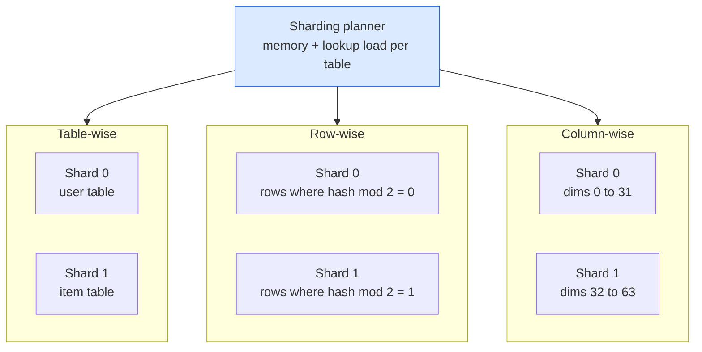

# 埋め込みテーブルとスパースモデル基盤

> **翻訳の状態:** 現行の[英語版](../../16-ml-systems/17-embedding-tables-sparse-models.md)からの翻訳です。

## TL;DR

広告、フィード、レコメンデーションを支えるモデルは、その大部分がルックアップテーブルです。小さなニューラルネットワークが埋め込みテーブルの上に載っており、テーブルはユーザー、アイテム、クエリなどのカテゴリ値ごとに学習済みベクトルを1つ保持し、数十億行、数百ギガバイト以上に達します。これは密な深層学習のエンジニアリング上の問題を反転させます。計算は安価であり、制約となるのはメモリ容量、メモリ帯域、そして行を保持する側と必要とする側の間のネットワークです。テーブルはデータベースのようにも振る舞います。見たことのない識別子が届き、その大半は二度と現れず、少数はすべてのリクエストで読まれ、各更新が触れるのは行のごく一部です。したがって設計上の問いはストレージの問いになります。識別子をどう行へ対応づけるか、どの識別子に行を与えるか、テーブルをどう分割するか、並行する更新にどの程度の整合性が必要か、変化し続けるテラバイト級の状態をどうチェックポイントするか、サービングがレイテンシ予算内でそれをどう読むかを決めなければなりません。

密なモデルの並列化は[分散学習の内部構造](15-distributed-training-internals.md)で扱います。これらの埋め込みを利用する検索とランキングの段階は[レコメンデーションシステム](07-recommendation-systems.md)に、継続的な更新は[継続学習とモデルの鮮度](16-continual-learning-model-freshness.md)にあります。

---

## 異なる種類のマシン

アイテムIDのようなカテゴリ特徴量は、数値としてネットワークへ入力できません。識別子の数値としての大きさには意味がないからです。モデルは代わりに、異なる値それぞれについてベクトルを学習し、それを引きます。10億アイテム、64次元、要素あたり4バイトなら、1つのテーブルはオプティマイザ状態を含めずに256 GBを占めます。本番のランキングモデルは、このようなテーブルを数十から数百持ちます。

それに比べてサンプルあたりの仕事は小さなものです。1リクエストは数百行を読み、プーリングし、その結果をいくつかの密な特徴量と連結して、数百万パラメータの多層パーセプトロンを実行します。演算そのものはアクセラレータ1台の一部に余裕で収まります。収まらないのは状態であり、それへのアクセスは数百ギガバイトに散らばるランダムリードで、その1つ1つがあらゆるキャッシュを外します。

トランスフォーマーとの対比は明確に述べておく価値があります。一方の直感がもう一方では誤解を招くからです。密なモデルでは、すべてのパラメータがすべてのサンプルに関与し、勾配は密で、スループットは行列積で決まります。スパースモデルでは、あるサンプルに関与するパラメータはほとんどなく、勾配が非ゼロになるのはおそらく100万行に1行で、スループットは行をどれだけ速く取得して書き戻せるかで決まります。メモリやネットワークを待っているジョブにアクセラレータを追加しても、何も得られません。

---

## ルックアップの構造

1サンプルの各スパース特徴量は、識別子の短いリストです。スコア対象の単一のアイテム、ユーザーが最後に閲覧した50アイテム、アイテムが属する3つのカテゴリといったものです。モデルは特徴量ごとにそれらの識別子の行を取得し、和、平均、またはアテンションプーリングで1つのベクトルへまとめます。したがって数千サンプルのバッチは、すべてのテーブルにまたがって数十万の行読み出しを発行します。

逆伝播では、テーブルに関する勾配は読み出された行でのみ非ゼロになります。オプティマイザはそれらの行だけを更新し、残りには触れてはなりません。これにより、ステップごとにテーブル全体に触れる実装は除外されます。スパースオプティマイザは、行インデックスのリストと対応する勾配のブロックを受け取るように書かれており、行ごとの状態も同じ方法で更新されます。

アクセスパターンの2つの性質が、以降のすべてを決めます。識別子の人気は大きく偏っているため、少数の行が読み書きの大きな割合を受け取り、ロングテールはまれにしか触れられません。また1つのバッチの中で同じ人気の識別子が何度も現れるため、取得前に識別子を重複排除すれば、正しさを損なうことなくテーブルへのトラフィックを大幅に減らせます。

---

## 識別子から行への対応づけ

テーブルは配列であり、識別子は際限なく増える集合から取り出される任意の64ビット値です。何かが一方をもう一方へ対応づけなければならず、その選択は品質、メモリ、運用に影響します。

| 方式 | 対応づけの方法 | メモリ | 代償 |
|---|---|---|---|
| 語彙 | 学習データから構築した辞書。未知の値は1行を共有 | 語彙に比例 | 新しい識別子は次の再構築まで表現を持たない |
| ハッシュ | `hash(id) mod N` | `N` 行で固定 | 無関係な識別子が衝突し、ベクトルを共有する |
| 多重ハッシュ | 2つ以上の独立したハッシュ、または商と剰余から得た行を組み合わせる | 固定で、識別子空間よりはるかに小さい | 識別子あたりのルックアップが増える。衝突は部分的になるが解消はされない |
| 衝突なしハッシュテーブル | 識別子から行へのキーバリューマップを必要に応じて拡張 | 受け入れた識別子に比例 | アドミッション、エビクション、サイズ変更可能なストアが必要 |

ハッシュトリックが魅力的なのは、テーブル以外に状態を持たないからです。どの識別子もどこかへ対応づけられ、テーブルは決して成長せず、学習とサービングは構造上一致します。その代償は不均等に現れます。人気の識別子がまれな識別子と衝突すると、共有ベクトルは人気の側の勾配に支配され、まれな識別子は単に誤って表現されます。人気の識別子同士が衝突すると両方が損なわれ、その損傷はトラフィックにとって最も重要な行に生じます。`N` を大きくすれば衝突は減りますが、どの識別子も対応づけられない行にメモリを費やします。

多重ハッシュは、他のどの識別子とも完全には共有されにくい行の組み合わせを各識別子に与えることで、これを和らげます。たとえば商剰余構成では、`id div m` と `id mod m` でインデックスされる2つの小さなテーブルを使って2行を組み合わせるため、すべての識別子が、合計サイズが識別子空間の平方根の小さな倍数にとどまるテーブルから、異なる対を受け取ります。

衝突なしテーブルは、受け入れた各識別子にハッシュマップ経由で位置を特定できる専用の行を与えることで、品質の損失を取り除きます。ルックアップ時間に上限のあるカッコウハッシュがよく使われます。その引き換えに、テーブルはトラフィックによってサイズが決まる動的なデータ構造となり、有界に保つには次節の方針が必要になります。

---

## テーブルはキャッシュである

衝突なしテーブルには、識別子が永遠に届き続けます。新しいアイテムが作られ、新しいユーザーが登録し、クローラやボットが二度と現れない識別子を作り出します。新しい識別子のすべてに行を与えると、テーブルはこれまでに見た異なる識別子の累積数とともに成長し、メモリの大半は勾配を1回受け取ったきり二度と読まれないベクトルを保持することになります。そしてそれらのベクトルはノイズです。1回の更新では行は初期値からほとんど動かないからです。

アドミッションは入口に対処します。識別子は、ある閾値の回数だけ観測されて初めて行を与えられます。回数は count-min sketch のようなコンパクトな構造で保持するか、各出現を固定確率で受け入れることで近似します。受け入れられるまで、その識別子のルックアップは共有のデフォルト行を返します。閾値は、メモリと、新しい識別子が独自の表現を得るまでの速さとのトレードオフであり、鮮度と直接に関係します。10回という閾値は、人気の新アイテムには影響がなく、ニッチなアイテムは永遠に学習されない可能性があることを意味します。

エビクションは出口に対処します。有効期間内に更新されなかった行は削除されます。数週間トラフィックに現れない識別子は、消えたか、あるいはベクトルが古びるほど変化したかのどちらかだという考えに基づきます。設定はテーブルごとに行います。短尺動画カタログのアイテムの入れ替わりと国コードの入れ替わりは、何桁も異なるからです。

これらをキャッシュポリシーとして捉えると、障害時の振る舞いを予測しやすくなります。エビクトされた識別子が戻ってきた場合はキャッシュミスであり、デフォルト行からやり直します。高すぎるアドミッション閾値は、テールに対して決して温まらないキャッシュです。そしてあらゆるキャッシュと同様に、テーブルが必要とするメモリは識別子空間のサイズではなく、ポリシーのもとでのワーキングセットによって決まります。これがキャパシティプランニングを扱いやすくします。

---

## テーブルのシャーディング

テーブルの合計がテラバイトに達するモデルは、複数のマシンやデバイスに分散させる必要があり、テーブルの切り方は3つあります。



テーブル単位の配置は、各テーブルを丸ごと1つのシャードへ置きます。最も単純で、ルックアップの宛先はテーブルあたり1つで済みますが、単一のテーブルが1シャードのメモリを超える場合や、1つのテーブルがルックアップの不釣り合いに大きな割合を受け取る場合には破綻します。行単位のシャーディングは、テーブルの行をハッシュでシャードへ分割します。任意のサイズのテーブルを扱える一方で、プーリングを伴うすべてのルックアップがシャードをまたぐスキャッタとギャザーになります。列単位のシャーディングは埋め込みの次元を分割し、各シャードがすべての行のより狭いスライスを保持します。すべてのルックアップがすべてのシャードに等しく触れるため、非常にホットなテーブルの負荷をうまく均しますが、メッセージ数が倍増します。

テーブルごとにこれらの中から選ぶことは、2つの資源を持つビンパッキング問題です。各テーブルには、行数と次元とバイト数の積にオプティマイザ状態を加えたメモリコストと、サンプルあたりのルックアップ数とプーリングサイズの積である負荷コストがあります。メモリだけを均す計画は、小さくて極端にホットなテーブルを大きくてコールドなテーブルの隣に置き、ジョブ全体のボトルネックとなるシャードを生みます。そのためプランナには計測されたアクセス頻度が必要であり、特徴量の定義が変わったときには再実行すべきです。長いユーザー履歴の特徴量を1つ追加するだけで、モデル全体の負荷バランスが変わりうるからです。

テーブル内の偏りは、行をシャードへハッシュしても消えません。ハッシュが均すのは行数であり、行へのトラフィックではないからです。通常の対策は、最もホットな行をワーカー側でキャッシュすることです。数千行が全読み出しの大きな割合を占めることは多く、数ステップごとに更新されるワーカーローカルのキャッシュは、その割合をネットワークから取り除きます。代償は、まさに最も頻繁に更新される行の値がわずかに古くなることです。

---

## パラメータサーバーと必要な整合性

スパース学習の古典的なアーキテクチャは、状態を保持する側と計算を実行する側を分離します。パラメータサーバーがシャードを保持します。ワーカーはバッチを読み、必要な行をプルし、勾配を計算し、それをプッシュします。サーバーは届いた順に更新を適用します。

興味深い問いは、更新にどれだけの協調が必要かです。完全同期の学習では、すべてのワーカーが同じパラメータバージョンに対して計算し、勾配はどれかが適用される前に結合されます。非同期の学習では、各ワーカーは終わり次第プッシュするため、勾配はワーカーが読んだ後に動いたパラメータへ適用されることがあります。

埋め込み行については、非同期性は特定の意味で安価です。2つのワーカーが干渉するのは、バッチが同じ行に触れるときだけです。各バッチはテーブルのごく一部にしか触れないため、ほとんどの行では1ステップの間にそれはほぼ起こりません。そのような行に対する古い勾配は、まったく古くないのです。衝突が頻繁な行はホットな行であり、非常に多くの更新を受けるため、個々の勾配の重要性は小さくなります。これがロックフリーなスパース更新の背後にある議論であり、同様の方式が密なモデルで機能するよりずっと前に、非同期パラメータサーバーがスパースモデルをスケールさせた理由です。

同じ議論は密な層では成り立ちません。すべてのサンプルがすべての密なパラメータを更新するため、すべての非同期勾配が互いに対して古く、ワーカー数が控えめな水準を超えると、その古さが収束を悪化させます。そのため現代のシステムは、この線に沿ってモデルを分割します。密なパラメータは各学習器に複製され、[分散学習の内部構造](15-distributed-training-internals.md)とまったく同じように all-reduce で同期されます。スパースパラメータは、パラメータサーバー上またはアクセラレータメモリ上のシャード化されたテーブルに置かれ、アクセスパターンが許容する緩和された整合性で更新されます。

テーブルをアクセラレータメモリに保持すると、ルックアップからネットワークホップがなくなり、完全同期のスパース学習が現実的になります。これはモデル品質と再現性を改善します。同時に、フリートで最も高価なメモリであるアクセラレータメモリが、大半がコールドな行の入れ物になります。ハイブリッド配置は、ホットな行やホットなテーブルをアクセラレータに、テールをホストメモリやパラメータサーバーに置きます。この分割も、シャーディングプランナの出力の1つです。

---

## 行ごとのオプティマイザ状態

適応的オプティマイザは、パラメータごとに統計を保持します。埋め込みテーブルへ素朴に適用すると、Adagrad は要素ごとに累積値を1つ保存することでメモリを2倍にし、Adam は3倍にします。256 GBのテーブルでは、これはモデルがあるハードウェア階層に収まるか収まらないかの違いです。

一般的な節約策は行単位のオプティマイザで、要素ごとではなく行ごとに1つの累積値を保持し、256バイトの行に4バイトを加えます。1つの行の要素は一緒に更新され、同程度のスケールの勾配を受けるため、この近似は穏やかなものです。

スパース更新は、馴染みのある正則化の意味も変えます。重み減衰は、正しく適用するならすべてのステップですべてのパラメータを縮小させますが、テーブルでそれを行えばすべての行に触れることになり、学習を成り立たせているスパース性を捨てることになります。実装は減衰を遅延適用し、読み出された行にのみ、その行が最後に触れられてからのステップ数でスケールして適用します。これには行ごとの最終更新ステップが必要ですが、それはいずれにせよエビクションポリシーが必要とするものです。スケールなしで触れたときだけ減衰を適用する実装は、まれな行を人気の行よりはるかに弱く正則化していることに、誰も気づかないままになります。

---

## 変化し続ける状態のチェックポイント

テラバイト規模のモデルのチェックポイントは書き込みに時間がかかるため、素朴な方法は破綻します。完全なスナップショットに1時間かかり、大規模ジョブ全体で数時間ごとに障害が発生するなら、フリートの時間のかなりの割合が、スナップショットの書き込みと、その間に失われた作業のやり直しに費やされます。その間学習を止めるのは高くつき、止めなければシャードごとに異なるステップを反映したスナップショットになります。

増分チェックポイントは、学習と同じスパース性を利用します。2つのチェックポイントの間に変化する行は一部にすぎないため、各シャードはダーティな行を追跡し、ベースラインに対する差分としてそれらだけを書き込みます。復旧はベースラインをロードし、差分を順にリプレイします。差分の連鎖はリストア時間を延ばし、失うと致命的になるファイルの集合を広げるため、新しいベースラインを定期的に書き込みます。これは[LSMツリー](../03-storage-engines/02-lsm-trees.md)のコンパクションのトレードオフが姿を変えたものです。実行中の障害復旧が目的であれば、チェックポイントを低い精度で保存することもできます。わずかに量子化された行からの再起動のコストは、節約されるストレージと書き込み帯域よりはるかに小さいからです。

整合性の問いには意図的な答えが必要ですが、それが与えられることはまれです。バリアなしでシャードごとに取得したスナップショットは整合したカットではありません。シャード0がステップ1,000を、シャード7がステップ1,040を反映しているかもしれません。非同期のスパース学習では、学習がすでに行間のその程度の不一致を許容しているという理由で、これはしばしば受け入れられます。しかし密なパラメータとスパースパラメータの関係については受け入れられず、サービングへ昇格させるチェックポイントについても、再現性を主張する場合にも受け入れられません。システムは、どのチェックポイントが整合したカットで、どれが復旧の補助なのかを明示すべきであり、後者を決して昇格させてはなりません。

同じダーティ行の追跡が、継続学習モデルがサービングへ公開する差分を生成するため、1つの仕組みが耐障害性と鮮度の両方を支えます。公開プロトコルは[継続学習とモデルの鮮度](16-continual-learning-model-freshness.md)で扱います。

---

## テーブルのサービング

サービングは、より厳しいレイテンシ予算で、勾配なしで、学習と同じ問題に向き合います。数百の候補をスコアするランキングリクエストは数万行を読み、それをミリ秒のうちに終えなければなりません。

1つ目の判断は、テーブルをモデルに対してどこに置くかです。各ランキングレプリカがすべてのテーブルを自身のメモリに持てば、ルックアップはローカルで高速ですが、メモリコストはレプリカ数だけ倍増し、フリートは計算ではなくメモリでサイジングされます。テーブルを別の埋め込みサービスへ移せば、ランキングレプリカは小さくなって計算に応じてスケールしますが、すべてのリクエストがネットワーク往復を支払います。その往復はシャードあたり1回のバッチ化されたマルチゲットでなければならず、行ごとの呼び出しであってはなりません。大規模なシステムは通常その中間に落ち着き、小さくホットなテーブルをローカルに、大きなテーブルをリモートに置いて、レプリカごとのキャッシュを前段に配置します。

2つ目の判断は、推論時に1行が何バイトを必要とするかです。学習済みの行は32ビット浮動小数点ですが、推論はそれよりずっと少ない精度で足ります。行ごとのスケールとオフセットを持たせて8ビットへ量子化すると、大半のテーブルでは小さな損失でメモリを約4分の1にでき、影響を受けるテーブルは評価で特定して高い精度のまま保てます。メモリがフリートのサイズを決めるため、これはレコメンデーションスタックで利用できる最大級のコスト削減手段です。

3つ目は階層化です。人気の偏りにより大半の行はコールドであり、コールドな行はホットセットのインメモリキャッシュの背後でフラッシュに置けます。キャッシュミスのコストは数十から数百マイクロ秒のデバイス読み出しになり、ミスがまれで、1リクエストの読み出しが並列に発行されるなら許容できます。この設計は、新しいコンテンツへのトラフィックスパイクのようにホットセットを急速に動かすものに敏感です。負荷が最も高い瞬間に、ミス率とテールレイテンシがともに上昇するからです。

これらすべてのキャパシティは、少数の計測値から導かれます。

```python
def table_bytes(rows: int, dim: int, bytes_per_elem: float,
                per_row_overhead: int = 16) -> float:
    """Memory for one table. per_row_overhead covers the hash-map slot,
    last-updated step, and row-wise optimizer state where present."""
    return rows * (dim * bytes_per_elem + per_row_overhead)

def serving_fleet_by_memory(tables: list[tuple[int, int]],
                            bytes_per_elem: float,
                            usable_bytes_per_replica: float) -> float:
    """Replicas needed to HOLD the model once, before any redundancy.
    Compare with replicas needed for compute; the larger one binds."""
    total = sum(table_bytes(r, d, bytes_per_elem) for r, d in tables)
    return total / usable_bytes_per_replica

# One billion rows at dim 64: fp32 training rows vs int8 serving rows.
train = table_bytes(1_000_000_000, 64, 4.0)   # ~272 GB with overhead
serve = table_bytes(1_000_000_000, 64, 1.0)   # ~80 GB with overhead
```

この計算における行数は、テーブルのアドミッションとエビクションのポリシーのもとで受け入れられたワーキングセットであり、トラフィックから計測します。代わりに識別子空間のサイズを使うと要件を何桁も過大に見積もり、昨日の行数を使うと成長を無視します。衝突なしテーブルの成長は、エビクションがアドミッションと釣り合うまで続きます。

---

## 障害モード

**際限のないテーブルの成長。** 衝突なしテーブルが、エビクションなしで、またはアドミッション閾値1で動いています。ボットが作り出したものを含め、これまでに見たすべての異なる識別子とともに成長し、トラフィックのピーク時にシャードがメモリを使い果たします。テーブルには、あらゆるキャッシュと同じ扱いが必要です。上限、ポリシー、そして占有率とアドミッション率に対するアラートです。

**ホットシャードのボトルネック。** シャーディング計画がバイト数を均した結果、1つのシャードがルックアップの大半を受け取るテーブルや行を抱えています。他のシャードが遊んでいる間、ジョブ全体のスループットはそのシャードのスループットになります。メモリだけでなくシャードごとのリクエスト率とレイテンシを見れば判明し、対策は計測されたアクセス頻度から作った計画と、ホットな行のワーカー側キャッシュです。

**重要な識別子でのハッシュ衝突。** トラフィックの多い2つの識別子が、ハッシュテーブルで1行を共有しています。どちらにも合わないベクトルで両方が表現され、その損失はヘッドトラフィックでの小さく説明のつかない劣化として現れます。ハッシュは決定的であるため衝突は恒久的であり、テーブルサイズかシードが変わったときにだけ変化します。その結果、誰もハイパーパラメータだと考えていなかった定数にモデル品質が依存することになります。

**学習とサービングで対応づけが一致しない。** サービングで使うハッシュ関数、シード、テーブルサイズ、または語彙が学習時と異なります。片側だけがアップグレードされたためかもしれません。すべてのルックアップは成功し、誤った行を返します。モデルの出力はもっともらしく、学習した内容とは無相関です。対応づけの設定は[レジストリ](13-model-registry-metadata.md)にあるモデルのサービング契約に含めるべきであり、サンプリングした識別子でのルックアップ一致テストを昇格ゲートに含めるべきです。

**整合していないチェックポイントの昇格。** バリアなしでシャードをまたいで取得したスナップショットが、サービングへ昇格されます。密な層と埋め込み行が異なるステップに対応しており、その組み合わせは一度も評価されていません。チェックポイントに種別を付け、整合したものからのみ昇格を許可すれば防げます。

**コールド階層でのレイテンシの崩壊。** 行がフラッシュへ階層化されているところへ、新しい識別子や新たに人気になった識別子の急増がホットセットを動かし、キャッシュミス率が上がり、急増の間にテールレイテンシが予算を超えます。平均的なホットセットではなく移動後のホットセットに合わせてキャッシュをサイジングし、ミス率の閾値でシェディングまたは縮退を行えば、障害は限定されます。

**連鎖内の差分の欠落。** アップロードの失敗や早すぎるガベージコレクションにより、増分チェックポイントの連鎖から差分が1つ欠けています。欠落以降のすべてが復旧不能になり、その事実はリストア中に発覚します。各差分は親を明示し、連鎖は書き込み時に検証し、差分はベースラインとともに1つの単位として保持すべきです。

---

## 意思決定フレームワーク

大半の選択は、特徴量のカーディナリティ、識別子の入れ替わりの速さ、読み出しの頻度から導かれます。

| 状況 | 設計上の帰結 |
|---|---|
| 小さく安定した識別子集合 | 語彙テーブルをすべての場所でローカルに保持する |
| 大きくゆっくり変化する集合。ある程度の品質低下は許容できる | ハッシュテーブル。ヘッドトラフィックで計測した衝突率からサイズを決める |
| メモリが厳しい大きな集合 | 多重ハッシュまたは合成的な埋め込み |
| 入れ替わりが速く、鮮度が重要 | アドミッションと有効期間によるエビクションを備えた衝突なしテーブル |
| 1つのテーブルが1シャードに収まらない | バッチ化され重複排除されたルックアップを伴う行単位のシャーディング |
| 少数のテーブルがルックアップを支配する | 列単位のシャーディング、またはそれらのテーブルのアクセラレータ配置 |
| サービングフリートがメモリでサイジングされている | 行の量子化、コールド行のフラッシュへの階層化、またはテーブルの埋め込みサービスへの移動 |

スパースモデル基盤を承認する前に、次のことを問います。各テーブルのサイズの上限を決めているのは何で、誰がそれを監視しているか。シャーディング計画は何を基準に均され、最後に再計算されたのはいつか。どのパラメータが同期的に更新され、残りがそうでなくてよい理由は何か。どのチェックポイントが整合したカットか。識別子の対応づけが学習とサービングで一致することはどう保証されているか。そして、サービングフリートのサイズを決めているのはメモリか計算か。この答えが、次の最適化をどこへ向けるべきかを決めます。

---

## 重要なポイント

1. スパースモデルはメモリとネットワークに制約され、計算は小さなものです。そのスケーリングはストレージの問題です。
2. 勾配は読み出された行にしか触れないため、オプティマイザからチェックポイントの書き込みまで、すべてのコンポーネントが行の部分集合で動作しなければなりません。
3. ハッシュは固定サイズで状態を持たない対応づけを与え、人気の識別子に最も重くのしかかる衝突という代償を払います。衝突なしテーブルは衝突を取り除き、キャッシュポリシーを必要とします。
4. アドミッションとエビクションがテーブルサイズを決めます。キャパシティは識別子空間ではなく、それらのポリシーのもとでのワーキングセットによって決まります。
5. シャーディングは、計測したアクセス頻度を使って、バイト数だけでなくルックアップ負荷も均さなければならず、ホットな行はワーカーでキャッシュするのが最善です。
6. 非同期更新は、バッチが同じ行に触れることがまれであるため埋め込み行には安全で、密な層には安全ではありません。これが、密は同期、スパースは緩和というハイブリッド設計が主流である理由です。
7. 行単位のオプティマイザ状態と遅延適用される正則化が、スパース更新をスパースなままに保ちます。
8. 増分チェックポイントはダーティな行だけを書き込みます。整合したカットと復旧の補助を区別し、前者だけを昇格させます。
9. サービングコストはテーブルメモリによって決まります。量子化、階層化、ローカルテーブルとリモートテーブルの選択が主要な手段です。
10. 識別子から行への対応づけはモデル契約の一部です。学習とサービングの不一致は、エラーなしに自信に満ちた無意味な出力を生みます。

---

## 参考文献

1. [Scaling Distributed Machine Learning with the Parameter Server](https://www.usenix.org/conference/osdi14/technical-sessions/presentation/li_mu): Li et al., OSDI 2014
2. [Deep Learning Recommendation Model for Personalization and Recommendation Systems](https://arxiv.org/abs/1906.00091): Naumov et al., 2019。DLRMアーキテクチャとメモリ律速の特性
3. [Feature Hashing for Large Scale Multitask Learning](https://arxiv.org/abs/0902.2206): Weinberger et al., 2009。ハッシュトリックとその衝突解析
4. [Compositional Embeddings Using Complementary Partitions for Memory-Efficient Recommendation Systems](https://arxiv.org/abs/1909.02107): Shi et al., 2019。商剰余構成
5. [Monolith: Real Time Recommendation System With Collisionless Embedding Table](https://arxiv.org/abs/2209.07663): Liu et al., 2022。頻度によるアドミッションと有効期限を備えたカッコウハッシュテーブル
6. [Software-Hardware Co-design for Fast and Scalable Training of Deep Learning Recommendation Models](https://arxiv.org/abs/2104.05158): Mudigere et al., 2021。アクセラレータクラスタでのテーブル、行、列のシャーディング
7. [Check-N-Run: a Checkpointing System for Training Deep Learning Recommendation Models](https://www.usenix.org/conference/nsdi22/presentation/eisenman): Eisenman et al., NSDI 2022。増分チェックポイントと量子化チェックポイント
8. [Bandana: Using Non-volatile Memory for Storing Deep Learning Models](https://arxiv.org/abs/1811.05922): Eisenman et al., 2018。DRAMキャッシュの背後への埋め込み行の階層化
9. [Hogwild!: A Lock-Free Approach to Parallelizing Stochastic Gradient Descent](https://arxiv.org/abs/1106.5730): Recht et al., 2011。スパース更新が非同期性を許容する理由
