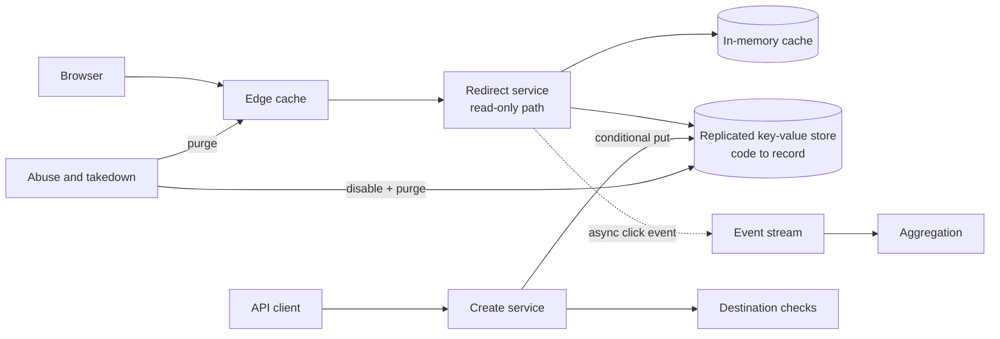

# URL短縮サービス: 識別子の割り当てとリダイレクト経路

> **翻訳の状態:** 現行の[英語版](../../21-reference-designs/01-url-shortener.md)からの翻訳です。

## TL;DR

URL短縮サービスは、短いコードを長いURLに対応づけ、それをたどった人をリダイレクトする。これは、読み取り中心でグローバルに分散したキーバリューサービスの設計判断を、すべて迫ってくる最小のシステムである。単一のボトルネックなしに一意な識別子をどう割り当てるか。運用者が制御できないキャッシュに対して、リダイレクト応答は何を約束するか。そして作成時には安全だった対応づけが敵対的に変わったあと、どう取り下げるか。

データモデルは小さな不変レコード1つなので、ストレージは難所ではない。難所は、誤って述べやすい3つの契約である。**コードの割り当て**は、並行実行やリージョン障害のもとでも一意でなければならず、第三者に他人のリンクを列挙させてはならない。**リダイレクトのセマンティクス**は、運用者が制御を保てるかどうかを決める。恒久リダイレクトはブラウザにキャッシュされ、事実上取り消せない。最も安い応答は、取り戻せない応答でもある。**濫用への対処**は第一級の要件である。短縮サービスは構造上リンク先を隠すものであり、攻撃者はそれを知っているからだ。以下の参照設計は意図的に保守的である。条件付き書き込みによるランダムなコード、短い明示的なキャッシュ寿命を付けた一時リダイレクト、そしてリダイレクト経路から切り離したクリック分析を採る。容量の数字はすべて例示である。

## 要件と契約

**機能要件。**

- URLに対する短縮リンクを作成する。カスタムエイリアスと有効期限は任意。
- コードへのリクエストを、そのリンク先へリダイレクトする。
- 所有者またはポリシーによって、リンクを無効化または削除する。
- リンクごとのクリック数を報告する。

**非機能要件。契約として述べる。**

| 性質 | 契約 |
|---|---|
| 一意性 | 1つのコードは、リージョン間や復元を含め、その全期間にわたり高々1つのリンク先に対応する |
| 安定性 | プロダクトが編集可能なリンクを明示的に提供しない限り、有効なコードのリンク先は変わらない |
| リダイレクトの可用性 | 作成の可用性より高い。読み手は書き込み経路に依存してはならない |
| 取り消し | 無効化されたリンクは、公表した有限の時間内に、あらゆる場所でリダイレクトをやめる |
| 推測困難性 | あるコードを知っていても、別のコードを見つけるうえで実用的な利点にならない |
| 自分の書き込みの読み取り | 作成者は、どのリージョンからでも、すぐにそのリンクをたどれる |
| 分析 | 結果整合。リダイレクトを決して止めない |

読み取りと書き込みの非対称性がアーキテクチャを決める。リダイレクトは作成より何桁も多く、レイテンシに敏感で、レコードが変わらないため古いレプリカから返しても安全である。作成はまれで、一意性の保証が必要で、数十ミリ秒を許容できる。

## 容量の見積もり

月に1億件の新規リンク、リダイレクトと作成の比100対1、ピーク係数10倍、保存レコード1件500バイト、保持5年を仮定する。

```text
creates/s (mean)    = 100,000,000 / 2,592,000      = 39
redirects/s (mean)  = 39 x 100                     = 3,860
redirects/s (peak)  = 3,860 x 10                   = 38,600
records in 5 years  = 100,000,000 x 60             = 6 billion
storage             = 6e9 x 500 bytes              = 3 TB before replication
```

3テラバイトは数台のノードに収まる。このシステムのサイジングを決めるのは、リダイレクトのスループットとテールレイテンシ、そしてキャッシュ層が読み取りトラフィックをどれだけ吸収するかである。手法は[キャパシティプランニングと概算見積もり](../01-foundations/10-capacity-planning.md)を参照。

コードの長さはレコード数から決まる。62文字のアルファベットでは次のようになる。

```text
62^6 = 56.8 billion      6 billion records fill 10.6% of the space
62^7 = 3.52 trillion     6 billion records fill 0.17% of the space
```

7文字なら空間は疎に保たれる。これは、次の2つの節で示すとおり、衝突時の再試行と推測への耐性の両方にとって重要である。

## アーキテクチャ



2つのサービスは1つのストアだけを共有する。リダイレクトサービスは読み取り専用で、作成経路にも、分析にも、濫用対策パイプラインの可用性にも依存しない。作成サービスは一意性の条件を付けて書き込む。分析は、非同期のイベントとしてリダイレクト経路を離れる。

## コードの割り当て

方式は5つある。協調のコスト、コードの長さ、コードが何を明かすかが異なる。

| 方式 | 一意性の仕組み | 明かすもの | 主なリスク |
|---|---|---|---|
| 中央カウンタを62進で符号化 | カウンタ | 作成順と件数。隣の値も有効なコードである | 列挙。カウンタが書き込みのボトルネックになる |
| 範囲やチケットの割り当て | 各ノードがカウンタ空間のブロックを借りる | 上と同じ | 割り当て器の復元後に範囲が重複する |
| 時刻順の64ビット識別子 | タイムスタンプ、ワーカー識別子、連番 | 作成時刻とワーカー | コードが長い(11文字)。時計とワーカー識別子の規律が要る |
| 条件付き書き込みによるランダムなコード | ストアが既存のキーを拒否する | 何も明かさない | 衝突時の再試行。compare-and-setのプリミティブが要る |
| リンク先のハッシュ | 切り詰めたハッシュ | 2人の利用者が同じURLを短縮したこと | 切り詰めによる衝突で、異なるURLが1つのコードに対応する |

**参照設計: 条件付き書き込みによるランダムなコード。** 暗号論的に安全な乱数源から7文字を生成し、存在しない場合のみ書き込む条件を付けて書く。競合したら生成し直す。

再試行の割合は充填率に等しい。3.52兆の空間に60億レコードがあるとき、新しいコードは0.17%の確率で衝突する。1,000回の作成のうち998回は最初の書き込みで成功する。障害を起こしたり、古い状態へ復元されたり、ホットスポットになったりする割り当て器は存在しない。リージョン間には、ストア自身の一意性検査以外の協調が要らない。

カウンタに基づく方式は、同じレコード数に対してコードが短く、再試行もない。それが好まれる理由である。ただしそのコストは構造的なものだ。範囲を貸し出す割り当て器は、同じ範囲を二度と渡してはならない。最後の貸し出しより前に取ったバックアップから復元された場合も含めてである。そのためには、割り当て器の最高水位が永続化され、エポックでフェンシングされていなければならない。[分散ロックとリース](../01-foundations/09-distributed-locks.md)で述べるとおりである。そして連番のコードは列挙できる。これは見た目の問題ではなく、セキュリティ上の性質である。

**文書化済み、GeorgievとShmatikov:** 著者らは公開の短縮サービスの短いコード空間を走査し、非公開のクラウド文書へのリンクや、自宅の住所が分かる地図の経路へのリンクを見つけた。コードが、列挙できるほど短く密だったからである。短縮リンクは、しばしば秘密であるかのように使われる。設計はそうなることを前提にすべきである。

リンク先のハッシュは、同じURLから同じコードが得られるので魅力的に見える。しかし2つの点で破綻する。切り詰めたハッシュは異なるURLで衝突するので、結局は条件付き書き込みとフォールバックが必要になる。そして同じリンク先の利用者全員を1つのレコードにまとめると、所有者ごとの分析、有効期限、削除ができなくなる。

### カスタムエイリアス

エイリアスは、呼び出し側が選んだキーで、同じ条件付き書き込みを使う。必要なものは3つある。予約語のリスト(プロダクト自身が使うパス)。一度だけ決める正規化の規則(大文字小文字の畳み込み、Unicodeの扱い)。そしてブランドになりすます紛らわしい名前に対するポリシーである。正規化は一意性検査の前に行う。そうしないと、見た目が同じ2つのエイリアスが共存する。

## リダイレクト応答

ステータスコードは、運用者が動かしていないキャッシュとの契約である。

**文書化済み、RFC 9110:** `301 Moved Permanently` の応答は既定でキャッシュ可能なので、ブラウザはそれを保存し、問い合わせをやめてよい。`302 Found` の応答は、明示的な鮮度情報を伴わない限りキャッシュ可能ではない。`307` と `308` は、それぞれ `302` と `301` の、メソッドを保存する版である。

| 選択 | 制御への影響 | 負荷への影響 | 分析への影響 |
|---|---|---|---|
| キャッシュヘッダなしの `301` | 失われる。ブラウザが無期限に保持しうる | 最も低い | 繰り返しのクリックが見えない |
| キャッシュヘッダなしの `302` | 保たれる。すべてのクリックがサービスに届く | 最も高い | 完全 |
| `Cache-Control: max-age=N` 付きの `302` または `301` | 保たれる。取り消しの遅れは N で上限が付く | 調整可能 | クライアントごとに N の範囲で過小に数える |

**参照設計:** `302` に短い明示的な `max-age` を付けて応答する。運用者自身のエッジキャッシュには、ブラウザより長い寿命を与える。エッジはパージできるが、ブラウザはできないからだ。取り消しの契約は「無効化から高々 N 秒と、パージの伝播時間」となる。これは公表でき、テストできる数字である。

リダイレクト経路そのものは、不変レコードに対するキャッシュの階層である。エッジキャッシュ、プロセス内キャッシュ、ストアの順に引く。レコードは変わらないので、無効化が必要なイベントは、無効化、削除、期限切れだけである。[キャッシュ無効化と一貫性](../04-caching/02-cache-invalidation.md)を参照。

存在しないコードにも、存在するコードと同じ配慮が要る。ランダムな走査は、すべての正のキャッシュを素通りしてストアに届くミスの流れを生む。否定的な結果を短時間キャッシュし、ストアの前に所属判定フィルタを置いて、ほとんどのミスをメモリから返す。[ブルームフィルタ](../03-storage-engines/05-bloom-filters.md)を参照。

## ストレージとリージョン配置

レコードは小さく、形が固定である。

```text
code            primary key
destination     URL, validated and length-bounded
owner           account identifier
created_at      timestamp
expires_at      optional
state           active | disabled | deleted
```

条件付きputを備えた複製キーバリューストアなら、どれでも扱える。コードのハッシュで分割する。ランダムなコードは構造上均等に散らばる。[パーティショニング戦略](../02-distributed-databases/05-partitioning-strategies.md)を参照。

マルチリージョンの配置は、このシステムで唯一の一貫性の問いを表に出す。作成が1つのリージョンでコミットされ、非同期に複製される場合、作成者がすぐに別のリージョン経由でリンクを開くと、存在するリンクに対して「見つからない」という応答を受け取る。対処は3つあり、コストの低い順に並べる。

1. **ミス時にフォールバックする。** 構文上正しいコードがリージョン内でミスした場合、見つからないと返す前に、権威を持つリージョンへ1回読みに行く。安く、実在するコードのミスがまれである限り正しい。
2. **コードにホームリージョンを埋め込む。** 接頭辞やチェックサムの文字で、新しいコードの読み取りを作成元へ振り分ける。1文字ぶんのコストがかかり、コードがトポロジに結びつく。
3. **作成の確認応答の前に同期複製する。** セマンティクスは単純だが、作成のレイテンシは最も遅いクォーラムに縛られる。

リージョンをまたぐ一意性は、どの場合も同じ仕組みから得る。条件付き書き込みを、そのキーについて線形化可能なストアが評価するか、リージョンが互いに素な空間からコードを引くかである。条件付き書き込みなしに「ランダムな衝突は起こりにくい」ことに頼ってはならない。起こりにくいことを起こりえないことに変えるのが、その書き込みである。

**コードを再利用してはならない。** リンクが削除されたり期限切れになったりしても、コードは予約されたままにする。短縮リンクの古い写しは、メール、文書、印刷物に残る。コードを再割り当てすれば、その読み手を他人のリンク先へ送ることになる。

## 濫用と取り下げ

短縮サービスが攻撃者にとって有用な理由は、ほかの全員にとって有用な理由と同じである。リンク先が見えないことだ。これは運用の後付けではなく、設計要件である。

- **作成時に検査する。** スキームと構文を検証し、ブロックリストにあるリンク先を拒否し、レピュテーションサービスに照会する。
- **あとでもう一度検査する。** 短縮した時点で問題のなかったリンク先が、1週間後にマルウェアを配布することがある。有効なリンクを、クリック量で重み付けして再走査する。
- **アカウント単位で作成をレート制限する。** 新しいアカウントには厳しい制限を課す。[レート制限](../06-scaling/05-rate-limiting.md)を参照。
- **削除ではなく無効化する。** 無効化したレコードは中間ページへリダイレクトし、証跡を保つ。
- **取り下げをすべてのキャッシュへ届かせる。** エッジをパージし、残りは上で選んだブラウザ側の短い寿命に委ねる。
- **自サービスの短縮リンクの短縮を拒否する。** ポリシーが許すなら、ほかの短縮サービスのリンクも拒否する。最終的なリンク先をスキャナから隠すリダイレクトの連鎖を防ぐためである。

## クリック分析

クリックを数えることが、リダイレクトを遅くしたり、可用性を下げたりしてはならない。リダイレクトサービスはイベント(コード、タイムスタンプ、粗いクライアント属性)をストリームへ出力し、待たずに応答する。集約がストリームを消費し、リンクごとの件数を維持する。

正しさに関する問いは、どのイベントパイプラインとも同じである。再試行による重複イベント、遅延イベント、件数を膨らませるボットのトラフィックだ。これらは[広告クリック集計](./04-ad-click-aggregation.md)で詳しく扱う。この設計に固有の点が2つある。キャッシュされたリダイレクトはイベントを生まないので、報告されるクリック数は下限であり、その精度はキャッシュの寿命に依存する。そしてリンクごとのユニーク訪問者数は、マージ可能なカーディナリティスケッチの自然な用途である。[確率的スケッチ](../03-storage-engines/10-probabilistic-sketches.md)で述べている。

## 障害トレース

### バックアップから復元された割り当て器

1. 範囲の割り当て器が、9,000,000までのブロックを貸し出している。
2. そのデータベースが故障し、最高水位が8,500,000のスナップショットから復元される。
3. 割り当て器は8,500,001から8,600,000を新しいノードへ貸し出す。
4. そのブロックのコードはすでに存在する。条件付き書き込みがなければ、新しいリンクが古いものを上書きし、既存の短縮リンクは他人のリンク先へ向かうようになる。

割り当て器があっても条件付き書き込みは残す。そして割り当て器の状態を、復元時に必ず進めるエポックでフェンシングする。

### 取り戻せなかった恒久リダイレクト

あるリンクがフィッシングとして通報され、無効化される。以前にそのリンクをたどった利用者は、リダイレクトされ続ける。ブラウザが `301` をキャッシュしていて、二度と問い合わせないからだ。運用者には、それらのキャッシュへ届く手段がない。応答に有限の寿命を持たせておくべきだった。

### バイラルになったリンク

1つのコードが、1つの出来事によって毎秒3万リクエストを受ける。そのレコードが、100台のリダイレクトサーバのプロセス内キャッシュから同じ1秒のうちに期限切れになり、すべてのサーバが同じキーをストアへ読みに行く。キーごとに並行するロードをまとめ、キャッシュの寿命にジッタを加える。[キャッシュスタンピード、コールドスタート、ウォーミング](../04-caching/04-cache-stampede.md)のとおりである。

### 列挙

クローラがコードを順に要求し、限定公開の文書へのリンクを含め、すべてのリンク先を収集する。ランダムで疎なコードは列挙を割に合わなくし、クライアントごとの「見つからない」応答への制限は列挙を可視化する。

### 分析の障害がリダイレクトを止める

イベントストリームが利用できず、リダイレクトサービスが発行で待たされる。リダイレクトのレイテンシが上がり、ついにはサービスがヘルスチェックに失敗する。発行は、上限のあるローカルバッファを使った非同期処理でなければならない。バッファが満杯なら捨て、捨てた数を数える。

## 設計レビューの問い

1. コードを一意にしているものは何か。その仕組みは、リージョンの分断とバックアップからの復元を生き延びるか。
2. コードを1つ持つ第三者は、ランダムな推測より速くほかのコードを見つけられるか。
3. どのステータスコードとキャッシュヘッダを返すか。その結果、リンクの取り消しにかかる最悪の時間はいくらか。
4. リダイレクト経路は何に依存しているか。そのうち、リダイレクトを失敗させずに故障してよいものはどれか。
5. 「見つからない」リクエストは、どうやってストアへの到達を避けるか。
6. 作成者が、作成の1秒後に別のリージョンからリンクをたどると何が起こるか。
7. リンクが削除されたあと、コードはどうなるか。
8. 作成後に悪性に変わったリンク先は、どう発見され、取り下げられるか。
9. キャッシュ、再試行、ボットを踏まえて、クリック数は何を意味するか。その意味は利用者に示されているか。

## 参考文献

- [RFC 9110, *HTTP Semantics*](https://www.rfc-editor.org/rfc/rfc9110): リダイレクトのステータスコードとキャッシュ可能性の定義
- [RFC 3986, *Uniform Resource Identifier (URI): Generic Syntax*](https://www.rfc-editor.org/rfc/rfc3986)
- [Georgiev and Shmatikov, *Gone in Six Characters: Short URLs Considered Harmful for Cloud Services* (2016)](https://arxiv.org/abs/1604.02734)
- [Flickr Engineering, *Ticket Servers: Distributed Unique Primary Keys on the Cheap* (2010)](https://code.flickr.net/2010/02/08/ticket-servers-distributed-unique-primary-keys-on-the-cheap/)
- [Twitter Engineering, *Announcing Snowflake* (2010)](https://blog.x.com/engineering/en_us/a/2010/announcing-snowflake)
- [Google, *Safe Browsing* developer documentation](https://developers.google.com/safe-browsing)
