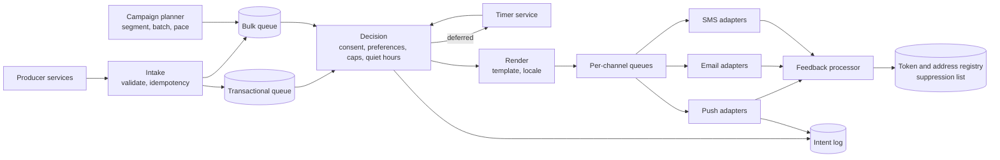

# 通知配信プラットフォーム: 設定、ファンアウト、プロバイダのセマンティクス

> **翻訳の状態:** 現行の[英語版](../../21-reference-designs/02-notification-delivery.md)からの翻訳です。

## TL;DR

通知プラットフォームは、多数の社内サービスから「この利用者にこの出来事を知らせよ」という依頼を受け取り、それをプッシュメッセージ、メール、SMS、アプリ内の項目に変える。転送は易しい部分で、ほとんどは他者の持ち物である。Apple、Google、メールボックス事業者、通信事業者が、それぞれの規則に従い、ベストエフォートで最後の区間を配送する。プラットフォームの本当の仕事は、その区間より手前のすべてである。送る**かどうか**(同意、設定、おやすみ時間、頻度上限)。**何を**送るか(1通か、ダイジェストか、以前の通知の置き換えか)。**いつ**送るか(今か、あとか、すでに古いので送らないか)。そして**どこまで粘るか**(再試行するか、別のチャネルへ切り替えるか、諦めるか)。

設計を形づくる性質は3つある。配送は**保証されず、順序も保たれない**。ワンタイムパスコードのように正しくなければならないものには、期待ではなく、有効期限と冪等なインテントが要る。ワークロードは**同じ名前を共有する2つの別のシステム**である。トランザクション系のメッセージは小さく、緊急で、マーケティングキャンペーンの後ろに並んではならない。キャンペーンは巨大で、後回しにでき、プロバイダと、宣伝対象のプロダクトの両方を過負荷にしうる。そしてすべての送信は**取り消せない外部への効果**である。重複、誤った端末へのメッセージ、オプトアウト後のメッセージは回収できない。運用者の呼び出しは[アラート評価と通知](../11-observability/04-alerting.md)が扱う。本設計はエンドユーザーへのメッセージングを扱う。容量の数字はすべて例示である。

## 要件と契約

**機能要件。**

- 生産側サービスから、受信者、カテゴリ、テンプレートのデータ、冪等キーを持つ通知インテントを受け付ける。
- プッシュ、メール、SMS、アプリ内受信箱で配信する。チャネルのポリシーはカテゴリごとに定める。
- 利用者の設定、法的な同意、おやすみ時間、頻度上限を守る。
- 予約送信、ダイジェスト、大きなセグメントへのキャンペーンに対応する。
- サポートと監査のために、すべてのインテントの結果を記録する。

**契約。**

| 性質 | 契約 |
|---|---|
| インテントの冪等性 | 同じ冪等キーは、チャネルごとに高々1つの利用者に見える通知を生む |
| 同意 | 送信の時点で利用者が許可していないチャネルには送らない |
| 古さ | 宣言された有効期限を過ぎたメッセージは配信しない |
| 分離 | トランザクション系のレイテンシは、キャンペーンの量の影響を受けない |
| 配送 | プロバイダへ渡したあとはベストエフォート。プラットフォームが報告するのは「利用者が見た」ではなく「プロバイダが受理した」である |
| 順序 | 保証しない。置き換えには明示的なコラプス識別子を使う |
| 監査可能性 | すべてのインテントが、理由つきの終端状態を記録として持つ |

契約に「プロバイダが受理した」と書くことには意味がある。プロダクトチームは、APIが成功を返したのでプッシュ通知は届いたのだと思い込みがちで、届かなかったときに黙って失敗するフローを作ってしまう。

## プロバイダが約束すること

設計は最後の区間のセマンティクスに合わせなければならないので、それを先に述べる。

**文書化済み、Apple Push Notification service:** リクエストはHTTP/2でデバイストークン宛に送る。ヘッダで、有効期限、優先度、任意のコラプス識別子を指定する。コラプス識別子があると、新しい通知が同じ識別子を持つ以前の通知を置き換える。端末がオフラインのとき、サービスは通知を限られた期間だけ保存し、そのアプリについては最新の1件だけを残して、古いものを捨てる。トークンがもう登録されていないことを示す応答は、送信側にそのトークンの使用をやめるよう伝えている。

**文書化済み、Firebase Cloud Messaging:** メッセージは最大4週間の生存期間を持ち、コラプスキーを付けられる。コラプスキーがあると、端末が再接続したとき、グループの最新のメッセージだけが配信される。トークンは古くなりうる。指針は、トークンの鮮度を追跡し、サービスが未登録と報告したトークンを削除することである。

**文書化済み、Web Push (RFC 8030):** プッシュメッセージは生存期間と緊急度を持ち、任意のトピックを付けられる。トピックは、同じトピックを持つ保留中のメッセージを置き換える。

**文書化済み、メール:** 送信ドメインの認証にはDKIM署名とDMARCポリシーを使う。RFC 8058はワンクリックの配信停止を定義している。大手メールボックス事業者は、認証、配信停止の扱い、迷惑メール報告率を含む大量送信者向けの要件を公表している。報告率のしきい値を超えた送信者は、スロットルされるか拒否される。

すべてのチャネルについて、4つの帰結がある。

1. 正しさの拠り所にできる配送確認はない。メッセージが届かなくても成り立つフローを設計する。
2. プロバイダは、オフラインの端末について最新以外のメッセージを捨てうる。通知は状態そのものではなく、状態を取りに行くためのヒントである。
3. 送信者の評判は、共有され、ゆっくりとしか回復しない資源である。無効なトークンや届かないアドレスへ送ると、同じ送信者アイデンティティを使う全員の配送が損なわれる。
4. プロバイダからのフィードバック(未登録トークン、ハードバウンス、迷惑メール報告)は、ログに書くだけのものではない。プラットフォームが消費しなければならない入力である。

## アーキテクチャ



段階を分けているのは、失敗の仕方が異なるからである。受付は高速で永続的でなければならない。判定はポリシーであり、最新の設定を読まなければならない。レンダリングはCPUの仕事で、テンプレートの正しさが問われる。チャネルアダプタは、プロバイダのレート制限とレイテンシに縛られる。各境界はキューであり、遅いプロバイダは自分のチャネルだけを滞留させる。[メッセージキューアーキテクチャ](../05-messaging/01-message-queues.md)を参照。

## 受付とインテントの識別

生産側は**インテント**を送る。受信者、カテゴリ、テンプレートの識別子とデータ、任意の有効期限とスケジュール、そして業務上の出来事から導いた冪等キー(たとえば `order-1234-shipped`)からなる。受付はそのキーのもとでインテントを永続化し、確認応答を返す。同じキーでの再送には、元の結果を返す。仕組みは[冪等性と操作の識別](../01-foundations/08-idempotency.md)のとおりである。

キーは生産側の責任である。何が同じ出来事にあたるかを知っているのは生産側だけだからだ。メッセージの文面で重複を除くプラットフォームは、文面が同じ別々の出来事をまとめてしまい、タイムスタンプが変わった重複を見逃す。

受付より下流では、すべての段階がat-least-onceである。重複が人の目に見えるのは、プロバイダを呼ぶ段階である。そこで第2の防護を置く。送信の前に `(インテント, チャネル, 端末)` を処理中として記録し、プロバイダが受理したあとで送信済みとして記録する。プロバイダの受理と記録のあいだでクラッシュしたワーカーは再試行し、2回送ることがある。プロバイダ自身が冪等キーを提供しない限り、この隙間は閉じられない。狭くすることしかできない。プロバイダがコラプス識別子に対応していれば、同じ識別子を持つ重複は積み重ならず、置き換えになる。[配信保証と効果の境界](../05-messaging/04-delivery-guarantees.md)を参照。

## 判定の段階

判定は、このインテントが各チャネルでメッセージになるかどうかに答える。次の順に評価する。

1. **法的な同意と抑止リスト。** 配信停止済みのアドレス、オプトアウトのキーワードを返信した番号、事前の同意を要する法域。ここで止まれば無条件に送らない。
2. カテゴリ別、チャネル別の**利用者設定**。
3. **有効期限。** 期限を過ぎたインテントは、理由を記録して捨てる。
4. 利用者のタイムゾーンでの**おやすみ時間**。緊急でないメッセージをタイマーへ回す。
5. 利用者別、カテゴリ別、チャネル別の**頻度上限**。
6. **集約。** 短い時間窓の中の関連する出来事を、1通のメッセージかダイジェストにまとめる。
7. **チャネルの選択とフォールバック。** たとえば、まずプッシュを送り、カテゴリが重要で、期限までにどの端末も確認しなければSMSを送る。

**評価は、キューへ入れる時点ではなく、送信の時点で行う。** 9時にキューへ入れたキャンペーンが、ある利用者の番になるのは9時40分かもしれない。その利用者が9時10分に配信を停止していたら、メッセージを送ってはならない。キューへ入れた時点でキャッシュした判定はどれも、キューが遅れたときに起こる同意違反である。延期のあとも同じで、タイマーが発火したら設定を読み直す。

カテゴリはポリシーを担う。セキュリティアラートは、マーケティングの上限もおやすみ時間も無視する。プロモーションのメッセージはそのすべてに従う。カテゴリを、所有者のいる、検証される必須フィールドにしておく。緊急度が自由記述のフラグだと、すべての生産側が自分を重要だと宣言する。必須フィールドにするのはそれを防ぐためだ。

延期された送信には、メモリ上の遅延ではなく、永続的なタイマーが要る。[分散スケジューリングとタイマーサービス](../18-workflow-job-systems/03-distributed-cron-scheduling.md)を参照。

## トランザクション系とバルク系は別のシステムである

パスコードは数秒で届かなければならない。2000万人へのキャンペーンは1時間かかってよい。キューとワーカーを共有すると、キャンペーンの滞留がパスコードの前に並ぶ。

**参照設計:** キュー、ワーカープール、プロバイダへのコネクションの予算をクラスごとに分ける。負荷がかかっているあいだ、トランザクション系のクラスはバルク系から借りず、貸しもしない。バルク系の中では、1つの送信者がチャネルを独占できないよう、キャンペーン間で公平にスケジュールする。仕組みは[優先度、公平性、バックプレッシャー](../18-workflow-job-systems/07-priority-fairness-backpressure.md)にある。

キャンペーンのファンアウトは、ループではなく計画のジョブである。プランナはセグメントを受信者へバッチ単位で解決し、制御したレートでバッチをバルクキューへ書き、送信全体をある時間窓にわたってペース配分する。ペース配分は三者のためにある。プロバイダのレート制限。利用者の端末(プッシュが集中すると、まとめられるかスロットルされる)。そして容量の節で示すとおり、プロダクト自身である。

## トークン、アドレス、フィードバック

レジストリは、利用者を配信可能な終端へ対応づける。デバイストークン、確認済みのメールアドレス、確認済みの電話番号である。その正しさはプライバシーの境界である。

- **トークンをセッションに結びつける。** 利用者がサインアウトしたら、別の利用者がその端末でサインインする前に、トークンとそのアカウントの関連を取り除く。そうしないと、次のアカウントの持ち主が前の持ち主の通知を受け取る。
- **更新し、失効させる。** 各トークンがアプリによって最後に確認された時刻を記録する。プロバイダの定める古さの期限を超えて沈黙しているトークンへは送らない。
- **フィードバックを消費する。** 未登録トークンの応答はトークンを削除する。ハードバウンスはアドレスを抑止する。迷惑メール報告は抑止し、送信カテゴリの違反として数える。
- **ペイロードを最小にする。** ロック画面は通知の文面を表示する。機微なものについては、識別子と一般的な1行だけを送り、詳細は認証後にアプリが取りに行く。

## 容量モデル

利用者5000万人、1人あたり1日平均5通の通知、2000万人へのキャンペーンを仮定する。

```text
steady rate         = 50,000,000 x 5 / 86,400         = 2,900 per second
campaign, unpaced   = 20,000,000 in 10 minutes        = 33,300 per second
in-flight requests  = 33,300/s x 0.1 s provider time  = 3,330 concurrent
```

定常の負荷は小さい。キャンペーンはその12倍で、完全に自分たちが引き起こすものである。つまり、ペース配分によって完全に制御できる。

より大きな影響は下流に出る。受信者の5%が10分以内にアプリを開き、1回の起動で10個のAPIリクエストを発行するとする。

```text
app opens           = 20,000,000 x 0.05               = 1,000,000 in 10 minutes
extra API load      = 1,000,000 x 10 / 600            = 16,700 requests per second
```

マーケティングの送信は、プロダクト自身のバックエンドにとって、その週で最大のトラフィックイベントになりうる。キャンペーンを10分ではなく1時間かけて配分すれば、その急増は6分の1になる。通知プラットフォームは、誘発してよい負荷の最大値を所有サービスから受け取り、キャンペーン計画の入力とすべきである。

## 障害トレース

### ワーカーのクラッシュ後の重複

1. プッシュアダプタが発送通知を送り、プロバイダが受理する。
2. 送信を記録する前に、ワーカーが強制終了される。
3. キューが再配信し、2台目のワーカーがもう一度送る。
4. 利用者は同じ通知を2件見る。

インテントから導いたコラプス識別子を使い、端末上で2件目が1件目を置き換えるようにする。処理中の記録も残し、再試行が少なくともこの曖昧さを検出して数えられるようにする。

### サインインコードを遅らせたキャンペーン

パスコードとプロダクトのお知らせが、1つのSMSキューを共有している。お知らせが400万通をキューへ入れる。プロバイダが許すのは毎秒数百通である。パスコードはその後ろで何時間も待ち、期限切れになる。利用者はサインインできない。キューとプロバイダの予算をクラスごとに分け、パスコードには有効期限を与える。遅れたものは、役に立たないまま配信されるのではなく、捨てられるようにする。

### 端末の前の持ち主への通知

利用者が共有タブレットでサインアウトするが、アプリはトークンの登録を解除しない。別の利用者がサインインし、トークンは2つのアカウントに関連づけられる。最初の利用者のメッセージが、もう本人の手を離れた端末に表示される。サインアウト時に登録を解除し、レジストリで1トークン1アカウントを強制する。トークンが新しいアカウントで再登録されたら、古いアカウントからの削除として扱う。

### 配信停止のあとに送られたメッセージ

利用者が9時10分にプロモーションメールを停止する。9時に組み立てたキャンペーンのバッチが、組み立て時点の設定のスナップショットを使って9時40分に送られる。このメッセージはコンプライアンス上のインシデントである。同意は送信時に評価し直す。抑止リストの検査は、アダプタの最後の手順に含める。

### 無効なトークンが評判を損なう

フィードバックの処理が、1か月のあいだ黙って失敗している。プッシュ送信の3分の1が未登録のトークンへ向かい、メールのバウンス率は3倍になっている。あるメールボックス事業者が、パスワード再設定を含め、そのドメインからの全メールの受信を保留し始める。フィードバックの遅延と、未登録やバウンスの比率を、主要な健全性のシグナルとして監視する。トランザクション系とプロモーション系の送信者アイデンティティを分け、片方がもう片方を道連れにしないようにする。

### 誤ったタイムゾーンでのおやすみ時間

おやすみ時間がサーバのタイムゾーンで評価されている。9時間離れた利用者が、午前3時にプロモーションを受け取る。利用者ごとにタイムゾーンを保存し、不明な場合の振る舞いを定義し、夏時間の切り替えをまたぐ延期をテストする。

## 運用と検証

ファネルを、チャネル別、カテゴリ別、プロバイダ別に追跡する。受け付けたインテント。理由別(同意、設定、上限、期限切れ)に捨てたもの。送信したもの。プロバイダが受理したもの。エラーの種別ごとに失敗したもの。そしてチャネルが報告する場合は開封されたもの。あわせて次も追跡する。クラス別のキュー滞留時間。インテントからプロバイダ受理までの時間のテール。フィードバック処理の遅延。トークンとアドレスの無効化率。迷惑メール報告率。

転送ではなくポリシーを試すテストで検証する。キューへの投入と送信のあいだのオプトアウト。キューの中で過ぎる有効期限。再配信された送信。サインアウトに続く別人のサインイン。1時間にわたってスロットルのエラーを返すプロバイダ。そしてトランザクション系の経路を計測しながら開始するキャンペーンである。

## 設計レビューの問い

1. 各生産側の冪等キーは何か。誰がそれを定義するか。
2. 同意と設定は、実際の送信に対してどの時点で評価されるか。
3. キューや延期のあいだに有効期限が過ぎたメッセージはどうなるか。
4. バルク系のトラフィックがどれだけあっても、トランザクション系のメッセージは遅れないか。遅れないことを証明する測定は何か。
5. ダッシュボードとプロダクトのロジックで、「配信済み」は何を意味するか。通知が届かなかった場合に壊れるフローはないか。
6. プロバイダのフィードバックはレジストリをどう変えるか。どれだけ速く変えるか。
7. サインアウト、アカウント削除、端末の譲渡のとき、デバイストークンはどうなるか。
8. 全利用者へのキャンペーンは、プロダクト自身のサービスにどれだけの負荷を誘発するか。その数字を誰が承認したか。
9. ロック画面には何が表示されるか。それはすべてのカテゴリで許容できるか。

## 参考文献

- [Apple, *Sending notification requests to APNs*](https://developer.apple.com/documentation/usernotifications/sending-notification-requests-to-apns): 有効期限、優先度、コラプス識別子のヘッダ
- [Apple, *Handling notification responses from APNs*](https://developer.apple.com/documentation/usernotifications/handling-notification-responses-from-apns)
- [Firebase Cloud Messaging documentation](https://firebase.google.com/docs/cloud-messaging)
- [Firebase, *Best practices for FCM registration token management*](https://firebase.google.com/docs/cloud-messaging/manage-tokens)
- [RFC 8030, *Generic Event Delivery Using HTTP Push*](https://www.rfc-editor.org/rfc/rfc8030)
- [RFC 6376, *DomainKeys Identified Mail (DKIM) Signatures*](https://www.rfc-editor.org/rfc/rfc6376)
- [RFC 7489, *Domain-based Message Authentication, Reporting, and Conformance (DMARC)*](https://www.rfc-editor.org/rfc/rfc7489)
- [RFC 8058, *Signaling One-Click Functionality for List Email Headers*](https://www.rfc-editor.org/rfc/rfc8058)
- [Google, *Email sender guidelines*](https://support.google.com/a/answer/81126)
