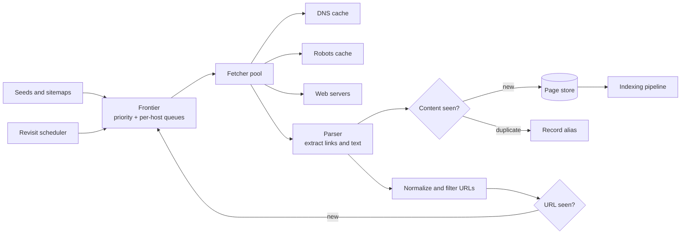

# Webクローラ: フロンティア、ポライトネス、鮮度

> **翻訳の状態:** 現行の[英語版](../../21-reference-designs/03-web-crawler.md)からの翻訳です。

## TL;DR

クローラはページをダウンロードし、リンクを抽出し、それを繰り返す。このループ自体は単純である。システムを定義するのは、ループが無視している3つの制約だ。**ポライトネス**。クロール対象のサーバは他人のものである。各ホストへのリクエストレートを決めるのは、クローラのハードウェアではなく、礼儀とロボット排除プロトコルである。**際限のなさ**。Webには無限のURLがあり、その大半は重複、トラップ、スパムである。クローラは、何を取得するかよりはるかに頻繁に、何を取得しないかを決めなければならない。**古さ**。保存したページは、取得した瞬間から古くなり始める。クロールは完了することがなく、より新しいか、より古いかがあるだけだ。

この3つは、1つのコンポーネントで交わる。**フロンティア**、つまり訪問すべきURLを保持し、次にどれを取るかを決めるデータ構造である。良いフロンティアは、相反する2つの目的を持つスケジューラである。優先度(価値のあるページを先に取得する)とポライトネス(1つのホストから速く取得しすぎない)だ。クローラ固有の設計判断のほとんどは、ここにある。その周りには汎用の部品が並ぶ。フェッチャのプール、DNSキャッシュ、重複検出、大容量ストレージである。以下の参照設計は、Mercatorとその後継の、公表されたアーキテクチャに従う。容量の数字はすべて例示である。

## 要件と契約

**機能要件。**

- シードURLとサイトマップから出発し、ページを発見して取得する。
- robotsの規則と、ホストごとのレート制限を守る。
- 同じコンテンツを繰り返し取得しない。
- ページを再訪し、保存した写しを新しく保つ。
- 取得したコンテンツとリンクグラフを、下流の索引処理へ出力する。

**契約。**

| 性質 | 契約 |
|---|---|
| ポライトネス | ホストごとに進行中のリクエストは高々1つ。リクエスト間には、ホストの応答時間に適応する最小の遅延を置く |
| robotsの順守 | 禁止されたパスを取得しない。robotsの規則は少なくとも毎日更新する |
| 身元の明示 | 連絡先URLを含む安定したユーザーエージェント。可能ならアドレス範囲を公表する |
| カバレッジ | 「Web全体」ではなく、定義した対象集合に対して測る |
| 鮮度 | 優先度の階層ごとの、保存した写しの期待経過時間のような、明示した目標 |
| 堅牢性 | 不正な形式のサイト、敵対的なサイト、無限に続くサイトは、そのホストのクロールを劣化させるだけで、フリート全体には及ばない |
| 再開可能性 | クラッシュで失うフロンティアの進捗には上限がある |

カバレッジと鮮度は、同じ取得予算を奪い合う。すべてを発見に使うクローラは古いページを返し、更新しかしないクローラは成長しない。予算の配分はプロダクトの判断であり、明示すべきである。

## 一次資料と適用範囲

| 資料 | 示していること | 限界 |
|---|---|---|
| Brin, Page (1998) | 初期の大規模クローラ。URLサーバが、それぞれ数百のコネクションを保持する分散フェッチャへ供給し、DNSキャッシュを持つ | 歴史的な規模 |
| Heydon, Najork, Mercator (1999) | 優先度キューとホスト別キューに分けたフロンティア。URL既出判定とコンテンツ既出判定 | 後続のクローラのほとんどが従う参照アーキテクチャ |
| Boldi et al., UbiCrawler (2004) | 中央の調整役なしに、コンシステントハッシュでホストをクローラエージェントへ割り当てる | 1つの分散設計 |
| Lee et al., IRLbot (2009) | 1台のサーバで41日間に63億ページ。ディスク上でのURL一意性判定と、スパムに対抗するドメイン別予算 | 1回のクロール。制約はCPUではなく、ディスクと評判だったことを示す |
| Cho, Garcia-Molina (2003) | 更新ポリシー。変化率に比例して再訪することは、平均鮮度にとって最適ではない | 仮定を明示した解析モデル |
| Manku, Jain, Das Sarma (WWW 2007) | 数十億ページ規模での、64ビットの類似度フィンガープリントによる近似重複の検出 | Googleが報告したパラメータ |
| RFC 9309 | ロボット排除プロトコル。キャッシュとエラー処理を含む | 2022年に標準化。よく使われるディレクティブの一部は対象外 |

## アーキテクチャ



ループは次のとおりである。フロンティアからURLを取り、ホストを解決し、robotsの規則を確認し、取得し、解析する。コンテンツの重複を判定し、抽出したリンクを正規化し、それぞれが発見済みかどうかを判定し、新しいものをフロンティアに加える。どの段階も、クローラがより少なく仕事をすることを選ぶ場所である。

## フロンティア

**文書化済み、Mercator:** フロンティアは2層からなる。**フロントキュー**はURLを優先度別に保持する。**バックキュー**はURLをホスト別に、1キュー1ホストで保持し、ポライトネスを強制する。「このホストに次に接続してよい最も早い時刻」をキーとするヒープが、フェッチャに次にどのバックキューを処理すべきかを教える。バックキューが空になると、高い優先度に偏らせながら、フロントキューから補充する。

この構造は2つの目的をきれいに分ける。

- 優先度は、どのホストの仕事がバックキューへ入るかを決める。
- ポライトネスは、各バックキューがいつURLを1つ放出してよいかを決める。
- フェッチャはURLを選ばない。順番の来たホストを受け取るだけである。

実装上の事実が3つ導かれる。フロンティアはメモリよりはるかに大きいので、RAMにあるのはキューの先頭だけで、残りはディスクかキューサービスに置く。フロンティアはクロールの状態なので、チェックポイントが必要である。失えば、Webを発見し直すことになる。そしてスループットを決めるのは、フェッチャのスレッド数ではなく、同時にクロールしているホストの数である。各ホストは、遅延間隔あたり高々1リクエストしか生まないからだ。

### 優先度

優先度の入力には、リンクに基づく重要度、シードからの深さ、ホストの評判、コンテンツの種類がある。再訪では、推定した変化率と、古いことのコストが加わる。優先度はURLごとに付けるが、**予算はホストやドメインごとに設ける**。**文書化済み、IRLbot:** 著者らは、ドメイン別の予算がなければ、クロールは無制限にURLを生成するサイトに乗っ取られると報告し、ドメインの評判に応じてクロール予算を割り当てる方法を述べている。

### ポライトネス

ホストごとにコネクションは一度に1つとし、リクエスト間に遅延を置く。よく使われる適応的な規則は、遅延を直前の応答時間の何倍かに設定する。遅いサーバへの接続は、自動的に少なくなる。制限はホスト名だけでなくIPアドレスにも適用する。数千のホスト名が1台のサーバを共有していることがあるからだ。

大きなサイトをどれだけ速くクロールできるかを決めるのは、ハードウェアではなくポライトネスである。

```text
2,000,000 pages on one host at 1 request per second = 2,000,000 s = 23 days
```

フリートの容量をどれだけ増やしても、この数字は変わらない。大きなサイトは継続的にクロールし、その鮮度は、速度ではなく、サイトマップと条件付きリクエストによって確保する。

## robotsの規則と身元の明示

**文書化済み、RFC 9309:** クローラは、クロールの前に各オーソリティから `/robots.txt` を取得し、自分のユーザーエージェントに一致する規則のグループを適用する。この仕様はエラー処理も定義しており、実装が誤るのはそこである。

- ファイルが**利用不能**(4xxのステータス)なら、クローラはどのリソースにアクセスしてもよい。
- ファイルに**到達不能**(サーバエラーやネットワーク障害)なら、クローラは全面禁止と見なさなければならない。
- キャッシュした規則は、ファイルに到達できない場合を除き、24時間を超えて使うべきではない。

この非対称性は意図されたものである。過負荷でエラーを返しているサーバを、すべてをクロールしてよいという許可として読んではならない。`Crawl-delay` のようなディレクティブは広く使われているが、標準には含まれない。それを尊重することは、クローラが文書化すべき配慮である。

クローラの名前を示し、その目的と遮断の方法を説明するページへリンクしたユーザーエージェントを送る。クローラを特定して連絡できる運用者は、スロットルをかける。それができない運用者は、アドレスを遮断する。

## 何を取得しないかを決める

### URLの正規化とURL既出判定

同じリソースには多くの表記がある。判定の前に正規化する。スキームとホストを小文字にし、既定のポートを取り除き、ドットセグメントを解決し、パーセントエンコーディングを正規化し、フラグメントを落とし、既知の追跡用やセッション用のパラメータを取り除く。規則はRFC 3986に由来する。パラメータのリストは、サイトの系統ごとに整備する。

そのうえでURL既出判定が、正規化したURLを以前に発見したかどうかを問う。数十億のURLでは、これは文字列のハッシュテーブルには大きすぎる集合所属問題である。固定長のフィンガープリントを保存し、ストアの前にメモリ上のフィルタを置いてほとんどの参照がディスクに触れないようにし、残りはバッチで処理する。[ブルームフィルタ](../03-storage-engines/05-bloom-filters.md)を参照。**文書化済み、IRLbot:** この論文は、まさにこの判定のための、ディスク上のバッチ構造を述べている。発見したURLごとにディスクをランダムに参照していては、クロール全体がそれに支配されるからである。

### コンテンツ既出判定と近似重複

異なるURLが同じページを返すことは多い。ミラー、印刷用表示、セッション違いなどである。コンテンツのチェックサムは完全な重複を捉える。広告やタイムスタンプだけが異なる近似重複には、類似度フィンガープリントが要る。**文書化済み、Manku et al.:** 64ビットのフィンガープリントを使い、80億ページのコーパスで、フィンガープリントの違いが高々3ビットのページを近似重複として扱った。

### トラップ

「翌月」へ永遠にリンクするカレンダー、あらゆるフィルタの組み合わせを持つファセット検索、すべてのリンクに新しい識別子を埋め込むスクリプトは、際限のないURL空間を作る。防御は検知だけでなく予算である。最大の深さ。時間窓あたり、ホストあたりの最大URL数。URLの最大長。パスごとのクエリパラメータの組み合わせ数の上限。そして新しいページの大半が重複であるホストの降格である。

## 取得

- **DNS**は隠れたボトルネックである。URLごとに同期的に解決すると、クロールはリゾルバのレイテンシで直列化される。結果を有効期間とともにキャッシュし、非同期に解決し、専用のリゾルバを運用する。ライフサイクルの問題は[DNSとコネクション管理](../06-scaling/13-dns-and-connection-management.md)にある。
- **条件付きリクエスト。** 再訪時にバリデータ(`If-Modified-Since`、`If-None-Match`)を送る。変更のないページのコストは、ダウンロードではなくヘッダの交換で済む。
- **上限。** 応答サイズ、最初のバイトまでの時間、合計時間、リダイレクトの連鎖の長さに上限を設ける。毎秒1バイトを永遠に送るサーバのコストは、有限の時間の1コネクションでなければならない。
- **レンダリング。** クライアント側のスクリプトで組み立てられるページは、コンテンツを得るためにヘッドレスブラウザを必要とする。コストは素の取得より1桁から2桁高い。レンダリングは、別の小さな階層として動かす。そこへ送るのは、価値があり、スクリプトへの依存が実証されたページだけにする。
- **信頼できない入力。** すべてのバイトは、そうでないと証明されるまで敵対的である。パーサは、メモリと時間の上限のもとで、フェッチワーカーの認証情報やネットワークから隔離して実行する。

## 分散

フロンティアはURLではなく**ホスト**で分割する。1つのワーカーが、あるホストのポライトネスの状態をすべて所有するようにするためだ。**文書化済み、UbiCrawler:** ホストはコンシステントハッシュでエージェントへ割り当てられ、エージェントの追加や削除で動くのは、ホストの一部だけである。

危険は再割り当てそのものにある。ホストがワーカーAからワーカーBへ移るとき、Aにまだ進行中のリクエストやキュー内のURLが残っていると、両方が同時にそのホストへ接続し、レートが2倍になる。ホストの所有権は、リースと、次に接続してよい時刻の引き継ぎによって移す。[リース、ハートビート、リカバリ](../18-workflow-job-systems/08-leases-heartbeats-recovery.md)で述べるとおりである。あるワーカーが、別のワーカーの所有するホストについて発見したリンクは、バッチで転送する。

## 鮮度と再訪のスケジューリング

保存した各ページには変化率があり、それは過去の訪問から推定するしかない。直感的なポリシー、つまり変化の頻度に比例してページを訪れる方法は、最良ではない。**文書化済み、Cho, Garcia-Molina:** 彼らのモデルでは、一様な再訪ポリシーのほうが比例ポリシーより良い平均鮮度を与える。最適なポリシーは、変化が速すぎて決して新しく保てないページには、注意をあまり向けない。

実用的な形はこうである。ページを重要度と推定変化率で階層に分け、階層ごとに再訪間隔を与える。取得のたびに変わるページを追うのはやめ、変動が激しいと分かっているものとして提供する。サイトマップとフィードをヒントとして使う。そのうえで、保存したページをサンプリングして現在のWebと比べ、結果を直接測る。

## 容量モデル

月に10億ページ、1ページあたりHTML 60キロバイト、発見済みURL 100億を目標とする。

```text
fetch rate        = 1,000,000,000 / 2,592,000 s     = 386 pages per second
bandwidth         = 386 x 60 KB                     = 23 MB/s = 185 Mbit/s
raw storage       = 1e9 x 60 KB                     = 60 TB per month before compression
URL fingerprints  = 10e9 x 8 bytes                  = 80 GB on disk
in-memory filter  = 10e9 x 10 bits                  = 12.5 GB at about 1% false positives
concurrent hosts  = 386 / (1 request per 2 s)       = at least 772 active at all times
```

帯域とCPUは控えめである。制約となる量は、並行してクロールできる異なるホストの数、既出集合の大きさ、そしてストレージである。予定より遅れているクロールに必要なのは、たいていマシンの追加ではなく、より広いホストの分散である。

## 障害トレース

### robotsのエラーを許可と読む

あるサイトのサーバが過負荷で、`/robots.txt` を含むすべてのパスに503を返す。クローラは取得の失敗を「規則なし」と扱い、通常は禁止されている数千のURLを要求して、過負荷を悪化させる。標準が求めるのはその逆で、到達不能は禁止を意味する。3つの場合(成功、利用不能、到達不能)を別々の状態として実装し、テストを付ける。

### 無限のカレンダー

イベントのページが、翌日へ際限なくリンクしている。クローラは1つのホストで4000万の一意なURLを発見するが、どれもほぼ空である。それらがフロンティアを埋め、そのホストの予算を何週間も使い切る。ホスト別のURL予算と、重複率による降格が被害に上限を与える。深さの制限だけでは防げない。どのページも直前のページから1クリックだからである。

### 2つのワーカーと1つのホスト

デプロイでフェッチャの半数が再起動する。コンシステントハッシュは、古いワーカーがまだ処理を終えていないうちに、大きなニュースサイトを新しいワーカーへ割り当て直す。10分間、そのサイトは合意したレートの2倍を受け、クローラのアドレス範囲を遮断する。所有権の移転には、リースと、引き継がれた次回接続可能時刻が必要である。

### リゾルバの崩壊

シードを取り込んだあと、クロールが数百万の新しいホストへ広がる。名前解決が共有リゾルバを圧倒し、タイムアウトが取得の失敗へ連鎖し、同じリゾルバを使う無関係なサービスまで劣化する。クローラには専用のリゾルバを与え、名前解決の並行度を制限し、否定的な結果をキャッシュする。

### セッション識別子が既出集合を無効にする

あるサイトが、すべての内部リンクにランダムなトークンを付ける。どのURLも新しく、どのページも重複である。URL既出判定はそのすべてを通す。気づくのはコンテンツ既出判定だけで、それは取得のコストを払ったあとになる。正規化の際に既知のセッションパラメータを取り除き、観測した重複率でホストを降格する。

## 運用と検証

追跡する対象は次のとおり。結果の種別ごと(成功、リダイレクト、クライアントエラー、サーバエラー、タイムアウト、robotsによる禁止)の取得レート。アクティブなホスト数。優先度別のフロンティアの大きさ。ホスト別の遅延の順守状況。ホスト別の重複率。DNSのレイテンシと失敗率。階層別の保存ページの経過時間の分布。そして条件付きリクエストで節約したバイト数。

ポライトネスは、アドレスごとの到着間隔を記録するテスト用オリジンで検証する。robotsの扱いは、標準に挙げられた場合に対して検証する。トラップ、リダイレクトのループ、遅い応答、過大な本文、不正なマークアップを含む合成サイトに対してクローラを走らせ、それぞれのコストが有限であることを要求する。再開は、クロールの途中でフロンティアの所有者を強制終了し、再取得されたURLと失われたURLを測って検証する。

## 設計レビューの問い

1. 対象集合は何か。カバレッジと鮮度は、それに対してどう測るか。
2. 取得予算は、発見と更新のあいだでどう配分されているか。誰が決めたか。
3. ホストごと、アドレスごとに一度に1リクエストであることを、ワーカーの再割り当て中も含めて、何が強制するか。
4. robotsの3つの結果(成功、利用不能、到達不能)はどう扱われるか。規則はどれだけの期間キャッシュされるか。
5. 1つのホストやドメインから受け入れるURLの数に、何が上限を与えるか。
6. 目標の規模で、既出集合はどれだけの大きさか。各参照はどこへ行くか。
7. 1つの応答に対して、時間、サイズ、リダイレクト、パーサの資源にどんな上限があるか。
8. ページの変化率はどう推定するか。常に変わるページはどうなるか。
9. サイトの運用者は、どうやってこのクローラを特定し、所有者に連絡し、減速または停止させるか。

## 参考文献

- [Brin and Page, *The Anatomy of a Large-Scale Hypertextual Web Search Engine* (Computer Networks and ISDN Systems, 1998)](https://doi.org/10.1016/S0169-7552(98)00110-X): 初期の大規模クローラの構成
- [Heydon and Najork, *Mercator: A Scalable, Extensible Web Crawler* (World Wide Web, 1999)](https://doi.org/10.1023/A:1019213109274)
- [Boldi, Codenotti, Santini, and Vigna, *UbiCrawler: A Scalable Fully Distributed Web Crawler* (Software: Practice and Experience, 2004)](https://doi.org/10.1002/spe.587)
- [Lee, Leonard, Wang, and Loguinov, *IRLbot: Scaling to 6 Billion Pages and Beyond* (ACM Transactions on the Web, 2009)](https://doi.org/10.1145/1541822.1541823)
- [Cho and Garcia-Molina, *Effective Page Refresh Policies for Web Crawlers* (ACM TODS, 2003)](https://doi.org/10.1145/958942.958945)
- [Manku, Jain, and Das Sarma, *Detecting Near-Duplicates for Web Crawling* (WWW 2007)](https://research.google/pubs/detecting-near-duplicates-for-web-crawling/)
- [RFC 9309, *Robots Exclusion Protocol*](https://www.rfc-editor.org/rfc/rfc9309)
- [RFC 3986, *Uniform Resource Identifier (URI): Generic Syntax*](https://www.rfc-editor.org/rfc/rfc3986)
- [Common Crawl](https://commoncrawl.org/)
