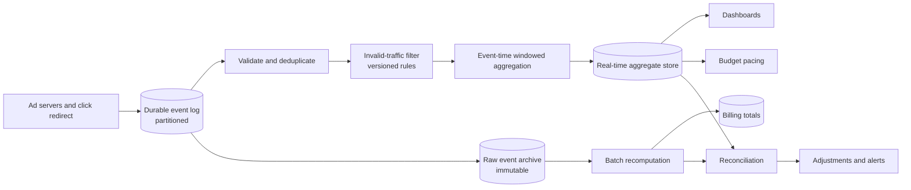

# 広告クリック集計: イベント時刻、重複排除、照合

> **翻訳の状態:** 現行の[英語版](../../21-reference-designs/04-ad-click-aggregation.md)からの翻訳です。

## TL;DR

広告クリック集計は、クリックイベントのストリームを、広告ごと、時間窓ごとの件数に変える。この件数は、許容度の異なる3つの利用者を動かす。ダッシュボードは1分以内に欲しがり、小さな誤差は許す。予算ペーシングは、キャンペーンが使いすぎる前に止められる速さを求める。課金は厳密に正しいことを求め、1日待てる。1つのパイプラインが3者すべてに最適であることはない。そこで設計は2本立てになる。出力が暫定である高速なストリーミング経路と、同じ不変のイベントログの上で動き、出力が確定である低速なバッチ経路である。両者のあいだには明示的な照合を置く。

「クリックを数える」ことを難しくする問題は3つある。**重複**。どの区間も再試行するので、同じクリックが複数回届く。それを1回と数えなければならない。**時刻**。クリックは、届いた分ではなく起きた分に帰属させる。そして一部は何時間も遅れて届く。**有効性**。クリックの一部はボットや誤った二度押しであり、広告主が監査できる形で除外しなければならない。仕組みは次のとおりである。重複排除の時間窓を伴うイベントの識別。ウォーターマークで閉じ、遅延のポリシーを定めたイベント時刻のウィンドウ。再生が二重計上にならないための、冪等またはトランザクショナルな出力。そして規則の変更が黙って履歴を書き換えないための、バージョン付きのフィルタリング。エンジンのセマンティクスは[ストリーム実行](../13-data-pipelines/02-stream-processing.md)が扱う。本章はそれを、出力が金額であるシステムに適用する。容量の数字はすべて例示である。

## 要件と契約

**機能要件。**

- 広告サーバとクライアントのリダイレクトから、クリックイベントを取り込む。
- 1分のウィンドウごとに、広告、キャンペーン、選んだ次元ごとの件数を出す。
- 直近の集計を、ダッシュボードとペーシングサービスへ提供する。
- キャンペーンごと、日ごとの請求対象の合計を出す。
- 無効なトラフィックを除外し、各イベントを除外した理由を記録する。

**契約。**

| 出力 | レイテンシ | 精度の契約 |
|---|---|---|
| リアルタイム集計 | イベントから問い合わせ可能になるまで1分未満 | 暫定。ウィンドウが確定するまで変わりうる |
| ペーシングのシグナル | 数秒から数十秒 | 一時的に過小に数えてよい。使いすぎは遅延によって上限が付く |
| 請求合計 | 数時間から1日 | イベントログと、名指しされたフィルタのバージョンに対して厳密。再現可能 |

追加の契約もある。受け付けたクリックはすべて、重複排除ののち、生ログにちょうど1回現れる。すべての集計は、それを生んだイベントまでたどれる。公表済みの数字への訂正は、それ自体が記録される。

リアルタイムの数字は暫定であると述べることが、この契約の中で最も価値のある一文である。それがなければ、最初に遅れて届いたイベントのまとまりが、どちらの数字が「正しい」かという論争になる。

## 一次資料と適用範囲

| 資料 | 示していること | 限界 |
|---|---|---|
| Ananthanarayanan et al., Photon (SIGMOD 2013) | 処理済みイベント識別子の、Paxosに支えられたレジストリを使い、データセンターをまたいでクリックとクエリのストリームを結合し、exactly-onceの出力を得る。毎分数百万イベントで、平均遅延は10秒未満 | 発表時点のGoogleの広告パイプライン |
| Gupta et al., Mesa (VLDB 2014) | 広告メトリクスのための地理複製されたウェアハウス。更新をバージョン付きのバッチで適用し、クエリは一貫した状態を見る | ストリーム処理ではなく、提供側のストア |
| Akidau et al., The Dataflow Model (VLDB 2015) | イベント時刻と処理時刻、ウィンドウ、ウォーターマーク、トリガ、累積モードを、独立した設計の軸として分ける | モデルである。保証はエンジンに依存する |
| Carbone et al. (VLDB 2017) | ストリーム処理でのexactly-onceな状態の基礎としての、演算子状態の一貫した分散スナップショット | エンジン内部の状態の一貫性であり、外部への効果ではない |
| Apache Kafka, KIP-98 | 冪等なプロデューサとトランザクション。消費、変換、生産の一巡を、ログの中でアトミックにする | アトミック性はログの境界で終わる |
| Yang et al., Druid (SIGMOD 2014) | 対話的な集約クエリのための、取り込み時にロールアップする列指向ストア | 1つのリアルタイム分析ストア |

## アーキテクチャ



イベントログが記録の正本である。その下流にあるものはすべて導出されたもので、作り直せる。ストリーミング経路はレイテンシを優先し、バッチ経路は完全性を優先する。照合は、両者の食い違いを、驚きではなく測定された量にする。

## イベントの識別と重複排除

クリックは、できるだけ早い段階で割り当てた識別子を持たなければならない。理想は、広告サーバが広告を描画するとき、またはリダイレクトサービスがクリックを受け取るときである。同じかどうかを定義するのは、ペイロードではなく識別子である。同じ識別子を持つ2つのイベントは、何回配送されても1つのクリックである。

重複はあらゆる区間で入り込む。ブラウザはリダイレクトを再試行し、コレクタはログへの書き込みを再試行し、ストリームジョブは障害のあとで再生する。それぞれを、安く扱える場所で扱う。

- **プロデューサからログへ。** 冪等な生産は、再試行した書き込みが2回追記されるのを防ぐ。
- **ログ全体にわたって。** キー付きの重複排除演算子が、ある時間窓のうちに見た識別子を覚え、繰り返しを落とす。時間窓は、ありうる最長の再配送の遅れを超えていなければならない。その状態の大きさは容量の節で見積もる。
- **ジョブからシンクへ。** 後述する。二重計上の大半が実際に起こるのはここである。

**文書化済み、Photon:** このシステムは、結合した各イベントの識別子を、データセンター間でPaxosにより複製したレジストリに記録する。ワーカーは、出力する前にレジストリへコミットする。レジストリが唯一の裁定者なので、複数のデータセンターのワーカーが可用性のために同じ入力を並行して処理しても、各イベントの出力は1回になる。

業務上の重複は、配送上の重複とは別物である。同じ利用者が同じ広告を2秒のうちに2回クリックした場合、識別子は異なり、どちらも正しく配送される。2回目が請求対象かどうかはポリシーの判断で、フィルタの段階に属する。

## イベント時刻、ウィンドウ、遅延

クリックは、それが起きた分に属する。処理時刻のウィンドウを使うと、障害のあとに再生した滞留分が、再生した分に帰属してしまう。実際には起きなかったスパイクと、クリックが本当にあった場所の穴が生まれる。

**文書化済み、The Dataflow Model:** この論文は4つの問いを分ける。何を計算するか。イベント時刻のどこでまとめるか(ウィンドウ)。処理時刻のいつ結果を出すか(ウォーターマークに駆動されるトリガ)。そして相次ぐ結果どうしがどう関係するか(累積)。

ここへの適用は次のとおりである。

- **タイムスタンプの権威。** 最初の信頼できる区間での、サーバ側の受信時刻を使う。クライアントの時計は誤っている。ときには何年も狂っており、攻撃者が設定することもできる。
- **ウィンドウ。** イベント時刻での1分のタンブリングウィンドウ。キーは広告と次元である。
- **ウォーターマーク。** それより前のイベントはもう残っていない、というエンジンの見積もり。ウォーターマークがウィンドウの終わりを過ぎたら、最初の結果を出す。
- **許容遅延。** ウィンドウの状態をさらに一定期間、たとえば1時間保持し、遅れたイベントが届いたら更新した結果を出す。下流のストアは、すでに見たウィンドウへの更新を受け入れなければならない。
- **許容遅延を超えたもの。** それより遅いイベントは、ストリーミング経路では加算しない。ただし生のアーカイブには残っており、バッチ経路がそれを含める。これが、2つの数字のあいだに設計として設けた差である。

更新した結果には、以前の結果との関係を定義しておく必要がある。ウィンドウの新しい合計を出力し、シンクがキーで**置き換える**方式は、差分を出力する方式より単純で安全である。再生された置き換えは無害だが、再生された差分は二重計上になるからだ。

## 二重計上のない出力

一貫したスナップショットを持つストリーム処理は、復旧後の内部状態が各入力をちょうど1回反映していることを保証する。この保証はエンジンの境界で終わる。ジョブが外部ストアへ「37を加算」と書き込み、チェックポイントの完了前に失敗して再生すると、ストアは「37を加算」を2回受け取る。

この隙間を閉じる設計は2つある。どちらも、一般的な形で[配信保証と効果の境界](../05-messaging/04-delivery-guarantees.md)に述べてある。

1. **冪等なシンク。** 集計の全体を、決定的なキー `(ウィンドウ開始, 広告, 次元)` のもとに、置き換えのセマンティクスで書く。再生は同じ値を書き直すだけである。これには、集計が増分ではなく合計であることが必要である。
2. **トランザクショナルなシンク。** チェックポイント間隔のあいだ出力をステージし、チェックポイントとともにアトミックにコミットする。結果はコミット時にはじめて見えるので、レイテンシにはチェックポイント間隔が含まれる。

**文書化済み、Mesa:** 更新は、バージョン番号で識別されるバッチで適用される。クエリは特定のコミット済みバージョンを読むので、読み手が適用途中のバッチを見ることはない。バージョン付きのアトミックなバッチは、冪等なシンクに対応する提供側の仕組みである。

これを誤る典型が、キャッシュの中で増分するカウンタである。高速だが、上流のどの段階も決して再試行しない場合にしか正しくない。

## 無効なトラフィック

クリックの一部は課金すべきではない。自動化されたトラフィック、短時間に繰り返されたクリック、ブロックリストにある発生元からのクリック、対応するインプレッションのないクリックである。フィルタの段階は規則を評価し、各イベントに、有効か無効かと、その理由のタグを付ける。

これを弁護可能に保つ規則が3つある。

- **削除せず、タグを付ける。** 無効なイベントは、理由コードとともにアーカイブに残す。自社の分析より件数が少ない理由を尋ねる広告主には、データから導いた答えを返すべきである。
- **規則にバージョンを付ける。** すべての集計は、それを生んだフィルタのバージョンを記録する。明日デプロイされるより良い規則は、遡って適用すれば昨日の数字を変える。それは副作用であってはならず、調整を記録した意図的な再処理でなければならない。
- **速い検知と遅い検知を分ける。** 安い規則はインラインで実行する。多数のアカウントにまたがる協調的なパターンのような高価な検知は、あとでアーカイブに対して実行し、調整を生む。そうした検知を支えるモデルは、[MLシステムの基礎](../16-ml-systems/01-ml-system-fundamentals.md)のライフサイクルに従う。

## 大規模での集約

**次元。** 次元を1つ加えるたびに、集計行の数が掛け算で増える。プロダクトが必要とする最も細かい粒度で集約し、粗いビューはロールアップで導く。利用者識別子のような高カーディナリティの属性を集計に持ち込まない。ユニークユーザー数は、[確率的スケッチ](../03-storage-engines/10-probabilistic-sketches.md)で述べる、マージ可能なカーディナリティ推定で提供する。

**ホットキー。** バイラルになったキャンペーンは、全イベントの大きな割合を1つのキーへ、したがって1つのパーティションと1つの演算子インスタンスへ送る。集約を2段階で行う。まず `(キー, ランダムなソルト)` で集約して負荷を分散し、量を減らす。次にキーだけで集約して部分結果をまとめる。合計と件数は、この方法で正しく合成できる。マージ可能なスケッチも同じである。

**提供。** 集計ストアは、「これらの広告、この時間範囲、これらの次元についての合計」に対話的に答える。取り込み時にロールアップする列指向ストアが合う。[分析クエリエンジン](../13-data-pipelines/03-analytical-query-engines.md)を参照。

## バッチ経路と照合

バッチ経路は、遅れたイベントが届く時間をおいたあと、完全なフィルタ群を使い、生のアーカイブから各日の合計を再計算する。その出力が請求の記録である。これは決定的であり、同じアーカイブと同じフィルタのバージョンが与えられれば、同じ合計を出す。請求書を再現可能にしているのは、この性質である。[バッチ実行](../13-data-pipelines/01-batch-processing.md)を参照。

照合は、バッチの合計を、同じ期間のストリーミングのウィンドウの和と比べ、差を分類する。

- 許容範囲内で、許容遅延を超えた遅延イベントで説明できる。
- 遅い検知でフィルタされたイベントで説明できる。
- 説明できない。これは2つの経路のどちらかの欠陥であり、担当者を呼び出す。

説明できない差は推移を追う。バッチ経路からのずれが広がっていくストリーミング経路は、どこかでイベントを失っているか、重複させている。それが見えるのは照合だけである。

## 容量モデル

1日10億クリック、ピーク係数5倍、1イベント500バイト、重複排除の時間窓1時間を仮定する。

```text
mean rate            = 1,000,000,000 / 86,400         = 11,600 events per second
peak rate            = 11,600 x 5                     = 58,000 events per second
raw archive          = 1e9 x 500 bytes                = 500 GB per day
dedup state (peak)   = 58,000 x 3,600 s x 16 bytes    = 3.3 GB of identifiers plus overhead
```

重複排除の状態は時間窓に比例して大きくなる。これは、より遅い再配送を許容するためのコストである。時間窓を1時間から1日に広げると、状態は24倍になる。ある点を超えると、残りの重複はバッチ経路で除くほうが安い。

ペーシングのレイテンシは、そのまま金額に換算される。

```text
overspend bound per campaign = spend rate x end-to-end lag
at 600 per hour and 2 minutes lag = 600 / 60 x 2 = 20 currency units
```

この上限に、予算の上限に近いキャンペーンの数を掛けたものが、パイプラインの遅延のコストである。ペーシングがダッシュボードより厳しいレイテンシの契約を持つ理由でもある。

## 障害トレース

### 再生でダッシュボードが2倍になる

1. 集約ジョブがカウンタストアへ増分を書き込む。
2. 10秒ぶんの結果を書いたあと、チェックポイントの前に失敗する。
3. 再起動すると、その10秒を再処理し、増分をもう一度書き込む。
4. ダッシュボードには山が現れ、ペーシングはキャンペーンを早く止める。

シンクが冪等ではなかった。ウィンドウをキーとして合計を書くか、出力をチェックポイントとともにコミットする。

### 止まったウォーターマーク

ログの1つのパーティションが、上流のコレクタが落ちているためにイベントを受け取らない。ウォーターマークは全パーティションの最小値なので、進まなくなる。どのウィンドウも閉じず、ほかのすべてのパーティションからのイベントが状態にたまるあいだ、ダッシュボードは平坦になる。アイドルなパーティションを検出し、タイムアウト後にウォーターマークから除外する。ウォーターマークの遅延を、第一級のシグナルとしてアラートする。

### 未来からのクリック

クライアントライブラリが、端末の時計でイベントに時刻を付ける。時計が翌年に設定された端末の一群が、1年先のウィンドウに入るイベントを出す。それがウォーターマークを進め、現在のすべてのイベントが遅延として扱われ、捨てられる。イベント時刻は最初の信頼できるサーバで割り当てる。妥当な範囲の外にあるタイムスタンプは、拒否するか、範囲内に丸める。

### リージョンの滞留が3時間遅れて届く

あるコレクタのリージョンが接続を失い、ローカルにバッファする。再接続すると3時間ぶんのイベントが届くが、すべて1時間の許容遅延を超えている。ストリーミング経路はそれらを集計に加えず、その期間のダッシュボードは低いままになる。バッチ経路はそれらを含め、請求は正しい。照合は、大きいが説明のつく差を示す。これは設計どおりの動作である。直近の数字は暫定であると、ダッシュボードに明示しておくこと。

### フィルタの変更が先月を書き換える

新しいボット規則がデプロイされ、バックフィルのジョブが直近30日をその規則で再処理する。公表済みのキャンペーン合計が2%下がるが、理由の記録はない。すでにレポートを受け取っていた広告主が異議を唱える。再処理は、新しいバージョンと明示的な調整を書かなければならない。公表済みの数字をその場で上書きしてはならない。

## 運用と検証

追跡する対象は次のとおり。イベント時刻から集計が問い合わせ可能になるまでの全体の遅延。パーティションごとのウォーターマークの遅延。遅延の区分別の遅延イベント率。重複排除のヒット率。規則別、バージョン別の無効トラフィック率。状態の大きさ。チェックポイントの所要時間。そして原因別に分類した照合の差。

決定的な再生で検証する。1日ぶんの入力を記録し、パイプラインを走らせ、無作為な時点で強制終了と再起動を行い、最終的な集計がバッチの結果と等しいことを要求する。重複、順序の乱れたイベント、沈黙するパーティション、ありえないタイムスタンプを持つイベントを注入する。同じアーカイブに対してバッチジョブを2回走らせ、出力が同一であることを要求する。

## 設計レビューの問い

1. クリックの識別子はどこで割り当てるか。2つのイベントを同じクリックにするものは何か。
2. 重複排除の時間窓はどれだけか。そのあとに届いた重複はどうなるか。
3. どの時計がイベント時刻を定義するか。タイムスタンプが誤っているイベントはどうなるか。
4. ウィンドウの結果は、いつ最初に出力されるか。どれだけの期間変わりうるか。シンクは変更をどう適用するか。
5. ジョブをどの瞬間に強制終了して再起動しても、集計が2回数えられることはないか。シンクを冪等またはトランザクショナルにしているものは何か。
6. アイドルな1つのパーティションがすべてのウィンドウを凍らせるのを、何が防ぐか。
7. 無効なクリックはどう記録されるか。公表された各数字を生んだのは、どのフィルタのバージョンか。
8. 請求されるのはどの数字か。それはどう再現され、リアルタイムの数字との差はどう説明されるか。
9. ペーシング経路の遅延から導かれる、使いすぎの上限はいくらか。

## 参考文献

- [Ananthanarayanan et al., *Photon: Fault-tolerant and Scalable Joining of Continuous Data Streams* (SIGMOD 2013)](https://research.google/pubs/photon-fault-tolerant-and-scalable-joining-of-continuous-data-streams/): データセンターをまたぐexactly-onceの結合
- [Gupta et al., *Mesa: Geo-Replicated, Near Real-Time, Scalable Data Warehousing* (VLDB 2014)](https://research.google/pubs/mesa-geo-replicated-near-real-time-scalable-data-warehousing/)
- [Akidau et al., *The Dataflow Model: A Practical Approach to Balancing Correctness, Latency, and Cost in Massive-Scale, Unbounded, Out-of-Order Data Processing* (VLDB 2015)](https://research.google/pubs/the-dataflow-model-a-practical-approach-to-balancing-correctness-latency-and-cost-in-massive-scale-unbounded-out-of-order-data-processing/)
- [Carbone et al., *State Management in Apache Flink: Consistent Stateful Distributed Stream Processing* (VLDB 2017)](https://www.vldb.org/pvldb/vol10/p1718-carbone.pdf)
- [Apache Kafka, *KIP-98: Exactly Once Delivery and Transactional Messaging*](https://cwiki.apache.org/confluence/display/KAFKA/KIP-98+-+Exactly+Once+Delivery+and+Transactional+Messaging)
- [Yang et al., *Druid: A Real-time Analytical Data Store* (SIGMOD 2014)](http://static.druid.io/docs/druid.pdf)
- [Uber Engineering, *Real-Time Exactly-Once Ad Event Processing with Apache Flink, Kafka, and Pinot*](https://www.uber.com/blog/real-time-exactly-once-ad-event-processing/)
