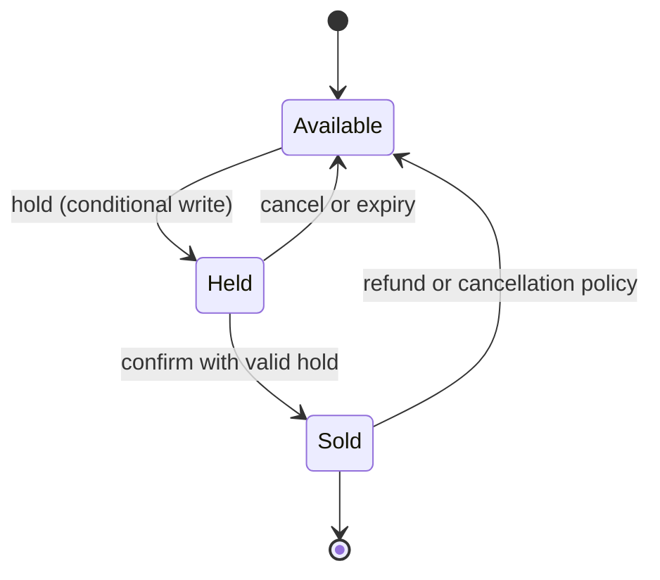
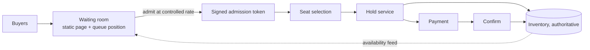

# チケット販売と在庫予約: ホールド、競合、公平なアドミッション

> **翻訳の状態:** 現行の[英語版](../../21-reference-designs/05-ticketing-inventory-reservation.md)からの翻訳です。

## TL;DR

座席、部屋、数量限定の商品など、固定の在庫を売るシステムには、緩めることのできない不変条件が1つある。販売済みの数とホールド中の数の合計は、存在する数を決して超えない。設計のほかのすべては、この不変条件を守ることの帰結である。しかも守らなければならないのは、数分かかり、他者のシステムの中で起こる支払いが進行しているあいだであり、商品の数をはるかに超える購入者が同じ1秒に押し寄せるあいだである。

設計を支える仕組みは3つある。**ホールド**は、支払いの前に商品を確保し、ひとりでに失効する、期限つきの権利である。数分かかる購入を、2つの短いアトミックな手順に変える。権威を持つ在庫レコードへの**条件付き書き込み**は、不変条件を、アプリケーションロジックの性質ではなくデータベースの性質にする。並行実行のもとで不変条件が生き残る場所は、そこしかない。購入経路の前に置く**アドミッション制御**、通常は待合室は、殺到を行列に変え、競合するレコードが処理できるレートだけを通す。繰り返される誤りも一貫している。在庫の確認と書き込みを別々の手順で行うこと。正しさをバックグラウンドの掃除処理に依存させること。そして支払いの成功を、ホールドがまだ有効だった証拠として扱うことである。支払いのステートマシンは[Stripe](../08-case-studies/06-stripe.md)が扱う。本設計は、同じ取引の在庫側を扱う。容量の数字はすべて例示である。

## 要件と契約

**機能要件。**

- イベントや商品の空き状況を表示する。
- 購入者が、特定の商品または数量を、限られた時間だけホールドできる。
- 支払いが成功したらホールドを販売に変える。支払いの失敗、購入者の離脱、時間切れのときは解放する。
- 購入者ごとの上限を強制する。
- 需要が容量を超えるとき、購入者を公平に受け入れる。

**契約。**

| 性質 | 契約 |
|---|---|
| 売り越しなし | すべての在庫単位について、どんな実行順序でも、どんなクラッシュのあとでも、常に `sold + held <= capacity` |
| ホールドの排他性 | 1つの商品は、失効していない保持者を高々1人持つ |
| ホールドの失効 | 期限を過ぎたホールドは、何かが掃除したかどうかに関係なく、何の権利も与えない |
| 販売の確定性 | 確定した販売は再割り当てされない。販売を伴わない請求は自動的に返金される |
| 冪等性 | ホールドや確定のリクエストを再試行しても、追加のホールドや販売は生じない |
| 空き状況の表示 | 参考情報であり、古い可能性がある。権威を持つのは書き込み経路だけである |
| 公平性 | 明示的に述べる。たとえば販売開始後の到着順 |

売り越しは、正しさの問題であると同時にポリシーの問題でもある。航空会社は、見込まれる不搭乗に備えて意図的に超過予約をする。不変条件は事業が定義するものであり、設計の仕事は、定義された上限を偶然に超えることを不可能にすることである。

## 一次資料と適用範囲

| 資料 | 示していること | 限界 |
|---|---|---|
| O'Neil, The Escrow Transactional Method (ACM TODS, 1986) | 各トランザクションが、必要になりうる量をまず取り分けておけば、集計量への並行更新は安全である。どのコミット順でも制約が成り立つ | 集計量が対象。個別に識別される商品ではない |
| Garcia-Molina, Salem, Sagas (SIGMOD 1987) | 長い活動を、補償を伴うローカルトランザクションの列として扱う | 補償は意味的に妥当でなければならない |
| Helland, Life beyond Distributed Transactions (CIDR 2007) | 単一エンティティのトランザクションで更新されるエンティティを、メッセージと、のちに確定または取り消される暫定的な操作で協調させる | アーキテクチャについての意見論文 |
| Bailis et al., Coordination Avoidance in Database Systems (VLDB 2015) | ある不変条件を協調なしに保てるかどうかは、不変条件と操作から判定できる。減算されるカウンタの下限は、協調なしには保てない | その論文の分析の枠組みとベンチマーク |
| PostgreSQL文書 | 行レベルのロックと、ロックされていない行を待たずに取る `SKIP LOCKED` | 1つのデータベースのセマンティクス |

## 購入のステートマシン



購入は、外部での待ちをはさむ、2つの短いトランザクションである。

1. **ホールド。** 商品を空きからホールド中へアトミックに移し、保持者と期限を記録する。空きでない商品が1つでもあれば失敗する。
2. **支払い。** 在庫システムの外で行われる。数分かかることがあり、結果が不明のままタイムアウトすることもある。
3. **確定。** 商品をホールド中から販売済みへアトミックに移す。ただし、ホールドがまだこの購入者のもので、失効していない**場合に限る**。

手順3の条件が、最もよく省かれる部分である。支払いの成功とホールドの有効性は、別々のシステムが決める独立した事実である。設計は、すべての組み合わせを扱わなければならない。

## 権威を持つ書き込み

不変条件は、並行する書き込みが出会う場所、つまりストレージエンジンで強制しなければならない。空き状況を読み、判断し、それから書くアプリケーションコードは、チェックしてから実行する形の競合になる。どちらかが書く前に、2つのリクエストが「空き」を読む。

**個別に識別される商品(指定席)。** 各座席は1行である。ホールドは、空き状態か、失効したホールドからのみ成功する条件付き更新である。

```sql
UPDATE seats
   SET state = 'held', holder = :buyer, hold_expires = now() + interval '8 minutes'
 WHERE id = :seat
   AND (state = 'available'
        OR (state = 'held' AND hold_expires < now()));
-- one row updated means the hold was acquired; zero means someone else has it
```

この更新は、行を変えるか変えないかのどちらかであり、アトミックである。事前の読み取りは信用しない。複数の座席のホールドは、すべての行が更新された場合にのみ成功する1つのトランザクションにする。

「隣り合うN席」や「最良の空きN席」では、候補を選んでロックする方法は、多くの購入者が同じブロックを欲しがるとき、ロック待ちとデッドロックを招く。**文書化済み、PostgreSQL:** `SELECT ... FOR UPDATE SKIP LOCKED` は、現在ロックされていない行を返し、残りは待たずに飛ばす。並行する購入者が、それぞれ別の空きブロックを取れる。

**数量で管理する在庫(自由席、物品)。** レコードは数量であり、ホールドは条件付きの減算である。

```sql
UPDATE inventory
   SET available = available - :n
 WHERE item = :item
   AND available >= :n;
```

これは正しい。そして人気の商品では、1つのホットな行になる。すべての購入者が同じロックを奪い合う。分離性の細かな点は[分離レベル](../01-foundations/02-isolation-levels.md)にある。

### ホットなカウンタを緩和する

**文書化済み、O'Neil:** エスクロー方式では、各トランザクションがまず自分の量を確保することで、多数のトランザクションが1つの集計量を並行して更新できる。確保した合計が存在量を超えることはないので、どの順序でコミットしても制約は成り立つ。

これを設計として適用するには、数量を**割り当て**に分ける。`k` 個のシャード、アプリケーションノード、またはリージョンのそれぞれに在庫の一部を与え、各自がローカルに自分の分を減らし、使われなかった割り当てはバックグラウンドで再配分する。競合は `k` 分の1になる。代償は終盤に現れる。在庫の合計が少なくなると、ある割り当ては空なのに別の割り当てにはまだ残りがある、ということが起こる。在庫があるのに購入者が断られうる。在庫が減るにつれて積極的に再配分するか、最後の数個については単一のカウンタへ畳む。

**文書化済み、Bailis et al.:** 並行する減算のもとで「カウンタが0を下回らない」という制約は、協調なしには保てない。エスクローは協調を避けているのではなく、ホットパスから割り当ての手順へ移している。

極端な競合に対するもう1つの選択肢は、単一ライタの設計である。イベントごとに1つのプロセスが在庫をメモリ上に持ち、永続ログから順番にリクエストを適用し、ロックは一切取らない。これは[注文マッチングエンジン](./06-order-matching-engine.md)の方式であり、最大級の販売開始に向く。

## 掃除処理に頼らない失効

ホールドは、すべてのバックグラウンドジョブが落ちていても、期限で権利を失わなければならない。失効は、掃除役が実行する動作ではなく、上の更新のように、**読み取り時と書き込み時に評価する述語**にする。行を早めに解放し、件数を整えるために掃除処理を走らせてもよい。ただしそれが止まっても、影響は、失効したホールドが次の購入者によって遅れて回収されることだけになる。

期限の設定と判定には、1つの時計、つまりデータベースの時計を使う。時計のずれたアプリケーションサーバ間で期限を比べると、ある購入者には早く、別の購入者には遅く失効する。[分散時間](../01-foundations/05-distributed-time.md)を参照。

数量で管理する在庫では、ホールドは、ホールド表の1行と減算の組である。失効すると数量が戻る。この返却は掃除役が行う加算なので、ホールドごとに冪等でなければならない。そうしないと、再試行された掃除処理が在庫を二重に戻し、システムは売り越す。

## 支払いと遅れて届く成功

支払いは、成功、失敗、不明の3つの結果を持つ外部への効果である。ホールドがまだ有効かどうかと組み合わせると、正常系が決して通らない場合が出てくる。

| 支払い | 確定時のホールド | 対応 |
|---|---|---|
| 成功 | 有効 | 販売を確定する |
| 失敗 | 問わない | ホールドを解放する |
| 成功 | 失効。商品はまだ空き | アトミックに取り直して確定する |
| 成功 | 失効。商品は再販売済み | 自動的に返金し、購入者に明確に伝える |
| 不明 | 問わない | 解放しない。プロバイダへ照会するかコールバックを待ち、そのうえで上の行を適用する |

悪い場合を減らす実践は3つある。

- **オーソリ、確定、キャプチャの順にする。** まず支払いのオーソリを取り、販売を確定し、販売が記録されたあとでのみ売上を確定(キャプチャ)する。手順のあいだで失敗しても、残るのは返金すべき請求ではなく、取り消すべきオーソリである。
- **支払いが始まったらホールドを延長する。** ホールドの期限は支払いのタイムアウトを超えているべきで、延長そのものも条件付き書き込みにする。
- **確定を冪等にする。** 支払いプロバイダのコールバックと、購入者のブラウザのリダイレクトは、どちらも確定を起動し、しばしば同時に起こる。2回目は、1回目の結果を返すだけで何もしない操作でなければならない。

補償のロジックはサーガである。一般的な扱いは、[ワークフローの効果コミットプロトコル](../18-workflow-job-systems/06-retry-idempotency-compensation.md)と[冪等性と操作の識別](../01-foundations/08-idempotency.md)にある。

## アドミッションと待合室

200万人が5万席を欲しがるとき、在庫経路をどう作っても、大半のリクエストは成功しえない。全員をそこへ到達させれば、ロックの競合、タイムアウト、再試行が確実に起こり、成功できたはずの購入者の体験まで悪くなる。

**参照設計:** 購入フローの前に置く待合室。



- 待合室は、静的でキャッシュ可能な基盤から提供し、購入者を動的な経路から遠ざけておく。
- 購入者は、ホールドと支払いのサービスが耐えられるレートで受け入れ、署名つきで期限のあるトークンを渡す。購入経路は、トークンのないリクエストを拒否する。
- 在庫が尽きたら、待合室がそう告げ、それ以上は誰も受け入れない。

公平性は、技術的な帰結を伴うプロダクトの判断である。厳密な到着順は、速いネットワークと自動化に有利に働く。開始時刻より前に到着した全員にランダムな順位を割り当てれば、1ミリ秒早く着くことの利点はなくなる。規則は公開する。それは必ず検証される。

濫用対策もここに属する。アカウント単位と支払い手段単位の購入上限。アイデンティティあたりの同時ホールド数の上限。そして受け入れ前のボット検知である。ホールドに上限がなければ、攻撃者は支払わずに全在庫を繰り返し確保し、全員に対して販売を妨害できる。リミッタの仕組みは[レート制限](../06-scaling/05-rate-limiting.md)にある。

## 空き状況の表示

座席表は、描画された瞬間に古くなる。ヒントとして扱う。短い寿命のキャッシュかレプリカから提供し、可能なら更新をプッシュする。そして、表示された座席が、購入者がクリックするまでになくなっているという、よくある場合を前提にインターフェースを設計する。ホールドに失敗したら、すぐに代替を提示する。最もホットな行への手動の再試行の嵐を招くエラーを返してはならない。

## 容量モデル

5万席、最初の1分に200万人の購入者が到着、1注文あたり2席、チェックアウトの中央値3分、ホールド8分を仮定する。

```text
without admission    = 2,000,000 x 5 requests / 60 s    = 167,000 requests per second on the hold path
orders needed        = 50,000 / 2                       = 25,000
admit at 1,000/s, 60% conversion
  admitted to sell out = 25,000 / 0.60                  = 41,700 buyers = 42 seconds of admission
hot counter ceiling  = 1 / 5 ms lock hold               = 200 transactions per second on one row
```

ここから3つの結論が出る。アドミッションは、競合する経路の負荷を2桁下げ、販売を1件も失わない。もともと上限は在庫だったからである。単一のカウンタ行は、受け入れたレートすら処理できない。割り当てか、単一ライタのキューが必要になる。そしてホールドは、役に立つ期間を過ぎても残る。

```text
seats held after 25 s of admission at 1,000 buyers/s x 2 seats = 50,000
```

30秒以内にすべての座席がホールドされ、イベントは売り切れに見える。その後の8分間でホールドの40%が失効し、座席が少しずつ戻る。立ち去った購入者はもういない。残りの在庫に比例して受け入れ、ホールドを短く保ち、離脱時にはすぐに解放し、待っている購入者には、ホールド中の座席が戻りうることを伝える。

## 障害トレース

### 確認してから書く

1. 2つのリクエストが、座席14Cを空きとして読む。
2. どちらも無条件に `state = 'held'` を書く。
3. 2つ目の書き込みが1つ目を上書きし、両方の購入者が支払いへ進む。
4. 1つの座席に、確定した販売が2件存在する。

空き状況の読み取りを関門にしてはならない。関門は条件付き書き込みである。

### 失効後の支払い

購入者の銀行が、承認に9分かける。ホールドは8分で失効し、別の購入者がその座席をホールドしている。支払いのコールバックは、ホールドを確かめずに確定する。座席が二重に売られるか、購入者が何も得ずに請求される。確定は条件付きにし、商品がなくなっていた場合の返金経路を自動化する。

### 在庫を凍らせた掃除処理の停止

失効が、失効したホールドを空きに戻す定期ジョブだけで実装されている。そのジョブが1時間失敗する。離脱されたホールドはすべてホールド中のままになり、座席の半分が誰のものでもないのに、イベントは空きなしと表示される。失効がホールド文の中の述語であれば、次の購入者がその座席を取るだけである。

### ホールドの占拠

スクリプトが数千のセッションを開き、すべての座席をホールドし、失効させ、また繰り返す。座席は1つも売れない。アカウント、支払い手段、アドミッショントークンごとに同時ホールド数の上限を設け、支払いに進んでいない購入者のホールドは短くする。

### 再試行されたホールド

購入者のホールドリクエストが、ゲートウェイでタイムアウトするが、データベースでは成功していた。クライアントが再試行し、さらに2席をホールドする。その購入者は4席をホールドしており、ほかの購入者に見える在庫は減る。ホールドリクエストには冪等キーを付け、再試行には元のホールドを返す。

### 解放時の二重の戻し入れ

掃除処理が、失効した数量ホールドを、カウンタへ加算することで解放する。ホールドを解放済みと記録する前にクラッシュし、再起動後にもう一度加算する。空き在庫は、その分だけ実際より多くなる。システムは、原因から遠く離れた時点で売り越す。解放は、ホールドの状態とカウンタを一緒に変える1つのトランザクションにし、ホールドがまだ解放されていないことを条件にする。

## 運用と検証

追跡する対象は次のとおり。作成、確定、失効、取り消しされたホールドの数。ホールドから確定への転換率と所要時間。原因別の条件付き書き込みの失敗率。在庫行でのロック待ち時間。ホールドが無効なのに成功した支払いと、その解決。自動で発行した返金。キューの深さとアドミッションのレート。そして継続的な不変条件の検査である。すべての単位について `sold + held <= capacity` が成り立ち、有効な保持者が2人いる商品がないことを確かめる。

素朴な設計なら失敗する並行テストで検証する。最後の1個に対する数千の同時ホールド。成功がちょうど1件であることを確かめる。失効と競合する確定。重複した確定のコールバック。強制終了された掃除処理。そして支払いの成功と確定のあいだでのプロセスのクラッシュである。待合室を置いた状態で、見込まれる到着レートでの販売開始のリハーサルを通しで行う。

## 設計レビューの問い

1. 売り越しなしの不変条件を強制する、ただ1つの文または操作はどれか。それを通らずに在庫を書けるコード経路はないか。
2. すべてのバックグラウンドジョブを止めても、ホールドは期限で権利を失うか。
3. ホールドの期限を設定し、判定するのはどの時計か。
4. ホールドの失効後に支払いが成功したとき、2つの場合のそれぞれで何が起こるか。
5. 支払いの結果が不明なとき、何が起こるか。
6. ホールド、確定、解放はそれぞれ冪等か。そのキーは何か。
7. 販売の最初の1分に、競合する在庫レコードへ届くレートはいくらか。そのレートを何が強制するか。
8. 1つのアイデンティティは同時にいくつのホールドを持てるか。支払わずにどれだけの期間持てるか。
9. 表示された座席がもう空いていないとき、購入者は何を見るか。その応答は再試行の嵐を生まないか。
10. どの継続的な検査が売り越しを検出するか。どれだけ速く検出するか。

## 参考文献

- [O'Neil, *The Escrow Transactional Method* (ACM TODS, 1986)](https://doi.org/10.1145/7239.7265): 集計量への並行更新を安全にするエスクロー方式
- [Garcia-Molina and Salem, *Sagas* (SIGMOD 1987)](https://doi.org/10.1145/38713.38742)
- [Helland, *Life beyond Distributed Transactions: an Apostate's Opinion* (CIDR 2007)](https://www.cidrdb.org/cidr2007/papers/cidr07p15.pdf)
- [Bailis et al., *Coordination Avoidance in Database Systems* (VLDB 2015)](https://www.vldb.org/pvldb/vol8/p185-bailis.pdf)
- [PostgreSQL documentation, *SELECT* (the locking clause and `SKIP LOCKED`)](https://www.postgresql.org/docs/current/sql-select.html)
- [PostgreSQL documentation, *Explicit Locking*](https://www.postgresql.org/docs/current/explicit-locking.html)
- [AWS Solutions, *Virtual Waiting Room on AWS*](https://aws.amazon.com/solutions/implementations/virtual-waiting-room-on-aws/)
