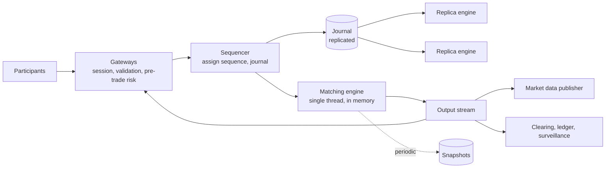

# 注文マッチングエンジン: シーケンシング、決定性、再生

> **翻訳の状態:** 現行の[英語版](../../21-reference-designs/06-order-matching-engine.md)からの翻訳です。

## TL;DR

マッチングエンジンは、銘柄ごとに注文板を保持し、公表された優先規則に従って買い注文と売り注文を組み合わせる。優先規則は、ほぼ例外なく、まず価格、次に到着時刻である。このシステムを定義する要件は、速さではなく**順序についての合意**である。同じ価格の2つの注文では早いほうが先に約定する。そのためシステムは、すべての入力に、1本の全順序の中のただ1つの位置を割り当てなければならない。そしてすべての参加者、レプリカ、監査人、規制当局が、あとからまさにその順序を復元できなければならない。

この要件は、本書のほとんどのサービスとは異なるアーキテクチャを生む。中核は、**単一スレッドで、インメモリの、決定的なステートマシン**である。それに入力を供給するのは**シーケンサ**で、各入力を処理の前にジャーナルへ書く。クリティカルパスには、ロックもデータベースもない。入力を順番に適用する1本のスレッドは、どちらも必要としないからである。可用性は、同じジャーナルをレプリカで再生することで得る。エンジンが決定的なので、レプリカは同じ状態に達する。復旧は、スナップショットとジャーナルの末尾部分の再生である。スケールは銘柄での分割で得る。板どうしは相互作用しないからだ。技術上のリスクは3か所に集中する。再生を元の実行からずれさせるもの。入力が永続化される前に結果を知らせてしまうもの。そして1参加者の故障したシステムに、際限なく注文を出させてしまうものである。容量の数字はすべて例示である。

## 要件と契約

**機能要件。**

- 指値注文と成行注文について、新規、取消、訂正のリクエストを受け付ける。
- 価格時間優先で注文を突き合わせ、約定を出力する。
- 各注文の状態変化を、その所有者へ報告する。
- マーケットデータ、つまり板の変化と約定の公開の列を配信する。
- 取引前のリスク上限と、銘柄単位の取引制御を強制する。

**契約。**

| 性質 | 契約 |
|---|---|
| 全順序 | 受け付けたすべての入力は、ちょうど1つのシーケンス番号を持つ。処理はシーケンス順に従う |
| 優先度 | 同じ価格水準では、シーケンスの早いものが先に約定する。数量を増やす、または価格を変える訂正は優先度を失う |
| 決定性 | 同じ初期状態と入力列が与えられれば、どの実行もバイト単位で同じ出力を生む |
| 開示前の永続化 | 入力がクォーラムで永続化されるまで、確認応答、約定、マーケットデータのメッセージを一切出さない |
| 冪等な受付 | 同じクライアント注文識別子で再送された注文は、2回受け付けない |
| エクスポージャの上限 | どの参加者も、設定された注文、ポジション、想定元本の上限を超えられない。注文が板に達する前に検査する |
| 復旧可能性 | 任意のシーケンス番号での状態を、スナップショットとジャーナルから再構築できる |

レイテンシは重要であり、取引所はそれで競い合う。ただしそれは、これらの契約の上に重ねる品質特性である。順序を証明できない速いエンジンは、市場ではない。

## 一次資料と適用範囲

| 資料 | 示していること | 限界 |
|---|---|---|
| Schneider (ACM Computing Surveys, 1990) | 決定的なステートマシンのレプリカは、同じリクエストを同じ順序で処理すれば、同じ出力を生む | 決定性と合意された順序を要する。性能については何も言わない |
| Fowler, The LMAX Architecture (2011) | 個人向け取引プラットフォーム。業務ロジックは1本のスレッドでメモリ上で動き、ジャーナルされ複製された入力を受け取る。そのスレッドで毎秒600万注文と報告された | 1つのシステム。数字は、そのワークロードとハードウェアについての著者の報告 |
| Thompson et al., LMAX Disruptor (2011) | ロックも、メモリ確保を伴うキューも使わずにスレッド間でメッセージを渡す、事前確保のリングバッファ | 並行処理の部品であり、取引所の設計ではない |
| Nasdaq TotalView-ITCH仕様 | 注文単位のマーケットデータプロトコル。注文の追加、約定、取消、置換を、シーケンス番号付きのメッセージで伝える | 1つの取引所のフィード形式 |
| FIX Trading Communityの標準 | シーケンス番号と再送要求を備えた、注文入力のセッションのセマンティクス | 業界のプロトコル群 |
| Knight Capitalに対するSECの行政手続き (2013) | デプロイの誤りにより、自動ルータが約45分間誤った注文を送り、損失は4億6000万ドルを超えた | ブローカーの注文ルータ。制御がない場合の帰結として引用する |
| Budish, Cramton, Shim (QJE 2015) | 連続時間のマッチングは速度競争を生む。離散的な間隔でのバッチオークションは、設計上の代替である | 経済分析であり、実装ではない |

## 注文板と優先度

1銘柄の板には2つの側がある。買い気配は価格の降順、売り気配は昇順に並ぶ。各価格水準は、板に残っている注文の先入れ先出しのキューを持つ。

- **指値注文**は、受け入れられる最悪の価格を指定する。反対側と交差すれば、板に残っている注文と約定する。最良価格から順に、同じ価格の中では古いものから順に、すべて約定するか交差しなくなるまで続く。残りは板に残る。
- **成行注文**は、すべて約定するか反対側が尽きるまで、最良の価格と約定する。
- **取消**は、板に残っている注文を取り除く。
- 数量を減らす**訂正**は、順位を保つ。数量を増やす、または価格を変える訂正は、取消と新規注文であり、新しい水準の最後尾に並ぶ。

IOC、FOK、自己約定の防止といった変種は、同じループの中で適用する規則である。

データ構造は操作から決まる。最良価格の参照、ある価格への挿入、注文識別子による除去、水準の先頭からの除去である。よくある構成は、価格の刻みをキーとする配列か木に価格水準を持ち、水準内の注文を連結リストで持ち、注文識別子からそのノードへのハッシュマップで定数時間の取消を実現する。価格と数量は、固定単位の整数にする。浮動小数点演算は避ける。コンパイラやハードウェアによって結果が異なりうるので、決定性を壊すからである。

## アーキテクチャ



**ゲートウェイ**は参加者のセッションを終端し、認証し、メッセージ形式と銘柄の規則を検証し、参加者ごとのリスク上限を適用し、リクエストをコンパクトな内部形式に変換する。水平にスケールし、板の状態は持たない。

**シーケンサ**は、並行する入力が1本の列になる唯一の地点である。各メッセージにシーケンス番号とタイムスタンプを付け、ジャーナルに追記する。ここから先、設計の中に並行性はない。

**マッチングエンジン**は、入力をシーケンス順に読み、適用する。I/Oを行わず、ロックを取らず、時計を読まない。結果は出力バッファへ書く。

出力ストリームの**消費者**は、ゲートウェイを通じて約定報告を返し、マーケットデータを配信し、清算と監視へ供給する。エンジンに対して非同期であり、出力を再生すれば作り直せる。

## なぜ1スレッドか

**文書化済み、LMAX:** このプラットフォームの業務ロジックは、1本のスレッドで、完全にメモリ上で動く。毎秒600万注文を処理すると報告された。入力は処理の前にジャーナルされ、複製される。状態は再生によって復旧する。

この理由づけは、このシステムに限らず一般化できる。1つの板の中でのマッチングは、本質的に逐次である。各注文の結果は、直前の注文が残した板に依存するからだ。複数のスレッドは同じ構造を奪い合い、ロックを必要とする。そのロックは、守っている仕事より高くつく。メモリを事前に確保し、キャッシュに優しい構造を使う1本のスレッドは、各注文を1マイクロ秒を大きく下回る時間で処理する。容量を決めるのは、並列性ではなくサービス時間である。こうした経路の測定の作法は、[パフォーマンスエンジニアリングとプロファイリング](../11-observability/08-performance-engineering-and-profiling.md)にある。

並行性は周縁にとどめる。解析、ジャーナル、複製、配信を担うスレッドは、上限のある事前確保のバッファを通じて、エンジンのスレッドとやり取りする。エンジンは消費者を決して待たない。下流の読み手が遅れたら、エンジンを遅くするのではなく、その読み手を切断するか落とす。

## 決定性

複製も復旧も、1つの性質に支えられている。ジャーナルを再生すれば、元の実行が正確に再現される。**文書化済み、Schneider:** 同一の決定的なステートマシンは、同一の順序付けられた入力が与えられれば、同一の出力を生む。したがって、実行のあいだで異なりうるものはすべて、ジャーナル内の入力にするか、禁止しなければならない。

| 非決定性の源 | 規則 |
|---|---|
| 壁時計の時刻 | エンジンは時計を読まない。時刻は、シーケンサが付与したフィールドとして届く。タイマーも入力である |
| 乱数 | 使わない。使うなら、ジャーナルされた入力をシードとする |
| ハッシュテーブルの反復順 | 順序が出力に影響する場所で、順序のない構造を反復しない |
| 浮動小数点演算 | 固定小数点の整数のみ |
| スレッドのスケジューリング | 入力を適用するスレッドは1本 |
| 設定と参照データ | 変更は、シーケンス番号を持つ入力として、シーケンサを通じて入る |
| コードのバージョン | ジャーナルはエンジンのバージョンを記録する。バージョンをまたぐ再生は、テストするか禁止する |

この性質は、仮定するのではなく、継続的に検証する。すべてのレプリカに、合意したシーケンス番号で自分の状態のハッシュを計算させ、比較する。不一致は決定性のバグを意味する。ずれたレプリカは、昇格させる前に停止すべきである。同じ構造のおかげで、エンジンは決定論的シミュレーションでテストできる。[分散システムの検証戦略](../20-production-readiness/04-verification-strategy-for-distributed-systems.md)で述べている。

決定性には鋭い刃がある。特定の入力でエンジンをクラッシュさせるバグは、同じシーケンス番号ですべてのレプリカをクラッシュさせ、再生のたびにまたクラッシュさせる。入力はシーケンス付与の前に検証し、不正なメッセージがジャーナルに入らないようにする。そして、毒になったエントリを飛ばすための、監査された運用手順を用意しておく。

## 複製、永続性、フェイルオーバー

ジャーナルが記録の正本であり、複製されるのはジャーナルである。シーケンサは各エントリをレプリカへ送り、クォーラムが保存した時点でコミット済みとして扱う。手段は、合意プロトコルか、明示的なフェンシングを伴うプライマリ・バックアップ方式である。[コンセンサスアルゴリズム](../02-distributed-databases/08-consensus-algorithms.md)と[リーダー選出](../02-distributed-databases/09-leader-election.md)を参照。

**入力がコミットされる前に、出力を出してはならない。** プライマリが注文を約定させ、約定を報告し、その注文がクォーラムに届く前に故障すると、新しいプライマリにはその記録がない。参加者は、市場には存在しない約定を持つことになる。エンジンは時間を節約するために投機的に処理してよいが、出力の関門が開くのはコミットの時点だけである。

レプリカは同じジャーナルに対して同じエンジンを動かし、数メッセージ遅れている。フェイルオーバーではレプリカを昇格させ、古いプライマリがそれ以上シーケンスを付与できないようフェンシングし、最後にコミットされたシーケンス番号から再開する。ゲートウェイは再接続し、セッションのシーケンス番号を使って、自分のメッセージのうちどれが受け付けられたかを知る。

**復旧**は、スナップショットと再生である。スナップショットはプライマリではなくレプリカが取るので、クリティカルパスは止まらない。保持している最も古いスナップショットより前のジャーナルは、アーカイブへ移せる。ただしそれは監査記録であり、規制が求める期間は保持する。これは最も厳格な形のイベントソーシングである。[イベントソーシングとドメインログ](../05-messaging/05-event-sourcing.md)を参照。

## マーケットデータ

公開フィードはエンジンの出力から導かれ、それ自体の配送の問題を持つ。多数の消費者、厳密な順序、そしてメッセージを黙って取りこぼすことへの許容のなさである。

**文書化済み、ITCH:** フィードは、注文単位のイベントをそれぞれシーケンス番号付きで運ぶ。消費者はそこから板全体を再構築する。

メッセージを1つ取りこぼした消費者は、誤った板を持つ。シーケンス番号を確かめない限り、それに気づかない。標準的な設計は次のとおりである。すべてのメッセージにシーケンスを付ける。フィードを2つの冗長な経路で送る。欠落を検出した消費者は、再生サービスへ再送を要求する。そして遅れすぎた消費者は、状態を捨て、スナップショットに続けてライブのストリームを読んで再構築する。欠落検出とスナップショットによる同じパターンは、[メッセージの順序付け](../05-messaging/03-message-ordering.md)にあるとおり、順序付きのファンアウト全般に当てはまる。

公平性は契約の一部である。公開フィードと非公開の約定報告は、どの参加者も、ほかの参加者より実質的に早く約定を知ることがないように出す。

## リスク制御とキルスイッチ

取引前の検査は、ゲートウェイか、シーケンサの直後に置く。注文が板に達する前に拒否する。最大の注文数量と金額。参照価格の周りの価格帯。参加者ごとのポジションと想定元本の上限。メッセージレートの上限。そしてクライアント注文識別子による重複検出である。

**文書化済み、Knight Capitalに対するSECの命令:** デプロイによって、1台のサーバに古いコードが有効なまま残った。同社のルータは、止められるまでの約45分間、意図しない大量の注文を送り、損失は4億6000万ドルを超えた。技術上の教訓は、取引所が自分自身と参加者に適用するものと同じである。制約対象のシステムの正しさに依存しない上限。ある参加者の全注文を取り消し、新規の注文を遮断するキルスイッチ。切断時の自動取消。そして価格が値幅を超えて動いたときの、銘柄単位の売買停止である。デプロイ側については[プログレッシブデリバリーとデプロイ戦略](../15-deployment/01-deployment-strategies.md)を参照。

参加者の総エクスポージャのように銘柄をまたぐ上限は、分割された1つのエンジンの中には収まらない。ゲートウェイで参加者ごとの予算に対して強制するか、予算の一部を各エンジンのパーティションへ割り当てる。後者は[チケット販売と在庫予約](./05-ticketing-inventory-reservation.md)で述べたエスクローの手法である。

## 分割と代替

異なる銘柄の板は相互作用しない。自然な分割は銘柄単位になる。各エンジンのインスタンスが、自前のシーケンサとジャーナルを持ち、一群の銘柄を所有する。取引量は強く偏る。最も活発な銘柄にはそれぞれ専用のエンジンが要ることがあり、静かな数千の銘柄は1つを共有する。スプレッドのように銘柄をまたぐ注文には、すべてのレッグを所有する単一のエンジンか、明示的な2段階のプロトコルが要る。

連続マッチングが唯一の設計ではない。**文書化済み、Budish, Cramton, Shim:** 著者らは、連続時間で注文を逐次処理することがわずかな速度の優位に報いると論じ、短い間隔で注文を集めて、各バッチを単一価格で決済することを提案している。従来の取引所の寄り付きと引けのオークションは、すでにこの方式で動いている。バッチでの決済はマッチングの規則を変えるが、シーケンサ、ジャーナル、決定性の要件は変わらない。

## 容量モデル

平均毎秒2万メッセージ、ピーク10万、ジャーナルの1メッセージ100バイト、5,000銘柄でトラフィックの5%が最も活発な銘柄に集中、再生レート毎秒200万メッセージを仮定する。

```text
peak on busiest book   = 100,000 x 0.05              = 5,000 messages per second
engine capacity        = 1 / 1 microsecond           = 1,000,000 messages per second per thread
journal per day        = 20,000 x 86,400 x 100 B     = 173 GB
messages per day       = 20,000 x 86,400             = 1.73 billion
full-day replay        = 1.73e9 / 2,000,000          = 864 s = 14 minutes
replay from 10-minute snapshot = 12,000,000 / 2e6    = 6 s
```

エンジンのスレッドには、最も活発な板に対して2桁の余裕がある。設計を決めるのは、スループットではなく復旧時間である。丸1日の再生はフェイルオーバーには長すぎる。そのためレプリカをホットに保ち、スナップショットでコールドスタートの時間に上限を設ける。レイテンシの下限を決めるのは、ジャーナルのスループットと、クォーラムへのコミットの往復である。

## 障害トレース

### 起こらなかった約定

1. プライマリが注文7001を約定させ、参加者へ約定を送る。
2. ジャーナルのエントリがどのレプリカにも届く前に故障する。
3. 昇格したレプリカに注文7001はない。板が異なる。
4. 参加者は、持っていないポジションをヘッジする。

出力がコミットの前に出された。外部へのすべての出力を、対応する入力のクォーラムでの永続化を条件にする。

### レプリカの乖離

新しいリリースが、ある参加者の全注文を取り消すとき、注文のハッシュマップを反復する。その反復順が、2つのビルドのあいだで異なる。取消は、プライマリとレプリカで異なる順序で出力され、順序に依存する状態がずれる。フェイルオーバーのあと、参加者は、以前の報告と矛盾する注文状態を見る。状態ハッシュを定期的に比較していれば、最初の乖離から数秒以内にレプリカを停止できた。

### 遅い消費者

出力ストリームを読む監視システムが停止する。そのバッファが埋まり、エンジンのスレッドが書き込みでブロックする。そのエンジン上の全銘柄でマッチングが止まる。エンジンは、消費者のためにブロックしてはならない。バッファが満杯になったら読み手を切断し、読み手はあとでジャーナルから復旧する。

### 再接続後の重複注文

参加者が注文を送り、確認応答の前に接続を失い、再接続して再送する。クライアント注文識別子による重複検出がなければ、両方が受け付けられ、参加者は意図の2倍のポジションを持つ。セッションのシーケンス番号と一意なクライアント識別子が、再送を安全にする。

### 毒になった入力

範囲外のフィールドを持つメッセージがゲートウェイを通過し、エンジンで算術例外を起こす。プライマリがクラッシュし、レプリカが昇格し、同じジャーナルのエントリを処理してクラッシュする。次のレプリカも同じである。再起動すると、ジャーナルの再生が同じ障害に行き着く。シーケンス付与の前に検証し、入力の境界をファジングする。そして、すべてのレプリカでエントリをスキップ済みと印を付ける、管理された手順を維持する。

### 1参加者からの際限のない注文

ある参加者のアルゴリズムがループに入り、市場から大きく外れた価格で、毎秒数千の注文を出す。レート制限と価格帯がなければ注文は執行され、人間が反応する前に損害が出る。自動の上限とキルスイッチは、ミリ秒で作動しなければならない。そして参加者自身のソフトウェアの外に置かなければならない。

## 運用と検証

追跡する対象は次のとおり。シーケンサのレイテンシ。クォーラムへのコミットのレイテンシ。メッセージあたりのエンジンのサービス時間の上位パーセンタイル。消費者ごとの出力バッファの占有率。シーケンス番号で見たレプリカの遅れ。状態ハッシュの一致。スナップショットの古さ。規則別のリスク上限による拒否。そしてマーケットデータの欠落と再送の件数。

再生で検証する。本番のジャーナルはどれも回帰テストである。候補のビルドに対して再生し、バイト単位で同一の出力を要求する。意図した規則変更の場合は、説明のつく差だけを許す。無作為な注文の流れを決定論的シミュレーションに通し、シーケンス付与、コミット、マッチング、出力のあいだのあらゆる地点でクラッシュを注入して、不変条件を検査する。対応する2つの注文のない約定はない。数量は保存される。優先度は守られる。そして、コミットされた入力なしに出された出力はない。

## 設計レビューの問い

1. 全順序を割り当てるものは何か。それはどこで永続化されるか。
2. 入力がクォーラムでコミットされる前に、システムから出ていく出力はないか。
3. エンジンは、入力列のほかに何を読むか。その一覧のすべての項目は決定的か。
4. 稼働中のレプリカの一致はどう検査するか。不一致のとき何が起こるか。
5. 最新のスナップショットからの復旧には、どれだけかかるか。保持している最も古いスナップショットからではどうか。
6. 出力ストリームの消費者が読むのをやめたら、何が起こるか。
7. 再接続のあと、同じ注文が2回受け付けられるのを、何が防ぐか。
8. 誤動作する参加者を止めるのはどの上限か。どれだけ速く作動するか。それは参加者自身のシステムに依存していないか。
9. マーケットデータの消費者は、欠落をどう検出し、修復するか。
10. 1つの入力がすべてのレプリカでエンジンをクラッシュさせたときの手順は何か。

## 参考文献

- [Schneider, *Implementing Fault-Tolerant Services Using the State Machine Approach: A Tutorial* (ACM Computing Surveys, 1990)](https://doi.org/10.1145/98163.98167): ステートマシン複製の基礎
- [Fowler, *The LMAX Architecture* (2011)](https://martinfowler.com/articles/lmax.html)
- [Thompson et al., *Disruptor: High Performance Alternative to Bounded Queues for Exchanging Data Between Concurrent Threads* (2011)](https://lmax-exchange.github.io/disruptor/disruptor.html)
- [Nasdaq, *TotalView-ITCH 5.0* specification](https://www.nasdaqtrader.com/content/technicalsupport/specifications/dataproducts/NQTVITCHspecification.pdf)
- [FIX Trading Community, *FIX Standards*](https://www.fixtrading.org/standards/)
- [SEC, *In the Matter of Knight Capital Americas LLC* (2013)](https://www.sec.gov/litigation/admin/2013/34-70694.pdf)
- [Budish, Cramton, and Shim, *The High-Frequency Trading Arms Race: Frequent Batch Auctions as a Market Design Response* (Quarterly Journal of Economics, 2015)](https://doi.org/10.1093/qje/qjv027)
- [Jane Street, *How to Build an Exchange* (tech talk)](https://www.janestreet.com/tech-talks/building-an-exchange/)
