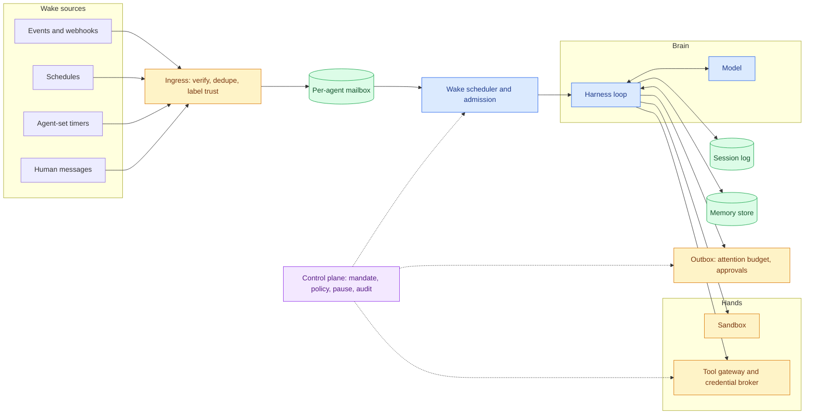

# 常時稼働エージェント: 常駐プロセスモデル

> **翻訳の状態:** 現行の[英語版](../../22-always-on-agents/01-always-on-agent-fundamentals.md)からの翻訳です。

## TL;DR

常時稼働エージェントとは、誰も起動しないモデル駆動のプロセスです。数週間から数か月にわたってマンデート(委任された任務)を保持し、イベント、スケジュール、自分で設定したタイマーで起動し、本人が不在の間に委任された権限で行動し、その生涯のほとんどをアイドル状態で過ごします。これによってエンジニアリング上の問題が変わります。リクエスト単位のエージェントは、それを起動した人間から正しさの境界を借りています。人間がタスクを選び、実行を見守り、結果を読むからです。常駐エージェントにはそのどれもありません。タスクの選択、監督、結果の受け手を、システム自身が用意しなければなりません。

そこで私たちは、エージェントをアイデンティティ、永続ログ、メールボックス、予算、オーナーを持つサービスとして設計し、モデルはその内部にある交換可能な部品の一つとして扱います。エージェントの状態は追記専用のセッションログと外部のメモリストアに置き、プロセスやコンテキストウィンドウには置きません。一つのエージェントについて同時に実行されるターンは厳密に一つです。起動は個々のメッセージへの反応ではなく、世界に対するレベルトリガーの照合(リコンサイル)です。権限は、スコープ、予算、アテンション許容量、有効期限を明記したマンデートによって与えられ、人間が更新しないかぎり失効します。

このサービスは、チャットエージェントが報告することのない四つの観点で評価されます。重要な出来事への反応がどれだけ遅れたか、行動すべきでないときにどれだけ行動したか、人間のアテンションをどれだけ消費したか、そして何も生まなかった起動まで含めて有用な成果一件にいくらかかったかです。

---

## 誰も Enter を押さないとき、何が変わるか

[LLMエージェント基礎](../17-llm-systems/01-agent-fundamentals.md)はループを説明しています。モデルが行動を提案し、ハーネスがそれを実行し、観測が戻り、停止条件に達するまでループが続きます。あの章はループを耐久性のある状態機械として扱っており、その内容はすべてここでも当てはまります。この部が扱うのは、ループが人間と結びつかずに動くとき、その周囲に何を構築しなければならないかです。

違いは並べて見ると最もよく分かります。

| 性質 | リクエスト単位のエージェント | 常時稼働エージェント |
|---|---|---|
| 誰が実行を始めるか | タスクを念頭に置いた人間 | イベント、時計、またはエージェント自身のタイマー |
| 誰がタスクを決めるか | 人間 | マンデートと観測に基づいてエージェントが決める |
| 監督 | 人間が見守るか結果をレビューする | エージェントが尋ねないかぎり誰もいない |
| 寿命 | 数分から数時間 | 数週間から数年。モデルやツールの更新をまたぐ |
| 状態 | コンテキストウィンドウ一つ、場合によってはチェックポイント | あらゆるプロセスより長生きするログとメモリストア |
| 入力の信頼性 | 大半はユーザー自身のプロンプト | 大半は第三者が書いたコンテンツ |
| 権限 | ユーザーのライブセッション | 委任されたもの。ユーザーがオフラインの間に行使される |
| 支配的なコスト | タスクあたりのトークン | 何もすることがなかった起動 |
| 支配的な障害 | ユーザーが目にする誤った回答 | 誰も目にしない誤った行動、あるいは行動の欠如 |

どの行も、リクエスト単位の設計がただで得ていた安全装置を一つずつ取り除きます。人間が実行を始めるなら、重複した開始はその人の誤りであり、開始されないことはその人の選択です。イベントが始めるなら、重複配信も配信の喪失も私たちのバグになります。人間が結果を読むなら、出来の悪い回答は利用の時点で見つかります。誰も読まないなら、結果が誰かの注意に値するかどうかをエージェントが判断しなければならず、その判断はどちらの方向にも誤りえます。この部の残りの章は、それぞれがこうした安全装置の一つを機構として作り直します。

## マンデート

常駐エージェントには、何のために存在するのかを書いた文書が必要です。意図を読み取るためのプロンプトが存在しないからです。これを *マンデート* と呼びます。マンデートは名前のある人間が所有するバージョン管理された設定オブジェクトであり、エージェントに許されることすべての根になります。

```yaml
mandate:
  id: oncall-triage/payments
  version: 14
  owner: team:payments-sre          # a human group that answers for this agent
  principal: svc:payments-triage    # the identity it acts as
  objective: >
    Keep the payments alert queue triaged. Correlate new alerts with
    deploys and known incidents, attach evidence, and page only when
    the runbook says a human decision is required.
  wake:
    events: [alertmanager.firing, deploy.finished]
    schedule: "*/30 * * * *"        # reconciliation sweep
  authority:
    read:  [metrics, logs, deploy-history, incident-tracker]
    write: [incident-tracker.comment, alert.annotate]
    gated: [alert.silence, deploy.rollback]   # needs approval
  budget:
    tokens_per_day: 4_000_000
    actions_per_hour: 60
    spend_usd_per_day: 40
  attention:
    pages_per_day: 3
    digest: "09:00 local"
  expires: 2027-02-01               # lapses unless renewed
```

ここにある四つのフィールドは、チャットエージェントに対応するものがありません。`wake` ブロックはエージェントの唯一の主導権の源であり、起動ソースを持たないエージェントは死んでおり、うるさい起動ソースを持つエージェントは高くつきます。`budget` ブロックは、暴走したループが誰かに気づかれるまでに消費できる量を制限します。`attention` ブロックはエージェントが人から奪ってよい量を制限します。これは[アテンション、評価、運用](06-attention-evaluation-operations.md)がシステムで最も希少な資源として扱うものです。そして `expires` は、権限が既定で減衰するようにします。オーナーがチームを去った常駐エージェントは止まるべきであり、それを確実に実現する唯一の方法は、誰も何もしなければ止まるようにしておくことです。

マンデートはシステムプロンプトに埋め込まれた散文ではなくデータです。三つの異なるコンポーネントがそれを強制するからです。スケジューラは `wake` を読み、ポリシー層は `authority` と `budget` を読み、アウトボックスは `attention` を読みます。モデルはその範囲内で計画できるようにマンデートのレンダリングを見ますが、モデルがそれを守るかどうかには何も依存しません。

## リファレンスアーキテクチャ



ここでの語彙は、Anthropic の常時稼働エージェント構築ガイドに従っています。このガイドは同じ部品に名前を付けています。あらゆるソースがエージェントを直接呼ぶ代わりに書き込む *イベントインボックス*、専用ストアに置かれる *タイマー*、*メモリ*、*パーミッション*、そして *アウトボックス* です。このガイドの言い方では、エージェントは実際には常時稼働していません。エージェントは眠り、起動のたびに *ラン* が走ります。ランはイベントを受け取り、作業を行い、起きたことを保存します。*セッション* はメッセージとツール呼び出しのトランスクリプトであり、ランはそれを再開するか、新しく始めます。この部では一貫して、ランを「ターン」、インボックスを「メールボックス」と呼びます。

この図は五つの関心事を分離しており、その分離こそが設計です。

*イングレス* は外の世界をメールボックスのエントリに変換します。送信元を認証し、重複を捨て、信頼ラベルを付け、ソースに確認応答を返す前にエントリを永続的にコミットします。下流のどの部品も Webhook と直接やり取りすることはありません。

*メールボックスとスケジューラ* はターンをいつ実行するかを決めます。バーストをまとめ、単一ターンの規則を強制し、フリート全体のアドミッション制限を適用します。「このエージェントはいま考えるべきか」に答える唯一の場所です。[起動ソース、メールボックス、スケジューリング](02-wake-triggers-scheduling.md)で扱います。

*ブレイン* はハーネスループとモデルです。ターンとターンの間は状態を持ちません。ログとメモリを読み、判断し、書き戻します。

*ハンズ* は副作用が起きる場所です。コードとファイルのためのサンドボックスと、ブレインが決して目にしない認証情報を保持するツールゲートウェイがこれにあたります。ハンズは使い捨てです。

*セッションログとメモリ* がエージェントそのものです。図中のすべてのプロセスが破壊されても、ログとメモリを読む新しいブレインは同じエージェントになります。[セッションログと耐久ランタイム](03-session-log-durable-runtime.md)と[メモリのライフサイクル](04-memory-lifecycle.md)で扱います。

*コントロールプレーン* はこれらすべての脇にあり、マンデート、ポリシー、一時停止スイッチ、監査証跡を保持します。重要な性質は、モデルの協力に依存しないことです。一時停止はスケジューラとツールゲートウェイで効力を持つので、混乱したエージェント、侵害されたエージェント、ループの途中にあるエージェントにも効きます。

## エージェントはログを持つアクターである

常駐エージェントに最もきれいに当てはまるモデルは仮想アクターです。アクターはアイデンティティ、プライベートな状態、メールボックスを持ち、メッセージを一度に一つ処理します。メモリ上に存在している必要はありません。実行されていないアクター宛にメッセージが届くと、ランタイムは保存された状態からアクターを活性化し、実行し、再び非活性化することがあります。Orleans や Durable Objects は通常のサービスのためにこれを作りました。これがエージェントに並外れてよく合う理由は三つあります。

第一に、エージェントのターンは長く非決定的であるため、同じエージェントの二つのターンが並行して走ると、その結果は統合できません。デプロイイベントとアラートが同時に届き、それぞれが自分のターンを始めると、両方が同じメモリを読み、両方がインシデントにコメントすると決め、両方が相手の学んだことを含まない要約を書きます。エージェントごとに一度に一ターンという不変条件が、残りを扱える問題にします。私たちはこれを、[リース、Heartbeat、復旧](../18-workflow-job-systems/08-leases-heartbeats-recovery.md)が説明するように、ログ上のリースとフェンシングエポックで強制します。ターンはエージェントのリースを取得してエポックを受け取り、ログへの追記はすべてそのエポックを伴います。長いモデル呼び出しの間にリースを失ったブレインは、次の追記でそのことを知って停止し、後任と交互に書き込むことはありません。

第二に、オンデマンドの活性化はデューティサイクルに合っています。一時間に九十秒考えるエージェントは、残りの五十八分半のあいだ計算資源を保持すべきではありません。

第三に、ターンには自然なトランザクションの形があります。メールボックスのエントリのバッチを取ることで始まり、自分の判断を追記してそれらのエントリに確認応答することで終わります。ブレインがその間に死ねば、エントリはメールボックスに残っており、次の活性化が再びそれを見ます。ターン内の副作用をその再実行のもとで安全にするプロトコルは第 3 章の主題です。

## メッセージではなく状態を照合する

Kubernetes のコントローラはレベルトリガーです。コントローラは「Pod が削除された」に対して行動するのではなく、「望ましい数は三で、観測された数は二である」に対して行動します。イベントは、見に行く時が来たというヒントにすぎません。これは常駐エージェントにとって正しい規律であり、最も見落とされやすい規律でもあります。エージェントへの自然な指示の仕方が「アラートが発火した、対処せよ」だからです。

エッジトリガーのエージェントは、イベント配信と同じ程度にしか信頼できません。イングレスのデプロイ中に Webhook が落ちれば、エージェントはアラートが発火したことを知らず、それを教えてくれるものは二度と現れません。レベルトリガーのエージェントは、原因が何であれすべての起動を、世界とマンデートを比較する理由として扱います。未トリアージで開いたままのアラートはどれか、オーナーのいないインシデントはどれか、自分がした約束のうち期限を過ぎたものはどれか。イベントは遅延を縮め、定期的なスイープは遅延に上限を与えます。そうすると信頼性の性質を一文で述べられます。*任意の状態に対するエージェントの反応時間は、配信が機能していればイベントの遅延以下であり、機能していなければスイープ間隔以下である。*

これにはコストがあります。すべての起動が、何も見つからないかもしれない観測作業を行うことです。空の場合を安くする方法は第 2 章で扱います。また、設計上の帰結もあり、こちらは元が取れます。エージェントは現在の状態から仕事を導くので、イベントの再生や重複は無害です。イベントは指示を運ばないので、二度実行されるものがありません。

## アイドルが通常の状態である

常駐エージェントの時間は三つの状態に分かれます。プロセスがなく、ストレージ以外のコストがかからない *休眠*。起動がターンに値するかを安価なチェックで判断する *トリアージ*。フルモデルが動く *作業*。ほとんどのマンデートでは休眠の割合が九十五パーセントを超え、それがいくつかの決定を導きます。

ランタイムはゼロまでスケールします。エージェントごとのプロセス、ウォームなコンテナ、保持された接続は、エージェントが十個なら賄えますが、十万個では不可能です。休眠を生き延びるべき状態は、ログ、メモリストア、ワークスペースのスナップショットに置きます。

活性化の遅延は反応時間の予算の一部です。ログからのコンテキスト再構築、ワークスペースの復元、キャッシュされていないプリフィルの支払いは、長い眠りの後の最初のターンにすべて課されます。プロバイダのプロンプトキャッシュは通常、使われないまま数分から一時間で失効します。そのため三十分ごとに起動するエージェントは毎回入力の全額を支払い、四分ごとに起動するエージェントはその一部しか支払わない、ということが起こりえます。このトレードオフのサービング側は[エージェント推論](../17-llm-systems/12-agent-inference.md)で扱っています。

ほとんどの起動は、大きなモデルに到達すべきではありません。決定的なフィルタや小さなモデルは、「このマンデートが気にする何かが変わったか」という問いに百分の一の価格で答えられます。設計の目標は、高価な経路が仕事のあるときにだけ走ることです。

## 常駐エージェントのサービスレベル

計測していないサービスは運用できません。そして通常のエージェント指標であるタスク成功率やタスクあたりのトークンは、誰かがタスクを定義したことを前提にしています。常駐エージェントには、エージェントが自分で仕事を選ぶときにも成り立つ指標が必要です。

| 指標 | 定義 | 何を捉えるか |
|---|---|---|
| 反応の鮮度 | マンデートに関係する状態が真になってから、エージェントの最初の永続的な応答までの時間 | 落ちたイベント、飢餓状態のメールボックス、遅い活性化 |
| 起動の完全性 | スケジュールされ配信された起動のうち、コミットされたターンまたは明示的なスキップを生んだ割合 | 沈黙の死。動かなくなったエージェント |
| 自発的行動の適合率 | 自分で開始した行動のうち、後から適切と判断された割合 | やりすぎと文脈の読み違い |
| 行動漏れ率 | 行動に値した状態のうち、何も行われなかった割合 | 臆病さと盲点。通常は監査で見つかる |
| アテンション消費 | 一日あたりの人間への割り込み数と、そのうち対応された割合 | 通知疲れと承認の形骸化 |
| 有用な成果あたりのコスト | 空の起動を含む全支出を、誰かが価値を認めた成果で割ったもの | ハートビートの無駄と暴走ループ |
| マンデート遵守 | ポリシーがブロックしたスコープ外の行動と、ブロックできなかったもの | インシデントになる前のポリシーの穴 |

起動の完全性は強調に値します。壊れたチャットエージェントは誰かが目にするエラーを出します。壊れた常駐エージェントが出すのは沈黙であり、沈黙は静かな一週間とまったく同じに見えます。私たちは期待されるターンの不在に対してアラートを出します。SRE チームがバッチジョブのハートビート欠落にアラートを出すのと同じ理由です。

## ライフサイクル

エージェントはその構成部品より長生きするので、その生涯の各遷移は固有の障害モードを持つ運用作業になります。

*プロビジョニング* はアイデンティティ、空のログ、初期メモリ、マンデートを作成し、オーナーを必須とすべきです。*稼働* は定常状態です。*一時停止* は新しいターンとゲート付きの副作用を止めますが、メールボックスのエントリは受け付け続けるので、再開してもその間の出来事は失われません。スケジューラには、そのバックログをまとめるのか再生するのかを決めるポリシーが必要です。*アップグレード* は、ログとメモリが旧バージョンによって書かれた生きているエージェントの下で、モデル、プロンプト、ツールを変更します。第 3 章はこれをマイグレーションとして扱います。*更新* は、オーナーが `expires` の前にマンデートを確認することです。*廃止* は認証情報を失効させ、タイマーをキャンセルし、人間への未回答の質問に答えるか取り下げ、保持ポリシーのもとでログをアーカイブします。

組織が省きがちな遷移は廃止です。エージェントは安価に作れ、それぞれが認証情報を保持するので、フリートには誰が与えたか誰も覚えていない常設の権限が蓄積します。期限切れになるマンデートと、エージェントごとにオーナーを記したインベントリが制御手段です。これは[ワークロードとエージェントのアイデンティティ](../10-security/12-workload-and-agent-identity.md)がサービスアカウントに適用するのと同じ制御です。

## 障害モード

| 障害 | メカニズム | 検知 | 緩和 |
|---|---|---|---|
| 沈黙の死 | 起動ソースの設定ミス、リースの固着、スケジューラのバグでターンが走らない | 起動の完全性の低下。不在アラート | 独立した生存スイープ。リースの期限切れ。ターン欠落へのアラート |
| 落ちたエッジ | イベントが失われ、エッジトリガーのエージェントが反応しない | 一部の状態について反応鮮度の裾が無限大になる | スケジュールによるレベルトリガーの照合 |
| 並行ターン | 一つのエージェントに二つの活性化 | フェンシングによる拒否。重複した副作用 | すべてのログ追記にリースとエポック |
| 起動ストーム | エージェント自身の行動が、自分を起こすイベントを発する | 外部要因なしに毎時起動数と支出が急増 | 自己起因イベントへのタグ付け。レート制限。予算による遮断 |
| マンデートのドリフト | 蓄積したメモリを通じて目的が数か月かけて再解釈される | スコープに対する行動の監査。ツール使用の拡大 | マンデートを毎ターン設定からレンダリングする。メモリはそれを修正できない |
| 孤児化した権限 | オーナーが去り、エージェントが有効な認証情報で動き続ける | インベントリにアクティブなオーナーがいない | 既定で失効。更新には名前のある人間が必要 |
| 誰も見ない誤った行動 | エージェントが誤って行動し、誰もレビューしない | サンプル監査。下流からの苦情 | 既定で可逆な行動。行った行動のダイジェスト。ゲート付きの階層 |
| タスク途中での予算枯渇 | 作業が半分のところで日次上限に達する | 予算停止で終わるターン | 終了処理のための予備。上限の前に進捗をコミットする |

## 意思決定フレームワーク

常時稼働エージェントは継続的な運用上のコミットメントであり、それが必要だと説明される問題の多くは実際には必要としません。

各状態への反応を書き下せるなら **決定的な自動化** を使います。ルールエンジンやワークフローのほうが安く、テストでき、インジェクションの攻撃面がありません。

仕事が周期的で各実行が独立しているなら **スケジュールされたリクエスト単位のエージェント** を使います。夜間のレポートや週次の依存関係レビューがそうです。これはエージェントを呼び出す cron ジョブです。メモリもメールボックスもリースも必要なく、与えるべきでもありません。

各イベントが単独で処理され、イベントごとに判断が必要なら **イベントトリガーのステートレスなエージェント** を使います。届いたチケットの分類などです。

次の三つが同時に成り立つなら **常時稼働エージェント** を使います。仕事が *行動するかどうか、いつ行動するか* についての判断を必要とすること。先週学んだことや約束したことが今日の正解を変えるので、起動をまたぐ連続性が重要であること。そして、状態がユーザーの都合ではなく世界の都合で発生することです。オンコールのトリアージ、アカウントの監視、長期にわたるリサーチ、カレンダーと受信箱を管理するパーソナルアシスタントは、いずれもこの基準を満たします。

迷ったら一段下から始めます。この梯子を一段上がるたびに障害の種類が一つ増え、常駐エージェントが最も多くを加えます。誤りうる永続メモリ、注意が向かなくなった後も残る権限、そして何も起きなくても積み上がるコストです。

## 重要なポイント

- 常駐エージェントは、人間が起動する実行が提供する三つの安全装置を失います。誰かがタスクを選び、誰かが見守り、誰かが結果を読むことです。それぞれを機構として作り直さなければなりません。
- マンデートは、オーナー、予算、アテンション許容量、有効期限を持つバージョン管理された設定です。コンポーネントがそれを強制し、モデルは読むだけです。
- エージェントとは、そのセッションログとメモリです。ブレインとハンズはステートレスで交換可能です。
- リースとフェンシングエポックで強制される、エージェントごとに一度に一ターンという不変条件が、メモリと副作用の一貫性を保ちます。
- 起動はレベルトリガーです。イベントは反応の遅延を縮め、定期スイープはそれに上限を与えます。これによりイベントの喪失や重複は無害になります。
- アイドルを前提に設計します。ゼロまでスケールし、起動を安価にゲートし、活性化とキャッシュミスのコストを見積もります。
- 反応の鮮度、起動の完全性、自発的行動の適合率、アテンション消費、有用な成果あたりのコストを計測します。沈黙に対してアラートを出します。
- 権限は減衰すべきです。マンデートは失効し、廃止は第一級の運用作業です。

## 参考文献

- [Building always-on agents](https://claude.com/resources/articles/building-always-on-agents): インボックス、タイマー、メモリ、パーミッション、アウトボックスの各プリミティブと、ランとセッションのサイクル
- [Scaling Managed Agents: Decoupling the brain from the hands](https://www.anthropic.com/engineering/managed-agents): 長寿命エージェントのためのブレイン、ハンズ、セッションの分離
- [Effective harnesses for long-running agents](https://www.anthropic.com/engineering/effective-harnesses-for-long-running-agents): 永続的な成果物を使って多数のコンテキストウィンドウをまたいで作業する方法
- [Building effective agents](https://www.anthropic.com/engineering/building-effective-agents): エージェントが適切な道具である場合とそうでない場合
- [Introducing ambient agents](https://blog.langchain.com/introducing-ambient-agents/): イベントストリームに基づいて行動し、必要なときだけ入力を求めるエージェント
- [Orleans: Distributed Virtual Actors for Programmability and Scalability](https://www.microsoft.com/en-us/research/publication/orleans-distributed-virtual-actors-for-programmability-and-scalability/): オンデマンドの活性化とシングルスレッドのアクター
- [Kubernetes Controllers](https://kubernetes.io/docs/concepts/architecture/controller/): 観測された状態と望ましい状態のレベルトリガーによる照合
- [Measuring AI Ability to Complete Long Tasks](https://arxiv.org/abs/2503.14499): エージェントが完了できるタスクの長さがどう伸びてきたか
- [Monitoring Distributed Systems](https://sre.google/sre-book/monitoring-distributed-systems/): 不在へのアラートを含む、症状ベースのアラート

---

## 関連する章

- [LLMエージェント基礎](../17-llm-systems/01-agent-fundamentals.md): すべての常駐エージェントがその内側で動くループと副作用の契約
- [ハーネスエンジニアリング](../17-llm-systems/09-harness-engineering.md): モデルを取り巻くランタイム。この部はそれを数か月の単位に拡張する
- [Durable Execution](../18-workflow-job-systems/04-durable-execution-workflow-engines.md): 長寿命のターンを支えるジャーナルとリプレイの仕組み
- [リース、Heartbeat、復旧](../18-workflow-job-systems/08-leases-heartbeats-recovery.md): 各ターンが依存する単一ライターのリースとフェンシングエポック
- [ワークロードとエージェントのアイデンティティ](../10-security/12-workload-and-agent-identity.md): 誰も居合わせないときにエージェントが行動するためのアイデンティティ
