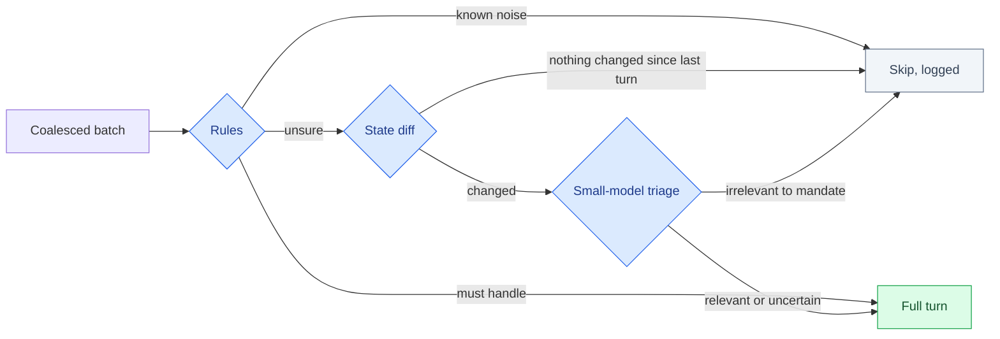

# 起動ソース、メールボックス、スケジューリング

> **翻訳の状態:** 現行の[英語版](../../22-always-on-agents/02-wake-triggers-scheduling.md)からの翻訳です。

## TL;DR

主導権は資源です。常駐エージェントを起こすたびに、活性化、コンテキストの再構築、そして通常はモデル呼び出しのコストがかかり、ほとんどの起動は何もすることを見つけません。したがって起動経路が、エージェントの信頼性と請求額の両方を決めます。私たちは起動経路を四段に分けます。外部のシグナルを永続化して信頼度をラベル付けするイングレス、それらをまとめるエージェントごとのメールボックス、起動がフルターンに値するかを安価に判断するゲート、そしてトークンとレートの予算に対してターンを受け入れるフリートスケジューラです。

エージェントを起こす方法は三つあります。イベント、スケジュール、ハートビートです。イベントは最も安く最も信頼性が低く、ハートビートは最も信頼性が高く最も無駄が多いので、健全な設計は遅延のためにイベントを、完全性のために低頻度のスイープを使います。エージェントは自分でもタイマーを設定します。常駐エージェントが約束を守る手段がこれであり、そのタイマーは永続的で、上限があり、可視でなければなりません。

メールボックスはタスクのキューではありません。何かが変わったかもしれないというヒントの集合であり、ターンは保留中のヒントを一度にすべて消費してから世界を見に行きます。この一つの決定によって、イベント駆動のエージェント設計が引き継ぎがちな順序付けと厳密一回の問題のほとんどがなくなります。

---

## 三つの起こし方

| ソース | 何がターンを始めるか | 反応の遅延 | 何も変わっていないときのコスト | 壊れ方 |
|---|---|---|---|---|
| イベント | 何かが起きた。Webhook、キューのメッセージ、行の変更 | 数秒 | ゼロ | イベントの喪失、または洪水 |
| スケジュール | 決まったジョブの決まった時刻に時計が達した | 最大で周期 | 周期ごとに一回の起動 | 時刻のずれ、発火漏れ、毎時ちょうどの集中 |
| ハートビート | ジョブの付いていないタイマー。エージェントが周囲を見回す | 最大で間隔 | 間隔ごとに一回の起動が永遠に続く | コスト。自作の雑務 |
| 自己設定タイマー | エージェントが理由を添えて起こすよう頼んだ | 要求どおり | 期日までゼロ | タイマーの喪失。際限のない自己再スケジュール |
| 人間のメッセージ | 人がエージェントに書いた | 数秒 | ゼロ | ターンの途中で届くこと |

計算すれば違いはすぐに分かります。五分間隔のハートビートは一日 288 回、一か月で 8,640 回の起動です。起動のたびに 30,000 トークンのコンテキストを再構築し、間隔がキャッシュの寿命を超えているためにそのどれもキャッシュされないなら、することが四十件あったかもしれないエージェントのために、月におよそ 2 億 6 千万の入力トークンを使うことになります。イベントソースなら四十回の起動で済みました。

ハートビートが存在するのは、イベントを持たない状態があるからです。「顧客が三日間返信していない」はイベントの不在です。「ダッシュボードがおかしく見える」はアラートルールとして表現できないかもしれず、だからこそエージェントが見ているのです。それにイベントは失われます。そこで実用上の規則は、世界がイベントを発せるところではイベントを、既知の時刻に期日が来るものにはスケジュールを使い、どちらも覆えないものにだけ、鮮度目標が許す最も遅い間隔でハートビートを使う、というものになります。第 1 章の照合スイープは特定の目的を持ったハートビートであり、失われたイベントの被害に上限を与えます。

## イングレス: シグナルを永続化する

エージェントを直接呼び出す Webhook ハンドラは、送信側のリトライポリシーをエージェントの信頼性の一部にしてしまいます。イングレスはその結合を断つために存在します。イングレスは次の五つを順に行い、四つ目が済んでから送信側に確認応答を返します。

1. **ソースを認証する。** 署名または相互 TLS のアイデンティティを検証します。認証されていない起動は、URL を見つけた誰にとっても無料の計算資源であり、そのペイロードはモデルに向かう攻撃者制御のテキストです。
2. **重複を排除する。** ソースのイベント ID から、それがなければコンテンツのハッシュから安定したキーを導出し、ウィンドウ内の繰り返しを捨てます。送信側はリトライしますし、どの送信側も少なくとも一回の配信までしか提供しません。
3. **正規化してラベルを付ける。** ペイロードを小さなエンベロープに縮約します。ソース、種別、対象キー、時刻、そして完全なペイロードへのポインタです。コンテンツが本人からのものか、内部システムからのものか、任意の第三者からのものかを記録する *信頼ラベル* を付けます。第 5 章は、結果として生じるターンに何が許されるかを決めるためにこのラベルを使います。
4. **メールボックスにコミットする。** エンベロープを永続的に書き込みます。
5. **確認応答を返す。**

エンベロープがペイロードではなくポインタを運ぶ理由は二つあります。大きなペイロードや敵対的なペイロードは、それを読むと決めたターンが意図的に取得すべきであり、届いたというだけでコンテキストに注入すべきではありません。また、ターンが走る頃にはペイロードが古くなっているかもしれないので、ターンはいずれにせよ記録システムから現在の状態を読むべきです。

## メールボックスが保持するのはヒントである

メールボックスは三つの部分から成ります。永続的なイベントリスト(通常はイベントごとにステータスを持つデータベーステーブル)、上で述べたイングレスハンドラ、そして保留中のイベントを取り出してエージェントを実行するワーカーです。テーブルが正本なので、クラッシュしたワーカーが止まったところから交代のワーカーが引き継げます。出発点として適切な粒度は本人ごとに一つのメールボックスであり、それぞれにアクティブなワーカーは厳密に一つです。

最初に思いつく自然な設計は、各エージェントに FIFO キューを与え、メッセージごとに一ターンを実行するものです。これはどんなバーストでも破綻します。四十個の Pod を再起動するデプロイは一分以内に四十件のアラートを発し、四十回の逐次ターンがそれぞれ同じデプロイを再発見します。並べ替えにも弱く、エージェントはメッセージ十一が処理される前に作られたコンテキストでメッセージ十二に対して行動します。

私たちはメールボックスを、対象ごとにキー付けされた順序のないヒントの集合として扱い、ターンがそれを空にします。

```python
def next_turn(agent_id: str, now: float) -> Turn | None:
    lease = leases.try_acquire(agent_id, ttl=TURN_LEASE_S)
    if lease is None:
        return None                      # a turn is already running

    hints = mailbox.peek_all(agent_id)   # not removed yet
    hints = [h for h in hints if now - h.time < h.ttl]        # drop stale
    if not hints or not debounce_elapsed(hints, now):
        leases.release(lease)
        return None

    batch = collapse_by_subject(hints)   # 40 alerts on one service -> 1 hint, count=40
    batch.sort(key=lambda h: (h.priority, h.time))

    if not gate.should_think(agent_id, batch):                # cheap check, see below
        log.append(agent_id, lease.epoch, Skip(batch.ids))
        mailbox.ack(agent_id, batch.ids)
        leases.release(lease)
        return None

    return Turn(agent_id, lease, batch, high_water=max(h.seq for h in hints))
```

この形からいくつかの性質が得られます。

*集約。* `collapse_by_subject` は同じ対象についてのヒントを、件数と最初と最後の時刻を持つ一つのエントリに畳みます。ターンは、14:02 から 14:03 の間に `payments-api` で四十件のアラートが発火したことを知ります。これは四十個の別々の事実より有用で、コストは一ターンです。

*デバウンス。* ターンはバーストの最初のヒントでは始まりません。ヒントの到着が静穏期間のあいだ止まるか、最も古いヒントが最大経過時間に達するか、どちらか早いほうまで待ちます。静穏期間は反応の遅延とターン数を交換し、最大経過時間は連続したストリームのもとでの遅延に上限を与えます。

*コミット後に確認応答。* ヒントは、ターンの結果がログに追記されるまでメールボックスに残ります。ターンの途中で死んだブレインはヒントをそのまま残し、次の活性化が再びそれを空にします。ターンは仕事をヒントからではなく現在の状態から導くので、やり直しは安全です。

*ハイウォーターマーク。* ターンの最中に届いたヒントは `high_water` より大きいシーケンス番号を持ちます。それらはバッチと一緒には確認応答されず、もう一度ターンを引き起こします。これがないと、エージェントが世界を読んだ後、終了する前に届いたヒントが、一度も考慮されないまま確認応答されてしまいます。

*陳腐化。* ヒントには生存期間があります。長い一時停止の後に見つかった六時間前のアラートのヒントが、そのアラートについてのターンを引き起こすべきではありません。せいぜいスイープを引き起こすだけです。

## ゲート: 考えるかどうかを決める

ゲートは、このバッチがフルターンに値するかという一つの問いに、正しく答えられる範囲で最も安く答えます。ゲートはカスケードであり、各段は前の段が決められなかったものだけを見ます。



*ルール* は、オーナーがすでに知っていることを処理します。マンデートが無視するイベント種別、ミュートされたソース、常にターンを必要とする種別です。*状態差分* はハートビートとスイープを処理します。ゲートは、開いているアラート ID の集合や受信箱の一覧のハッシュなど、マンデートが対象とする観測可能な状態のダイジェストを計算し、前回のターンの終わりに記録したダイジェストと比較します。ダイジェストが変わっていなければ、前回のターンがすでにこの世界を見ています。*小型モデルによるトリアージ* は、エンベロープとマンデートの短いレンダリングを読み、関連性を分類します。

ゲートを誠実に保つ規則は二つです。ゲートはフェイルオープンにします。不確かな結果、タイムアウト、エラーはフルターンになります。重要だったのにスキップされた起動は目に見えず、無駄なターンは単にお金の問題だからです。そして、すべてのスキップを理由とともにセッションログに追記します。黙って捨てるゲートは死んだエージェントと区別がつきません。スキップの記録はゲートの再現率を測るデータにもなります。スキップされたバッチをサンプリングし、オフラインでフルターンを走らせ、行動していたはずの頻度を数えます。

トリアージは第三者のコンテンツを読むので、インジェクションの標的になります。その出力は一つの列挙ラベルであり、ツールを持たず、メモリに書き込めません。敵対的なペイロードにできる最悪のことはフルターンを引き起こすことで、それはフェイルオープンの方向です。

## 自己設定タイマー

常駐エージェントは約束をします。ロールバックが効いたかを二十分後に確認する、木曜までにベンダーから返信がなければフォローアップする、といったものです。エージェントは、永続タイマーを書き込むツールを通じて自分の起動をスケジュールすることで約束を守ります。タイマーはメールボックスとは別の専用ストアに置きます。メールボックスが保持するのは、いま準備ができている仕事だけだからです。スケジューラがタイマーストアをポーリングし、繰り返しのスケジュールは次の発生時刻に進め、一回限りのフォローアップは完了とし、メールボックスにイベントを追加します。仕組みは、[分散スケジューリングとタイマーサービス](../18-workflow-job-systems/03-distributed-cron-scheduling.md)が説明するあらゆる永続タイマーサービスと同じです。タイマーのレコードは、理由をエージェント自身の言葉で保持します。発火時のターンは、タイマーを設定した記憶のない新しいコンテキストで走るかもしれないからです。

自己スケジューリングは適応的な起動間隔の仕組みでもあります。インシデントを見守るエージェントは二分ごとに起動し、同じエージェントが静かな夜には一時間まで間隔を延ばせます。エージェントに次の起動を上下限の範囲内で選ばせることで、イベントを持たない状態についても、イベントソースのコスト上の利点の多くを得られます。

これはまた、エージェントが自分をいつまでも忙しくしておく手段にもなります。制御は構造的に行います。間隔にはマンデートが定める下限と上限があります。エージェントごとの保留中タイマー数には上限があります。数回連続で副作用も状態の変化も生まなかったタイマーは、失敗し続けるポーラーに適用するのと同じバックオフで間隔を乗算的に延ばします。そして保留中のタイマーは、毎ターンのエージェントのコンテキストとオペレータ画面に一覧表示し、エージェントもオーナーも何を約束したかを見失わないようにします。

## 起動の取りこぼし

スケジューラの障害やエージェントの一時停止は、発火するはずだった起動のバックログを残します。復旧時にどうするかはその起動の意味に依存し、ポリシーはスケジューラではなく起動の定義に置きます。

| ポリシー | 空白の後の動作 | 用途 |
|---|---|---|
| 集約 | 空白をヒントに記録したうえで一度だけ発火する | スイープとハートビート。既定 |
| スキップ | 何も発火せず、次の発生を待つ | 遅れると価値のない定時ダイジェスト |
| キャッチアップ | 取りこぼした発生を順にすべて発火する | 日次レポートのように、周期ごとに独立した出力を持つ仕事 |

レベルトリガーのエージェントでは、集約がほぼ常に正解です。一回のスイープが、取りこぼした起動が見たはずのものをすべて観測するからです。長い障害の後のキャッチアップは、プラットフォームがそれを吸収する余力が最も乏しい瞬間に、フリート全体でターンのバーストを引き起こします。

イベントソースには別の修復が必要です。取りこぼしたイベントは記録を残さないからです。対応しているソースごとに、エージェントは *カーソル*、つまり永続的に考慮し終えた最後の項目の ID またはタイムスタンプを自分の状態に保持します。スイープはカーソル以降の項目をソースから直接列挙し、カーソルはターンの結果と同じログ追記の中で進みます。これは[配信保証と副作用境界](../05-messaging/04-delivery-guarantees.md)のコンシューマオフセットのパターンをエージェントに適用したもので、「Webhook が届いたことを願う」を「何を見たかを証明できる」に変えます。

## ターンの途中で届くメッセージ

人間のメッセージは最も優先度の高いヒントであり、ターンの実行中に、ときにはそのターンを訂正するために届きます。扱い方は三つあり、どれが正しいかはターンが何をしているかによります。

*キューに入れる。* メッセージはメールボックスで待ち、次のターンを引き起こします。これは正しく単純ですが、十五分かかるターンでは、オーナーがたったいまやめるよう頼んだことを、エージェントが十四分間やり続けることを意味します。

*操舵する。* ハーネスは各ツール境界で本人からのメッセージがメールボックスにないか確認し、あれば次の観測として注入します。ターンは新しい情報とともに続行します。通常はこれを選びます。注入は、進行中の副作用がない境界でのみ行う必要があります。

*プリエンプトする。* 停止と分類されたメッセージ、またはコントロールプレーンからの一時停止は、次の境界でターンをキャンセルします。ハーネスはキャンセルのレコードを追記し、すでにコミットされた副作用はコミットされたままログに見える形で残ります。

操舵できるのは本人からのメッセージだけです。ターンの途中で届いた第三者のメールは他と同じヒントであり、それを実行中のコンテキストに入れると、部外者に進行中の作業の向きを変える手段を与えることになります。

## フリートのスケジューリング

一つのエージェントの起動経路はメールボックスとリースです。一つのモデルクォータを共有する一万のエージェントはスケジューリング問題であり、[優先度、公平性、Backpressure](../18-workflow-job-systems/07-priority-fairness-backpressure.md)と同じ構造を持ちますが、一つ変わった制約があります。希少な資源はモデルプロバイダでの毎分トークン数であり、ターンのトークン需要は受け入れ時点では分からないのです。

*集中の回避。* 人が書いたスケジュールは毎時ちょうどに集まります。エージェントの三分の一が `:00` に起動するフリートは、一時間の需要の三分の一を最初の一分に送ります。スケジューラはエージェント ID のハッシュから導いた決定的なエージェントごとのジッタを加え、各エージェントのオフセットは安定し、フリートの負荷は平坦になります。

*推定トークンによるアドミッション。* スケジューラは、最近のターンの移動パーセンタイルから、エージェントごとのターンあたりトークン数の推定を保持し、推定需要がプロバイダの残り予算とテナントの取り分に収まるときにだけターンを受け入れます。超過したターンは事後に課金します。これはサイズ推定にノイズのあるアドミッション制御なので余裕を確保し、その大きさは推定の観測誤差から決めます。

*優先度クラス。* 人間が開始したターンが最初、次に鮮度目標を持つイベント起因のターン、次にスイープ、最後にメモリ統合のようなバックグラウンド作業です。プロバイダのスロットリング下では最下位のクラスが完全に止まります。スイープと統合は遅れを許容するよう設計されているので、これは許容できます。

*公平性。* エージェントが起動ストームに陥ったテナントは、フリートの分ではなく自分の取り分を使い切るべきです。テナント間の重み付き公平キューイングと、その下のエージェントごとのレート制限が、両方の分離レベルを与えます。

*ソースへのバックプレッシャー。* メールボックスが深くなっても、集約がその多くを吸収します。深いメールボックスも一ターンで空になるからです。ターンの遅延そのものが鮮度目標を超えて伸びたら、スケジューラはスイープを落とし、デバウンスのウィンドウを広げ、最後に低優先度の起動を明示的なスキップレコードとともに断ります。黙って捨てることは決してしません。

## 障害モード

| 障害 | メカニズム | 検知 | 緩和 |
|---|---|---|---|
| 自己起動ループ | エージェントの行動が、自分を起こすイベントを発する | 自己起因の起動。外部レートは横ばい | 副作用にエージェント ID を刻印しイングレスで除外する。レート上限 |
| 集約が別個のイベントを隠す | 二つの異なる問題が同じ対象キーを共有する | 行動漏れの監査 | 対象と種別でキー付けする。ヒントに件数とサンプルを含める |
| デバウンスの飢餓 | 連続ストリームが静かにならない | 最古ヒントの経過時間が伸びる | すべてのデバウンスに最大経過時間の上限 |
| ゲートの偽陰性 | トリアージが重要なものをスキップする | サンプリングしたスキップのオフライン再生 | フェイルオープン。ゲートのしきい値を上げる。必ず処理する種別のルール |
| 確認応答の競合による喪失 | ターンの途中で届いたヒントが見られないまま確認応答される | カーソルの欠落。反応鮮度の裾 | 確認応答にハイウォーターマーク |
| タイマーのリーク | エージェントが発火より速くタイマーを設定する | 保留タイマー数の増加 | エージェントごとの上限。効果のない発火へのバックオフ |
| サンダリングハード | 揃ったスケジュール、または障害後のキャッチアップ | 周期境界でのアドミッションキューの深さ | ハッシュジッタ。集約ポリシー。段階的な再開 |
| スイープの飢餓 | イベントが予算をすべて消費する | スイープの遅れ | 照合クラスのための予約枠 |
| 古い起動 | 一時停止後、数時間前のヒントに基づいてターンが行動する | ターン開始時のヒント経過時間 | ヒントの TTL。行動の前に現在の状態を読む |

## 意思決定フレームワーク

起動の設計は、鮮度目標と実際に利用できるイベントソースから選びます。

関係するすべての状態に信頼できるイベントがあるなら、各ソースにカーソルを持つイベントと、完全性の保険として一時間ごとまたは一日ごとの低頻度スイープを使います。これが最も安い正しい設計です。

一部の状態が不在であるか、見に行かなければ分からないなら、特定の約束のために自己設定タイマーを加え、残りにだけハートビートを使います。ハートビートの前に状態差分ゲートを置き、変わっていない世界のコストをハッシュ比較一回にします。

鮮度目標が、許容できるデバウンスウィンドウより厳しいなら、そのワークロードはホットパスに常駐エージェントを置くべきではないのかもしれません。前段に決定的なレスポンダを置き、レスポンダがエスカレートしたものをエージェントに処理させます。

フリートについては、アドミッションの単位を早期に決めます。余裕を持たせたターン単位のトークン推定は、少数の非常に大きなターンが支配的になるところまではうまく働きます。それを超えたら、長い作業を再開可能なセグメントに分割し、スケジューラがそれらを交互に実行できるようにします。

## 重要なポイント

- すべての起動にはコストがあり、ほとんどの起動は何も見つけません。常駐エージェントの経済性は起動経路で決まります。
- 遅延のためにイベントを、既知の期日のためにスケジュールを、シグナルのないものにだけハートビートを使います。低頻度のスイープが失われたイベントの被害に上限を与えます。
- イングレスは認証し、重複を排除し、信頼度をラベル付けし、確認応答の前にコミットします。エンベロープが運ぶのはペイロードではなくポインタです。
- メールボックスはヒントの集合です。ターンはそれを空にし、対象ごとに集約し、それから世界を読むので、重複と並べ替えは無害です。
- ヒントへの確認応答は、ターンのコミット後に、ターン開始時に読んだハイウォーターマークまでに限って行います。
- 起動は、ルール、状態差分、小型モデルの順でゲートします。フェイルオープンにし、すべてのスキップを記録します。
- 自己設定タイマーは約束を守り、間隔を適応させます。上限を設け、バックオフし、見えるようにします。
- フリートは、ハッシュジッタ、トークン推定によるアドミッション、優先度クラス、テナントごとの公平性でスケジュールします。落とすときは明示的に落とします。

## 参考文献

- [Building always-on agents](https://claude.com/resources/articles/building-always-on-agents): イベントインボックス、単一ワーカー、バッチ処理、フォローアップとスケジュールというタイマーの区分
- [Introducing ambient agents](https://blog.langchain.com/introducing-ambient-agents/): イベントストリーム駆動のエージェントと、それを取り巻く人間とのやり取りのパターン
- [Simulating Human Cognition: Heartbeat-Driven Autonomous Thinking Activity Scheduling for LLM-based AI systems](https://arxiv.org/abs/2604.14178): 内省と計画のための周期的な内部起動
- [Kubernetes Controllers](https://kubernetes.io/docs/concepts/architecture/controller/): ヒントとしてのイベントと、仕事の単位としての照合
- [Orleans: Distributed Virtual Actors for Programmability and Scalability](https://www.microsoft.com/en-us/research/publication/orleans-distributed-virtual-actors-for-programmability-and-scalability/): メールボックス、ターン、オンデマンドの活性化
- [Standard Webhooks](https://www.standardwebhooks.com/): Webhook 配信における署名、冪等性キー、リプレイ防止
- [Exponential Backoff And Jitter](https://aws.amazon.com/blogs/architecture/exponential-backoff-and-jitter/): 揃ったリトライやスケジュールにランダム化が必要な理由
- [Reliable Cron across the Planet](https://queue.acm.org/detail.cfm?id=2745840): 発火漏れのポリシーと、スキップと二重実行の意味論

---

## 関連する章

- [分散スケジューリングとタイマーサービス](../18-workflow-job-systems/03-distributed-cron-scheduling.md): スケジュールと自己設定の起動が依存する永続タイマーサービス
- [優先度、公平性、Backpressure](../18-workflow-job-systems/07-priority-fairness-backpressure.md): フリートスケジューラが再利用するアドミッションと公平配分の仕組み
- [配信保証と副作用境界](../05-messaging/04-delivery-guarantees.md): イングレスの背後にある少なくとも一回の配信、重複排除、コンシューマオフセット
- [バックプレッシャー](../06-scaling/07-backpressure.md): ターンが需要に追いつかないとき、何をどの順で落とすか
- [エージェント推論](../17-llm-systems/12-agent-inference.md): アイドル後の起動コストを決めるプレフィックスキャッシュの滞留
