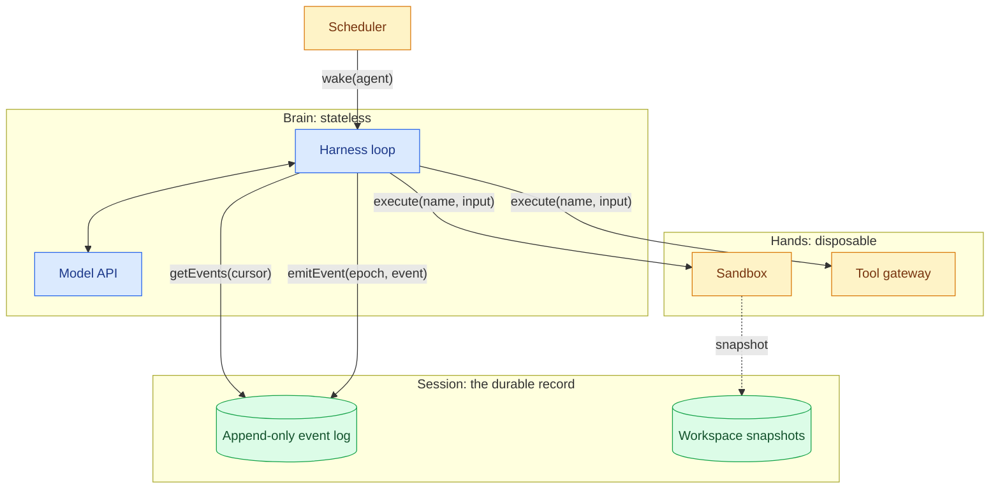

# セッションログと耐久ランタイム

> **翻訳の状態:** 現行の[英語版](../../22-always-on-agents/03-session-log-durable-runtime.md)からの翻訳です。

## TL;DR

常駐エージェントは、それを動かすあらゆるプロセス、埋めていくあらゆるコンテキストウィンドウ、そして自分を駆動するモデルの複数のバージョンよりも長生きします。これを成り立たせる唯一の方法は、エージェントのアイデンティティを永続的な追記専用の *セッションログ* に置き、それ以外のすべてを派生物または使い捨てとして扱うことです。コンテキストウィンドウはログから計算されるビューです。ブレイン、つまりハーネスループとモデルは、ステートレスな読み手かつ追記者です。ハンズ、つまりサンドボックスとツールは、一つの狭いインターフェースの背後にある交換可能な実行者です。

この構成を安全にするプロトコルは三つあります。*ターンコミットプロトコル* は、副作用を実行する前にその意図を記録し、クラッシュが残すものを未知の状態ではなく回復可能な未確定レコードにします。*コンテキストプロトコル* は、活性化のたびに、もはや一つのウィンドウに収まらないログからどうウィンドウを構築するかを決めます。一連の作業の内側ではコンパクションを使い、作業と作業の間では引き継ぎ成果物を伴うクリーンなリセットを使います。*アップグレードプロトコル* は、生きているエージェントの下でモデル、プロンプト、ツールを、カナリアを伴うマイグレーションとして変更します。これから読むことになるログとメモリは、前任者が書いたものだからです。

モデル呼び出しは、私たちが決してリプレイしない唯一のステップです。その出力は一度だけ記録され、復旧時に読み戻されます。これによって、非決定的な部品を決定的な復旧方式の内側に置けるようになります。

---

## なぜプロセスは状態を保持できないのか

ほとんどのエージェントの最初のバージョンは、状態を都合のよい場所に置きます。会話はハーネスのメモリに、作業ファイルはコンテナに、認証情報は環境変数に、計画はモデルのコンテキストに置かれます。Anthropic による Managed Agents 構築の記録は、それがどこへ行き着くかを述べています。ハーネス、サンドボックス、セッションがすべて一つのコンテナに同居すると、そのコンテナはペットになります。死ねばセッションは失われ、ハングすれば誰かが世話をして回復させなければならず、エージェントが考えていたことを失わずに交換することはできません。

リクエスト単位のエージェントにとって、これは不便にとどまります。常駐エージェントにとっては失格です。数か月のうちに、それらのプロセスはどれも再起動され、再スケジュールされ、アップグレードされ、退去させられるからです。そこでエージェントを三つに分割します。



インターフェースは意図的に小さくしてあります。ブレインはある位置からイベントを読み、自分のリースエポックのもとでイベントを追記し、`execute(name, input)` を呼んで文字列を受け取ります。ハンズがコンテナなのか、リモートサービスなのか、別のエージェントなのかをブレインは知りません。この狭さが、必要な二つの復旧ケースを与えます。ハンズが故障すれば、ブレインはツールエラーを見て、代わりをプロビジョニングし、作業を続けます。ブレインが故障すれば、スケジューラが新しいブレインを起こし、それがログを読んで続行します。どちらの場合も、故障したプロセスを取り戻す必要はありません。

この分割には、起動にとって重要な遅延上の利点もあります。サンドボックスの中に住んでいないブレインは、サンドボックスを待つ必要がありません。ログからすぐに推論を始め、ターンが実際に必要とすると分かったときにだけサンドボックスをプロビジョニングできます。そして常駐エージェントのターンの多く、つまり状態を読んで何も変わっていないと判断するターンは、サンドボックスを一度も必要としません。

## ログに含まれるもの

セッションログは、型付きイベントの追記専用の列です。各イベントは、シーケンス番号、タイムスタンプ、書き手のリースエポック、そしてそれを生成したハーネスとモデルのバージョンを持ちます。

| イベント | 書かれるタイミング | 用途 |
|---|---|---|
| `TurnStarted` | ブレインがリースを取得したとき。取得したメールボックスのヒントを列挙する | 復旧。何がターンを引き起こしたかの監査 |
| `ModelOutput` | モデルの応答を受信したとき。全文を記録する | 記録済みのステップについてモデルを再度呼ばないため |
| `EffectIntent` | 副作用を伴うツール呼び出しの前。冪等性キーを持つ | クラッシュ後の未確定の副作用の検出 |
| `EffectResult` | ツールが戻った後 | 対を完成させる。モデルが見た観測 |
| `Observation` | 読み取り専用ツールの結果。多くは blob への参照 | コンテキストの再構築 |
| `Compaction` | ビューの中で要約がある区間を置き換えるとき。対象区間を保持する | 区間を読み直さずにコンテキストを構築する |
| `MemoryWrite` | メモリレコードが提案またはコミットされたとき | 第 4 章の来歴 |
| `HumanMessage`、`Approval` | 本人が何かを言う、またはゲート付きの行動を決定するとき | 操舵。認可の証拠 |
| `TurnEnded` | 結果がコミットされたとき。確認応答したヒントと次の起動を列挙する | ターンの原子性 |
| `Skip`、`Cancelled` | ゲートが起動を断ったとき、またはターンがプリエンプトされたとき | 静穏と死の区別 |

スキーマより重要な性質が二つあります。ログは、エージェントが何をして何を見たかについての唯一の正本です。したがって、ログにないことは、復旧、監査、そしてエージェント自身の将来のコンテキストにとっては起きなかったことになります。そしてログは決して編集されません。コンパクション、ビューのための秘匿化、要約は、いずれも古いイベントの読み方を記述する新しいイベントを生成します。三月に下された判断をデバッグするオペレータは、三月にモデルに見せられたものを正確に見ることができます。

## ターンコミットプロトコル

あらゆる耐久ランタイムにおける難問は、プロセスが死んだ時点で実行中だった副作用がどうなるかです。[ワークフローの副作用コミットプロトコル](../18-workflow-job-systems/06-retry-idempotency-compensation.md)がこれを一般的に扱っています。エージェントの場合、プロトコルは次のとおりです。

```text
1. append EffectIntent{key, tool, input}        # durable before the call
2. result = execute(tool, input, idempotency_key=key)
3. append EffectResult{key, result}
```

復旧時、新しいブレインは現在のターンから結果のない意図を探します。それぞれは *未確定* です。呼び出しは一度も送られなかったかもしれず、送られて適用されたかもしれず、適用されたが応答が失われたのかもしれません。次に何が起きるかはツールの契約に依存します。ツールが契約を宣言するのはそのためです。

| ツールの契約 | 未確定の意図に対する復旧動作 |
|---|---|
| キーによる冪等 | 同じキーで再実行する。受信側が元の結果を返す |
| 照会可能 | キーまたは自然な識別子で副作用を検索し、結果を記録するか再実行する |
| 読み取り専用 | 自由に再実行する |
| 冪等でも照会可能でもない | リトライしない。副作用を不明として記録し、モデルに、ゲート付き階層の行動であれば人間に提示する |

最後の行が正直な行です。冪等性キーも送信済みアイテムの検索も持たない API を通じてメールを送るツールは、エージェントランタイムのどんな仕組みを使っても厳密一回にはできません。正しい振る舞いは、次のターンに真実を伝えることです。メールは送られたかもしれないし、送られていないかもしれないと伝え、決める前に確認させます。不確実性を隠すことが重複を生みます。

このプロトコルは、*ジャーナルとリプレイ* 型のランタイムと *チェックポイントと再実行* 型のランタイムの選択がなぜ重要かも示します。Temporal、Restate、DBOS のようなジャーナル型エンジンは各ステップの結果を記録し、復旧時には記録済みの結果を差し込みながらコードをリプレイします。そのため、十二回のツール呼び出しを行って十三回目でクラッシュしたターンが再実行するのは一回です。チェックポイント型フレームワークはノード境界で状態を保存し、一つのノードがターン全体を含んでいれば、復旧は十二回すべてを再実行します。どちらも正しくなりえます。チェックポイント型では、正しさはノード内のすべてのツールが冪等であることに依存し、チェックポイントの粒度がそのまま重複の粒度になります。

## モデルを記録する

耐久実行エンジンは、リプレイが同じ状態に到達するよう、ワークフローコードが決定的であることを要求します。モデル呼び出しは決定的の正反対です。同じプロンプトが異なる出力を生み、浮動エイリアスの背後にあるプロバイダのモデルは、元の呼び出しとリプレイの間に変わるかもしれません。

解決策は、モデル呼び出しを、リプレイされるコードとしてではなく、結果がジャーナルされる副作用として扱うことです。`ModelOutput` は、ハーネスがそれに基づいて行動する前に全文が追記されます。復旧時、ハーネスは記録された出力を読んでそこから進み、モデルを呼ぶのは最後に記録されたステップの次のステップについてだけです。したがって、復旧したターンは元の軌跡を継続し、途中で別の軌跡に分岐することはありません。もしモデルに再度尋ねて、最初の三ステップがすでに実行された計画について異なる判断をされたら、そうした分岐が起きます。

出力の記録は、後で扱う二つの道具の素材にもなります。過去の判断をデバッグのために正確に再現することと、記録された軌跡を候補モデルに対して評価のために再実行することです。

## 収まらないログからコンテキストを構築する

一週間もすれば、ログはどのコンテキストウィンドウよりも大きくなります。したがってコンテキストは活性化時に計算される *ビュー* であり、一般的な技法は[コンテキスト管理](../17-llm-systems/08-context-management.md)が説明しています。常駐エージェントに固有の決定は三つあります。

**ビューには固定の骨格がある。** すべてのターンのコンテキストは、同じ安定したプレフィックスで同じ順序で始まります。システムの指示、レンダリングされたマンデート、ツール定義、そしてコアメモリです。ターン固有の内容はその後に続きます。安定させるのは、厳密なプレフィックスで一致をとるプロンプトキャッシュのためであり、順序は最も変化の遅い内容を先頭に置きます。プロンプトの先頭近くにタイムスタンプや、並べ替えたばかりのメモリ一覧を差し込むエージェントは、起動のたびに全トークンの正規料金を支払います。

**コンパクションは続けるため、リセットはやり直すため。** 一連の作業の内側では、ハーネスはコンパクションを行います。古い区間を要約で置き換え、古くなったツール結果を消し、最近のターンはそのまま残します。コンパクションは連続性を保ちますが、エージェントには見えない形で情報を失い、コンパクション済みのテキストを繰り返しコンパクションするとずれていきます。長時間動作するコーディングエージェントに関する Anthropic の報告によれば、コンパクションだけでは不十分でした。タスクの途中でコンテキストを使い果たしたエージェントは、次のウィンドウに、半端に終わった作業と、そのことを伝えない要約を残しました。

代替策は *引き継ぎ成果物を伴うコンテキストリセット* です。永続的な進捗はウィンドウに残さずワークスペースに書くよう、エージェントに指示し、ハーネスがそれを強制します。合否のステータスを持つタスクリスト、進捗メモ、説明的なメッセージを持つコミット履歴です。新しいコンテキストはクリーンに始まり、それらの成果物を読み、ワークスペースが成果物の主張どおりの状態にあるかを確認するチェックを走らせ、続行します。ウィンドウは作業用の紙になり、ワークスペースがタスクの記憶になります。

同じ選択は、あらゆる起動の冒頭にルーティングの決定として現れます。エージェントがした質問への返信や、保留された行動への承認のように、以前の作業を継続するイベントは、その作業が存在するセッションを再開します。無関係なイベントは新しいセッションを始めます。コンパクションも置き換えも詳細を失うので、残さなければならないものは、ウィンドウを手放す前にメモリかワークスペースに書き込みます。

常駐エージェントの経験則は、別々の事柄についての起動の間ではリセットし、長引く起動の内側ではコンパクションすることです。ほとんどの起動は短く、直前の起動とは無関係です。昨日のインシデントの要約を今日のカレンダーの質問に読み込めば、トークンを使って混乱を加えるだけです。

**ビューは省いたものを明示する。** 要約と直近の数イベントから構築されたターンには、そのことを伝えるべきです。逐語的な履歴がどこまで遡るのか、それ以前の内容は要約されていること、そしてログ検索ツールで原文を取得する方法です。履歴全体を見ていると信じているエージェントは、欠落の上で自信を持って推論します。

## ハンズ: 感傷抜きのサンドボックス

サンドボックスは、エージェントがコードを実行し、ファイルを編集し、ブラウザを操作する場所です。分離された設計ではサンドボックスは家畜であり、そのことが要件を決めます。

*遅延してプロビジョニングし、素早く復元する。* サンドボックスを必要とするターンは、ウォームなものにアタッチするか、エージェントのワークスペーススナップショットを新しいサンドボックスに復元します。スナップショットの復元時間は反応遅延に加算されるので、ワークスペースは小さく保ち、差分でスナップショットを取ります。

*ターン境界でスナップショットを取る。* `TurnEnded` が参照するワークスペーススナップショットが、将来のターンが復元するものです。コミットに至らなかったターンが書いたファイルはサンドボックスとともに破棄され、ワークスペースはログと整合した状態に保たれます。

*秘密を持たせない。* サンドボックスは、第三者のコンテンツを読んだモデルが書いたコードを実行します。その環境にあるものは、攻撃者に読まれうると考えるべきです。認証情報はサンドボックスの外にあるツールゲートウェイに置き、そこで呼び出しがどう認可されるかは第 5 章で説明します。

*寿命はタスクより短いと想定する。* サンドボックスは退去させられますし、長い待機がサンドボックスを保持してはいけません。承認を三日間待っているエージェントは、タイマーテーブルの一行とログ中の保留イベントであり、コンテナもモデル呼び出しも伴いません。これが永続タイマーのもたらす性質です。待つことのコストはストレージだけになります。

## 生きているエージェントをアップグレードする

リクエスト単位のエージェントは、新しいバージョンをデプロイすればアップグレードされ、次のタスクがそれを使います。常駐エージェントは物事の途中にいます。未完了の約束があり、メモリは古いプロンプトの語彙で書かれ、ログは古いスキーマのツール呼び出しで埋まり、タイマーの理由はもう持っていないかもしれない能力を前提にしています。その下にあるものを変えることはマイグレーションです。

*固定し、意図的に動かす。* 各エージェントは、自分が動いているモデルのバージョン、プロンプトのバージョン、ツールスキーマのバージョンを記録します。浮動エイリアスは便利ですが、プロバイダ側のあらゆる変更を、フリート全体への予告なしのデプロイにしてしまいます。固定されたバージョンはロールアウトを通じて移動します。

*カナリアの前にシャドーリプレイ。* `ModelOutput` と観測が記録されているので、最近のターンのサンプルを取り、それぞれが見た正確なコンテキストを再構築し、副作用を実行せずに候補バージョンを走らせることができます。提案された行動を記録済みの行動と、ルールとジャッジモデルで比較すれば、どのエージェントも行動を起こさないうちに振る舞いの変化が見つかります。この比較が有効なのは分岐点の直後の最初のステップだけです。その後の観測は違っていたはずだからです。それでも、最もよくある退行を捉えるには十分です。ツール選択の違い、割り込みたがる新しい傾向、行動のしきい値の変化などです。

*コホート単位のカナリア。* 新しいバージョンは、影響範囲が小さいことを基準に選んだ少数のエージェントに適用し、第 1 章の指標を対照コホートと比較します。期間はエージェントの仕事の一周期を覆う長さが必要で、週次のリズムなら一週間より長くなります。

*スキーマは追加的に移行する。* ツールスキーマの変更は、あらゆるワイヤプロトコルの規則に従います。フィールドを追加し、古いフィールドを読める状態に保ち、記録済みのイベントを決して再解釈しません。削除されるツールについては、それを参照するタイマーとメモリをどうするかを決める必要があります。

*ロールバックを実効あるものに保つ。* モデルのロールバックは簡単です。新しいバージョンがメモリに書いたもののロールバックは簡単ではありません。カナリア期間中は、メモリへの書き込みに書き手のバージョンをタグ付けし、まとめてレビューしたり取り消したりできるようにします。

## フォークとリプレイ

ログがエージェントなので、エージェントはフォークできます。あるシーケンス番号までのログをコピーし、有効な認証情報を持たない新しいアイデンティティを付け、先へ走らせます。フォークは、稼働中のエージェントに触れずにインシデントを調査し、実際の履歴に対してプロンプトの変更をテストし、「このメールが届いていなかったら何をしていたか」という問いに答えるための手段です。

フォークは世界から隔離しなければなりません。そのツールゲートウェイは記録用スタブかシミュレートされた環境であり、タイマーは本番のスケジューラに発火せず、アウトボックスはどこにも届きません。これが防ぐ障害は、顧客に二通目のメールを送ってしまうデバッグセッションです。

## 容量とコストのモデル

[起動トリガーとスケジューリング](02-wake-triggers-scheduling.md)のフリートを引こう。一万の常駐エージェントが一日に約 11 万 8400 ターンを実行する。永続ログは高い部分ではない。ターンは 1 件 2.5 キロバイトのレコードを約 14 件追記するので、ターンあたり 35 KB、一日で 4.1 GB、圧縮前に年約 1.5 TB だ。ツールの出力がその 5 分の 4 を占めるから、保持ポリシーは実質的にツール出力のポリシーになる。30 日を原文で保てば 124 GB のホットセット、それより古いは要約し、命令文書自身の成果物はどちらも独立して生き残らせる。

金を食うのは読むことで、読みはディスクではなくコンテキストビューで決まる。20 万トークンのウィンドウを出力の余白を空けるために半分未満で運用し、固定プレフィックス 4 万、コアメモリ 1 万、要約 8 千と仮定する。原文の履歴に残るのは約 4 万 2000 トークン、1 ターン 1200 トークンなら 35 ターン分だ。

ウィンドウを設定する前に、二つの帰結を体に覚えさせる価値がある。

三百ターン以上前の作業へ戻すウェイクは、セッションの続きではなく自分についての物語を読んでいる。これがこれ以上の圧縮をやめて引き継ぎの成果物でリセットする理由の算数であり、圧縮の閾値をウィンドウの何パーセントではなく履歴のターン数で決めるべき理由でもある。

常駐プレフィックスに足したトークンは 1 でテールの残りを減らし、その後はフリートのすべてのウェイクで支払い続ける。コアメモリを 5000 トークン増やすと、このフリートでは入力トークンが一日 5 億 9200 万増える。キャッシュなしなら約 USD 1,800、Hit 率 90 パーセントでも約 USD 400 だ。「エージェントの助けになるから」というメモリブロックは、テールの 5 分の 1 と一日 400 ドルと交換する。それを承認するレビューでこの取引を名指しにしておく価値がある。

モデル出力をジャーナルに残すことは、復旧を手頃にするためにある。一エージェントの 30 日セッションは約 360 ターン。これへ質問し直すとインシデントあたり約 USD 14 で、しかも調査中の軌跡とは違う軌跡ができる。ジャーナルから読めばタダで、元の動作を正確に再現する。「リプレイは読むだけで、決して聞き直さない」は清さのルールより先に経済のルールであり、ストレージを節約してジャーニングを省いたチームは、最も答えを必要とする瞬間にポストモーテムへ代価を払う。

さらに二つのサイズは総量ではなく同時実行数から決まる。ピーク秒あたり 5.5 ターン、サンドボックスの保持 40 秒なら、Little の法則は約 220 の同時サンドボックスを求める。これを下回るプールはまずターン遅延の裾として現れ、エラーレートは後から動く。だから障害率を待つのではなく遅延で警告する。そしてフェンシングのエポックによる追記拒否カウンタは定常状態でゼロを読むべきだ。1 つでも値があればリースなしの brain が動いているということで、この章で外部世界への影響半径を持つ唯一の障害だ。

## 障害モード

| 障害 | メカニズム | 検知 | 緩和 |
|---|---|---|---|
| 復旧時の副作用の重複 | チェックポイントが副作用より粗い。ツールが冪等でない | ターン ID を共有する下流の重複レコード | 副作用ごとの意図と結果。冪等性キー。宣言されたツール契約 |
| 副作用の結果の喪失 | 応答が失われ、意図が解決されない | 復旧時に結果のない意図 | キーによる照会。不明な結果を次のターンに提示する |
| リプレイ時の軌跡の分岐 | 記録済みのステップについてモデルを再度呼ぶ | 記録された出力とリプレイされた出力が異なる | モデル出力をジャーナルする。リプレイは読むだけで再度尋ねない |
| ゾンビブレイン | リースを失った古いブレインが再開して追記する | 追記時のエポック不一致 | すべての書き込みでログがフェンシングエポックを検査する |
| コンパクションのドリフト | 要約の要約が制約を失う | ずっと前に与えられた指示にエージェントが違反する | 永続的な指示はウィンドウではなくマンデートとメモリに置く。成果物を伴うリセット |
| 半端な引き継ぎ | タスク途中でコンテキストが尽き、次のウィンドウが状態を読み違える | 開始時にワークスペースが自身のチェックに落ちる | 進捗を段階的にコミットする。ターン開始時の検証 |
| キャッシュに不利なプレフィックス | プロンプトの早い位置に変動する内容 | キャッシュされたトークンの割合がほぼゼロ | 安定した骨格。変動する内容は最後に置く |
| ワークスペースとログの乖離 | 未コミットのファイルが残る、またはコミット済みのものが残らない | 復元時のスナップショット ID の不一致 | `TurnEnded` が参照するスナップショットのみを使う |
| アップグレードによる退行 | 新しいモデルが古いメモリを違う形で読む | コホート指標の乖離 | シャドーリプレイ、コホートカナリア、バージョンタグ付きのメモリ書き込み |
| フォークが本番に漏れる | デバッグ用フォークが有効な認証情報やタイマーを持つ | フォークのアイデンティティに帰属する副作用 | フォークにはスタブのゲートウェイと隔離されたスケジューラを与える |

## インシデントプレイブック

ランタイムのインシデントはすべて、三つの成果物のどれが違うかという話になる。ログ、外部世界、そしてワークスペースだ。まずどちらのペアがずれたのかを確定しろ。復旧策は完全に異なり、三つのうちの復旧の一つは、親切な格好をしたデータ喪失だからだ。

### 外部システムへ同じ効果が 2 回届いた

そのターン id を持つ意図レコードをすべて引き、結果を読め。キーの異なる 2 つの意図なら、チェックポイントが効果より細かく、結果が着地する前にステップが再実行されたということで、コミットプロトコルのバグだ。1 つの意図の結果が未解決なら、応答を失って何かしらがキーを引かずに再試行したわけで、ツールゲートのバグだ。症状を止めるためにすべてのツール呼び出しをグローバルロックで直列化するな。まれな重複をフリート全体の遅延劣化へ変えるだけで、未知の結果のケースはなお未解決のまま残る。タイムアウトは否定の確認応答ではないからだ。検証は記録したターンをスタブのゲートへリプレイし、2 回目の試行が実行を繰り返さず 1 回目の結果を返すことを確認すること。

### 復旧した実行が元の実行と同じ行動をしなかった

リプレイしたツール意図をジャーナルした意図と突き合わせ、最初の分岐を見ろ。その後はずっと下流だ。モデルのステップで分岐しているなら、そのステップは読まれずに聞き直されている。レコードにモデルのバージョンが入っているか、ジャーナルが呼び出し種別をすべて覆っているかを確認しろ。ハーネスはアシスタントの本文だけを記録し、ツールのルーティングを忘れがちだ。サンプリングパラメータを固定して分岐は直ったと宣言するな。温度ゼロでもツール結果が 1 つ違えば分岐するし、次のインシデントをストレージ破損として誤診される。検証は同じセッションを 2 回リプレイして意図が両方で一致することを要求すること。ハーネスを変えるたびに実行できるテストにしておく。

### 前に与えた指示をエージェントが破った

その指示がどこに住んでいるかを問え。ウィンドウの中にしかないなら、圧縮はすでにそれを書き換えており、破りは設計の想定どおりの挙動でモデルの失敗ではない。永続する指示は命令文書かコアメモリに置く。状態からレンダリングされ、記憶には依存しない。もっと良い要約を期待して圧縮をやり直すな、そしてテールを延べて穴を埋めるな。上に見たとおりテールは他のすべてのウェイクの負担で成り立っている。検証は古いトランスクリプトではなく、新しいターンの組み立て済みコンテキストの中にその指示が見つかることだ。

### 次のウィンドウが引き継いだタスクを誤読した

これは半途の引き継ぎだ。前のコンテキストがタスクの途中で尽き、その要約がそれを記述していなかった。エージェントに触る前にワークスペース自身のチェックを実行しろ。成果物が現実と一致するか、しないかのどちらかで、その答えが復旧を続きにするか修復にするか決める。チェックが通れば続行、通らなければ最後のコミット済みスナップショットから復元して前方へ再生し、どのステップが着地したかをエージェントに推測させるな。ウィンドウの中に書かれた進捗ノートを信用するな。それはまさにこのインシデントが生んだ成果物だ。検証はターン開始時の検証をハーネスで必須にすること。次の引き継ぎが要約の誠実さに依存する状態を二度と作らない。

### 古いエポックという理由で追記が拒否された

発生した時点で既に障害が続いているものとして扱え。最初にリースなしで追記した brain を見つけて止め、その後その brain が最後にリースを更新した時刻と拒否の間の影響半径を確定しろ。その区間でログに一度も現れない効果を取った可能性があるからだ。エージェント自身の記録からではなく、ゲート側から効果を列挙しろ。その記録こそが問題になっている対象だ。不一致を消そうとしてリースのタイムアウトを延ばすな。区間が伸びて古い brain が行動できる時間が長くなり、次の発生は高くつく。検証は強制フェイルオーバーの訓練を通じて拒否カウンタがゼロのまま進むこと、そして影響半径内のすべての効果が適用、ロールバック、明示的な許可のいずれかとして処理済みになること。

## 意思決定フレームワーク

ランタイムの選択は、エージェントがどれだけ長く待つか、繰り返された副作用がどれだけ高くつくかから導かれます。

| 状況 | 妥当なランタイム |
|---|---|
| ターンが短く、副作用が冪等で、待機は数分 | キュー、エージェントごとのデータベース行、ターン単位のチェックポイント |
| ターンが多数のツール呼び出しにまたがり、一部の副作用が冪等でない | 耐久実行ライブラリまたはエンジンによる副作用単位のジャーナル |
| 数日の待機、人間の承認、エージェントごとに多数のタイマー | タイマーとシグナルをプリミティブとして持つ耐久実行エンジン |
| 大規模なフリート、コード実行、厳格な分離 | マネージドなエージェントランタイム、または自前で構築するブレイン、ハンズ、セッションの分割 |

どれを選ぶにせよ、エージェントが実際の権限を持つ前に、四つの問いに文書化された答えがあるべきです。クラッシュ後の再実行の単位は何か。どのツールが冪等でなく、それが未確定のときエージェントは何をするか。新しいコンテキストは最初に何を読み、どうやってそれを検証するか。そして、新しいモデルバージョンは、行動する前にこのエージェント自身の履歴に対してどうテストされるか。

## 重要なポイント

- セッションログがエージェントです。ブレインはステートレスな読み手かつ追記者であり、ハンズは `execute(name, input)` の背後にある使い捨ての実行者です。
- すべての副作用の前に意図を、後に結果を記録します。復旧は各ツールが宣言した契約に従って未確定の意図を解決し、解決できないものについては真実を伝えます。
- チェックポイントの粒度が重複の粒度です。副作用が冪等でないなら、副作用単位でジャーナルします。
- モデル呼び出しはジャーナルされ、決してリプレイされません。そのため復旧したターンは元の軌跡を継続します。
- コンテキストは、安定したキャッシュに優しい骨格を持つ、ログ上のビューです。一連の作業の内側ではコンパクションし、作業の間では引き継ぎ成果物とともにリセットします。
- 待機中のエージェントのコストはストレージだけであるべきです。コンテナも、接続も、モデル呼び出しもありません。
- 生きているエージェントのアップグレードはマイグレーションです。バージョンを固定し、記録済みのターンに対してシャドーリプレイし、コホート単位でカナリアを行い、メモリへの書き込みにバージョンをタグ付けします。
- フォークはインシデントを調査可能にします。ただし、有効な認証情報、タイマー、アウトボックスから切り離されていることが条件です。

## 参考文献

- [Building always-on agents](https://claude.com/resources/articles/building-always-on-agents): ランとセッション、セッションの再開と新規開始、コンパクション前の状態の保存
- [Scaling Managed Agents: Decoupling the brain from the hands](https://www.anthropic.com/engineering/managed-agents): セッション、ハーネス、サンドボックスの分割とその復旧特性
- [Effective harnesses for long-running agents](https://www.anthropic.com/engineering/effective-harnesses-for-long-running-agents): 初期化セッションと段階的セッション、進捗の成果物、コンパクションだけでは足りない理由
- [Effective context engineering for AI agents](https://www.anthropic.com/engineering/effective-context-engineering-for-ai-agents): コンパクション、構造化されたメモ、有限な資源としてのコンテキスト
- [Temporal: Workflows](https://docs.temporal.io/workflows): イベント履歴、決定的リプレイ、タイマー、シグナル
- [Restate documentation](https://docs.restate.dev/): 長時間動作するハンドラのためのジャーナルされた実行と永続的なプロミス
- [DBOS documentation](https://docs.dbos.dev/): ライブラリとして提供される、Postgres へのワークフローのチェックポイント
- [LangGraph persistence](https://langchain-ai.github.io/langgraph/concepts/persistence/): チェックポインタ、スレッド、割り込みと再開
- [Firecracker: Lightweight Virtualization for Serverless Applications](https://www.usenix.org/conference/nsdi20/presentation/agache): 信頼できないコードのための高速起動 microVM による分離

---

## 関連する章

- [Durable Execution](../18-workflow-job-systems/04-durable-execution-workflow-engines.md): セッションログの下にある、イベント履歴、リプレイ、タイマーの仕組み
- [ワークフローの副作用コミットプロトコル](../18-workflow-job-systems/06-retry-idempotency-compensation.md): 意図、結果、冪等性キーの規律の一般形
- [コンテキスト管理](../17-llm-systems/08-context-management.md): ログ上のビューが適用するコンパクションと予算配分の技法
- [ハーネスエンジニアリング](../17-llm-systems/09-harness-engineering.md): ステートレスなブレインが実行するループと、そのツール実行契約
- [ワークフローの観測性とリプレイ](../18-workflow-job-systems/09-workflow-observability-replay.md): デバッグと回帰テストのための記録済み履歴のリプレイ
