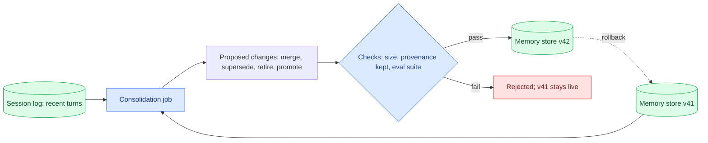

# 常駐エージェントのメモリライフサイクル

> **翻訳の状態:** 現行の[英語版](../../22-always-on-agents/04-memory-lifecycle.md)からの翻訳です。

## TL;DR

リクエスト単位のエージェントにとって、メモリの問題は検索です。適切な一節を見つけてウィンドウに入れることです。常駐エージェントにとって、メモリの問題は *保守* です。常駐エージェントは、編集者のいないまま数か月にわたって毎日自分のメモリに書き込み、そして自分が書いたものを信頼します。誤りは局所にとどまりません。二週目に事実として記録された誤った推論は、十週目には正解として読み戻され、行動を形作り、それに依存するさらなるメモリを生みます。

そこで私たちはメモリを、ノートではなく、書き込み経路を持つデータベースとして扱います。すべてのレコードは来歴を持ちます。どのイベントがそれを生んだか、ソースがどれだけ信頼されていたか、その事実がいつ真であったか、エージェントがそれをいつ知ったかです。信頼できないコンテンツからの書き込みは隔離されます。エージェントがアイドルの間に走るオフラインの統合ジョブが、重複をマージし、矛盾を解決し、古くなったエントリを引退させ、その出力をストアの新しいバージョンに書き込むので、悪い統合はロールバックできます。削除は、削除されたレコードから派生したすべてのものに伝播します。

メモリを安全に使えるものに保つ運用上の規則は、メモリはどこを見るべきか、何を期待すべきかについてのヒントである、というものです。権威は世界のほうにあります。記憶している事実に依存する行動の前に、エージェントはその事実を確認します。

---

## 常駐エージェントはなぜ違うのか

[コンテキスト管理](../17-llm-systems/08-context-management.md)は、単一のセッションがウィンドウに入れるものをどう選び、圧縮し、予算配分するかを扱い、[RAG パターン](../17-llm-systems/04-rag-patterns.md)は、他の誰かが保守するコーパスに対する検索を扱います。どちらも、読み手と書き手が長期にわたって同一の監督されないプロセスであることを想定していません。そこから三つの帰結が生じます。

*コーパスは自分で書いたものである。* 何が記憶に値するかをエージェントが決め、文章にし、整理します。判断の誤りが、将来の自分の証拠になります。

*世界はその下で動いていく。* 「Dana が課金サービスのオーナーである」は書いた時点では真でした。Dana がチームを異動しても、メモリストアに通知するものはありません。

*メモリは持続する入力チャネルである。* コンテキストウィンドウはセッションの終わりに破棄されるので、成功したプロンプトインジェクションの持続時間には上限があります。インジェクションのもとで書かれたメモリレコードは、将来のすべてのセッションに読み込まれます。メモリは一時的な侵害を永続的な侵害に変えます。

## 階層とその権威

メモリは、どう書かれるか、どう読み込まれるか、他のものと衝突したときにどれだけの権威を持つかで分けると整理しやすくなります。

| 階層 | 内容 | 書き手 | 読み込み | 権威 |
|---|---|---|---|---|
| マンデートと指示 | 目的、スコープ、オーナーからの恒常的な規則 | コントロールプレーンを通じてオーナー | 毎ターン、キャッシュされるプレフィックスの中 | 最高。メモリはこれを修正できない |
| コアメモリ | 小さく整理されたブロック。本人が誰か、現在の約束、主要な好み | サイズ上限のもとでエージェント。および統合 | 毎ターン | 高い。真であり続けるよう短く保つ |
| 意味記憶 | 個々のレコードとしての事実と学習した好み | エージェントの書き込みツール。統合 | 必要に応じて検索 | 中程度。行動の前に検証する |
| 手続き記憶 | 繰り返すタスクのやり方。ランブック、スキル、スクリプト | エージェントが提案し、オーナーまたはテストが承認する | 毎ターン名前を一覧表示。本体は使用時に読み込む | 承認後は高い |
| エピソード記憶 | 起きたこと。セッションログとその要約 | ランタイム | 必要に応じて検索 | 証拠であって指示ではない |
| 共有メモリ | 複数のエージェントやチームが使う事実 | レビューを伴う多数の書き手 | 必要に応じて検索 | 書き手の立場による |

この表で最も重要なのは最初の行です。エージェントの生涯を通じて成り立つべき指示はマンデートに属します。そこでは人間がそれを所有し、毎ターンにレンダリングされます。それがエージェントの書いたメモリにしか存在しないなら、エージェントの書いたメモリに起こりうるすべての問題にさらされます。統合による言い換えも、インジェクションによる置き換えもそこに含まれます。

二番目に重要なのは、常時読み込まれるものと検索されるものの区別です。常時読み込まれるメモリは起動のたびにコストがかかり、モデルの注意をタスクと取り合うので、厳格なトークン上限(通常は数千トークン)を持ち、追加するには何かを追い出さなければなりません。検索されるメモリは大きくなれますが、その代わりエージェントは調べるべきことを知っていなければなりません。よくあるパターンは、コアメモリに短いインデックス(トピックごとにポインタ付きの一行)を置き、本体は関係するときに取得するファイルやレコードに置くものです。Anthropic の常時稼働ガイドは、四種類の内容を持つ具体的な配置を示しています。専用ファイルに置かれたユーザーの指示とメモのインデックスは、どちらも毎ランで読み込まれます。エージェントがすでに報告したことの記録は、同じことを繰り返さないためにあります。メモの本体は必要に応じて取得され、進捗ファイルはタスクごとに一つあります。現行のいくつかのハーネスは、これをインデックスファイル付きの Markdown ファイルのディレクトリとして実装し、一部は git を背後に置いて、すべての変更に作者、差分、取り消し手段を持たせています。

## レコード

保守できるメモリレコードには、テキスト以上のものが必要です。

```python
@dataclass
class MemoryRecord:
    id: str
    kind: Literal["fact", "preference", "commitment", "procedure", "observation"]
    subject: str                  # normalized entity or topic key
    text: str
    # provenance
    source_event: int             # session-log sequence number that produced it
    source_trust: Literal["principal", "internal", "third_party", "inferred"]
    writer_version: str           # model and prompt version of the writer
    # time
    valid_from: datetime | None   # when the fact became true in the world
    valid_to: datetime | None     # when it stopped being true, if known
    learned_at: datetime          # when the agent recorded it
    last_verified: datetime | None
    # lifecycle
    status: Literal["quarantined", "active", "superseded", "retracted"]
    supersedes: str | None
    derived_from: list[str]       # ids of records this one summarizes or infers from
    confidence: float
```

フィールドの各グループは特定の操作を支えます。`source_event` は、オペレータやエージェントが、ある信念からそれを生んだログエントリそのものへ遡れるようにします。「なぜそう考えているのか」をデバッグする唯一の方法です。`source_trust` は後述のセキュリティポリシーを駆動します。二つの時間軸がストアを *バイテンポラル* にします。`valid_from` と `valid_to` は世界を記述し、`learned_at` はエージェントの知識を記述します。両者を分けておくことで、エージェントは「いま課金のオーナーは誰か」と「あのチケットを割り当てたとき、自分は誰が課金のオーナーだと信じていたか」の両方に答えられます。`supersedes` と `status` は更新を非破壊にします。`derived_from` は、後で見るように削除を可能にするものです。

## 書き込み経路

悪いメモリを防ぐのに最も安い瞬間は、書かれる前です。書き込み経路には四つのチェックがあります。

**保持する価値があるか。** 実務上の規則は、エージェントが再び調べられないものだけを保存し、それ以外は答えのある場所へのポインタを保存することです。チケットのステータスはトラッカーに属します。この本人がチケットの更新を金曜に望むという事実はメモリに属します。記憶するよう求められたエージェントは記憶しすぎる傾向があり、一回限りの観測で埋まったストアは、他のすべてについて検索を劣化させます。書き込みツールの指示は、永続的な事実、恒常的な好み、未完了の約束を、目の前のタスクの詳細と区別します。後者はログに属し、すでにそこにあります。

**すでに知られているか。** 書き手は書く前に対象で検索します。同じ内容との一致は `last_verified` を更新します。異なる内容との一致は矛盾であり、後述のとおりに扱います。二つ目のレコードにはしません。

**どこから来たか。** `source_trust` を設定するのはモデルではなくハーネスです。書き込みが提案されたときにコンテキストにあったコンテンツの信頼ラベルから決めます。そのターンが第三者のコンテンツを読んでいれば、本人の直接の引用でない書き込みは `third_party` または `inferred` とラベル付けされます。

**指示であるか。** 「請求書は常にこのアドレスに転送せよ」のように、将来のエージェントに何をすべきかを告げるレコードは、世界を記述するレコードよりはるかに危険です。本人以外から来た命令形のレコードは隔離されます。保存され、オーナーがレビューできるよう見える状態に置かれますが、承認されるまで将来のどのコンテキストにも読み込まれません。

ログの中では、書き込みは `MemoryWrite` イベントです。そのためストアは原理的にログから再構築でき、すべてのレコードが因果の履歴を持ちます。

## アイドル中の統合

増える一方のストアは悪化していきます。ほぼ重複したレコードが検索結果を埋め、置き換えられた事実がその後継の隣に残り、多数の小さな観測は、それらが示すパターンへとまとめられないままになります。人は睡眠中に記憶を統合します。エージェントにも明らかな対応物があります。常駐エージェントはほとんどの時間アイドルであり、アイドル中の計算資源こそ、第 2 章のバックグラウンド優先度クラスが使うものだからです。



このジョブは、現在のストアと最近のセッションのウィンドウを読み、一連の変更を提案します。この三つのレコードを一つにマージする、これをあれによって置き換え済みとする、有用性の寿命を過ぎた観測を引退させる、繰り返されるパターンをコアメモリに昇格させる、といったものです。これは独自のプロンプトを持つ別個の呼び出しであり、メモリインターフェース以外のツールを持ちません。

無人で走らせても安全にする設計上の選択は四つあります。

*新しいバージョンを書く。* 統合は、モデルによるエージェントの信念の、情報を失う書き直しです。バージョン `n` の隣にストアのバージョン `n+1` を生成し、新しいほうが信頼できるだけ長く使われるまで古いほうを保持すべきです。Anthropic のマネージドエージェント向け統合機能は、執筆時点ではリサーチプレビューですが、この形をしています。ストアと一連の過去セッションを入力に取り、別の出力ストアを書きます。その場での編集は、悪い統合を回復不能にします。

*マージを通じて来歴を保存する。* マージされたレコードの `derived_from` はその入力を列挙し、`source_trust` は入力の中で最も低い信頼度になります。統合が、第三者の主張をラベルのない事実へとロンダリングしてはいけません。

*マンデートと承認済みの手続きには手を付けない。* 統合ジョブはそれらへの変更を、人間のレビュー用に提案できます。書き換えることはできません。

*昇格の前に評価する。* エージェントの実際の履歴から取った、答えの分かっている固定の質問セットを、候補ストアに対して尋ねます。前のバージョンが持っていた答えを失う統合は却下します。

スリープタイム計算の研究が、コスト面の論拠を与えています。何が尋ねられるかを見越してアイドル中に一度行った仕事は、同じコンテキストに対するその後のすべてのクエリに償却されます。報告されている利益は、将来のクエリがコンテキストから予測可能なときに大きく、そうでないときは小さくなります。安定したマンデートを持つ常駐エージェントでは、通常は予測可能です。

## 真実の維持

統合は矛盾を見つけますが、それを裁定する何かが必要です。ポリシーには順序があります。

より信頼されたソースは、より信頼されていないソースに勝ちます。したがって本人の発言は推論に勝ちます。同等に信頼されたレコードの間では、現在時制の質問については `valid_from` が遅いほうが勝ち、両方とも保持されます。どちらも真だったからです。どちらの規則でも決まらない場合、レコードは衝突中とマークされ、どちらかが検索されたときにエージェントにそのことが伝えられます。見える衝突は、自信に満ちたコイン投げよりましです。

置き換えは決して上書きではありません。古いレコードは `valid_to` と `status: superseded` を得て、照会可能なまま残ります。エージェントの過去の行動はそれに基づいて取られたものであり、監査は当時何が信じられていたかを見る必要があるからです。

陳腐化は、統合時だけでなく読み取り時にも扱います。レコードの種類ごとに期待寿命があります。「ビルドが赤い」は短く、「本人は午前の会議を好む」は長いものです。検索は、テキストの横にレコードの経過時間と最終検証時刻を返します。エージェントの指示はこれを行動に結びつけます。記憶している事実はどこを見るかの手がかりにしてよく、行動が依存する事実は先に記録システムで検証します。チェックが通れば `last_verified` を更新します。通らなければ、その場でレコードを置き換えます。これは最も安い真実の維持です。真実が重要になるまさにその時に行われるからです。

## 忘却

保持は一部がコストの問題で、大部分は義務の問題です。メモリには、本人についての個人データと、記憶されることに同意していない第三者についての個人データが蓄積します。[データ保持とコンプライアンスエンジニアリング](../20-production-readiness/05-data-retention-and-compliance-engineering.md)が全面的に適用されます。

レコードの削除は簡単な部分です。難しいのは、そこから派生したすべてのものです。統合が削除された事実を要約にマージしていれば、要約はまだそれを含んでいます。埋め込みインデックスがそのベクトルを保持していれば、検索はまだそれを返します。他のレコードが書かれたときにその事実がコンテキストにあったなら、それらが言い直しているかもしれません。`derived_from` グラフは、削除がレコードからすべての子孫へと前向きにたどり、削除された入力なしで各々を再生成するか、それらも削除できるようにするために存在します。このグラフがなければ、唯一の完全な消去は、秘匿化したログからストアを再構築することです。

セッションログにも、別の仕組みで同じ扱いが必要です。ログは追記専用なので、消去は、対象者ごとの鍵でペイロードを暗号化して鍵を破棄するか、ペイロードをログから参照される blob として保存し、blob を削除して墓標イベントを残すことで実装します。

## 攻撃面としてのメモリ

メモリを経由するプロンプトインジェクションは、常駐エージェントに特徴的な脆弱性です。攻撃は時間的に離れた二段階から成ります。エージェントが今日読むコンテンツがメモリへの書き込みを引き起こし、そのメモリが、敵対的なコンテンツがまったく存在しない後のセッションで行動を引き起こします。エージェントのメモリや知識ベースのポイズニングに関する研究は、少数の細工されたレコードで、検索ベースのエージェントを確実に誘導するのに十分でありうることを示しています。

防御はレコードの構造から導かれます。

- **信頼ラベルはハーネスが設定し、統合後も残る。** モデルはそれを引き上げられません。
- **信頼できないソースからの命令形は隔離する。** 上で述べたとおりです。
- **検索されたメモリはデータとして提示する。** ビューは想起されたレコードを、ソースと経過時間を添えた区切られたブロックに包み、指示とは分けます。これはリスクを下げますが、なくしはしません。
- **能力は汚染に従う。** コンテキストに `third_party` のメモリを含むターンは、第 5 章の規則のもとで、第三者のコンテンツを直接読んだターンと同じに扱います。
- **メモリへの書き込みはセキュリティイベントである。** ソースイベントとともに記録し、新しい宛先、認証情報、恒常的な指示といったパターンに一致したらアラートを出し、オーナーが差分としてレビューできるようにします。
- **回復が可能である。** 来歴があれば、敵対的な文書を見つけたオペレータは、因果の履歴にそれを含むすべてのレコードを列挙し、まとめて撤回できます。

## 共有メモリ

複数のエージェント、またはエージェントとそのサブエージェントが一つのストアに書くとき、通常の並行性の規則が適用されますが、一つ付け加えることがあります。書き手は自信があり、流暢で、ときどき間違うので、最後の書き込みが勝つ方式はデータ損失に等しくなります。

書き込みは基づいたバージョンを伴い、衝突する書き込みは拒否されて、書き手が調整します。あらゆる楽観的方式と同じです。git を背後に置くストアはこれをマージの仕組みから得て、さらにレビューを加えます。エージェントは共有メモリへの変更をブランチとして提案し、統合役のエージェントか人間がそれをマージします。スコープは並行性と同じくらい重要です。レコードは、マンデートがその対象をカバーするエージェントにだけ見えるべきです。そうしないと共有メモリは、低信頼のエージェントがウェブから読み取ったものが高信頼のエージェントの信念になるチャネルになります。

## メモリの評価

メモリシステムは、エージェントがそれを使って何をするかで評価されます。したがってコンポーネントの指標は必要ですが、十分ではありません。

| 指標 | 問い |
|---|---|
| 既知の答えに対する再現率 | 答えが履歴の中にある質問に対して、エージェントはそれを検索して使うか |
| 陳腐化率 | 判断に使われたレコードのうち、もはや真でなかったものはどれだけか |
| 有害な想起率 | 検索されたレコードが、メモリがない場合より結果を悪くした頻度はどれだけか |
| 矛盾のバックログ | ストアは未解決の衝突をいくつ抱えているか。その数は増えているか |
| コアメモリの変動 | 常時読み込まれるブロックはどれだけ頻繁に変わるか。各変更はレビューに耐えるか |
| 統合による退行 | 統合の実行が失った既知の答えはいくつか |

有害な想起は、チームが省きがちな指標です。メモリに欠点がないわけではありません。古い、あるいは無関係なレコードは、エージェントを誤ったアプローチに固定することがあります。どんなメモリ機能についても、正直なベースラインは、その機能を切った同じエージェントです。その機能が勝てないタスクでは、読み込むべきではありません。

## 障害モード

| 障害 | メカニズム | 検知 | 緩和 |
|---|---|---|---|
| 古い事実が行動を駆動する | 世界が変わり、レコードは変わらなかった | 行動が失敗する、または誤る。陳腐化率 | 行動前の検証。種類ごとの寿命。`last_verified` |
| 推論が事実として記録される | エージェントの推測がラベルなしで保存される | ソースの引用を持たないレコード | `inferred` の信頼レベル。低い確信度。想起時に明示する |
| メモリポイズニング | 第三者のコンテンツが永続的な書き込みを引き起こす | 命令形や宛先を含む書き込みへのアラート | ハーネスが設定する信頼度、隔離、汚染に基づく能力制限 |
| 信頼のロンダリング | 統合が信頼できない主張を普通の事実にマージする | `derived_from` を欠くマージ済みレコード | 最低信頼度の継承。昇格前の来歴チェック |
| 破壊的な統合 | 要約が制約や約束を落とす | 評価スイートが既知の答えを失う | バージョン管理された出力ストア。ロールバック。保護された階層 |
| コアメモリの肥大 | 常時読み込まれるブロックが大きくなり、注意が薄まる | トークン数。タスク品質の低下 | 厳格な上限。インデックスと必要時に取得する本体 |
| 検索の汚染 | 重複と些事が結果を埋める | ストアの成長とともに上位 k 件の適合率が下がる | 書き込みフィルタ。統合。経過時間と利用に基づく引退 |
| 不完全な消去 | 派生した要約とインデックスが削除済みデータを保持する | 削除した内容が再び現れる | `derived_from` グラフ。子孫の再生成。ログには鍵の破棄 |
| 共有メモリでの更新の喪失 | 並行する書き手が互いを上書きする | 起きるはずのバージョン衝突が起きていない | 楽観的バージョニング。レビューを伴う変更提案 |

## 意思決定フレームワーク

必要に思えるよりも少ないメモリから始めます。マンデート、小さなコアブロック、検索可能なセッションログを持つエージェントは、それだけで連続性を持っており、階層を一つ加えるたびに保守の義務が増えます。

エージェントが同じ事実を繰り返し再発見するなら、意味記憶のストアを加えます。同じ方法を繰り返し導き直すなら、手続き記憶を加え、承認にはテストかレビューを課します。検索の適合率が下がり始めるか矛盾が蓄積したら統合を加えます。それより前には加えません。統合そのものが誤りの源だからです。共有メモリは最後に、エージェント同士が互いの学習を重複させていることが実証されたときに加え、スコープを狭く絞ります。

ストレージの基盤としては、インデックスとバージョン管理を持つファイルが最も強い既定です。検査でき、差分が取れ、取り消せ、エージェントがすでに持っているツールで扱えます。ベクトルインデックスを持つレコードストアは、インデックスファイルで記述できる量を超えたときに導入する価値があり、ファイル方式がただで与えていた来歴とバージョニングを保つべきです。

## 重要なポイント

- 常駐エージェントにとって、メモリは保守の問題です。自分の証拠を自分で書き、その下で世界は変わり、書いたものはセッションをまたいで持続します。
- 生涯にわたる指示は、人間が所有するマンデートに属します。エージェントが書いたメモリはそれを修正できません。
- 常時読み込まれるブロックは小さく保ち、上限を設けます。それ以外はインデックスの背後に置き、必要に応じて検索します。
- すべてのレコードは、来歴、ハーネスが設定する信頼ラベル、二つの時間軸、派生元へのリンクを持ちます。
- 書き込み経路で、価値、重複、ソース、命令形かどうかを確認します。本人から来たものでない指示は隔離します。
- アイドル中に、来歴を保ちながら新しいストアバージョンへと統合し、既知の答えに対する評価の後にだけ昇格させます。
- 置き換えは上書きではありません。記憶している事実は、行動がそれに依存する瞬間に検証します。
- 削除は、要約、インデックス、ログに届かなければなりません。最初の消去要求の前に、派生グラフを設計しておきます。
- 有害な想起を、メモリなしのベースラインに対して測定します。

## 参考文献

- [Building always-on agents](https://claude.com/resources/articles/building-always-on-agents): 四種類のメモリ、コピーよりポインタ、過去のセッションに対するドリーミング
- [MemGPT: Towards LLMs as Operating Systems](https://arxiv.org/abs/2310.08560): モデルが自身のページングを管理する階層型メモリ
- [Sleep-time Compute: Beyond Inference Scaling at Test-time](https://arxiv.org/abs/2504.13171): 同じコンテキストへの後続クエリに対するオフライン作業の償却
- [Generative Agents: Interactive Simulacra of Human Behavior](https://arxiv.org/abs/2304.03442): 観測ストリーム、内省、新しさ、重要度、関連性による検索
- [A-MEM: Agentic Memory for LLM Agents](https://arxiv.org/abs/2502.12110): 新しいメモリが、リンクされた古いメモリの更新を引き起こす仕組み
- [AgentPoison: Red-teaming LLM Agents via Poisoning Memory or Knowledge Bases](https://arxiv.org/abs/2407.12784): 保存されたレコードを通じたバックドア攻撃
- [Effective context engineering for AI agents](https://www.anthropic.com/engineering/effective-context-engineering-for-ai-agents): 構造化されたメモ取りとジャストインタイムの検索
- [Letta: sleep-time agents](https://docs.letta.com/guides/agents/architectures/sleeptime): 主エージェントのメモリブロックを編集するバックグラウンドエージェント
- [Zep: A Temporal Knowledge Graph Architecture for Agent Memory](https://arxiv.org/abs/2501.13956): バイテンポラルな事実と、上書きに代わる無効化

---

## 関連する章

- [コンテキスト管理](../17-llm-systems/08-context-management.md): 想起されたメモリがタスクそのものとウィンドウをどう取り合うか
- [RAG パターン](../17-llm-systems/04-rag-patterns.md): メモリストアのオンデマンド階層のための検索の仕組み
- [データ保持とコンプライアンスエンジニアリング](../20-production-readiness/05-data-retention-and-compliance-engineering.md): エージェントのメモリが全面的に引き継ぐ消去と保持の義務
- [コンフリクト解決](../02-distributed-databases/04-conflict-resolution.md): 共有メモリが必要とする、並行する書き手のためのマージポリシー
- [リポジトリのコンテキストとポリシープレーン](../19-compound-engineering/03-agent-context-engineering.md): コーディングエージェントのためのリポジトリ単位の指示とメモリファイル
