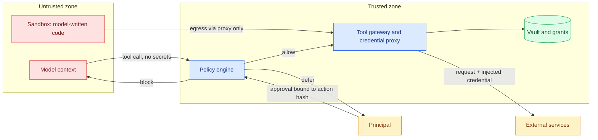

# 常設権限と封じ込め

> **翻訳の状態:** 現行の[英語版](../../22-always-on-agents/05-standing-authority-containment.md)からの翻訳です。

## TL;DR

常時稼働エージェントは、セキュリティエンジニアリングが通常は切り離しておく三つの条件を兼ね備えます。ある人のアクセス権を保持し、見知らぬ人が書いたコンテンツを読み、その人が眠っている間に行動します。モデルの内側で指示とデータを確実に分離するフィルタは存在せず、それを試みる公表済みの防御は適応的な攻撃者に破られてきました。したがって設計上の立場は、モデルは読んだものによって誘導されることがあり、それを取り巻くシステムがその事態を乗り切れるものにしなければならない、というものになります。

封じ込めは、モデルに依存しない制御から組み立てます。エージェントは自身のアイデンティティを持ち、本人の権限を、狭く、短命で、オーディエンスに束縛された委任として持ち運びます。本人の認証情報のコピーとしては決して持ちません。認証情報はエージェントの環境の外にあるプロキシに置きます。各ランには、それを起こしたものと読んだものの信頼ラベルから能力セットが割り当てられ、信頼できないコンテンツを取り込んだランが、機微なデータへの到達と外部への送信を両方行うことはできません。すべてのツール呼び出しは、許可されるか、ブロックされるか、*保留* されます。保留された呼び出しはセッションを保存したままランを終了させ、人間の答えは後から、提案された行動そのものに束縛された通常のインボックスイベントとして戻ります。

常駐エージェントには、セッションには不要だったものも必要です。エージェントの協力なしに機能する一時停止、更新されなければ失効する権限、そしてすべての副作用をマンデートのバージョン、起動イベント、モデルのバージョンに帰属させる監査証跡です。

---

## 脅威モデルが変わる

[LLMエージェント基礎](../17-llm-systems/01-agent-fundamentals.md)は、監督されたエージェントのセキュリティモデルを示しています。そこではユーザーの存在が制御の一つです。ユーザーはツール呼び出しを見て、おかしな要求に気づき、タブを閉じます。ユーザーを取り除くと四つのことが変わります。

*信頼できない入力が無人のまま届く。* エージェントの起動ソースは、メール、チケット、ウェブページ、プルリクエスト、他のエージェントからのメッセージです。常駐エージェントが読むものの大半は本人以外の誰かが書いたものであり、その一部はエージェントに読ませるために書かれています。

*権限がオフラインで行使される。* 本人はセットアップ時に一度同意しました。その後のすべての行動はその同意に基づいて取られ、「本当にこれを意図したのか」と尋ねる相手はいません。

*侵害が持続する。* 第 4 章は、メモリに書き込むインジェクションがセッションより長生きすることを示しました。タイマーは二つ目の持続チャネルです。敵対的な指示は、自分自身の将来の起動をスケジュールできます。

*検知が遅れる。* チャットでの誤った行動は数秒で目に入ります。バックグラウンドエージェントの誤った行動は、その結果が表面化したときに見つかります。それは永遠に来ないかもしれません。

Simon Willison の *致命的な三要素(lethal trifecta)* は、データ窃取にとって危険な組み合わせに名前を付けています。プライベートデータへのアクセス、信頼できないコンテンツへの露出、外部と通信する手段です。三つすべてを持つエージェントは、ウェブページから受信箱を読んでどこかへ送れと言われる可能性があります。Meta の *Agents Rule of Two* はこれを状態変更に一般化します。一つのセッションの中で、エージェントは、信頼できない入力の処理、機微なシステムやプライベートデータへのアクセス、状態の変更または外部との通信のうち、多くとも二つまでしか持つべきではありません。有用な常駐エージェントは、その生涯を通じて三つすべてを必要とします。エンジニアリング上の問いは、単一のランが三つを同時に持たないようにするにはどうするか、そしてそれが避けられないときに何を要求するかです。

## アイデンティティ: エージェントは独立した主体である

最初の決定は、リクエストに誰の名前が載るかです。エージェントをユーザー自身のトークンで動かすという便利な答えは、三つの理由で誤りです。下流のサービスはユーザーの行動とエージェントの行動を区別できず、異なるポリシーを適用することも、役に立つ監査を生成することもできません。マンデートがその小さな一部しかカバーしないのに、トークンはユーザーにできることすべてを運びます。そしてエージェントの失効がユーザーの失効を意味してしまいます。

エージェントは、[ワークロードとエージェントのアイデンティティ](../10-security/12-workload-and-agent-identity.md)が説明するように、独自のアイデンティティを持つワークロードであり、*委任* を通じて本人のために行動します。OAuth トークン交換(RFC 8693)はこれを直接表現します。エージェントは自身の認証情報とユーザーの許可の証拠を提示し、サブジェクトがユーザーで `act` クレームがエージェントを名指すトークンを受け取ります。両方を読むリソースサーバは、「このユーザーが、このエージェントを通じて、これらのスコープで」を強制し、そのとおりに記録できます。

| 性質 | メカニズム | 常駐エージェントにとっての意味 |
|---|---|---|
| 独自のアイデンティティ | SPIFFE アイデンティティや署名付きワークロードトークンなど、エージェントランタイムに発行されるワークロード認証情報 | 行動が帰属可能で、個別に失効できる |
| コピーではなく委任 | サブジェクトとアクターのクレームを伴うトークン交換 | 下流のポリシーがエージェントの行動を区別し、絞り込める |
| 狭い | マンデートの `authority` ブロックから導かれるスコープ。リソースごとのオーディエンス束縛(RFC 8707) | カレンダー用のトークンは銀行では役に立たない |
| 短命 | ランごとに発行される数分のアクセストークン | 漏れたトークンは役に立つ前に失効する |
| 送信者に束縛 | DPoP(RFC 9449)または相互 TLS による束縛 | ログやサンドボックスからコピーされたトークンを他所でリプレイできない |
| 減衰する | サブエージェントや下流エージェントへの各ホップはスコープを減らすことしかできない | 委任の連鎖が、始まったときより多くの権限で終わることはない |

これに関する標準は動いている最中です。Model Context Protocol の 2026 年の改訂は、サーバを OAuth リソースサーバとして扱い、保護リソースメタデータ(RFC 9728)を公開させ、自分宛に発行されていないトークンを拒否することを義務付け、アイデンティティプロバイダを通じたエンタープライズ管理の認可を追加しています。IETF の WIMSE ワーキンググループは、エージェントがワークロードアイデンティティと OAuth をどう組み合わせるべきかを起草しており、ドメインをまたぐ認可の連鎖や、ユーザーの確認を認可イベントに変換することが含まれます。これらは追う価値がありますが、どれも待つべきではありません。表にある性質は、トークン交換とオーディエンス制限から今日構築できます。

### 不在のもとでの同意

人間の OAuth 同意は、ブラウザと人を前提にしています。午前三時のランにはどちらもありません。二つの仕組みがこの隙間を埋めます。

日常的な権限については、本人がセットアップ時に、マンデートで境界づけられた *常設の委任* を与えます。これらのスコープを、このエージェントに、この日付まで、というものです。これはエージェント内の長命なトークンとしてではなく、認可サーバ上の許可として保存されます。そのためエージェントはそれに対して短いトークンを発行し、サーバはそれを一元的に失効できます。マンデートの有効期限が、許可の有効期限です。

エージェントが保持していない権限については、尋ねます。Client-Initiated Backchannel Authentication(CIBA)がそのための OAuth の形です。エージェントが認可を要求し、認可サーバがユーザー自身のデバイスでユーザーに連絡し、ユーザーが承認するとトークンが発行されます。エージェントはブラウザのフローに入ることも、ユーザーの認証情報を見ることもありません。これは、その場にいない当事者のためのステップアップ認可であり、後述する保留された呼び出しのプロトコルレベルの形です。

## 認証情報は外に置く

エージェントのコンテキストウィンドウとサンドボックスは、どちらも攻撃者のテキストが到達しうる場所です。どちらかにある認証情報は、露出したものと考えるべきです。常時稼働エージェントについての Anthropic の指針と Managed Agents の設計は、同じ推奨をしています。エージェントの環境の外にプロキシを置き、外向きのリクエストに認証情報を付加させ、エージェントが決してそれを保持しないようにすることです。

プロキシは秘密を隠す以上のことをします。すべての外向きリクエストがそこを通るので、プロキシは、外向き通信をマンデートが名指す宛先に制限する場所であり、イングレスがエージェント自身の副作用を認識できるようリクエストにエージェントのアイデンティティを刻印する場所であり、レートと支出の予算を強制する場所であり、監査レコードを書く場所でもあります。直接のネットワーク経路を持たないサンドボックスと、許可リストを持つプロキシがあれば、「注入されたコードが攻撃者のサーバにデータを投稿しようとした」は、ブロックされた接続とアラートになります。

プロキシが解決しないのは、エージェントが正当に保持している権限の悪用です。マンデートがメールの送信を許しているなら、誘導されたエージェントはメールを送れます。次の二つの節はそのためにあります。

## 汚染に基づく能力

Rule of Two はセッションについての言明です。私たちはそれを、第 2 章でイングレスが付けた信頼ラベルと、第 4 章からメモリレコードが持つ信頼ラベルを使って、ランごとに強制します。

ランは、それを起こしたものから計算された能力セットで始まります。ランが読み進めるにつれ、ハーネスはコンテキストに入ったものの中で最も低い信頼レベルを追跡し、そのレベルが下がると能力を取り除きます。ランの中で能力が戻されることは決してありません。

| ランが取り込んだもの | プライベートデータの読み取り | 内部状態への書き込み | 外部との通信、または不可逆な操作 |
|---|---|---|---|
| 本人と内部のコンテンツのみ | 許可 | 許可 | マンデートの範囲で許可 |
| 第三者のコンテンツ | 許可 | 影響が小さく可逆な書き込みは許可 | 本人に保留 |
| 第三者のコンテンツ。プライベートデータのスコープは要求しない | 付与しない | 付与しない | その第三者への返信は許可 |

中央の行がよくあるケースです。届いたメールを読み、本人のファイルにアクセスできるエージェントです。読んで考えることはできます。システムの外に出るものはすべて人間を待ちます。三行目は外部向けの仕事のパターンです。外部のメッセージに答えるランは、盗む価値のあるものを一度も与えられていないので、自由に返信できます。

汚染は粗く、安全だった行動の一部も保留します。必要なところで精度を取り戻すアーキテクチャパターンは二つあります。

*隔離された読み手。* ツールを持たず、メモリにもアクセスできない別個のモデル呼び出しが、信頼できないコンテンツを読み、制約された結果を返します。分類、スキーマに対して検証された抽出フィールド、あるいはそれ自体が信頼できないとラベル付けされた要約です。特権を持つランは構造化された結果を見て、生のテキストは決して見ません。これはデュアルモデルのパターンであり、戻りのチャネルが狭い程度に応じて機能します。自由文の要約は指示のチャネルになりますが、列挙されたラベルはなりません。

*読む前に計画する。* CaMeL の設計では、特権を持つモデルが、本人のリクエストだけからプログラムとして計画を書きます。モデルの外にあるインタプリタがそれを実行し、どの値が信頼できないソースに由来するかを追跡し、値がツール呼び出しに流れ込む前にポリシーを検査します。信頼できないコンテンツは、計画が操作するデータを変えられます。計画そのものは変えられません。これはモデルの振る舞いに依存しない保証を与えますが、柔軟性という代償を伴います。読んだものに適応できない計画は、より弱いエージェントだからです。これは、制約のないエージェントよりも常駐エージェントに向いています。繰り返されるマンデートには、繰り返される計画があるからです。

これらのどれも、インジェクションを不可能にするものと読むべきではありません。主要な防御の著者自身が攻撃者も務めた研究は、適応的な攻撃が公表済みの十二の防御すべてを迂回したと報告しています。この章の制御に価値があるのは、モデルが誘導されたときの結果に上限を与えるからであり、その観点で評価すべきです。

## 許可、ブロック、保留

常駐エージェントが提案するすべてのツール呼び出しは、三つの結果のいずれかになります。進むか、ブロックされるか、承認を待つかです。ポリシーエンジンは、ツールが宣言するリスク階層、ランの汚染、マンデート、予算から決定します。

| 階層 | 例 | クリーンなランの既定 | 汚染されたランの既定 |
|---|---|---|---|
| 観測 | ダッシュボードを読む、ログを検索する | 許可 | 許可 |
| 可逆な内部書き込み | コメントを追加する、チケットにラベルを付ける、下書きを保存する | 許可 | 許可。行動ダイジェストに載せる |
| 外部向け、または取り消しにくい | メッセージを送る、マージする、カレンダーを変更する | 常設の範囲内で許可 | 保留 |
| 不可逆、または高価値 | 支払う、削除する、アクセスを付与する | 保留 | 保留。ステップアップ認証を伴う |
| マンデート外 | `authority` にないものすべて | ブロック | ブロック |

モデルベースの分類器もこの経路に置けます。分類器を使って危険な行動を止める自動承認モードは、人がレビューしなければならない量を減らします。それは階層の上に重ねる層であって代替ではありません。最も重大な決定には依然として人間が必要だからです。

### 保留された呼び出し

監督されたエージェントにおける保留はダイアログボックスです。常駐エージェントではそこに誰もおらず、人は答えるのに一日かかるかもしれません。ランを一日開いたままにすれば、ワーカー、サンドボックス、エージェントの単一ターンのリースを保持し続け、エージェントは他のことを何も処理できなくなります。

仕組みは、ランを終了させることです。フックがゲート付きの呼び出しを捕捉し、セッションは呼び出しを保留したまま保存され、リクエストはアウトボックスを通じて本人に送られます。ワーカーは同じエージェントの他のイベントを処理できる状態になります。人が答えると、その答えはインボックスイベントとして届き、それを受け取ったランが、保存されたセッションを保留中の呼び出しのところから再開します。第 3 章の言い方では、これは永続的な待機です。結果のない `EffectIntent` と、保留中の承認レコードがあり、計算資源は使いません。

これが制御になるか儀式になるかは、四つの細部で決まります。

*承認は行動に束縛される。* リクエストはツールと引数を正確に表示し、承認はそのハッシュを持ちます。再開時に、ポリシーエンジンはハッシュを再計算します。エージェントの保留中の呼び出しが承認されたものと異なれば、承認は適用されません。そうしなければ、誘導されたエージェントは無害なメッセージの送信を求めておいて、別のメッセージを送ることができます。

*リクエストは信頼された側がレンダリングする。* 人間が読む説明は、ゲートウェイが構造化された呼び出しから生成したものであり、モデルが書いたものではありません。誘導されたモデルは、安心させる説明も書きます。

*承認は失効し、世界は再確認される。* 月曜にロールバックについて与えられた承認は、木曜の大きく変わったシステムをロールバックする権限ではありません。再開されたランは、実行の前に前提条件を検証します。

*沈黙には定義された意味がある。* すべての保留リクエストはタイムアウトと既定値を持ち、既定値は安全な方向です。それはほぼ常に、行動せず、次のダイジェストでそう伝えることです。

### 承認疲れ

一日に四十回尋ねられる人は、読まずに承認します。その時点でゲートは監査証跡を提供するだけで、安全を提供しません。対策は、承認を注意に値するだけ稀にすることです。*常設の承認* は、繰り返される決定を、勤務時間内に社内会議を再調整する許可のような、境界づけられた規則に変換し、ポリシーエンジンが尋ねることなくそれを強制します。エージェントは、同じリクエストが何度か承認された後にそうした規則を提案でき、その提案自体がゲート付きの行動です。承認率と決定までの時間を監視します。承認率が百パーセントに近く、決定が二秒未満で下されているなら、ゲートは機能しなくなっています。

## 予算はセキュリティ制御である

誘導されたエージェントやループするエージェントは、まず、使うことを許された量によって制限されます。マンデートの予算、つまり一日あたりのトークン、一時間あたりの行動数、一日あたりの金額、受信者ごとのメッセージ数は、ゲートウェイとスケジューラで強制されます。予算は、上限のないインシデントを上限のあるものに変え、最も早いシグナルを生みます。普段は許容量の十分の一しか使わないエージェントでの予算停止は、ページに値する異常だからです。

予算は、誰かが想像できる最悪のケースからではなく、観測された使用量に控えめな余裕を加えて設定すべきです。目的は、異常な振る舞いがすぐに壁に当たることです。

## 一時停止、失効、期限切れ

すべての常駐エージェントには、エージェント自体が問題であるときにも機能する停止が必要です。

*一時停止* は、スケジューラがランを受け入れる前と、ゲートウェイが副作用を実行する前に確認するコントロールプレーンのフラグです。モデルに止まるよう頼むものではありません。設定すると、実行中のターンには次のツール境界で、新しいターンには即座に効力を持ちます。メールボックスはイベントを受け付け続けるので、再開しても失われるものはありません。

*失効* は、認可サーバで常設の許可を取り消します。アクセストークンは短命でランごとに発行されるので、失効の遅延はトークンの寿命で上限が決まります。これが、その寿命を数分に保つ論拠です。同時にリースエポックを進め、まだ動いているブレインが次のログ追記で失敗するようにします。

*期限切れ* はデッドマンスイッチです。マンデートは、オーナーが更新しないかぎりその日付で失効し、失効したマンデートは一時停止と同じ扱いになります。これは、誰も気づかない障害、つまりオーナーが去ったエージェントに対して機能する唯一の制御です。

*フリート停止* は、コホート単位で一時停止を適用します。テナント別、モデルバージョン別、ツール別です。ツールに脆弱性が見つかったとき、あるいは悪いモデルバージョンがロールアウトされているとき、オペレータはそれを使うすべてのエージェントを一つの操作で止める必要があります。

## 監査

誰も見ていなかったので、目撃者なら答えられたはずの問いに、記録が後から答えなければなりません。すべての副作用について、ゲートウェイは次のものを記録します。エージェントのアイデンティティと委任した本人、マンデートのバージョン、起動イベントとその信頼ラベル、ランとセッションの識別子、モデルとプロンプトのバージョン、呼び出し時点の汚染レベル、ポリシーの決定とそれを生んだ規則、そして保留された呼び出しについては承認者と行動のハッシュです。セッションログは推論を保持し、ゲートウェイのログは事実を保持します。後者は、モデルが影響を及ぼせないコンポーネントが書きます。

ここから二つの定常レポートが生まれます。オーナーへの日次ダイジェストは、エージェントが何をしたかを列挙します。これは監督の最小限の代替です。そして定期的なアクセスレビューは、マンデートが与える権限とエージェントが実際に使った権限を比較し、その差を取り除きます。

## 障害モード

| 障害 | メカニズム | 検知 | 緩和 |
|---|---|---|---|
| インジェクションによる流出 | 信頼できないコンテンツが、プライベートデータと外向きチャネルを持つランを誘導する | 外向き通信のブロック。汚染されたランからの保留された送信 | 汚染に基づく能力。外向き通信の許可リスト。認証情報プロキシ |
| 混乱した代理人 | エージェントがユーザーの完全なトークンを使い、サービスが絞り込めない | サービスのログでエージェントの行動が区別できない | アクタークレームを持つ委任トークン。オーディエンス束縛 |
| サンドボックスからの認証情報の窃取 | 環境内の秘密が注入されたコードに読まれる | 想定外の発信元からのトークン使用 | プロキシが保持する認証情報。送信者に束縛されたトークン |
| 承認のすり替え | 承認された行動と実行された行動が異なる | 再開時のハッシュ不一致 | 行動のハッシュに束縛された承認。信頼された側でのレンダリング |
| 形骸化した承認 | リクエストが多すぎて、人間が読まなくなる | 承認率がほぼ 100%、決定時間がほぼゼロ | 境界のある常設の承認。より少なく、より良いリクエスト |
| 持続する侵害 | インジェクションがメモリに書き込む、またはタイマーを設定する | 命令形のメモリ書き込み。汚染されたランで設定されたタイマー | 隔離。汚染されたランはレビューなしにタイマーを設定できない |
| 特権の肥大 | スコープが時間とともに追加され、削除されない | 付与されたスコープと使用されたスコープの差が広がる | ゲートウェイのログに基づくアクセスレビュー。期限切れ |
| 止められないエージェント | 停止がモデルへのメッセージとして実装されている | ループや侵害のもとで一時停止が効かない | スケジューラとゲートウェイでの一時停止。エポックの更新。失効 |
| 委任の増幅 | サブエージェントが親より多くの権限を受け取る | 下流でトークンのスコープが広い | トークン交換で減衰を強制する |
| 古い承認の実行 | 承認と再開の間に状況が変わった | 前提条件のチェックが失敗する | 承認の失効。副作用の前に再確認する |

## 意思決定フレームワーク

侵害された一つのランに何ができるかから出発し、その答えがマンデートのオーナーにとって受け入れられるものになるまで減らします。

エージェントが第三者のコンテンツを決して読まないなら、汚染の追跡は不要で、階層と予算で足ります。この立場にある有用な常駐エージェントは少なく、仮定するのではなく検証すべきです。ウェブ検索も受信メールも、どちらもこの前提を破るからです。

第三者のコンテンツを読み、プライベートデータを保持するなら、汚染されたランから外向きチャネルを取り除き、外に出さなければならないものは保留します。これが、メール、文書、チケットを扱うアシスタントの既定の構成です。

自動応答のように、待つことなく信頼できない入力に基づいて外部に行動しなければならないなら、プライベートデータを取り除きます。そのランには専用の狭いスコープを与え、それ以外は何も与えません。

ワークロードが本当に、人間のゲートなしに一つのランで三つすべてを必要とするなら、高リスクのシステムとして扱います。外部のポリシーインタプリタを伴う計画してから実行する方式、可能なかぎり狭いスコープ、低い予算、完全な監査、そして残余リスクを書面で受け入れたオーナーです。

## 重要なポイント

- モデルは読んだものによって誘導されうると仮定します。封じ込めはモデルの外にある制御から得られます。
- エージェントは自身のアイデンティティを持ち、本人の権限を、アクタークレームを伴う、狭く、短命で、オーディエンスに束縛され、送信者に束縛された委任として持ち運びます。
- 認証情報は、コンテキストとサンドボックスの外にあるプロキシに置きます。プロキシは、外向き通信、予算、監査の要所でもあります。
- 能力は、ランが取り込んだものの信頼レベルからランごとに割り当て、取り除く方向にしか変えません。人間のゲートなしに、プライベートデータ、信頼できない入力、外向きチャネルを同時に持つランがあってはなりません。
- すべてのツール呼び出しは、許可されるか、ブロックされるか、保留されます。保留された呼び出しはランを終了させ、答えはインボックスイベントとしてセッションを再開します。
- 承認は行動そのもののハッシュに束縛し、リクエストは信頼された側からレンダリングし、失効させ、沈黙の意味を定義します。
- 承認は稀に保ちます。繰り返される決定は境界のある常設の規則に変換し、形骸化を監視します。
- 一時停止はスケジューラとゲートウェイで、失効は認可サーバで行い、マンデートは期限切れにします。これらのどれもモデルに依存してはなりません。

## 参考文献

- [Building always-on agents](https://claude.com/resources/articles/building-always-on-agents): 認証情報プロキシ、許可、ブロック、待機の決定、インボックスを通じて再開する保留されたツール呼び出し
- [The lethal trifecta for AI agents](https://simonwillison.net/2025/Jun/16/the-lethal-trifecta/): 流出の条件としてのプライベートデータ、信頼できないコンテンツ、外部通信
- [Agents Rule of Two: A Practical Approach to AI Agent Security](https://ai.meta.com/blog/practical-ai-agent-security/): セッションごとに三つの危険な性質のうち多くとも二つまでしか持たない
- [Defeating Prompt Injections by Design](https://arxiv.org/abs/2503.18813): CaMeL。信頼された入力からの計画と、能力を検査するデータフロー
- [The Attacker Moves Second](https://arxiv.org/abs/2510.09023): 公表済みのプロンプトインジェクション防御を迂回する適応的攻撃
- [RFC 8693: OAuth 2.0 Token Exchange](https://www.rfc-editor.org/rfc/rfc8693): サブジェクトトークンとアクタートークンによる委任
- [RFC 9449: OAuth 2.0 Demonstrating Proof of Possession](https://www.rfc-editor.org/rfc/rfc9449): 送信者に束縛されたトークン
- [OpenID Connect Client-Initiated Backchannel Authentication](https://openid.net/specs/openid-client-initiated-backchannel-authentication-core-1_0.html): ユーザーが目の前にいないクライアントのための帯域外のユーザー認可
- [Model Context Protocol: Authorization](https://modelcontextprotocol.io/specification/draft/basic/authorization): リソースに束縛されたトークンを持つ OAuth リソースサーバとしての MCP サーバ
- [AI Agent Authentication and Authorization (draft-ietf-wimse-aims)](https://datatracker.ietf.org/doc/draft-ietf-wimse-aims/): エージェントのためのワークロードアイデンティティと OAuth の組み合わせ。作業中のドラフト

---

## 関連する章

- [ワークロードとエージェントのアイデンティティ](../10-security/12-workload-and-agent-identity.md): エージェントのアイデンティティを構成するワークロード認証情報と委任の連鎖
- [OAuth 2.1 と高保証の認可プロファイル](../10-security/11-oauth-security-profiles.md): 送信者に束縛されたトークンと、常設の許可が使うべき強化されたフロー
- [大規模な認可](../10-security/07-authorization-patterns.md): 許可、ブロック、保留の背後にあるポリシーエンジンと決定モデル
- [脅威モデリングと悪用ケース](../10-security/08-threat-modeling-and-abuse-cases.md): 侵害された一つのランが到達できる範囲を列挙する構造化された方法
- [LLMエージェント基礎](../17-llm-systems/01-agent-fundamentals.md): この章が拡張する、監督されたエージェントのセキュリティモデル
