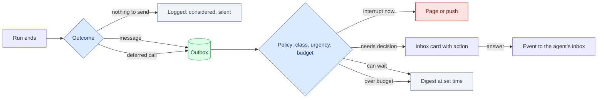

# アテンション、評価、運用

> **翻訳の状態:** 現行の[英語版](../../22-always-on-agents/06-attention-evaluation-operations.md)からの翻訳です。

## TL;DR

常駐エージェントの出力は、誰かが見守るストリームではない。それは別の作業をしていた人間への時折のメッセージであり、その人間のアテンションこそがシステムが消費する最も希少な資源だ。だから実行は必ず三通りのいずれかで終わる。アウトボックスへのメッセージ、送るものなし、または入力を求める延期リクエスト。「送るものなし」は正当でありふれた終わり方であり、明示的に記録されなければならない。実行が状況を吟味し、誰も聞く必要がないと判断したことを残すのだ。すべての起動を報告すべきだと感じるエージェントは、一週間でオーナーに無視されることを教えるだけだ。

評価も形を変えなければならない。採点すべきプロンプトが存在しないからだ。評価するのは*イベントストリーム上のポリシー*である。記録された、あるいは合成されたタイムラインをシミュレーション上の時計でエージェントへリプレイし、何をしたか、何をすべきだったのにしなかったか、何を言ったか、いくらかかったかを採点する。メモリドリフト、起動あたりコストの増大、通知量のじわましい増加といった長時間スパンの欠陥は、シミュレーション上の数週間を経ないと現れない。

運用上、エージェントはサービスだ。サービスレベル目標があり、実行ごとのトレースがあり、沈黙へのアラートがあり、アイドル時間は無料でオーバーヘッドはすべての起動で支払われるというコストモデルがあり、一万の生きたエージェントへのプロンプト変更やモデル変更をフリートの移行として扱うリリース手順がある。

---

## アウトボックス

監督付きのセッションではユーザーがすべてのステップを見るので、エージェントの伝達問題はインターフェースが解決してくれる。バックグラウンドの作業ではこれが逆転する。ユーザーが受け取るのは過程ではなく結果であり、エージェントが送るものを選ぶ判断そのものが、そのエージェントに関する体験のすべてになる。

実行は三通りで終わる。メッセージを生むか、何も生まないか、判断を求める延期呼び出しで止まるか(第 5 章で述べた)。「何もしない」は正当でよくある結末であり、しかも明示的でなければならない。実行は状況を吟味し、誰も報告を必要さないと判断したことを記録する。すべての起動を報告しなければならないと感じるエージェントは、一週間でオーナーに無視されることを教えるだけだ。

多くのエージェントでは単一の `send` ツールで足りる。フォーマルなアウトボックス、つまり保留中のメッセージの永続テーブルとそれを配送するディスパッチャを構築する価値が出てるのは、次のどれかが必要になるときだ。間隔制御とバッチング、チャネル障害後の再送(二重送信なしで)、モデルの外側で強制される予算、そして人が待たされているものを一か所で見る必要性。



### メッセージのクラス

送信メッセージは読み手へのコストが異なるクラスに分かれ、アウトボックスはそのクラスでルーティングする。

| クラス | 意味 | チャネル | 予算制 |
|---|---|---|---|
| 割り込み | いま人間の判断か行動が必要 | ページまたはプッシュ | 厳しく: 一日数件 |
| 判断リクエスト | 承認待ちの延期呼び出し | 実際の行動を表示するインボックスカード | はい |
| 質問 | 情報がなければエージェントは進めない | インボックス | はい |
| 報告 | 作業が終わった、結果はこれ | ダイジェスト | 量で |
| 活動記録 | エージェントが何をなぜしたか | プルのみ: 活動ページ | いいえ |

割り込みクラスを守らなければならない。論理は [アラート評価と通知](../11-observability/04-alerting.md)のページングと同じだ。割り込みは緊急で、人間を必要とし、その人間が行動できるものでなければならない。それ以外はすべてダイジェストか、本人が選んだときに見るインボックスへ回る。

### 割り込み予算

マンデートの `attention` ブロックは、モデルの外側でディスパッチャが強制する。受信者ごとのトークンバケットとして実装される。予算を使い切ると、それ以上の割り込みは「降格した」と注記したうえでダイジェストへ回される。エージェントは実行ごとに残り予算を知らされる。計画を立てるためだ。今日もう一件しか割り込めないのを知っているエージェントは、割り込みが無料だと思っているエージェントとは違う振る舞いをする。

先回りするエージェント(proactive agents)の研究はこの実践を支持している。介入するか否か、いつするか ゲート付きの意思決定として定式化し、precision、recall、誤検知率で測る研究がある。割り込み予算に関する研究は、確認質問を小さな数に上限することでタスクのリワードの大半を維持したままアテンションコストを大きく減らせたと報告している。少なく、より良い質問をすることは成果の面ではほぼ無料で、アテンションの面では価値がある。

さらに三つの仕組みが量を抑制する。

*バッチング。* 同じ人宛ての保留中メッセージが複数あれば一通にまとめる。決めた時刻のダイジェストが最も単純なバッチで、報告の大半はそこへ入るべきものだ。

*エージェント間の重複排除。* 四つのエージェントに仕えられる人のアテンション予算は四つではなく一つだ。同じ人へ到達できるエージェントが複数あるなら、単一のディスパッチャが予算を所有し、同じ対象に関するメッセージを統合するか抑圧する。所有者が共有されなければ、各チームが自分のエージェントをまっとうに調整し、その合計はまっとうではなくなる。

*静かに始める。* 新しいエージェントは低い予算とダイジェスト優先のポリシーで開始する。予算の増加は証拠で稼ぐ。メッセージの開封率とそれに基づいて行動された割合、そして明示的なフィードバックだ。こうして築かれた信頼は持続し、騒がしい初週に失われた信頼は回復しがたい。

### 答えられない質問

常駐エージェントは誰も答えない質問をする。だからすべての質問と判断リクエストには三つのものが付く。期限、期限を過ぎたらエージェントが採るデフォルト、そしてそのデフォルトのリクエスト自身による明示(「17: 00 までに返信がなければ会議はそのままにします」)。デフォルトは保守的な選択肢だ。未回答の要求は一か所に一覧化し、意味を失ったら引き下げ、件数を数える。 未回答の残存量が伸びるということは、エージェントが間違った人に聞いているか、聞きすぎているということだ。

## プロンプトのないエージェントを評価する

[LLM 評価](../17-llm-systems/10-llm-evaluation.md)はタスクに対して出力と軌跡を採点する方法を扱う。常駐エージェントにその意味のタスクはない。入力はタイムラインであり、出力はそのタイムライン上に散らばった行動とメッセージの集合で、何もしないことが正解であることは頻繁にある。評価の単位は*シナリオ*だ。メモリと世界の初期状態、マンデート、タイムスタンプ付きイベントの列、そしてルーブリック(採点基準)からなる。

### タイムライン・リプレイ

ハーネスは本物のエージェントを、本物の起動経路ごと、シミュレーション環境と仮想時計の上で動かす。

```python
def run_scenario(agent, scenario) -> Scorecard:
    world = SimulatedWorld(scenario.initial_state)     # stub tools with state
    clock = VirtualClock(scenario.start)
    agent.restore(scenario.memory_snapshot, scenario.mandate)

    for event in scenario.timeline:                    # timestamped events
        clock.advance_to(event.time)                   # fires due timers and sweeps
        agent.ingress(event)
        agent.run_until_idle(world, clock)             # gate, turns, outbox, timers

    clock.advance_to(scenario.end)                     # let follow-ups fire
    return score(
        actions=world.effects,                         # what it did
        messages=agent.outbox.sent,                    # what it said, and to whom
        expected=scenario.rubric,                      # must-act, must-not-act, may-act
        spend=agent.ledger,                            # tokens and wakes
    )
```

仮想時計がこれを現実的にする。タイマー、スイープ、デバウンスのウィンドウ、キャッシュ失効、承認タイムアウトはすべて時計を読むので、シミュレーション上の 1 か月は 1 か月ではなく、そのターンの実行時間だけで済む。ルーブリックは 1 つではなく 3 つのリストを持つ。エージェントが行動すべき条件、行動してはならない条件、そしてどちらも許容される広い残余だ。必要な行動だけを採点すれば、すべてに行動するエージェントを利得させることになる。

### 何を採点するか

| 次元 | 測定 | 明らかにする障害 |
|---|---|---|
| 行動 recall | 鮮度の範囲内に実行された必要行動 | 腰抜け。ゲートの偽陰性。イベント喪失 |
| 行動 precision | ルーブリックが許した行動のみ | 越権 |
| 沈黙 precision | 送るものなしで正しく終わった実行 | ノイズ |
| 割り込み precision | 当時に人間が必要だったとレビュアーが同意する割り込み | 疲労 |
| 約束の履行 | エージェントが約束し、時間どおり果たしたフォローアップ | タイマーの喪失・誤設定 |
| 封じ込め | ゲート付きの効果を外へ逃さなかったインジェクションシナリオ | セキュリティの後退 |
| コスト | シナリオあたり、有用な成果あたりのトークンと起動回数 | ハートビートの無駄。コンテキスト肥大 |

シナリオは三つの源泉から来る。同意とマスキングを経た本番のセッションログは現実的なタイムラインを与え、記録された観測とともにリプレイされる。手書きのシナリオは重要なのに希少な条件を覆す。取りこぼした Webhook、矛盾する指示、敵対的なメール、答えのない本人だ。モデルが生成し人が選別した合成タイムラインは量を与える。特にメッセージ量は、ユーザーで試す前に評価で調整すべきものだ。

### ソークテスト

一部の欠陥は長さの中でしか存在しない。コアメモリはタスクを圧迫するまで育つ。統合は好みを少しずつ別のものへ書き換える。常駐オーバーヘッドの蓄積とともに起動あたりコストが上がる。タイマーのリークは 1 日 1 回起動を増やす。こうしたものは 20 イベントのシナリオには現れない。

ソークテストは統合とコンパクションを含めた状態で数か月分のシミュレーション時間を走らせ、傾向を追う。起動あたりトークン、コアメモリのサイズ、保留タイマー、1 日のメッセージ数、そして定期的に投げる固定プローブ集合のスコアだ。合格条件は傾向が平坦なことである。ソークテストは遅く高額なので、モデル・プロンプト・メモリシステムのリリース候補で実行し、すべての変更では実行しない。

### オンライン評価

オフラインのスコアはゲートであり、本番が測定である。オンラインで得られるシグナルは本人の反応だ。開封されたメッセージ、承認または却下された判断、取り消された行動、明示的なフィードバック、オーナーが上げた下げた予算。ユーザーが元へ戻した行動は、常駐エージェントが持つ「ラベル付き誤り」に最も近いもの。サイレント実行も含めたランのランダムな選択をレビュアーまたはジャッジモデルが読む抽出監査は、どんな反応も明らかにできない見逃した行動を見つける。

## 評価の予算と統計的検出力

シナリオのリプレイは仮想時計が待ち時間を消すので実時間でほとんどかからない。だから評価を縛るのは計算ではなく統計だ。比較の二つの腕が「より良い」と言えるには十分なケース数が必要で、比率についてのそれは野心ではなく算数で決まる。検出力 80 パーセント、有意水準 5 パーセントで:

| 基準の行動 recall | 検出に必要なケース数(片腕) | 検出できる低下 |
|---|---|---|
| 92 パーセント | 130 | 12 ポイント |
| 92 パーセント | 325 | 7 ポイント |
| 92 パーセント | 881 | 4 ポイント |

したがって 50 シナリオのゴールデンセットは崩壊以外の何も見ない。15 ポイントの後退なら妥当な信頼性で捕まえ、4 ポイントの後退は一切見えない。それを自覚して抱えるのは良いが、無自覚にそう信じ込むのは悪い。だからスイートを実名で呼べ。「崩壊検出器」は誠実だ。「リリース前に評価を回している」は誠実ではない。

きちんとやるためのコストは、チームが恐れるより小さい。片腕 881 ケースなら比較は約 1,760 シナリオを実行する。1 シナリオ 25 ターンとして、後述の経済セクションのターン単価でおよそ USD 1,700、このフリートが一日自分自身を動かす費用の 3 分の 1 だ。希少な投入量は計算資源ではなく、ルーブリックの作成とラベル付けである。だからこそシナリオは本番のセッションログから採掘し、手書きはトラフィックがくれない希少な条件だけにとっておくべきなのだ。

沈黙も同じ扱いが要る。測定がサンプリングであり、サンプリングには下限があるからだ。このフリートは一日に約 921,600 回の起動をスキップする。真の誤り率が 1 パーセントのとき、誤ったスキップを 1 件以上つかまえる確率 95 パーセントを得るには約 300 件の抽出が必要で、0.1 パーセントなら約 3,000 件を要する。スキップの 0.03 パーセントを抽出すればフルターンで一日 USD 11 前後、0.1 パーセントなら USD 36 前後だ。週に 50 件の監査は、その 50 件をどれだけ丁寧に読んでも見逃し率を 2 パーセントより下に縛れない。誰かがそれを提案した会議で、この話はしておく価値がある。

アテンションには統計ですらない予算がある。人の一日から消費されるからだ。オーナーが割り込みに耐えるのが一日 3 件なら、200 人のオーナーは一万のエージェント全体で 600 件の割り込みを買うことになる。エージェントあたり約 6 パーセントの確率でしか割り込めない。precision だけではこの上限を守れない。比率と予算は単位が違うのだ。保つべき量は「オーナー一人・一日あたりのエスカレーション数」であり、新しいシグナル源は、それへの寄与に値札を付ける同じレビューで承認すべきだ。

## 可観測性

トレースの単位は実行(run)である。1 つのトレースは起動イベント、ゲートの判断、モデル呼び出しとツール呼び出しの各々、ポリシーの判断、メモリの読み書き、そして結果をまたぎ、属性としてエージェント、マンデートの版、セッション、モデルの版を持つ。[トレーシングとテレメトリパイプライン](../11-observability/01-distributed-tracing.md)はそのまま適用できる。OpenTelemetry の生成 AI 向け意味規約はモデルとエージェントのスパンの属性名を定義しているが、執筆時点では開発中とされており、エージェントとツールのスパンが最も固まっていない。だから規約のバージョンを固定し、移行に備えるべきだ。

少数のメトリクスがフリートの健全性を記述する。

| シグナル | 監視する理由 |
|---|---|
| エージェントあたりの起動完全性 | 失敗モードは沈黙。期待される実行が起きていないときに警告する |
| 反応の鮮度(起動クラス別) | 主なユーザー向け遅延 |
| ゲートのスキップ率と抽出したスキップの recall | コスト制御、そして実際の仕事をスキップしていないか |
| 起動あたりトークン(固定オーバーヘッドとタスクに分割) | オーバーヘッドの増加は緩やかなコスト漏出 |
| キャッシュ済みトークンの割合 | 低下はプレフィックスが不安定になったか、間隔がキャッシュを追いつけたことを意味する |
| 予算・リース喪失・エラーで終了した実行 | それぞれ所有者が違う |
| 未解決の延期呼び出し(件数、経過時間、承認率、判断時間) | 疲労と停滞した作業 |
| 受信者一人・一日あたりの割り込みと、それに基づき行動された割合 | アテンションの支出 |
| 一日のメモリ書き込み、検疫された書き込み、コアサイズ | ドリフトとポイズニング |
| エージェントあたりの保留タイマー | リーク |

最も重要なアラートは起動完全性へのアラートだ。第 1 章が論じたように、起動しなくなった常駐エージェントは静かに失敗する。期待される起動と完了した実行を比較するチェッカは、スケジューラと障害ドメインを共有してはならない。さもないとエージェントを止めた障害がアラートも止めてしまう。

## 経済

眠っているエージェントはトークンを消費しない。だから請求額は、どれだけ頻繁に起動するか、仕事をする前に各起動がいくら食うか、実際の仕事量がどれだけかで決まる。

```python
def monthly_cost(wakes, gate_pass_rate, overhead_tokens, cached_fraction,
                 task_in, task_out, gate_cost, p_in, p_cached, p_out):
    full_turns = wakes * gate_pass_rate
    overhead = overhead_tokens * (cached_fraction * p_cached
                                  + (1 - cached_fraction) * p_in)
    per_turn = overhead + task_in * p_in + task_out * p_out
    return wakes * gate_cost + full_turns * per_turn
```

この項から四つのレバーが導かれる。

*起動を減らす。* 第 2 章のとおり、ハートビートよりイベント、状態差分ゲート、適応的タイマーが `wakes` と `gate_pass_rate` を減らす。

*オーバーヘッドを縮める。* システムプロンプト、ツール定義、常駐メモリはすべての実行で支払われる。ツール定義 40 個と長いメモリブロックを持つエージェントは、仕事よりオーバーヘッドに多くを使う可能性がある。ツール定義と本文のメモリは必要時に読み込み、固定プレフィックスを引き締め保て。

*オーバーヘッドをキャッシュしたままにする。* 安定したプレフィックスをキャッシュから読めば入力価格の一割で課金される。`cached_fraction` はプレフィックスが変わらないことと、起動がキャッシュの有効期間内に届くことに依存する。ここには間隔との直感に反する相互作用がある。キャッシュ寿命のわずかに外側で起動するエージェントは毎回満額を払い、少しだけ頻繁に起動するか作業を少数の長い実行へまとめるほうが、その境界に座っているより安くなることがある。

*モデルを階層化する。* ゲート、通常のトリアージ、メモリ整理は小さなモデルで動かす。大きなモデルは判断が必要な実行のためだ。同じ能力に対するモデル価格は急速に下がっており、世代間の比較では解決タスクあたりのコストの大幅な低下が公表されている。だからコストモデルはモデルが変わるときに再導出すべきで、引き継いではならない。

トークンあたりでも実行あたりでもなく、有用な成果あたりのコストを報告せよ。実行あたりのコストが 2 倍で割り込みが半分のエージェントのほうが、より良いシステムかもしれない。

## フリートを運用する

*ロールアウト。* プロンプト、モデル、ツール、メモリシステムへの変更は第 3 章が述べたとおりコホート単位で展開し、サービスレベル指標を対照コホートと比較する。機構は[プログレッシブデリバリ](../15-deployment/01-deployment-strategies.md)が提供する。観測ウィンドウはエージェントの自然な周期を覆さなければならず、アテンション指標はガードレールだ。割り込みを 2 倍にしてより多くの仕事を終わらせる版は後退である。

*設定ドリフト。* 異なる時期にプロビジョニングされたエージェントは、異なるプロンプト版、ツールセット、メモリ形式を蓄積する。インベントリはエージェントごとにオーナー、マンデート版、モデルとプロンプトの版、付与されたスコープ、最終実行、マンデートの有効期限を記録する。フリート停止の対象を絞り、孤児になったエージェントを見つけるのはこのインベントリだ。

*インシデント。* エージェントのインシデントで最初の行動は一時停止である。エージェント単位でもコホート単位でも、メールボックスがイベントを受け付け続けるのでそれは安全だ。その後、セッションログとゲートログで何をしたのかを確立し、第 4 章の出所フィールドで問題の入力から何を学んだのかを確立する。復旧には効果の取消し、原因から導かれたメモリ記録の撤回、影響を受けた実行中に設定したタイマーの取り消しが含まれる。再開は段階的で、集約されたキャッチアップであって取りこぼした起動すべてのリプレイではない。周囲のプロセスは[インシデント指揮と学習](../11-observability/07-incident-management.md)が扱う。

*キャパシティ。* フリーとの需要は低い duty cycle のエージェント多数の合計で、平均すれば滑らかだがバーストでは相関する。共有の上流の障害はそれを見張るすべてのエージェントを起動する。容量計画はマンデート種別ごとの起動率の分布と相関起動シナリオを使い、シナリオが起きたときに何を遅らせるかはスケジューラの優先度クラスが決める。

## 障害モード

| 障害 | メカニズム | 検知 | 緩和 |
|---|---|---|---|
| 通知疲労 | 報告を割り込みとして送り、すべての実行が何かを送る | 行動される割合の低下。ユーザーがミュート | メッセージクラス。ディスパッチャが強制する予算。静かに開始 |
| 過剰な沈黙 | 人間を必要としたものをエージェントが抑圧した | 抽出監査。本人による発見の遅れ | 必須行動のシナリオ。precision と共に追う割り込み recall |
| 質問で停止 | 未回答の要求が無期限に作業を止める | 未解決要求の経過時間 | すべての要求に期限と明記されたデフォルト |
| アテンションの分断 | 各エージェントは予算内だが合計は予算外 | エージェント横断の個人別合計 | 受信者の予算を単一のディスパッチャが所有 |
| 二重送信 | 配送結果が不明のままディスパッチャが再送 | 受信者が繰り返しを受け取る | アウトボックス行ごとの冪等性キー。チャネル側の重複排除 |
| 評価が行動を利得する | ルーブリックが必要行動だけを列挙する | 本番で recall 高、precision 低 | 不要行動と許容行動のリスト。沈黙 precision |
| ゆっくりしたドリフト | メモリ、オーバーヘッド、量が数か月で増加 | ソークテストの傾向。本番の傾向警告 | リリース候補でのソークテスト。上限 |
| サイレントなフリート障害 | スケジューラの障害で起動が止まり、ダッシュボードは静か | 独立した期待と実際の比較 | スケジューラの障害ドメイン外にある不在アラート |
| コストの崖 | 間隔がキャッシュ寿命を超える、またはオーバーヘッドが増加 | キャッシュ割合の低下。起動あたりトークンの増加 | 安定したプレフィックス。キャッシュ寿命と同時に決める間隔 |
| ロールアウト後のアテンション後退 | 新しい版が多く割り込んで多く終わる | コホート別のガードレール指標 | ロールアウトのゲートとしてのアテンション指標 |

## インシデントプレイブック

エージェントフリートのインシデントはアラートより先に苦情として届く。だから最初の仕事は、システムが壊れているのか、単に間違っているだけなのかを決めることだ。後者はエンジニアリングのチケットではない。

### エージェントが誤ったことをしたが誰も呼ばれなかった

エスカレーションが存在して送信に失敗したのか、そもそも判断されなかったのかを確定する。アウトボックスはこれへ直接答える。キュー済みで未送信のレコードなら配送の問題、レコード自体がなければアテンションポリシーが沈黙を選んだということだ。障害なのは前者だけ。後者では直感を鍛え直す代わりに判断レコードを読み、その条件がそもそもマンデートに入っていたかを確かめる。「エージェントが教えてくれるべきだった」という報告の大半は、誰も書き下さなかったマンデートを記述している。一つの苦情に答えるためにフリート全体のしきい値を下げるな。一人の期待のために全オーナーの割り込み予算を使うことになる。検証は、ルーブリックへ必須行動のエントリを足してシナリオをリプレイし、このエージェントがそこでエスカレーションすることを確認することだ。

### オーナーがエージェントをミュートし始めた

ミュートは考えられる最も明確な評価シグナルで、件数として届く。オーナー一人・一日あたりのエスカレーション数を予算と比べるのだ。件数が予算を超えているなら、対処は引き算、つまり precision が最も低いシグナル源を落とすか、緊急度の低いクラスをダイジェストへまとめて送ることだ。precision を上げるために新しいシグナル型を追加するな。また、同じ量が一度に届く窓へ配送を遅らせるだけの静穏時刻を発明するな。検証はミュートしたオーナーが自らミュートを解くことを眺めること。ダッシュボードで偽造できない唯一の確認がそれだ。

### スコアは横ばいで、ユーザーは不平を言っている

苦情の波のあいだ集約スコアが横ばいなら、測定が生産を記述しなくなったという意味である。三つを順番に確認せよ。マンデートとテナント別のスライススコア(集約値は燃えているコホートを隠す)。ケースの出所(現在のトラフィックから更新されないシナリオ集合は数週間で陳腐化する)。そしてルーブリックの不要行動リストで、寛大なルーブリックは沈黙を成功として採点するため最も速く腐る。不平と合わせるためにメトリクスのベースラインを組み替えるな。議論を終結させ、将来その議論をする能力も奪う。

### 品質はそのままにコストが倍になった

モデルに触る前にソークの傾向を読め。起動あたりトークン、コアメモリサイズ、保留タイマー、エージェント日あたりの起動回数だ。よくある原因はプレフィックス変更後のキャッシュ residency の低下、レビューごとに少しずつ増える常駐オーバーヘッド、そしてエージェント・日に 1 回ずつ増えるタイマーのリークで、一万規模なら誰もスケジュールしていない起動が一万増える。金を節約するために原文のテールを削るな。それは正しさのレバーであり、後でインシデントで使われる。検証はターン開始時のキャッシュ割合が帯へ戻ったこと、支出が減るあいだプローブ集合の行動 recall が保たれたことを確認することだ。

### モデルまたはプロンプトのアップグレード後に一部のエージェントが後退した

何かをグローバルにロールバックする前にコホートを比較せよ。フリートこそが後退を帰属できる唯一の計器であり、グローバルなロールバックはそれを破壊する。カナリアを保ち、多数派コホートを戻し、新版の下で書かれたメモリ書き込みが旧版の下で違って読まれないかを確認する。もし違うなら、ロールバックに必要なのは版の切り替えではなく版タグ付きの書き込みだ。コホート横断で平均して単一の判定を出すな。十分の一のエージェントが劣化するあいだにフリート全体が「何も起きていない」と思い込む方法がそれである。検証は後退したスライスが帯へ戻り、フリートの残りが変わらないことを確認することだ。

## 意思決定フレームワーク

アテンションの設計はエージェントにユーザーができる前に決める。単一の `send` ツールと日次ダイジェストは、一人のエージェントと一人の本人に正しい。予算を強制すべきもの、障害するチャネル、あるいは一人の人に複数のエージェントがあるなら、ディスパッチャを持つアウトボックスへ移行せよ。

評価への投資は権限に比例させる。読んで報告するだけのエージェントには、recall とノイズのためのシナリオテストが要る。行動するエージェントには、ツールを与える前に不要行動のシナリオとインジェクションのシナリオが要る。メモリを持ち長く生きるエージェントには、モデルやメモリシステムを変えるたびにソークテストが要る。

目標はマンデートから定める。反応の鮮度は、エージェントが遅れると本人が何を失うかから来る。割り込み予算は、本人がどれだけ耐えるかから来る。コスト上限は、成果の価値から来る。三つを同時に満たせないエージェントは、マンデートが間違っている。多くの場合、正しい対処はマンデートを狭めることだ。

## 重要なポイント

- 人間のアテンションは常駐エージェントが消費する資源である。実行はメッセージで、何もしないで、または延期された要求で終わり、沈黙は記録された正当な結果である。
- 送信メッセージを分類し、クラスでルーティングし、割り込み予算はモデルの外側のディスパッチャで強制する。静かに開始して、稼がせる。
- ある人へのアテンションは、その人に到達できるすべてのエージェント横断で単一のディスパッチャが所有すべきだ。
- すべての質問は期限と、明記された保守的なデフォルトを持つ。
- タイムライン上のポリシーを、仮想時計の上で、必須・不要・許容のルーブリックで評価する。行動だけでなく沈黙と割り込みも採点する。
- モデル、プロンプト、メモリシステムを変える前に、シミュレーション上の数か月でドリフトをソークテストする。
- 実行ごとにトレースし、存在しない実行へのアラートはスケジューラの障害ドメイン外から発し、固定オーバーヘッドとキャッシュ割合をコストの先行指標として監視する。
- アイドルは無料である。コストは起動回数に起動あたりオーバーヘッドと実際の仕事を掛けたもので、間隔はキャッシュ寿命と相互作用する。
- フリートはコホートロールアウト、オーナーと有効期限を持つインベントリ、そしてインシデントの最初の行動としての一時停止で運用する。

## 参考文献

- [Building always-on agents](https://claude.com/resources/articles/building-always-on-agents): アウトボックス、実行が終わる三つの形、静かな開始、実行ごとのコンテキストオーバーヘッド
- [Introducing ambient agents](https://blog.langchain.com/introducing-ambient-agents/): notify、question、review のインタラクションとエージェントの要求のためのインボックス
- [PRISM: Festina Lente Proactivity: Risk-Sensitive, Uncertainty-Aware Deliberation for Proactive Agents](https://arxiv.org/abs/2602.01532): いつ介入するかを precision、recall、誤検知率で測る
- [Ask Less, Ask Better: Allocating User Attention in Proactive LLM Agents with Interruption Budgets](https://arxiv.org/abs/2610.24411): 上限を設けた確認質問とアテンションコスト
- [Monitoring Distributed Systems](https://sre.google/sre-book/monitoring-distributed-systems/): 何がページングに値するか、そして症状へのアラート
- [OpenTelemetry semantic conventions for generative AI](https://opentelemetry.io/docs/specs/semconv/gen-ai/): モデル、エージェント、ツール操作のスパンと属性名
- [Measuring AI Ability to Complete Long Tasks](https://arxiv.org/abs/2503.14499): 長時間タスクのホライズンを能力指標として扱う
- [Demystifying evals for AI agents](https://www.anthropic.com/engineering/demystifying-evals-for-ai-agents): タスク、グレッダー、トランスクリプトから作るエージェント評価

---

## 関連する章

- [LLM 評価と可観測性](../17-llm-systems/10-llm-evaluation.md): シナリオ採点の土台にある採点とジャッジモデルの方法
- [アラート評価と通知](../11-observability/04-alerting.md): ページングの規律。割り込みクラスはこれをエージェントのメッセージへ適用する
- [SLO とエラーバジェット制御](../11-observability/05-slos-error-budgets.md): 反応の鮮度と起動完全性を目標へ変える
- [プログレッシブデリバリとデプロイ戦略](../15-deployment/01-deployment-strategies.md): 生きているエージェントへの変更のためのコホート展開とガードレール指標
- [FinOps とコストエンジニアリング](../11-observability/06-finops-cost-engineering.md): 有用な成果あたりのコストの発想の背景
- [インシデント指揮と学習](../11-observability/07-incident-management.md): エージェントを一時停止した後の対応プロセス
